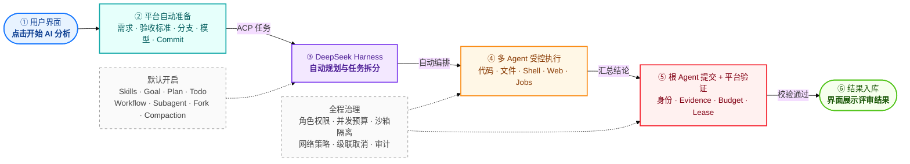
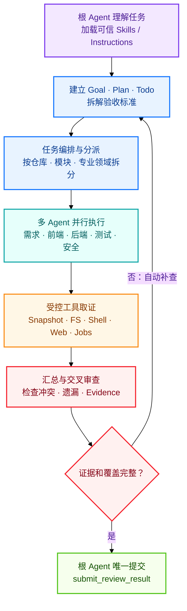

# 代码评审平台 V4：DeepSeek Harness 全能力流程架构

> 状态：目标架构草案  
> 详细实施方案：[`代码评审平台-V4-DeepSeekHarness-全能力默认开启执行方案.md`](./代码评审平台-V4-DeepSeekHarness-全能力默认开启执行方案.md)

## 1. 一句话说明

用户在界面上只点击一次 **“开始 AI 分析”**。需求、验收标准、分支、模型、仓库 Commit、Prompt 和 Harness 配置全部由程序自动准备；DeepSeek Harness 自动规划、拆分和执行任务，平台负责权限、证据、预算和结果入库。

## 2. V4 总体架构



### 用户看到的流程

```text
点击“开始 AI 分析”
→ 等待程序自动执行
→ 查看最终评审结果
```

用户不需要填写 Prompt，不需要操作 Harness，也不需要手工选择任何 Agent 能力。

## 3. DeepSeek Harness 代码评审工作流



Harness 自动运行这套完整工作流：

1. 根 Agent理解任务并建立执行目标；
2. “任务编排与分派”节点使用 Workflow 能力，将任务拆给多个专业子 Agent；
3. 子 Agent并行搜索代码、读取文件、运行检查和查阅受控资料；
4. Critic/验证逻辑汇总并检查遗漏；
5. 证据不足时自动回到规划阶段补查；
6. 证据完整后，只允许根 Agent提交最终结果。

## 4. 各层职责

| 层级 | 负责什么 | 不负责什么 |
|---|---|---|
| 用户界面 | 启动分析、查看状态和结果 | 不组装 Prompt，不操作 Agent |
| 平台程序 | 自动读取业务数据、冻结 Commit、生成 Prompt 和 Policy | 不替模型判断代码实现情况 |
| DeepSeek Harness | Goal、Plan、Todo、Workflow、多 Agent、工具循环、Compaction | 不直接访问数据库和生产凭据 |
| Worker / Broker | Tool 权限、快照、沙箱、网络、预算、Evidence、Lease | 不替 Agent生成最终结论 |
| 数据库 | 原子保存可信结果、Evidence、Usage 和审计元数据 | 不接受绕过 Broker 的 Agent写入 |

## 5. 默认开启的能力

| 能力组 | 默认能力 | 效果 |
|---|---|---|
| 规划编排 | Skills、Instructions、Goal、Plan、Todo、Ralph | 自动理解、规划、跟踪和补查 |
| 多 Agent | Spawn、Fork、Control、Workflow、并行调用 | 按仓库和专业领域并行分析 |
| 执行工具 | Snapshot、Filesystem、Sandbox Shell、Jobs、Web | 搜索代码、运行检查、生成候选 Artifact |
| 长任务保障 | Token Meter、Compaction、Checkpoint、Session Resume | 控制上下文并支持安全恢复 |

这些能力在 V4 中一次性接入并默认开启，但按 Agent 角色分配权限：根 Agent拥有完整编排能力，子 Agent只获得当前任务需要的工具。

## 6. 五条不可突破的边界

1. **根 Agent唯一提交**：子 Agent只能返回调查结果和 Evidence。
2. **固定 Commit始终只读**：文件写入只能发生在隔离 Workspace。
3. **所有工具都经过治理**：Shell、Web、Filesystem 和 Jobs 不能绕过 Policy/Broker。
4. **Evidence 必须可验证**：绑定仓库、Commit、文件、Blob、行范围和生产 Agent。
5. **任务结束必须收敛**：成功、失败、取消或 Lease 丢失都会级联停止全部 Agent、Job 和进程。

## 7. 最终效果

```text
用户点击一次
→ 程序自动准备全部上下文
→ Harness 自动规划并组织多 Agent
→ 多 Agent并行调查、测试和取证
→ 自动交叉审查和补查
→ 根 Agent形成最终结论
→ 平台验证并原子入库
→ 用户查看结果
```

相较 V3 单 Agent串行评审，V4 的主要变化是：

- 用户操作不增加，仍然只点击“开始 AI 分析”；
- Harness 从单 Agent工具循环升级为完整自主编排；
- 跨仓库、前后端、测试和安全检查可以并行；
- 长任务具备 Todo、Compaction、Checkpoint 和恢复能力；
- V3 的固定 Commit、Evidence、Lease 和原子提交边界继续保留。

## 8. 架构边界

本文只说明 V4 的核心流程和职责边界。具体默认 Policy、数据库/RPC、代码改造、测试矩阵、发布与回滚步骤见：

[`代码评审平台-V4-DeepSeekHarness-全能力默认开启执行方案.md`](./代码评审平台-V4-DeepSeekHarness-全能力默认开启执行方案.md)

V4 作为一个完整版本一次性发布，所有兼容功能能力默认开启；未通过完整 Release Gate 前，不切换生产默认路径。