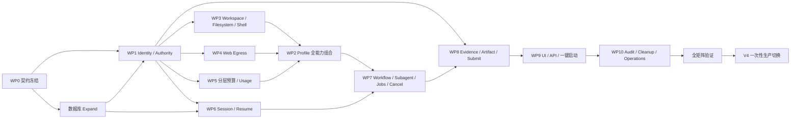

# 代码评审平台 V4：DeepSeek Harness 全能力默认开启执行方案

> 状态：实施设计稿  
> 交付方式：一个 V4 版本一次性完成、一次性切换、全部能力默认开启  
> 关联架构：[`代码评审平台-V4-DeepSeekHarness-全能力流程架构.md`](./代码评审平台-V4-DeepSeekHarness-全能力流程架构.md)

## 1. 目标与交付边界

### 1.1 产品目标

用户在界面上只执行一个动作：

```text
点击“开始 AI 分析”
```

后续全部由程序完成：

1. 从已导入 Story 读取需求和验收标准；
2. 从批次配置读取目标分支和模型；
3. 解析并冻结所有仓库 Commit；
4. 生成 V4 能力策略、Prompt、模型路由、预算和 Harness Profile；
5. 启动 DeepSeek Harness 根 Agent；
6. 根 Agent 自动使用 Skills、Goal、Plan、Todo、Workflow、Subagent、Fork、Jobs、Filesystem、Sandbox Shell、Web、并行工具和 Compaction；
7. 多 Agent 完成调查、验证、补查和汇总；
8. 根 Agent 唯一提交评审结果；
9. Worker 校验 Evidence、权限、Lease 和预算后原子入库；
10. 平台回收全部 Agent、Job、进程和临时资源。

### 1.2 一次性交付的含义

“一次性接入”指：

- 开发可以拆成多个有依赖关系的工作包；
- 测试环境可以持续集成和验证；
- 生产只发布一个完整 V4；
- 不向用户分批开放能力；
- V4 Job 从创建开始就使用完整能力面；
- 未完成全部 Release Gate 前，不把任何 V4 能力切为生产默认。

### 1.3 默认开启的准确含义

“默认开启”指所有 V4 功能能力在默认策略中可用，不需要用户逐项勾选：

- 根 Agent 默认拥有完整编排能力；
- 子 Agent 按角色获得完成任务需要的默认权限；
- 能力开启不等于所有 Agent 拥有相同权限；
- Shell 默认使用 `workspace-write` 沙箱，不是 `danger-full-access`；
- Web 默认经过平台出口策略，不是任意网络访问；
- Filesystem 默认写隔离 Workspace，不修改固定 Commit 快照；
- 根 Agent 是唯一拥有最终提交权的主体；
- 仍保留运维紧急熔断开关，但不作为面向用户的功能开关。

### 1.4 不属于“全部功能能力”的项目

以下项目不因“默认开启所有能力”而无条件启用：

- 与当前 `llm-pi-ai` 路由重复的 `llm-deepseek` adapter；
- 向第三方发送会话内容的外部 Telemetry；
- 当前操作系统不支持的 Shell 实现，例如 Linux/macOS 上的 PowerShell 专用插件；
- `danger-full-access` 沙箱模式；
- 未进入当前 Harness base composition、也未经过平台治理设计的实验插件；
- out-of-process Claude/Codex/ACP 子 Agent provider。

这些是重复实现、平台不兼容能力或额外安全域，不属于本次 V4 默认能力契约。V4 首版子 Agent统一采用 Harness 原生 in-process `spawn` 和 `fork`。

## 2. 当前 V3 基线与 V4 差距

### 2.1 V3 当前状态

V3 当前每个 Story Task：

```text
一个 Task
→ 一个私有 DSH 进程
→ 一个 ACP Session
→ 一个根 Agent
→ 五个模型可见工具
→ 一次 submit_review_result
```

模型当前只能看到：

- `search_snapshot_code`；
- `find_snapshot_files`；
- `read_snapshot_code`；
- `list_snapshot_commits`；
- `submit_review_result`。

`worker/harness/code-review-acp/cordis.patch.yml` 当前显式关闭 Shell、Filesystem、Web、Skills、Subagent、Workflow、Goal、Todo、Jobs 和 JSONL Session persistence。

### 2.2 不能只删除 `disabled: true`

直接解除禁用会产生以下问题：

1. 子 Agent 默认继承父 composition，可能看到 `submit_review_result`；
2. Broker 只识别 `taskId + agentAttempt + token`，不知道调用者是不是根 Agent；
3. Evidence 没有记录由哪个 Agent 和 Tool Call 产生；
4. 当前模型请求统计错误地用 Broker tool call 数代替真实模型请求；
5. 当前 Agent cwd 是空目录，打开 Shell/Filesystem 也没有安全可写的源码 Workspace；
6. Harness Web 的基础公共地址校验不能替代生产网络出口策略；
7. memory session 和 attempt 清理无法支持重启恢复；
8. 当前 supervisor 只保证终止直接子进程，不能证明所有后代进程被回收；
9. Lease 丢失、用户取消、父 Agent失败时，缺少完整 Agent Tree 级联取消；
10. 数据库仍按“一个 attempt 一个 Agent run”设计，无法表达父子树、分层预算和权限审计。

因此，V4 必须同时完成能力启用和平台治理，二者缺一不可。

## 3. V4 默认能力清单

### 3.1 Harness 原生能力

| 能力 | Harness plugin/tool id | V4 默认状态 | 默认使用方式 |
|---|---|---:|---|
| Agent Instructions | `agent-instructions` | 开启 | 加载平台生成的可信 Instructions；仓库内容按不可信数据处理 |
| Skills | `skill`、`skill-filesystem`、`skill-badge`、`tool-skill` | 开启 | 加载平台签名 Skill，支持需求、后端、前端、测试、安全评审 |
| Commands | `commands`、`command-feedback`、`command-goal`、`command-compact` | 开启 | 能力进入 composition；ACP 自动化流程不要求用户输入 slash command |
| Goal | `goal`、`goal-round-driver`、`tool-goal` | 开启 | 根 Agent维护总体目标和验收覆盖 |
| Plan Mode | `plan-mode` | 开启 | 插件可用；自动化任务不在等待人工批准的状态启动 |
| Todo | `tool-todo` | 开启 | 根 Agent及授权子 Agent维护执行清单 |
| Ralph | `tool-ralph` | 开启 | 受轮次和预算约束，用于复杂补查循环 |
| Spawn Subagent | `subagent-spawn-in-process`、`tool-subagent` | 开启 | 新上下文研究任务，支持 continuable background |
| Fork Subagent | `subagent-fork-in-process`、`tool-subagent-fork` | 开启 | 基于父 Agent已完成 turn 的历史继续分析 |
| Subagent Control | `tool-subagent-control`、`tool-subagent-list-agents` | 开启 | `send_message`、`interrupt_agent`、`list_agents` |
| Workflow | `workflow-worker-thread`、`tool-workflow` | 开启 | 编排并行调查、交叉审查、补查和汇总 |
| Jobs | `tool-jobs` | 开启 | 管理构建、静态检查和测试任务 |
| Bash | `tool-bash`、`bash-sandbox` | 开启 | 仅在隔离 Workspace 中运行，默认 `workspace-write` |
| PowerShell | `tool-pwsh`、`pwsh-sandbox` | 按 OS 开启 | Windows 开启，Linux/macOS 使用 Bash |
| Filesystem | `fs-observation-policy`、`fs-sandbox`、`tool-fs`、`tool-fs-search` | 开启 | 固定快照只读，所有写操作进入 per-attempt overlay |
| Web | `web`、`web-search-*`、`web-fetch-*`、`tool-web` | 开启 | 模型可调用，但实际出口必须经过平台 allowlist/proxy |
| Parallel Tool Calls | `agent-loop.maxParallelToolCalls` | 开启 | 只读和无副作用工具允许并行，mutation/submit 串行 |
| Token Meter | `token-meter` | 开启 | 计量上下文和模型使用 |
| Auto Compaction | `compaction-basic` | 开启 | 超过阈值自动压缩，计入独立预算 |
| Tool Result Pruning | `tool-result-pruner` | 开启 | 压缩大工具结果，保留头尾和关键信息 |
| Session Checkpoint | `session-checkpoint-policy` | 开启 | 模型请求和顶层工具前创建检查点 |
| JSONL Persistence | `session-persistence-jsonl` | 开启 | Session 写持久卷，支持恢复、审计摘要和保留策略 |
| Spill | `spill-local`、`spill-policy` | 开启 | 大输出保存到隔离 spill 区域，不进入日志 |
| Repeat Reminder | `repeat-tool-reminder` | 开启 | 防止模型重复无效调用 |

### 3.2 平台功能能力

以下能力不是打开 Harness plugin 就自动成立，必须由平台实现并默认启用：

- 根 Agent、父子 Agent和 Workflow Agent身份；
- 根 Agent唯一提交；
- Agent role 与 Tool Policy；
- 父子 Agent注册和可信 lineage；
- Attempt、Agent、模型类型分层预算；
- Agent Tree 级联取消；
- Evidence producer 归属；
- 固定 Commit只读源与可写 overlay；
- Shell 资源限制；
- Web 网络出口 allowlist；
- Session checkpoint、恢复和 fencing；
- Tool/Permission 审计；
- Artifact/Patch 管理；
- 真实 usage 持久化；
- 进程树、Job、Socket、Workspace 和 Session 清理。

## 4. 默认 V4 Policy

所有 V4 Job 创建时冻结一份 Policy snapshot。建议初始默认如下；数值必须在上线压测后最终确认，但 capability 布尔值保持默认开启。

```yaml
version: 4
capabilities:
  instructions: true
  skills: true
  goal: true
  plan: true
  todo: true
  ralph: true
  subagentSpawn: true
  subagentFork: true
  subagentControl: true
  workflow: true
  jobs: true
  shell: true
  filesystem: true
  webSearch: true
  webFetch: true
  parallelTools: true
  autoCompaction: true
  sessionPersistence: true
  sessionResume: true
  artifacts: true

sandbox:
  defaultMode: workspace-write
  dangerFullAccess: false
  commandTimeoutMs: 60000
  maxProcessesPerAttempt: 64
  maxWorkspaceBytes: 2147483648
  maxWorkspaceFiles: 100000

agents:
  maxAgentsPerAttempt: 8
  maxDelegationDepth: 2
  maxConcurrentChildren: 4
  allowOutOfProcessProviders: false

workflow:
  maxConcurrentSteps: 4
  maxRuntimeMs: 900000

jobs:
  maxConcurrentJobsPerOwner: 4
  maxRuntimeMs: 300000

parallelTools:
  maxPerStep: 8
  mutationToolsSerial: true

modelBudget:
  maxTotalRequests: 160
  maxRootRequests: 80
  maxChildRequests: 32
  maxRetryRequests: 12
  maxCompactionRequests: 8
  maxRalphRounds: 12

web:
  maxRequestsPerAttempt: 20
  maxResponseBytes: 2097152
  maxTotalBytes: 20971520
  allowHttp: false
  allowedPorts: [443]
  allowedDomains: []
  denyPrivateNetworks: true

session:
  checkpointEveryEvents: 100
  retentionDays: 7
  encryptAtRest: true
  resumeOnWorkerRestart: true
```

### 4.1 Agent role 默认权限

| 能力 | `root-reviewer` | `research-child` | `implementation-child` | `critic-child` | `workflow-child` |
|---|---:|---:|---:|---:|---:|
| Snapshot read/search | 是 | 是 | 是 | 是 | 按步骤 |
| Skills | 是 | 是 | 是 | 是 | 按步骤 |
| Goal/Plan/Todo | 是 | Todo | Todo | 否 | 按步骤 |
| Spawn/Fork/Workflow | 是 | 深度允许时 | 否 | 否 | 仅声明步骤 |
| Web | 是 | 是 | 默认否 | 是 | 按步骤 |
| Filesystem write | 是 | 否 | 是 | 否 | 按步骤 |
| Sandbox Shell/Jobs | 是 | 否 | 是 | 只读检查 | 按步骤 |
| Artifact/Patch | 是 | 否 | 是 | 只读 | 按步骤 |
| `submit_review_result` | **唯一允许** | 否 | 否 | 否 | 否 |
| 数据库/Worker 管理能力 | 否 | 否 | 否 | 否 | 否 |

最终有效权限必须是以下交集：

```text
V4 全局 Policy
∩ Agent role Policy
∩ Harness child toolFilter
∩ Broker 强制授权
∩ 当前 Lease / Budget / Workspace / Network 状态
```

## 5. 目标运行流程

```text
用户点击“开始 AI 分析”
  → API 创建 V4 Analysis Job
  → DB 冻结 Story、分支、模型、V4 Policy
  → Worker 冻结仓库 Commit
  → Worker 创建 Attempt、Root Agent identity、Broker、Workspace、Session root
  → Worker 生成默认全能力 Harness Profile
  → 启动 DSH + ACP initialize/session open/prompt
  → 根 Agent 加载 Skills、Goal、Plan、Todo
  → Workflow 拆分需求、仓库、测试、安全等任务
  → Spawn/Fork 多个子 Agent 并行执行
  → Snapshot/Web/FS/Shell/Jobs 均经过角色策略和 Broker
  → 子 Agent 返回结构化报告和 Evidence
  → Critic Agent 检查冲突、遗漏、证据和覆盖率
  → 不足则更新 Todo，继续补查或执行 Ralph 循环
  → 根 Agent 汇总并调用 submit_review_result
  → Broker 验证 root authority、Lease、Evidence、Coverage、Budget
  → 数据库原子提交结果和可信元数据
  → Attempt sealed
  → 取消并 drain 全部后代 Agent、Workflow 和 Jobs
  → Flush Session / Usage / Audit
  → 回收进程树、Socket、Workspace 和过期 Session
  → Job finalizer 汇总结果
```

## 6. 数据模型和 RPC 改造

必须新增 forward migration，建议命名：

```text
supabase/migrations/<next>_v4_harness_all_capabilities.sql
```

禁止回改历史 migration。

### 6.1 现有表扩展

#### `ai_model_config`

新增或扩展：

- V4 capability policy 默认值；
- `max_agents_per_attempt`；
- `max_delegation_depth`；
- `max_concurrent_children`；
- `max_parallel_tool_calls`；
- `max_concurrent_jobs_per_owner`；
- root/child/total model request budgets；
- retry/compaction/Ralph budgets；
- Web request/bytes budget；
- Workspace bytes/files/process limits；
- Session retention/checkpoint policy。

#### `analysis_job`

冻结：

- `policy_version = 4`；
- `capability_policy_snapshot`；
- `harness_version`；
- `profile_hash`；
- `model_snapshot`；
- `requested_branch`；
- repository snapshots。

#### `analysis_agent_run`

继续作为 Story attempt/root run 的权威汇总记录，新增：

- `root_session_id`；
- `root_agent_id`；
- `policy_hash`；
- `tree_digest`；
- `session_revision`；
- `cancel_requested_at`；
- `sealed_at`；
- 真实 model/retry/compaction/token/cost usage；
- resume 次数和最后 checkpoint。

#### `analysis_agent_evidence`

新增：

- `producer_agent_node_id`；
- `producer_session_id`；
- `tool_call_id`；
- `evidence_origin`：`PINNED_SNAPSHOT` 或 `GENERATED_ARTIFACT`；
- `policy_hash`；
- `session_revision`。

只有 `PINNED_SNAPSHOT` 可以证明代码已经实现；Workspace 中生成的内容只能作为 Artifact，不能冒充现有实现 Evidence。

### 6.2 新表

#### `analysis_agent_node`

每个根 Agent和子 Agent一行：

- `id`；
- `agent_run_id`；
- `agent_id`；
- `session_id`；
- `parent_agent_node_id`；
- `agent_role`；
- `provider`：`root/spawn/fork/workflow/ralph`；
- `delegation_depth`；
- `status`；
- `tool_policy_hash`；
- `started_at/finished_at/cancelled_at`；
- 分 Agent usage。

#### `analysis_tool_audit`

只存安全元数据：

- Agent、Session、Tool Call ID；
- 工具名、permission verdict；
- 开始/结束时间和耗时；
- 请求/响应字节数；
- budget reservation；
- error code；
- 不存 prompt、源码和工具正文。

#### `analysis_permission_decision`

记录：

- Agent role；
- tool；
- policy layer；
- allow/deny；
- reason code；
- policy hash。

#### `analysis_session_checkpoint`

记录：

- session id/revision；
- JSONL storage locator；
- content hash；
- Harness/profile version；
- checkpoint status；
- created/retention timestamps。

不得在普通数据库列保存 Session 原文或源码。

#### `analysis_artifact`

保存候选 Patch、测试报告等：

- artifact type；
- producer Agent；
- workspace-relative path；
- content hash；
- size；
- storage locator；
- retention；
- verification status。

### 6.3 新增或修改 RPC

建议新增：

- `register_analysis_agent_node`；
- `mark_analysis_agent_node_terminal`；
- `reserve_analysis_agent_budget`；
- `commit_analysis_agent_usage`；
- `append_analysis_tool_audit`；
- `save_analysis_session_checkpoint`；
- `load_resumable_analysis_attempt`；
- `request_analysis_attempt_cancel`；
- `save_analysis_artifact`。

必须修改：

- `enqueue_analysis_job`：冻结 V4 policy 和 Harness 版本；
- `claim_next_story_task`：返回完整 V4 policy snapshot 和 fencing token；
- `heartbeat_story_task`：返回 cancel/lease 状态；
- `save_agent_review_result`：校验 root identity、tree digest、session revision 和 policy hash；
- `fail_agent_review`：先 fence/revoke，再终止整棵 Agent Tree；
- stale lease reclaim：使旧 attempt 的所有工具、usage 和提交立即失效。

所有写 RPC 保持 service-role only；浏览器不能获得 claim token、Session JSONL、源码、Broker token 和模型 Key。

## 7. Worker 与 Harness 代码改造

## 7.1 WP0：版本和能力契约冻结

### 修改/新增文件

- 锁定根项目 `@deepseek-ai/dsh` 精确版本；
- 新增 `worker/harness/code-review-acp/v4-capability-contract.json`；
- 新增 `worker/src/ai/policy/v4-capability-policy.ts`；
- 新增 Harness resolved tool inventory contract test。

### 实施内容

1. 记录允许的 plugin id、模型工具名和 schema hash；
2. 区分 root/child/workflow 的工具集合；
3. Harness 升级后出现未知工具必须 fail closed；
4. profile、policy、prompt、Harness version 一起生成 config hash；
5. 将“全能力”定义固定为本方案第 3 节，不随依赖升级自动扩张。

### 完成标准

- 任一工具增加、删除或 schema 变化都会使 contract test 失败；
- 生产 Job 能追溯到唯一 Harness/profile/policy 组合。

## 7.2 WP1：Agent Identity 与 Authority

### 修改文件

- `worker/src/ai/runtime/deepseek-harness-acp-engine.ts`；
- `worker/src/ai/control/attempt-control-broker.ts`；
- `worker/src/harness-plugins/review-control-tool/index.ts`；
- `worker/src/harness-plugins/snapshot-tools/index.ts`。

### 新增文件

- `worker/src/ai/control/agent-authority-ledger.ts`；
- `worker/src/ai/control/attempt-tree-controller.ts`；
- `worker/src/harness-plugins/agent-authority-policy/`。

### 实施内容

1. 创建稳定 `rootAgentId/rootSessionId`；
2. 父 Agent创建 child 时向 Broker 注册 lineage；
3. Broker 生成短期、绑定 Agent 的 capability token；
4. 每次工具调用携带 `agentId/sessionId/parent/depth/role/toolCallId`；
5. Broker 不信任模型参数自报身份，只接受已注册 capability；
6. 子 Agent权限只能缩小，不能扩大；
7. `submit_review_result` 只向 root role 暴露；
8. Tool execute、Broker 和 DB 三层再次校验 root；
9. child 调用 submit 返回 `SUBMIT_ROOT_ONLY`，不得 conclude turn。

### 完成标准

- 子 Agent即使伪造 root id 或直接请求 Broker 也无法提交；
- 任一工具调用都能追溯到 Agent Tree 节点。

## 7.3 WP2：Profile 全能力组合

### 修改文件

- `worker/harness/code-review-acp/cordis.patch.yml`；
- `worker/harness/code-review-acp/package.json`；
- `worker/src/ai/acp/profile-materializer.ts`；
- `worker/src/ai/acp/acp-client.ts`；
- `Dockerfile.worker`。

### 实施内容

1. 移除 V3 对功能能力的禁用项；
2. 开启第 3 节列出的所有原生能力；
3. 保留重复 adapter、外部 telemetry、OS 不兼容项的禁用；
4. 插入平台 authority、budget、usage、web policy 等插件；
5. 每 attempt 生成 role policy 和 child toolFilter；
6. ACP permission handler 从固定五工具改为动态角色策略；
7. permission 默认 deny，只有 policy 明确允许才 allow-once；
8. `agent-loop.maxParallelToolCalls`、Jobs、Subagent depth、Ralph rounds 显式配置；
9. resolved tool inventory 启动时与 contract 对比。

### 完成标准

- V4 root resolved inventory 包含全部默认能力；
- 每类 child 只看到角色允许的工具；
- 未知工具不能静默进入模型上下文。

## 7.4 WP3：Workspace、Filesystem 与 Sandbox Shell

### 修改文件

- `worker/src/git/prepare.ts`；
- `worker/src/config.ts`；
- `worker/src/ai/runtime/deepseek-harness-acp-engine.ts`；
- `docker-compose.worker.yml`；
- `Dockerfile.worker`。

### 新增文件

- `worker/src/ai/workspace/attempt-workspace.ts`；
- `worker/src/ai/workspace/workspace-policy.ts`；
- `worker/src/ai/workspace/overlay-cleaner.ts`。

### 实施内容

1. 固定 Commit 源保持只读；
2. 为每 attempt 创建独立 writable overlay；
3. implementation child 可使用独立分支 overlay；
4. Harness cwd 指向受控 Workspace，不再是空目录；
5. 禁止访问 cache root、DSH_HOME、Broker socket 和宿主路径；
6. 防止 path traversal、symlink/hardlink/device/mount 逃逸；
7. `.git/config` 不含凭据；
8. Shell 注入最小环境变量，不继承 service role、Git token、Broker 管理 token；
9. 设置 CPU、RSS、PID、FD、时间、磁盘、文件数量限制；
10. 所有写入作为 Artifact/Patch，不修改 pinned snapshot。

### 完成标准

- Agent 能读写 Workspace、运行构建和测试；
- 不能修改固定 Commit、读取密钥或逃逸到宿主文件系统；
- attempt 结束后 overlay 可确定性清理。

## 7.5 WP4：Web Search / Fetch 出口治理

### 修改文件

- Harness profile Web provider 配置；
- `docker-compose.worker.yml`；
- `worker/src/ai/control/attempt-control-broker.ts`；
- `worker/OPERATIONS.md`。

### 新增文件

- `worker/src/ai/web/egress-policy.ts`；
- `worker/src/ai/web/url-validator.ts`；
- `worker/src/harness-plugins/platform-web/`。

### 实施内容

1. `web_search`、`web_fetch` 默认可见；
2. 实际请求统一经过平台 Web provider/proxy；
3. 仅 HTTPS 和允许端口；
4. DNS 解析、实际连接和每次 redirect 都重新校验；
5. 拒绝 loopback、RFC1918、link-local、metadata 和内网域名；
6. 禁止访问 Supabase、Vault、GitLab 管理面、Broker socket 和模型管理地址；
7. 限制响应大小、MIME、超时、重定向次数和总字节；
8. 页面内容标记为不可信数据；
9. 审计 URL origin/path，日志删除 query、fragment 和正文。

### 完成标准

- 允许域名可正常检索；
- SSRF、DNS rebinding、redirect 绕过和大响应全部拒绝；
- 源码、凭据和网页正文不进入日志。

## 7.6 WP5：分层预算与真实 Usage

### 修改文件

- `worker/src/harness-plugins/model-budget-governor/index.ts`；
- `worker/src/ai/acp/profile-materializer.ts`；
- `worker/src/ai/runtime/deepseek-harness-acp-engine.ts`；
- `worker/src/db/jobs.ts`。

### 新增文件

- `worker/src/ai/control/hierarchical-budget-ledger.ts`；
- `worker/src/harness-plugins/usage-reporter/`。

### 实施内容

1. 保留 attempt 全局 hard cap；
2. 增加 root/child/depth/kind 预算；
3. 并行模型请求在调用 provider 前原子 reserve；
4. retry、compaction、Ralph、普通 loop 分开计量；
5. in-process 所有 Agent共享总预算；
6. governor 通过认证 IPC 将真实 counter 上报 Broker；
7. 修复当前 `modelRequests = broker.toolCalls` 的错误映射；
8. provider 有 token usage 时存真值，没有则保持 `null`；
9. 预算耗尽先阻止 provider 请求，再返回稳定错误码；
10. UI 展示 attempt 总量及 Agent 分项。

### 完成标准

- root + 并行 children + retry + compaction 永不突破总 hard cap；
- DB usage 与 governor/provider 一致，不再用工具调用冒充模型请求。

## 7.7 WP6：Session Persistence、Compaction 与 Resume

### 修改文件

- `worker/harness/code-review-acp/cordis.patch.yml`；
- `worker/src/ai/acp/acp-client.ts`；
- `worker/src/ai/runtime/deepseek-harness-acp-engine.ts`；
- `worker/src/ai/acp/profile-materializer.ts`；
- `worker/src/config.ts`；
- `docker-compose.worker.yml`。

### 新增文件

- `worker/src/ai/session/session-registry.ts`；
- `worker/src/ai/session/session-recovery.ts`；
- `worker/src/ai/session/session-retention.ts`。

### 实施内容

1. 用 JSONL persistence 替换 memory persistence；
2. Session root 放独立持久卷，不随 attempt 临时目录删除；
3. 使用稳定 root/child session id；
4. ACP client 支持 reopen/resume，而不是每次只 `session/new`；
5. Session checkpoint 与 DB revision 对齐；
6. 单 writer lock + DB fencing 防止两个 Worker恢复同一 Session；
7. 自动 compaction 和 tool-result pruning 默认开启；
8. compaction usage 纳入预算和审计；
9. torn log/未知 event/版本不兼容时 fail closed；
10. JSONL 目录权限、加密、容量和 retention 可运维。

### 完成标准

- Worker 重启后可继续同一未提交 Session；
- 不重复执行已完成副作用；
- 已提交结果以 DB receipt 为准，不因 ACP 响应丢失而重复提交。

## 7.8 WP7：Workflow、Subagent、Jobs 与级联取消

### 修改文件

- `worker/src/ai/runtime/deepseek-harness-acp-engine.ts`；
- `worker/src/ai/acp/acp-process-supervisor.ts`；
- `worker/src/index.ts`；
- Heartbeat/lease 处理；
- Harness role profile。

### 实施内容

1. Engine 管理完整 Agent Tree 生命周期；
2. 限制 Agent 总数、深度和并发；
3. spawn 使用新上下文，fork 只继承父 Agent已完成 turn；
4. 当前 turn 新 Evidence 必须通过任务参数或共享 Ledger 显式传递；
5. Jobs 绑定 exact owner session；
6. 用户取消、Lease 丢失、预算耗尽、Worker shutdown、root 提交成功时关闭新 admission；
7. child-first cancel/drain Agent Tree；
8. cancel Workflow holder 和 Jobs；
9. supervisor 使用真实 process group/cgroup 兜底回收全部后代；
10. DB fencing 阻断所有迟到工具、usage 和提交。

### 完成标准

- 任意取消场景后没有存活 child、Job、进程、Socket 和可继续写入的旧 capability；
- 根 Agent提交后迟到 child 不能改变结果。

## 7.9 WP8：Evidence、Artifact 与最终提交

### 修改文件

- `worker/src/ai/control/evidence-ledger.ts`；
- `worker/src/ai/control/attempt-control-broker.ts`；
- deterministic verifier；
- `worker/src/harness-plugins/review-control-tool/index.ts`；
- `worker/src/index.ts`；
- `worker/src/db/jobs.ts`。

### 实施内容

1. Evidence receipt 记录 producer Agent/Session/Tool Call；
2. root 可以引用当前 Agent Tree 内 child 产生的 Evidence；
3. 跨 attempt、跨 tree、已 revoke Evidence 拒绝；
4. pinned snapshot Evidence 与 generated Artifact 严格分离；
5. Artifact 可用于建议 Patch 和测试结果，不能证明代码已实现；
6. submit 校验 root identity、tree digest、session revision、policy hash；
7. DB commit 成功后 Broker sealed；
8. ACP 响应丢失时读取 DB receipt，不重复生成结果；
9. finalizer 只消费 verified Evidence 和 committed result。

### 完成标准

- 子 Agent可以贡献证据，但不能直接提交；
- 伪造、越界或来自修改后 Workspace 的“现有实现证据”全部拒绝；
- 最终结果只提交一次。

## 7.10 WP9：UI、API 与一键启动

### 修改文件

- `src/lib/api.ts`；
- `src/types.ts`；
- 当前批次/分析页面；
- `src/pages/WorkerManagementPage.tsx`；
- `supabase/functions/admin-model-config/*`。

### 建议新增文件

- `src/pages/AgentRunDetailPage.tsx`；
- `src/pages/HarnessPolicyPage.tsx`；
- Agent Tree、Usage、Audit 摘要组件。

### 实施内容

1. 用户界面仍只有“开始 AI 分析”；
2. 点击后 API 自动冻结 Story、分支、模型和默认 V4 Policy；
3. 不要求用户输入 Prompt 或选择 Harness 能力；
4. 管理员页面展示默认能力策略，但普通启动流程不展示开关；
5. 详情页展示 Agent Tree、状态、预算、工具计数、Evidence 和 Artifact 摘要；
6. 支持取消、重试和恢复；
7. VIEWER 只读，REVIEWER 可启动/取消，ADMIN 可管理策略；
8. 浏览器不返回源码工具结果、Session JSONL、Key 和 token。

### 完成标准

- 用户一次点击完成全部上下文准备和 Harness 启动；
- 全能力默认生效，不需要额外配置步骤。

## 7.11 WP10：日志、审计、清理与运维

### 修改文件

- `worker/src/security/redaction.ts`；
- Worker logger 调用点；
- `worker/OPERATIONS.md`；
- `docker-compose.worker.yml`；
- 发布检查脚本。

### 实施内容

记录：

- Job/Task/Attempt/Root/Agent/Parent/Session ID；
- Tool 名、permission verdict、耗时、字节；
- Budget reserve/commit/deny；
- Session revision/checkpoint；
- Cancel reason；
- Harness/profile/policy hash；
- Artifact metadata。

禁止记录：

- Prompt、需求全文、源码、工具正文；
- Session JSONL 内容；
- API Key、service role、Git token、claim token、Broker token；
- Authorization header；
- Web URL query/fragment 和网页正文。

运维必须提供：

- Session/Workspace/Artifact retention；
- 磁盘容量告警；
- RPM/TPM/模型费用告警；
- Agent/Job/进程孤儿检查；
- Session corruption runbook；
- Web egress 故障 runbook；
- 紧急熔断开关；
- V4 worker 扩缩容和滚动重启步骤。

## 8. 工作包依赖与执行顺序

开发工作包可以并行，但依赖和合并顺序必须遵守：



建议实际执行顺序：

1. 冻结 Harness 版本和工具契约；
2. 数据库 expand migration；
3. Agent identity、lineage、root authority；
4. Broker role policy 和 permission audit；
5. 分层预算和真实 usage；
6. Workspace、Sandbox、Filesystem；
7. Web egress；
8. 全能力 Profile；
9. Session persistence、compaction 和 resume；
10. Agent Tree、Workflow、Jobs 和级联取消；
11. Evidence、Artifact 和 root-only submit；
12. UI/API 一键启动与可观测性；
13. 运维、清理、告警和回滚；
14. 完整 E2E 和事故演练；
15. 一个 V4 版本统一切换默认路径。

## 9. 错误码要求

V4 至少增加稳定错误码：

| 错误码 | 含义 |
|---|---|
| `AGENT_IDENTITY_INVALID` | Agent capability 或 lineage 无效 |
| `AGENT_ROLE_DENIED` | 当前 Agent role 无权调用工具 |
| `SUBMIT_ROOT_ONLY` | 非根 Agent尝试提交 |
| `AGENT_TREE_LIMIT_EXCEEDED` | Agent 数量或深度超过限制 |
| `AGENT_TREE_CANCELLED` | Agent Tree 已取消 |
| `MODEL_BUDGET_EXHAUSTED` | 模型预算耗尽 |
| `TOOL_BUDGET_EXHAUSTED` | Tool/Web/Workspace 等预算耗尽 |
| `WORKSPACE_POLICY_DENIED` | Filesystem/Shell 越界 |
| `WEB_EGRESS_DENIED` | Web 目的地或请求被拒绝 |
| `SESSION_FENCED` | Session 已被新 Worker 或新 attempt 接管 |
| `SESSION_FORMAT_UNSUPPORTED` | Harness/Session 格式不兼容 |
| `SESSION_RECOVERY_FAILED` | Session 无法安全恢复 |
| `EVIDENCE_AGENT_INVALID` | Evidence 不属于当前 Agent Tree |
| `EVIDENCE_ORIGIN_INVALID` | Artifact 被错误用于证明现有实现 |
| `ATTEMPT_ALREADY_SEALED` | Attempt 已提交或终止 |
| `PROCESS_TREE_CLEANUP_FAILED` | 后代进程未完全回收 |

错误消息必须脱敏，不包含源码、Prompt、路径外秘密和凭据。

## 10. 测试与验收矩阵

| 维度 | 必测场景 | 通过标准 |
|---|---|---|
| 默认能力 | 创建 V4 Job 后检查 resolved profile | 所有第 3 节能力默认开启；用户无额外开关 |
| 一键启动 | 用户只点击“开始 AI 分析” | Story、分支、模型、Commit、Prompt、Policy 自动准备 |
| Tool Contract | Harness 新增/删除/修改工具 | 与 contract 不一致立即 fail closed |
| Spawn/Fork | spawn、fork、continuable、多层 delegation | lineage/depth/role 正确；fork 不继承当前未完成 turn |
| Workflow | 并行、pipeline、失败、取消 | 并发受限；失败可汇总；取消无孤儿 |
| Submit | child 直接/间接/伪造 root/并行 submit | 全部拒绝；仅根 Agent一次提交 |
| Evidence | child Evidence、伪造、跨 attempt、Workspace 内容 | 合法 tree Evidence 可汇总；非法全部拒绝 |
| Filesystem | read/write/edit/grep/glob | 仅 Workspace 可写；固定快照和宿主不可写 |
| Shell | build/test、超时、fork bomb、读取 env | 正常任务可运行；资源越界和密钥读取失败 |
| Jobs | list/output/kill、owner dispose | owner 隔离；退出后无 Job 孤儿 |
| Web | 允许域名、内网 IP、DNS rebinding、redirect、大响应 | allowlist 正常；绕过全部拒绝并审计 |
| Parallel | 多个只读 Tool 并行、mutation 冲突 | 只读并行；mutation/submit 串行；预算原子 |
| Budget | root+children+retry+compaction+Ralph | 不突破总 cap；分项和 provider usage 一致 |
| Compaction | 长上下文、多次压缩、工具大结果 | 保留 Goal/Todo/Evidence；usage 正确 |
| Persistence | Worker 重启、torn log、writer 竞争 | 同 Session 安全恢复或 fail closed；不重复副作用 |
| Cancel | UI 取消、Lease 丢失、SIGTERM、预算耗尽 | Agent/Workflow/Job/进程全部收敛；迟到写被 fence |
| DB | 旧 token、并发 commit、stale reclaim | root-only、fencing 和唯一提交约束生效 |
| UI/RBAC | ADMIN/REVIEWER/VIEWER | 权限正确；敏感内容不进入浏览器 |
| 清理 | 正常、失败、重启、强杀 | 无孤儿进程、Socket、Workspace 和过期 Session |
| 回滚 | V4 worker 回滚、Session 版本不兼容 | 停止新领任务，安全失败或新 attempt，不破坏已提交结果 |

### 10.1 必须执行的验证命令

实现完成后至少执行：

```bash
supabase db reset --no-seed
npm run worker:typecheck
npm run worker:build
npm run test:worker
npm run build
npm run lint
```

还必须增加并运行：

- Harness resolved profile contract test；
- V4 Broker/Authority integration test；
- Session restart/resume E2E；
- Web SSRF 测试；
- Workspace/Sandbox escape 测试；
- Agent Tree cancel/process cleanup 测试；
- 真实模型小 Job 全能力 E2E。

## 11. 最终全能力 E2E 场景

发布前必须用一个真实固定 Commit 小 Job，在同一个 attempt 中证明：

1. 用户只点击“开始 AI 分析”；
2. 程序自动读取需求、验收标准、分支和模型；
3. 根 Agent创建 Goal、Plan 和 Todo；
4. 加载平台 Skills/Instructions；
5. 使用 Workflow；
6. 创建 spawn child；
7. 创建 fork child；
8. 使用 Agent control/list；
9. 并行执行多个只读 snapshot tool；
10. 使用 Web search/fetch 访问允许域名；
11. implementation child 在 overlay 中写文件；
12. 使用 Sandbox Shell 和 Jobs 运行检查；
13. 产生 Artifact/Patch；
14. 触发 tool-result pruning；
15. 触发至少一次自动 compaction；
16. 重启 Worker 并恢复 Session；
17. 子 Agent贡献合法 Evidence；
18. 子 Agent调用 submit 被拒绝；
19. 根 Agent成功提交；
20. 数据库只产生一个 committed result；
21. attempt sealed 后所有迟到调用被拒绝；
22. 全部 Agent、Workflow、Jobs、进程、Socket 和 Workspace 正确清理。

以上任意一项未通过，V4 不得切为生产默认。

## 12. 迁移、发布与回滚

### 12.1 数据库迁移

采用 expand/contract：

1. 先新增表、列、索引和 RPC；
2. 保持 V3 数据可读；
3. V4 Worker 只领取 `policy_version = 4` 的任务；
4. 完整验证后将新建 Job 默认设为 V4；
5. 暂不删除 V3 字段和 RPC；
6. 稳定运行并完成数据保留期后再做 contract migration。

### 12.2 生产切换

1. 停止创建新分析 Job；
2. 等待 V3 attempt 完成或安全终止；
3. 部署 DB expand migration；
4. 部署 Session/Web/Workspace 依赖和持久卷；
5. 部署全部 V4 Worker；
6. 运行连通性、安全和全能力小 Job；
7. 将 enqueue 默认 policy 切到 V4；
8. 恢复用户“开始 AI 分析”入口；
9. 观察 Agent Tree、预算、错误率、磁盘和模型成本；
10. 达到稳定窗口后确认发布完成。

### 12.3 回滚原则

- 不直接回滚数据库 migration，优先前滚修复；
- 停止 V4 新 Job，关闭 Worker admission；
- cancel/drain 活跃 V4 Agent Tree；
- 回滚到能读取扩展 schema 的兼容 Worker；
- 已提交结果绝不重跑；
- Session 格式不兼容时标记 `SESSION_FORMAT_UNSUPPORTED`，创建新 attempt，不篡改 JSONL；
- 外部副作用通过 Artifact/Workspace/Audit 清理，不通过删除数据库记录掩盖；
- 紧急情况下可以由运维关闭 Web、Shell-write、Subagent depth 或 Workflow，但用户配置仍保持 V4 默认全开语义，事故解除后恢复。

## 13. Release Gate

全部满足才允许发布：

- [ ] 用户只点击一次“开始 AI 分析”；
- [ ] 所有任务上下文由程序自动准备；
- [ ] 第 3 节所有兼容功能能力默认开启；
- [ ] 根 Agent工具面完整；
- [ ] 子 Agent权限按角色收窄；
- [ ] root-only submit 在 Tool、Broker、DB 三层成立；
- [ ] Agent identity 和 lineage 不可伪造；
- [ ] Evidence 绑定 producer Agent、Session、Tool Call 和 pinned Commit；
- [ ] Workspace/Shell 不能访问固定快照、宿主和密钥；
- [ ] Web 不能访问内网和未授权地址；
- [ ] 全局和分 Agent预算在 provider 请求前强制执行；
- [ ] model/retry/compaction/token usage 是真实值；
- [ ] Session 可 checkpoint、恢复和安全失败；
- [ ] 所有取消路径能级联回收后代；
- [ ] 进程树回收在目标 Linux 容器中验证；
- [ ] 日志、DB 和浏览器不泄露源码、Prompt 和凭据；
- [ ] 完整 E2E 22 项全部通过；
- [ ] 迁移、扩容、磁盘满、网络失败和回滚演练通过；
- [ ] 运维文档和告警上线。

## 14. 实施完成定义

V4 完成不是“Profile 中不再有 `disabled: true`”，而是同时满足：

```text
全部功能能力默认可用
+ 用户一键启动
+ 多 Agent 自动编排
+ 角色权限不可越权
+ 根 Agent唯一提交
+ Evidence 可验证
+ 预算可强制
+ Session 可恢复
+ 网络和文件系统可隔离
+ 取消和清理可收敛
+ 数据可审计
+ 生产可回滚
```

只有以上整体成立，才算完成 DeepSeek Harness 全能力一次性接入。