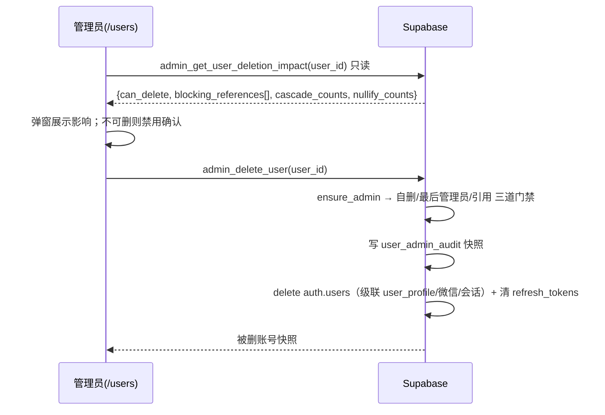

# 需求开发评审一致性平台 V1.10：删除用户最终执行方案

## 1. 背景与目标

`/users` 用户管理页现在只能改角色，不能删账号。实际积压的清理需求有三类：

- **僵尸账号**：注册了没点验证邮件，永远登录不了（截图里 3 个「待验证」）；
- **重复注册**：同一人用两个邮箱各注册一次（例如同名的 gmail 与企业邮箱各一份）；
- **误注册 / 测试账号**。

管理员现在只能去 Supabase 后台手工删，那既绕过了平台的权限门禁，也不会留下任何平台侧审计。

目标：管理员在 `/users` 页面安全地删除账号 —— 能删的直接删干净，不能删的**明确说清为什么**，并且每次删除都留下不依赖被删对象的审计快照。

## 2. 范围与非目标

包含：
- 删除前的影响评估（只读）与删除执行（写），两个 admin-only RPC；
- 删除审计表（快照式，被删用户的信息不随之消失）；
- `/users` 页面的「操作」列、确认弹窗与阻止原因展示。

**非目标（明确不做，避免误解）**：
- **不做「禁用登录」**。禁用要在 GoTrue 层生效（`banned_until`）才算真的禁用，只改 `user_profile` 拦不住登录；那是另一套状态机（登录拦截、RLS 谓词、前端强制登出），不在本次范围。有痕迹又必须停用的账号，本版的做法是把角色降为「查看者」并在 Supabase 后台 ban，文档里写清。
- 不做批量删除（一次一个，降低误删范围）。
- 不动任何业务表的外键行为：**绝不**为了能删用户而把 `analysis_job.requested_by` 之类改成级联删除。

## 3. 当前实现与问题

```text
/users → AdminUsersPage（src/App.tsx:1011）
  ├─ adminListUsers()        → RPC admin_list_users()        （ensure_admin + join auth.users）
  └─ adminUpdateUserRole()   → RPC admin_update_user_role()  （ensure_admin + 最后一个管理员保护）
```

`auth.users` 的引用现状（`pg_constraint` 实测）：

| 删除行为 | 引用方 | 含义 |
|---|---|---|
| **NO ACTION（会阻止删除）** | `review_batch.created_by`、`analysis_job.requested_by`、`human_review.reviewer_id`、`ai_import_record.imported_by`、`import_file.uploaded_by`、`ai_model_config.created_by`、`model_connectivity_test.requested_by`、`batch_operation_log.performed_by` | 业务与审计归属，必须保留 |
| CASCADE | `user_profile`、`wechat_identity`、`wechat_binding_handoff`、`wechat_login_handoff`、`wechat_oauth_attempt`、`auth.sessions` / `identities` / `mfa_factors` / … | 账号自身的附属数据，跟着删是对的 |
| SET NULL | `review_skill.created_by`、`review_skill_upload.uploaded_by`、`review_skill_version.published_by` | 技能作者置空，技能版本本身不可变、不受影响 |

所以"删除用户"不是一个动作，而是一个**判定**：只有不被 NO ACTION 表引用的账号才能真删。直接 `delete from auth.users` 的后果是抛一个裸的外键错误，管理员看不懂也不知道该怎么办。

## 4. 需求与验收标准

| # | 需求 | 验收 |
|---|---|---|
| A1 | 只有管理员能评估/删除 | 非管理员调用两个 RPC 均以 `ADMIN role required` 拒绝 |
| A2 | 不能删自己 | 传入自己的 id → `CANNOT_DELETE_SELF` |
| A3 | 不能删最后一个管理员 | 只剩一个 ADMIN 时删他 → `CANNOT_DELETE_LAST_ADMIN` |
| A4 | 目标不存在 | → `USER_NOT_FOUND` |
| A5 | 有业务引用时拒绝，并逐项给出数量 | → `USER_HAS_REFERENCES` + `blocking_references: [{table, label, count}]` |
| A6 | 可删时删干净 | `auth.users` 行消失；`user_profile`、微信绑定、会话一并消失 |
| A7 | 遗留刷新令牌不留 | `auth.refresh_tokens` 里该用户的行被清掉（`session_id` 为空的旧令牌级联删不到） |
| A8 | 审计不依赖被删对象 | `user_admin_audit` 留下邮箱/用户名/角色/创建时间快照 + 操作者快照 |
| A9 | 影响评估是只读的 | 调用 impact RPC 不改变任何数据 |
| A10 | 页面能看懂 | 弹窗列出「会一并删除」「会被置空」「阻止删除的引用」，阻止时确认按钮禁用 |

## 5. 总体设计



两个 RPC 共用同一个判定函数，保证"弹窗说能删"与"执行时能删"用的是同一套规则（时间差内数据变了则执行时仍会拒绝，这是对的）。

## 6. 数据与接口设计

新增表 `public.user_admin_audit`：

| 列 | 说明 |
|---|---|
| `id` | 主键 |
| `deleted_user_id` | 被删用户 id（**不加外键**，否则审计会随用户消失） |
| `deleted_email` / `deleted_display_name` / `deleted_role` / `deleted_user_created_at` | 快照 |
| `deleted_by` / `deleted_by_email` / `deleted_by_display_name` | 操作者（id 保留外键，操作者还在） |
| `cascade_summary` jsonb | 一并删除/置空的条数快照 |
| `created_at` | 时间 |

RLS：仅 ADMIN 可读；写入只经 RPC。

新增 RPC（都 `security definer` + `ensure_admin()`，granted to `authenticated`）：
- `admin_get_user_deletion_impact(p_user_id uuid) returns jsonb`（只读）
- `admin_delete_user(p_user_id uuid) returns jsonb`

前端：
- `src/lib/api.ts`：`adminGetUserDeletionImpact()` / `adminDeleteUser()`；
- `src/lib/user-deletion.ts`：纯函数 —— 把 RPC 返回的引用清单转成中文文案、判定确认按钮是否可用（可单测，不碰网络）；
- `src/App.tsx` 的 `AdminUsersPage`：新增「操作」列 + 确认弹窗。

不涉及 Edge Function（删除走 SECURITY DEFINER RPC；`postgres` 对 `auth.users` 有 delete 权限，实测 `has_table_privilege = true`），所以发布只需 `supabase db push` + 前端部署。

## 7. 前端与 Worker/运行时改造

Worker / DSH / 运行时：**不涉及**。用户删除不触及 Worker 链路。

## 8. 安全、兼容与回滚

- 三道门禁（自己、最后管理员、业务引用）全部在数据库侧，前端只做展示；绕过前端直接调 RPC 同样被拒。
- 审计表不引用被删用户，删除后仍可追溯"谁删了谁"。
- 不改任何既有外键与 RLS，历史数据零影响。
- 回滚：删除本身不可逆（这是删除功能的固有属性，靠"只允许删无痕迹账号"把损失面压到最小）；功能回滚只需前端不显示按钮 + `revoke execute` 两个 RPC。

## 9. 实施步骤与文件范围

1. 迁移：审计表 + 判定函数 + 两个 RPC + 授权；
2. SQL 测试（覆盖 §4 全部验收项）；
3. 前端纯逻辑模块 + 单测；
4. 页面接线（操作列 + 弹窗）；
5. 本地 Supabase 端到端实删验证；
6. lint / typecheck / test / build。

```text
新增 supabase/migrations/<UTC>_admin_delete_user.sql
新增 supabase/tests/<UTC>_admin_delete_user_test.sql
新增 src/lib/user-deletion.ts
新增 src/lib/__tests__/user-deletion.test.ts
改   src/lib/api.ts
改   src/types.ts
改   src/App.tsx（AdminUsersPage）
```

## 10. 验证结果

### 10.1 实际执行

| 项 | 命令 | 结果 |
|---|---|---|
| 迁移应用 | `supabase migration up --local`（并重复直接应用一次验证幂等） | 成功 |
| SQL 测试 | `psql < supabase/tests/20260918050615_admin_delete_user_test.sql` | 通过（覆盖 §4 全部 10 条） |
| SQL 变异验证 | 删掉"有引用就拒绝"那一段判定后重跑 | 立刻报 `ASSERT FAILED: a user with business references must not be deletable` → 断言有效 |
| 前端纯逻辑单测 | `npm run test:web` | 13 条新用例全部通过（共 110 通过） |
| 全量测试 | `npm test` | **853 passed / 0 failed** |
| 类型检查 | `npm run web:typecheck` | 通过 |
| Lint | `npm run lint` | 0 errors |
| 构建 | `npm run build` | 成功 |

### 10.2 本地真实链路（不是只跑单测）

在本地 Supabase 上造一个"注册未验证"的僵尸账号，以**真实管理员身份**（注入
`request.jwt.claims` + `role authenticated`，与前端调用路径等价）走两个 RPC：

- 影响评估返回 `can_delete: true`、`blocking_references: []`、附属与置空计数全 0；
- 执行删除返回 `deleted: true` 与被删账号快照；
- 删除后：`auth.users` 0 行、`user_profile` 0 行（级联）、`auth.refresh_tokens` 0 行残留；
- 审计表留下 `zombie_e2e@test.local / 角色 REVIEWER / 操作者 admin@local.test`。

再对一个**有痕迹**的真实管理员账号做评估（只读，不删），返回：

```json
{ "code": "USER_HAS_REFERENCES", "can_delete": false,
  "blocking_references": [ {"label":"创建的模型配置","count":2},
                           {"label":"产生的操作日志","count":1} ] }
```

即界面上会显示"创建的模型配置：2 条、产生的操作日志：1 条"，而不是一个裸的外键错误。
验证用的审计行已从本地库清除。

### 10.3 未验证项

- **浏览器里的实际点击流程未跑**：弹窗内容与按钮可用状态的逻辑已由 13 条纯函数单测覆盖，
  但"点开弹窗 → 看到清单 → 点确认"的真机交互要等前端部署后由人验一次。
- 云端未做任何写操作：迁移未推送，云端 `/users` 页面还没有这个按钮。
- 未做压力/并发验证（删除是单条、低频操作）。

## 11. 发布清单（由用户手动执行）

```bash
# 1) 提交
git add -A && git commit -m "V1.10: 用户管理支持删除账号"

# 2) 推库（新增审计表 + 3 个函数）
supabase migration list --linked                    # 应看到 20260918050615 待推
supabase db push --linked --dry-run --skip-vault
supabase db push

# 3) 部署前端（Vercel 自动或手动触发）
#    只有前端 + 数据库，**不涉及 Worker，不需要重建容器**，也不涉及 Edge Function

# 4) 验收（在 /users 页面）
#    - 对一个「待验证」僵尸账号点删除 → 弹窗显示"没有业务记录，可以安全删除" → 确认后消失
#    - 对一个建过批次的账号点删除 → 确认按钮置灰，并列出"创建的评审批次：N 条"等
#    - 对自己点删除 → 提示"不能删除自己的账号"
```

