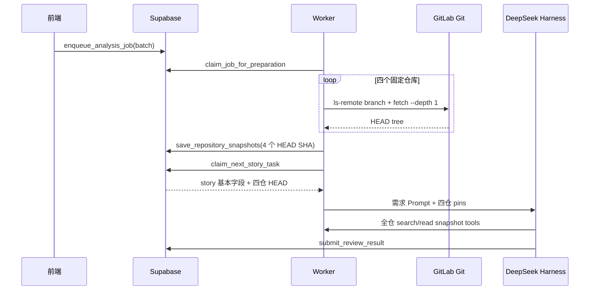

# 需求开发评审一致性平台 V1.11：需求提交归属与精准变更分析最终执行方案

> 文档状态：**V1.11 已完成代码实现与本地验证，尚未发布到云端**（2026-09-19）。数据库 10 份前滚迁移、Worker/DSH、管理员归属规则、Git 身份管理、运行监控与可选 GitLab MR 增强均已落地；真实验证结果见第 16 节，云端发布必须由用户按第 14.2 节手动执行。
>
> 核心 Git 版不依赖 GitLab API。若暂时没有 VPN/API Token，系统会明确记录 `MR_METADATA_UNAVAILABLE` 并继续 Commit/diff 分析；后续只需配置独立只读 `GITLAB_API_TOKEN` 即可启用 MR 标题、描述、作者、分支和 commit 集增强。
>
> 方案目标：把当前“给每个需求一份需求信息，然后让 DSH 在四个仓库 HEAD 上从零全仓搜索”的模式，升级为“先冻结该需求的候选提交与 diff，再围绕变更分析，必要时有理由地扩展到依赖上下文”。

## 0. 执行摘要与最终结论

### 0.1 用户提出的三个思路是否可行

| 思路 | 可行性 | 最终结论 |
|---|---|---|
| 获取 GitLab 提交人、提交时间、提交描述，并按两到三周筛选 | 可行，但当前实现不具备完整历史 | 核心链路优先使用现有 Git 协议凭据采集 Git 对象；默认窗口 21 天，可选 14/21/28 天。现有 `--depth 1` 必须另建历史采集链路 |
| 再按需求开发人员过滤提交 | 部分可行 | 只能生成候选，不能单独证明提交属于某需求。邮箱精确映射是强身份信号；姓名只能是弱信号；同一开发人员同期多个需求时必须标记歧义 |
| AI 根据提交变动而不是只看最终代码 | 可行且应作为主路径 | 新增“需求提交清单”和受控 commit diff 工具；AI 先读 selected commit/diff，再读取 HEAD 最终代码作为可提交证据 |
| 监控展示每个需求准备分析的提交与时间范围 | 可行 | 在 `/monitoring` 新增“分析范围”卡片、范围准备事件、提交明细、实际已读状态、范围扩展记录和降级原因 |

### 0.2 推荐方案不是“只看提交”，而是三层上下文

1. **主分析范围（PRIMARY）**：需求候选提交、commit message、变更文件和 diff hunk。
2. **依赖上下文（RELATED）**：变更文件直接依赖的接口、DTO、配置、测试、调用方；Agent 必须通过 `expand_analysis_scope` 声明原因后扩展。
3. **全仓兜底（GLOBAL）**：候选为空、身份未映射、历史不完整、需求跨仓或候选提交不足时，退回当前固定 HEAD 全仓能力；必须记录降级原因，不能伪装成精准分析。

硬限制为“禁止无记录地扩大范围”，而不是“禁止 Agent 看变更文件以外的代码”。只看 diff 会漏掉调用链、旧实现、配置和被间接影响的代码，同样会降低准确率。

### 0.3 最重要的产品语义

- “开发人员 + 时间窗”只代表**候选召回**，不代表需求归属事实。
- “没有候选提交”不等于“没有实现”，不得自动导出 `NOT_IMPLEMENTED`。
- 系统在 Agent 启动前自动冻结“强关联主集 + AI 相关性候选池”；不要求开发人员回忆或逐条确认自己的提交。
- AI 的最终实现证据仍必须来自固定 HEAD 上的 `read_snapshot_code`；diff 是导航和变更证据，不能冒充最终代码仍然存在。
- 不按提交数量评价个人绩效，不提供开发人员提交排名。

### 0.4 在现有思路上的精度升级

要把精度做到最高，正式归属路径采用 **结构化需求号优先、Commit 基础版、MR 可选增强**：基础版先从冻结 Git 对象建立“需求 ↔ Commit/diff”关联；配置独立只读 GitLab API 后，再增加 MR 标题、描述、分支和 merge/squash 信息。开发人员和时间窗只补捞历史漏标提交。中候选由 Agent 先读 diff 判定 `RELATED/UNRELATED/UNCERTAIN`；冲突或信息不足自动扩大上下文或降级，不设置日常人工确认闸门。

### 0.5 对外术语和实施状态约定

- 本文新增能力已经完成本地实现与验证，但**尚未发布到云端/现网**；“当前实现与问题”章节描述的是 V1.11 改造前基线，最终落地状态以第 16 节为准。
- “需求提交归属”只表示“某个提交是否应进入某需求的 AI 分析上下文”，不代表代码所有权、实际贡献认定或个人绩效。
- `RELATED/UNRELATED/UNCERTAIN` 是 AI 对候选是否值得纳入当前需求分析的判断，不是业务事实；监控必须标“AI 判定”，管理员反馈也不回写历史 Attempt。
- “基础版”不需要 GitLab MR API：使用冻结 Git 对象、Commit message/trailer、作者/提交者、可达性和 diff。
- “MR 增强版”需要另配最小只读 GitLab API Token，才可读取 MR 标题、描述、源/目标分支、MR commit 集、squash commit 和 merged_at。未配置时必须标 `MR_METADATA_UNAVAILABLE`，不能展示或使用 MR 强关联。
- `Commit`=一次 Git 代码提交；`Diff`=该提交前后的代码差异；`HEAD`=本次 Job 冻结的最终代码版本；`manifest hash`=冻结提交清单的内容指纹；`Attempt`=某个需求的一次 AI 执行尝试。
- 文中所有 REQ、人员、MR、SHA、日期和监控数据都是虚构示例，除明确引用当前代码路径和表名外，不代表生产数据。

## 1. 背景与目标

### 1.1 当前问题

当前一次 Job 会固定四个仓库的分支头 SHA；每个需求领取后，Worker 把同一组四仓 HEAD 交给 DSH。Prompt 只告诉 Agent 需求基本信息、分支和四个 SHA，然后要求它自行检索。结果是：

- 每个需求都从四仓全量空间开始探索，搜索次数和 token 消耗偏高；
- Agent 不知道本周哪些文件、哪些函数真的发生了变化；
- 同一个开发人员提交的目标需求、无关重构、修复和合并提交混在一起；
- 最终代码能说明“现在是什么”，但不能直接说明“这次需求改了什么”；
- 监控只能看到正在调用 `search_snapshot_code` / `read_snapshot_code`，看不到为何选择这些代码，也看不到任务开始前准备了哪些提交。

### 1.2 V1.11 目标

1. 新 Job 为每仓冻结可复现的 `base_sha → head_sha`；仅当 `enumeration_status=COMPLETE` 时保存并声称范围 Commit manifest 完整，超过上限或历史缺失时必须降级。
2. 把 Excel 中的开发人员映射到稳定 Git 身份，至少支持一个人多个 author email。
3. 在模型调用前，以确定性规则生成每个需求的候选提交和 selected commits。
4. DSH 首先阅读 selected commit 的 diff 和变更文件，再按显式理由扩展上下文。
5. `/monitoring` 可回答：时间范围是什么、候选如何产生、AI 准备分析哪些提交、实际读了哪些提交、是否扩展到全仓、为何降级。
6. 旧 Job、在途 Attempt 和旧结果不改变语义；新能力可灰度、可关闭、可前滚修复。

### 1.3 成功指标

上线后按模型、策略和范围模式分组观察，不直接拿不同模型混比：

- 精准模式任务中，首次全仓搜索前至少读取 1 个 selected commit/diff 的比例 ≥ 95%；
- 有强关联信号的 gold set 中，自动 selected commit **零已知误选**；召回率单独报告；
- `GLOBAL_FALLBACK` 比例可统计且有机器原因码，不能出现“未知原因”；
- 单任务 `search_snapshot_code` 次数、输入 token、模型请求数和墙钟时间相对 V1.10 基线下降；目标值在首轮 A/B 后确定，不在没有数据时伪造百分比；
- 任意任务可从监控页复原其冻结范围、算法版本、identity snapshot hash、selected commit manifest hash 和范围扩展历史。

## 2. 范围与非目标

### 2.1 本次包含

- 批次/Job 的提交时间窗设置，默认 21 天，可选 14/21/28 天；
- 每仓 Git 范围、提交拓扑、作者/提交者、提交时间、主题/正文、trailers、文件统计采集；
- 开发人员—Git 身份管理与冲突校验；
- 需求输入快照、候选生成、强关联主集与 AI 相关性候选池自动冻结；
- selected commit diff 的不可变存储与受控读取；
- DSH Prompt、工具契约、Broker、Session 恢复指纹改造；
- 监控摘要、提交明细、范围事件、实际读取与扩展轨迹；
- 数据权限、审计、容量、灰度、回滚、测试和发布步骤。

### 2.2 非目标

- 不通过 Commit 数、代码行数或归属数考核个人；
- 不承诺从 squash 后的单一提交还原 squash 前每个人的全部贡献；
- 不要求开发人员逐条确认提交；管理员纠错仅作为低频反馈和规则改进能力，不阻塞分析；
- 不把 Git diff 直接写进运行事件 payload、普通日志或浏览器批量游标；
- 不把四个白名单仓库之外的零结果解释为“没有提交”；
- 不修改旧 Job 的分析范围，不回填伪造的历史 manifest；
- 不重建或重置数据库；迁移只新增并前滚。

## 3. 当前实现与问题（按仓库实际代码核验）

### 3.1 当前调用链



### 3.2 已确认事实

1. `worker/src/git/prepare.ts:fetchExactWithRetry()` 使用 `git fetch --depth 1`。新缓存通常只有 HEAD，不能可靠枚举两到三周祖先。
2. `analysis_repository_snapshot` 只有 `repository_name/requested_branch/commit_sha/commit_subject/prepared_at`，没有 base、范围来源和完整清单。
3. `worker/src/pipeline/prepare-job.ts:prepareJob()` 串行解析四仓分支头。四仓不是数据库事务内同一时刻的原子快照；只能记录各自 `resolved_at`，不能对外声称“同一毫秒冻结”。
4. V4 已有 `list_snapshot_commits` 和 `/attempt/list-commits`，但 `SnapshotStore.commits()` 最多 50 条、无分页/总数/truncated；底层只返回 `%H/%s/%an/%aI`。在 depth-1 缓存上它通常只能看到 HEAD。
5. 当前没有 commit diff 工具。Workspace 复制 HEAD 工作树时排除了 `.git`，Agent 不能自行安全运行 `git show` 获取历史 diff。
6. `review_story.owners_text` 语义已经是“开发人员”，但只是自由文本；前端按 `，,、；;` 分隔。系统没有员工号、GitLab user id、author email 的稳定映射。
7. `claim_next_story_task()` 当前不把 `owners_text/release_window` 放进 story envelope；`StoryFields` 也没有 owners 字段。
8. `0005_remove_review_story_description_acceptance_criteria.sql` 删除了结构化 `description/acceptance_criteria`。当前 claim 明确返回二者为 null；实际 Prompt 中这两段为空。原始 Excel 行仍在 `source_data`，但当前没有受控提取为模型上下文。
9. `worker/src/ai/prompts/agent-review-v1.ts` 的 Prompt 只列需求与四仓 pins，要求 Agent 自主检索；没有“本次候选提交”“范围模式”“先读 diff”的约束。
10. 最终证据由 `read_snapshot_code` 产生 evidenceId 并绑定固定 HEAD，这是正确边界，应继续保留。
11. `/monitoring` 的 `get_analysis_runtime_console()` 返回 task/attempt/agent/current activity；`RuntimeTaskList` 只显示状态、Worker、Agent 数和当前活动，没有分析范围。
12. 当前事件中有 `TASK_REPOSITORIES_READY`、`PINS_VERIFIED` 和工具生命周期，但没有范围生成、候选冻结、范围降级和扩展事件。
13. Session 恢复校验包含 Harness/session format、policy、profile、skill catalog；未包含需求输入 hash、提交范围 hash、身份快照 hash和归属算法版本。
14. `0019_single_harness_execution.sql` 已移除 Worker 的 `supported_engines/protocol_version` 领取协商；如果直接创建 V1.11 Job，旧 Worker 可能误领。
15. 当前凭据足以 Git clone/ls-remote，但仓库没有 GitLab REST/GraphQL 客户端，不能假定 deploy token 能访问 Users/MR API。

### 3.3 根因

不是单一的“Prompt 写得不够好”，而是缺少模型调用前的五个确定性事实：

1. 本轮代码范围；
2. 需求开发人员对应的 Git 身份；
3. 需求与 Commit 的关联强度；
4. Commit 的实际 diff；
5. 范围不可靠时的明确降级状态。

## 4. 需求与验收标准

### 4.1 功能验收

| 编号 | 要求 | 可验证验收 |
|---|---|---|
| R1 | 时间窗冻结 | Job 冻结 `window_days`；每仓以实际 `head_resolved_at` 生成 UTC 半开区间 `[range_start_at,range_end_at)`；执行中修改批次设置不影响已建 Job |
| R2 | Git 范围可验证 | 每仓都有 `base_sha/head_sha/range_source/ancestry_status/enumeration_status/manifest_hash/commit_count/resolved_at`；只有 `enumeration_status=COMPLETE` 才对外显示“完整” |
| R3 | 历史不静默截断 | shallow boundary、无祖先、超过硬上限、fetch 失败均产生稳定错误码；不得把前 50 条当完整范围 |
| R4 | 身份映射 | 一个开发人员可绑定多个 email fingerprint；重复 fingerprint 不能同时绑定两个有效人员；姓名命中只标弱匹配 |
| R5 | 候选可解释 | 每条关系保存规则版本、score、reason codes、身份匹配方式、需求号匹配位置和 selected 来源 |
| R6 | 提交清单冻结 | ACP 启动前 task 的强关联主集与 AI 候选 manifest 已落库并有 hash；Attempt 只读取该冻结版本 |
| R7 | diff 优先 | 精准模式 Prompt 明确要求先调用 `list_story_commits` 和 `read_story_commit_diff`；工具审计可证明实际调用 |
| R8 | 最终证据仍可信 | IMPLEMENTED/PARTIAL 仍至少引用一个 `read_snapshot_code` evidenceId，diff 不能直接替代 |
| R9 | 显式扩展 | 从 PRIMARY 扩到 RELATED/GLOBAL 必须调用 `expand_analysis_scope`，记录层级、reason code、Agent、Attempt 和时间 |
| R10 | 无候选不误判 | `NO_CANDIDATE`/`IDENTITY_UNRESOLVED`/`RANGE_INCOMPLETE` 不自动生成 `NOT_IMPLEMENTED` |
| R11 | 监控可见 | 任务运行前后都能看到范围、selected commits、实际已读、扩展层级和降级原因 |
| R12 | 旧任务兼容 | v1 Job 保持原 Prompt/工具/恢复语义；旧 Session 不注入 v2 范围 |
| R13 | 混跑安全 | 只有声明支持 `storyCommitScopeVersion=2` 和新 contract hash 的 Worker 能领取 v2 Job |
| R14 | 隐私 | 浏览器、日志和事件不返回完整 author email；UI 只显示开发人员、Git author display name 和脱敏邮箱 |
| R15 | 自动归属可审计 | 规则选择、AI 相关性判定、自动排除、范围扩展和可选管理员纠错都保存来源、before/after、reason、时间，不覆盖旧审计行 |
| R16 | 规则可视化治理 | 管理员可从侧边栏“归属规则”查看预置规则、复制为草稿、通过条件卡片配置，并通过数据库固定 `SYSTEM_SAFETY_CONTRACT_V1` 检查后发布；每次发布生成不可变版本与 hash，Job 冻结该版本，在途和历史任务不随规则修改漂移 |

### 4.2 固定测试矩阵

必须建立本地 Git 图 fixture 和人工 gold set，覆盖：

- 一个开发人员一个需求多个提交；
- 一个开发人员同期多个需求；
- 多人协作、`Co-authored-by`；
- author 与 committer 不同；
- merge commit、squash、rebase、cherry-pick；
- 完整 revert、部分 revert、revert 后再实现；
- 同名不同人、一个人多个邮箱、邮箱大小写；
- 提交信息包含一个或多个 story code；`REQ-001` 不得误命中 `REQ-0010`；正文普通提及与独立 `Story-Id:` 必须分级；
- 需求号只出现在 MR 标题（可选 MR 增强阶段）；
- 边界时刻恰好等于 start/end，验证半开区间；
- 窗口内超过 50/500/2000 条提交；
- shallow history 未补全、base 不可达、force-push 后对象不可取；
- 无代码需求、白名单外仓库、机器人生成提交、二进制和超大 diff；
- selected commit 在 HEAD 已被回滚；
- v1/v2 Job、新旧 Worker、同 attempt/跨 attempt Session 恢复。

自动 selected 的 gold set 门槛是零误选；低置信候选召回率另报，不能把低置信候选伪装成自动确认来提高数字。

## 5. 总体设计

```mermaid
flowchart TD
  A[管理员选择 14/21/28 天<br/>默认 21 天] --> B[enqueue Job 冻结 scope settings]
  B --> C[四仓冻结 HEAD]
  C --> D[历史采集器补深并解析 base..head]
  D --> E{范围完整?}
  E -- 是 --> F[Commit Manifest + hash]
  E -- 否 --> G[DEGRADED + 机器原因]
  H[需求输入快照] --> I[身份映射快照]
  F --> J[确定性归属算法]
  I --> J
  J --> K[强关联主集 + AI 候选 Manifest]
  K --> L[DSH 先读 commit/diff]
  L --> M[读取 HEAD 最终代码取证]
  M --> N{需要更多上下文?}
  N -- 是 --> O[显式 expand scope]
  O --> M
  N -- 否 --> P[提交 verdict]
  G --> Q[GLOBAL_FALLBACK]
  Q --> M
  K --> R[/monitoring 分析范围卡片]
  O --> R
```

### 5.1 组件职责

| 组件 | 职责 | 不负责 |
|---|---|---|
| Job 入队 RPC | 冻结 window、scope version、算法版本、需求输入 | 不访问 GitLab |
| `prepare-job` | 冻结四仓 head，采集历史，保存 manifest，生成 task scope | 不用 LLM 判断归属 |
| Git 范围采集器 | 补深、拓扑遍历、diff stats、完整性校验、规范 hash | 不依赖 Worker cache 长期存在 |
| 身份解析器 | 规范人员、邮箱 fingerprint、姓名弱匹配、冲突状态 | 不把姓名当强身份证明 |
| 候选生成器 | 按版本化规则打分、选择、给出 reason codes | 不生成 AI verdict |
| Broker/DSH tools | 按 task 冻结范围返回 commit/diff，记录实际读取和范围扩展 | 不允许任意 SHA/任意仓库读取 |
| `read_snapshot_code` | 读取 HEAD 最终代码并产生 evidenceId | 不证明 Commit 归属 |
| 监控 RPC/UI | 展示摘要、提交、读取/扩展事实 | 不展示 diff 正文和完整邮箱 |

## 6. 时间窗、Git 范围与提交归属算法

### 6.1 时间窗最终规则

- 默认 `window_days=21`，创建分析 Job 前可选 14、21、28；Job 入队只冻结天数，不伪造尚未解析仓库时的统一截止时刻。
- 每仓 `range_end_at=head_resolved_at`，`range_start_at=range_end_at-window_days`，区间为 UTC 半开区间 `[range_start_at,range_end_at)`；任务页展示四仓最早 start 和最晚 end，并明确这是聚合显示。
- 主代码增量范围以 Commit 是否位于冻结 `base..head` 且可达 `head_sha` 为准，不以作者时间单独决定。`authored_at` 是作者记录时间，`committed_at` 是 Git 提交者时间，`merged_at` 只有 MR API 可用时才有；三者分别保存和展示。一个两个月前创建、今天才合入的侧分支 Commit，只要新进入 `base..head` 仍属于增量范围；时间字段只参与候选排序/解释。
- 四仓 HEAD 在准备阶段依次解析并保存各自 `head_resolved_at`。这样 HEAD 与该仓窗口使用同一个事实时刻，不把 Job 入队时间、仓库解析时间和业务发布时间混为一谈。
- 若存在同分支上一个成功的 v2 Job，优先以其 head 作为 `base_sha`，`range_source=PREVIOUS_SUCCESSFUL_JOB`；该 `base..head` 是代码增量范围，21 天窗口仅用于无需求号的人员候选过滤。强需求号关联即使 authored_at 早于窗口，也不会因分支较晚合入而被漏掉。
- 首次无 v2 基线时，从当前 head 沿 first-parent 向前寻找 `committed_at < range_start_at` 的最近祖先，`range_source=TIME_DERIVED`。
- 找不到可靠 base 时不伪造空范围，置 `BASELINE_REQUIRED` 或 `RANGE_INCOMPLETE`，任务默认降级到 GLOBAL，而不是让整个批次卡死。
- 四仓严格同一发布切面的需求不能靠串行 `ls-remote` 保证，必须显式提供 release manifest 中的四仓 SHA；页面仍分别显示各仓解析时间。

### 6.2 核心历史采集不依赖 GitLab REST API

第一阶段复用当前 Git clone 凭据，新增独立历史元数据缓存：

1. 初始化临时 bare repo，不复用 HEAD 工作树的 `depth=1` 假设。
2. fetch 冻结 `head_sha`；先使用 `--shallow-since=start_at-7d`，服务器不支持时使用 `--deepen=200` 分段补深。
3. 每轮检查 first-parent 是否已出现窗口前祖先；最大补深 5000 Commit。
4. 验证 `git merge-base --is-ancestor base head`。
5. 检查 `.git/shallow` 边界不得落入 `base..head`；否则 `enumeration_status=SHALLOW_INCOMPLETE`。
6. 以 `git rev-list --topo-order --reverse base..head` 完整列举，不使用当前 50 条工具上限。
7. 超过每仓 2000 Commit 时状态为 `RANGE_TOO_LARGE`，不截断成“完整”。
8. 采集元数据和文件统计；候选选出后才生成并归档 diff 正文，控制体积。

GitLab REST/MR API 是第二阶段增强项，只用于 GitLab user/MR 关联。它需要独立最小只读 Token，不能复用 clone deploy token，也不能成为核心提交采集的前置条件。

### 6.3 Commit 规范化

每个 Commit 保存：

- `sha`、`parent_shas`、`tree_sha`；
- `author_name`、`author_email_fingerprint`、`authored_at`；
- `committer_name`、`committer_email_fingerprint`、`committed_at`；
- `subject`、受长度限制的 body、解析后的 trailers；
- `is_merge`、`is_revert`、`reverted_sha`、`patch_id`（只作重复提示）；
- `files_changed/additions/deletions/binary_files`；
- 文件级 `path/old_path/change_type/additions/deletions`；
- 可选 `mr_iid/mr_title/mr_author/merged_at`；
- `effective_status=EFFECTIVE|REVERTED|PARTIAL|UNKNOWN`。

Merge commit 的变更以 first-parent diff 表示“合并给目标分支带来了什么”；子 Commit 与 merge 节点可同时保存拓扑，但统计唯一贡献时不能重复计数。rename 使用固定阈值（例如 `--find-renames=50%`），算法版本变化必须产生新 generation。

### 6.4 开发人员身份映射

管理页新增“Git 身份”配置：

- 平台开发人员显示名；
- 可选员工号（从 `古今（49086）` 这类文本解析后由管理员一次性校验身份映射，不需要每周确认提交）；
- 一个或多个 Git author email；
- 一个或多个 Git author name alias；
- 可选 GitLab username/user id（只有 API 验证后才是强信号）；
- 状态 `VERIFIED|UNVERIFIED|CONFLICT|DISABLED`。

匹配优先级：

1. 已验证 email fingerprint：强身份；
2. 已验证 GitLab user 与 commit/MR 关联：强身份；
3. 员工号与已校验人员身份：人员解析强信号，但仍需 Git identity；
4. author name 精确别名：弱身份；
5. 模糊姓名：不自动映射，任务按 `IDENTITY_UNRESOLVED` 进入需求号匹配或全仓降级。

邮箱隐私：浏览器输入后由受控服务计算 `HMAC(normalized_email, identity_pepper)`；业务表只存 fingerprint、domain 和 masked value。Commit 原始邮箱不写日志、不进监控事件、不返回普通前端。identity pepper 放 Vault，不写环境示例正文。

### 6.5 最精确的归属策略：结构化需求号优先，Commit 基础版 + MR 可选增强（算法 v2）

#### 6.5.1 两条能力路径必须分开

**基础版（V1.11 核心，现有 clone 凭据可支持）**：读取冻结 Git 对象中的 Commit message/trailer、作者/提交者、父节点、`base..head` 可达性、变更文件和 diff。它不读取 MR 标题、描述、源分支、merged_at 或 squash 元数据。

**MR 增强版（可选，必须另配只读 GitLab API Token）**：在基础版上增加 MR 标题、描述、源/目标分支、MR commit 集、merge/squash commit、作者和 merged_at。现有 deploy/clone token 不保证有该权限；未配置时必须显示 `MR_METADATA_UNAVAILABLE`，不得伪造空 MR 结果。

两条路径共同遵循的优先级是：

```text
Commit 或 MR 独立 Story-Id 字段 / 规范需求链接
  > 完整 token 需求号 + 可达性/已验证作者等另一条独立线索
  > 已验证开发人员身份 + Git 增量范围 + 模块/diff
  > 只有姓名或语义相似的最后兜底
```

MR 能把一组变更组织得更完整，但不是基础链路的必要条件。普通 MR 只纳入可达冻结 HEAD 的节点；squash 以 squash commit 与冻结 MR diff 为主；merge 使用 first-parent diff；所有 MR 元数据保存采集时间和 hash，不能拿实时页面状态解释历史 Job。

管理员事后纠错只用于改进规则和形成 gold set，不参与每周日常运行，也不要求开发人员记忆提交历史。

#### 6.5.2 从源头提高精度的可选研发规范

以下规范用于从源头提高后续关联精度。V1.11 基础能力不以历史提交补写为上线前置条件，也不要求开发人员回忆旧记录；研发流程负责人完成宣贯后，新需求提交按同目录的《[V1.11 开发提交填写规范](./需求开发评审一致性平台-V1.11开发提交与合并申请填写规范.md)》执行，宣讲和打印可直接使用《[图文版](./需求开发评审一致性平台-V1.11开发提交与合并申请填写规范-图文版.html)》。是否进一步增加 CI/MR 合并门禁由研发流程负责人另行决定，不属于本版实现范围：

1. 分支命名：`feature/<story-code>-<short-name>`；
2. MR 模板必填结构化字段：`Story-Id: <story-code>`，多需求时一行一个；
3. Commit 推荐 trailer：`Story-Id: <story-code>`，不要只在自然语言中提到；
4. GitLab CI/MR 检查：目标分支为受管分支时，MR 至少有一个可在当前批次或需求系统验证的 Story-Id；
5. squash 时把 `Story-Id` 和 MR IID 保留到 squash commit message；
6. 一个 MR 涉及多个需求必须显式列出，不允许算法强制一对一；
7. 紧急修复可填写 `No-Story-Reason`，系统将其放入 AI 相关性候选池或按规则排除，不能伪造需求号。

这套规范上线后，“需求对应哪些提交”的主答案来自可验证的 MR/Story-Id 关系；作者和时间窗退居召回与漏标修复用途。

#### 6.5.3 术语白话解释与具体判断例子

下面这些词只描述**系统能观察到的客观线索**，不是要求开发人员手工回忆。

> 示例编号说明：下面用 `REQ-001` 表示平台从 Excel 导入的一条真实需求编码（数据库字段 `story_code`）。GitLab 把每个“申请合并代码”的记录叫 Merge Request，简称 MR；`!246` 只是 GitLab 显示的第 246 号合并申请。编号都只是示例，不是当前系统预置数据。
>
> “平台匹配需求编码”必须使用版本化 parser，而不是普通 `includes()` 子串：① 基础版解析 Commit message/trailer；MR 增强版才通过只读 API 读取 MR 标题、描述、源/目标分支；② `Story-Id:` 独立字段或需求系统规范链接可作为直接关联；③ 标题和分支按当前批次编码集合做最长优先、完整 token 边界匹配，编码前后不得继续连接字母、数字、`_` 或 `-`，所以 `REQ-001` 绝不能命中 `REQ-0010`；④ MR/Commit 正文中的普通自然语言提及默认只作候选，`Revert REQ-001` 也不能直接证明当前实现；⑤ 多个有效编码建立多对多关系，不强制一对一；⑥ 保存 parser version、命中位置和规范化 token。未配置 MR API 时跳过全部 MR 字段，只走 Commit 与 Git 范围能力。如果所有位置都没有需求编码，系统进入“开发人员 + 时间窗 + diff”的候选分析。

| 术语 | 白话解释 | 具体例子 | 系统能得出的结论 |
|---|---|---|---|
| MR | Merge Request，开发人员把一个分支申请合并到目标分支的“合并申请单” | 张三把 `feature/STORY-128-batch-close` 申请合入 `feature_sit`，GitLab 生成 MR !246 | MR 能把分支、提交集合、作者、目标分支和最终 diff 串在一起 |
| 平台记录需求与 MR 的关联（仅 MR 增强版） | 配置只读 MR API 后，平台读取 MR；只有独立 `Story-Id:` 字段或规范需求链接解析出的编码与当前批次编码精确相等，才自动保存直接关系 | 平台需求编码是 `REQ-001`；MR 描述独立一行写 `Story-Id: REQ-001` | 直接进入主分析集；标题/正文普通提及不走这条直接关联 |
| Story-Id | 一种可选的固定写法：在 MR 或提交说明里专门写一行需求编号，便于机器读取；不是 GitLab 强制字段 | 当前示例需求编码为 `REQ-001`，描述末尾写 `Story-Id: REQ-001` | parser 提取冒号后的 token，与本批次编码精确比对；`REQ-0010` 不会命中 `REQ-001` |
| Commit trailer | Commit message 最后几行的“键: 值”标记，不是代码内容 | `修复批量关闭权限` 后面另起一行写 `Story-Id: STORY-128` | 系统读取 Git 提交说明就能获得需求号，不需要 GitLab 页面人工填写第二次 |
| 需求分支 + MR commit 集 | 分支名称带需求号，该分支通过 MR 合并；MR 中的所有 Commit 是一组 | 分支叫 `feature/STORY-128-batch-close`，MR !246 包含 A/B/C 三个 Commit | “分支需求号”和“同一 MR 提交集合”两条线索同时成立，A/B/C 自动进入强关联主集 |
| 需求号 + 已验证作者 | Commit 明确写需求号，并且作者 Git 身份已经与需求开发人员做过一次性映射 | Commit 写 STORY-128；author email fingerprint 对应需求开发人员张三 | 两条独立线索一致，自动强关联；不是让张三逐条确认 Commit |
| 已验证开发人员 | 管理员只需一次性把“需求里的张三”与其 GitLab username/author email 对应起来 | `张三（10086）` ↔ GitLab `zhangsan` ↔ `z***@example.com` | 此后系统自动识别张三的提交；开发人员不需要每周确认 |
| 时间窗 | 本次只召回最近一段时间进入冻结分支的提交，默认 21 天 | 当前仓库冻结时刻向前 21 天 | 只能缩小范围，不能单独证明提交属于某需求 |
| 项目模块匹配 | 代码文件路径属于需求所在项目通常使用的模块 | 订单需求改到 `order/service/`、`order/api/`，而不是 `license/` | 可作为中等线索；路径可能共用，不能单独自动归属 |
| 变更语义相似 | diff 中出现需求特有的接口名、配置键、表名或页面名 | 需求名是“批量关闭订单”，diff 新增 `batchCloseOrders` 和 `/orders/batch-close` | AI 用来判断中候选相关性；仅文字相似不能当确定事实 |
| 姓名别名 + 时间 | 只看到 Git author name 叫“张三”，且时间在窗口内，但没有可靠 email/username | Git 历史显示作者 `Zhang San`，无法证明是哪位张三 | 弱线索；默认不自动归属，只有无其它候选时才交给 AI 兜底 |
| 另一个需求号 | Commit 明确写了其它需求，并没有声明同时服务当前需求 | 当前分析 STORY-128，但 Commit 写 `Story-Id: STORY-131` | 自动排除，不算给 STORY-128 |
| 目标分支不符 | Commit/MR 没有进入本次评审冻结的目标分支 | MR 合入 `release`，本次 Job 评审的是 `feature_sit`，Commit 也不可达该 head | 不属于本次代码快照，自动排除或记录为范围外 |
| 完整回滚 | 后续 Revert 把某次改动完整撤销，最终 HEAD 已没有效果 | A 新增批量关闭，B 为 `Revert A`，且反向 patch 完整抵消 A | A/B 保留审计，但不拿 A 证明最终已经实现 |
| 身份冲突 | 同一个 Git email/username 被映射给两个人，或者同名无法区分 | `dev@example.com` 同时配置给张三和张三丰 | 不猜归属；标 `IDENTITY_AMBIGUOUS`，改用需求号或全仓兜底 |

“需求编码匹配”是**整体机制**：基础版在 Commit message/trailer 中解析，MR 增强版才额外读取标题、描述和分支；`Story-Id: REQ-001` 是一种优先级更高的**推荐结构化格式**。它们不是两套不同规则。如果完全没写需求编码，就进入开发人员 + Git 增量范围 + 模块/diff 的 AI 候选流程。

五种常见情况可以这样理解：

1. **最明确**：GitLab MR 明确写着真实需求编号，平台自动建立需求—MR关系，并把该 MR 的最终变化交给 AI。
2. **比较明确**：平台此前没有保存需求—MR关系，但 Commit/MR 明确写真实需求编号，或者需求分支与已验证作者两条线索同时对上。系统自动加入强关联主集。
3. **需要 AI 判断**：没有需求号，但作者、21 天时间窗、订单模块和 diff 实体都像当前需求。系统把它放入候选池，AI 读 diff 后输出相关/无关/不确定。
4. **线索很弱**：只有作者名字像、时间也差不多。系统不直接归属；无其它候选时才有限量地交给 AI。
5. **不能作为当前有效实现**：只命中另一个需求号且没有当前需求关系时自动排除；被完整回滚的实现与回滚提交仍然和当前需求相关，必须保留分析，但 `effective_status=REVERTED`，不能拿原实现证明冻结 HEAD 仍已实现。身份冲突则降级，不能猜归属。

#### 6.5.4 证据信号分级

| 等级 | 证据信号 | 示例 | 系统动作 |
|---|---|---|---|
| 直接关联 | 独立 `Story-Id:` 字段或规范需求链接解析出的编码，与当前批次需求编码精确相等；MR 字段仅在配置 API 时可用 | Commit trailer 或 MR 独立行写 `Story-Id: REQ-001` | `AUTO_SELECTED_EXPLICIT`，必进主集 |
| 需求号命中 | 标题、subject 或源分支按完整 token 边界命中需求号；正文自然语言提及不算此类 | 标题为 `[REQ-001] 订单批量关闭`，且不会匹配 `REQ-0010` | 作为组合强信号，不单独冒充直接关联 |
| 双线索匹配 | “需求号命中”再与可达性、MR commit 集或已验证作者等独立信号同时成立 | `feature/REQ-001-*` 且提交作者匹配，并且 Commit 可达冻结 HEAD | `AUTO_SELECTED_STRONG` |
| AI 候选 | 已验证作者 + 时间窗 + 模块/路径与需求项目匹配，但没有明确需求号 | 同一开发人员同期提交 | `AI_RELEVANCE_REQUIRED`，自动进入 AI 候选池 |
| 最后兜底 | 姓名 alias + 时间窗，或仅语义相似 | 同名作者两周内提交 | 仅在无更强候选时进入受限兜底池 |
| 排除、失效或降级 | 仅命中其它需求且没有当前需求关系→排除；完整回滚→仍相关但当前失效；目标分支/HEAD不可达→范围外；身份冲突→降级 | A 实现 REQ-001，B 完整 Revert A | A/B 都保留分析，`relation_status=RELATED`、`effective_status=REVERTED`；不得用 A 单独证明当前实现 |

“独立信号”不能重复计分：MR 标题和由同一 MR 自动生成的 squash subject 属于同一来源；author name 和由同一 email 映射出的 display name也属于同一身份来源。

#### 6.5.5 决策规则，不使用容易误导的简单总分

不再以“达到 70 分就自动归属”作为最终判据，而使用自动证据门槛：

- `AUTO_SELECTED_EXPLICIT`：存在“直接关联”，即结构化字段/规范链接解析出的编码精确相等；
- `AUTO_SELECTED_STRONG`：至少一组“双线索匹配”成立，且 Commit/merge/squash 节点可达冻结 HEAD，也没有“排除或降级”条件；普通正文提及或单独标题 token 不足以自动强选；
- `AI_RELEVANCE_REQUIRED`：没有直接关联和双线索匹配，但至少有两项独立 AI 候选信号；自动进入候选池，由 Agent 读取 diff 后输出相关性；
- `WEAK_FALLBACK`：只有“最后兜底”线索，或只有一项 AI 候选信号；仅在没有更强候选时按数量上限送入 Agent；
- `CONFLICT`：强信号分别指向不同需求、同一 email 映射多人、MR 与 target branch 不符；不等待人员处理，Agent 收到冲突事实并进入 `UNCERTAIN` 或扩大范围；
- `EXCLUDED`：仅命中其它需求且没有当前需求号/共同 MR 关系，或明确不属于本次冻结代码范围时排除。完整回滚不排除，改写 `effective_status=REVERTED`；bot/generated 只降权，若有关联需求号、MR 或相关路径仍保留候选。

系统可以保存 `rank_score` 用于同级排序，但状态只能由上述门槛决定；UI 不把分数展示成概率。管理员可以在结果产生后纠错，纠错只生成新规则样本，不回写已经运行的 Attempt。

#### 6.5.6 候选生成的正向与负向信号

正向信号：

- MR/Commit trailer 中完整 Story-Id 精确匹配；
- MR source branch 中完整 Story-Id，必须按边界匹配，`STORY-12` 不能误命中 `STORY-123`；
- MR 标题/描述中的需求系统链接解析出同一 Story-Id；
- 已验证 author/co-author email 属于需求开发人员；
- committed/merged time 落在冻结窗口；
- 变更模块与需求项目、应用、关联特性映射一致；
- diff 中出现需求特有的 API、配置键、表名或页面名称；该项只作中弱信号，不能单独自动归属；
- 同一 MR 的 commit 集或 squash commit。

负向/冲突信号：

- 出现另一个有效 Story-Id 且没有声明多需求；
- 作者在同一窗口负责多个需求且没有需求号/MR关联；
- Commit 不可达冻结 head 或 MR target branch 不是 Job 目标分支；
- 提交晚于该仓 `range_end_at`；
- 完整 revert：原实现与 revert 都保留 `RELATED`，将效果标 `REVERTED` 并检查冻结 HEAD 是否有替代实现；部分 revert 标 `PARTIAL/UNKNOWN`；
- bot/dependency update/generated code 且没有需求号：只作降权信号；相关 MR、路径或需求号可以覆盖该降权，不能一律排除；
- 变更只属于明确映射到其它项目/模块的路径。

#### 6.5.7 Merge、squash、cherry-pick 和多人协作

- 普通 MR：需求关联 MR，分析集包含 MR 在 `base..head` 中可达的有效 Commit；
- squash MR：以 squash commit 和 MR diff 为主，原始 Commit 只作审计信息，不假设目标分支仍可达；
- merge commit：first-parent diff 表示该 MR 给目标分支引入的最终变更，不能与子 Commit 重复统计；
- cherry-pick：如果 trailer/MR 明确继承 Story-Id，可以关联；仅 patch-id 相同只能提示，不能确认；
- `Co-authored-by`：共同作者分别记录，任一开发人员匹配可形成身份信号；
- 代提交：Story-Id/MR 强关联可覆盖“作者不是需求开发人员”，标记 `CONTRIBUTOR_OUTSIDE_OWNER_LIST`，不直接排除；
- 一个需求跨四仓：允许关联多个 MR 和多个仓库，最终 selected manifest 是所有有效关系的并集。

#### 6.5.8 对历史未遵循规范的数据

历史 Commit 没有 Story-Id 时，按以下顺序补救：

1. 通过 GitLab MR API 查 commit/MR、branch、MR title/description、squash commit；
2. 通过已验证 author email + 时间窗召回；
3. 用项目/模块路径、需求名称关键词和 diff 实体做中信号排序；
4. 同一开发人员同期多个需求时，候选全部保留并标 `MULTI_STORY_AMBIGUOUS`，由 Agent 逐条读取 diff 做相关性判定；
5. Agent 对每条中候选输出 `RELATED/UNRELATED/UNCERTAIN`、reason codes 和读取事实，不要求开发人员回忆；
6. 仍无候选时 `GLOBAL_FALLBACK`，不得自动判未实现。

### 6.6 需求级范围模式

| mode | 条件 | AI 首轮行为 |
|---|---|---|
| `EXACT_STORY_COMMITS` | 只有 `AUTO_SELECTED_EXPLICIT/AUTO_SELECTED_STRONG`，无冲突 | 直接分析强关联 MR/Commit 与最终 diff |
| `HYBRID_CANDIDATES` | 有强关联，也有 `AI_RELEVANCE_REQUIRED` | 强关联进入主集；中候选由 AI 先做相关性判定 |
| `DEVELOPER_WINDOW` | 无强关联，但开发人员身份已解析 | 自动冻结受限候选池，AI 逐条判定相关性 |
| `REQUIREMENT_REF_ONLY` | 人员未映射，但提交/MR 有需求号 | 分析需求号命中的 MR/Commit，并标记人员信息缺失 |
| `NO_CODE_EXPECTED` | 需求源数据明确标记无需代码 | 不自动判未实现；输出无需代码的来源说明 |
| `GLOBAL_FALLBACK` | 身份未解析、范围不完整、候选为空、仓库范围外 | 保持当前固定 HEAD 检索，但监控明确显示原因 |

稳定原因码包括：`MR_METADATA_UNAVAILABLE`、`IDENTITY_UNRESOLVED`、`IDENTITY_AMBIGUOUS`、`NO_CANDIDATE`、`NO_EXPLICIT_LINK`、`MULTI_STORY_AMBIGUOUS`、`STRONG_SIGNAL_CONFLICT`、`RANGE_INCOMPLETE`、`RANGE_TOO_LARGE`、`BASELINE_REQUIRED`、`OUT_OF_SCOPE_REPOSITORY`、`DIFF_TOO_LARGE`、`NO_CODE_EXPECTED`。

### 6.7 全自动“准备范围 → 冻结候选池 → AI 相关性判定 → 正式评审”流程

开发人员不需要、也不应该逐条回忆自己的提交。Job 不设置人工确认等待态，完整流程自动推进：

```text
QUEUED
  → PREPARING_CODE
  → PREPARING_SCOPE
  → PROCESSING
      ├─ COMMIT_RELEVANCE_TRIAGE
      └─ REQUIREMENT_REVIEW
  → FINALIZING
  → SUCCEEDED / FAILED
```

1. `PREPARING_CODE`：冻结四仓 head 和历史范围；
2. `PREPARING_SCOPE`：获取 MR/Commit、构建强关联主集和中弱候选池、归档 diff，不启动模型；
3. 数据库原子冻结 `scope_generation + candidate_manifest_hash + story_input_hash + identity_snapshot_hash`，Job 自动进入 `PROCESSING`；
4. `COMMIT_RELEVANCE_TRIAGE`：
   - `AUTO_SELECTED_EXPLICIT/AUTO_SELECTED_STRONG` 直接进入主分析集；
   - `AI_RELEVANCE_REQUIRED` 必须逐条读取 commit summary 与关键 diff，输出 `RELATED/UNRELATED/UNCERTAIN`；
   - `WEAK_FALLBACK` 只在强/中候选为空时进入，按排序和数量上限读取；
   - 冲突候选不得由 AI 假装确认；标记 `UNCERTAIN` 并自动扩大到 RELATED/GLOBAL；
5. `REQUIREMENT_REVIEW`：使用“强关联主集 + AI 判定 RELATED + UNCERTAIN 保守上下文”分析需求实现；
6. 相关性结果、理由、实际读取记录和扩展层级写入监控；
7. 候选池有硬上限。超限或所有候选均 `UNRELATED/UNCERTAIN` 时自动 `GLOBAL_FALLBACK`，不得卡住 Job；
8. 管理员可在分析后对明显错误做低频纠错，形成 gold set 和规则优化输入；纠错不要求原开发人员参与，也不改变已完成 Attempt 的历史输入。

相关性判定必须与最终需求 verdict 分开：`UNRELATED` 只表示“该 Commit 与当前需求无关”，绝不等于需求未实现；最终 `NOT_IMPLEMENTED` 仍需满足现有全仓检索覆盖与证据门槛。

## 7. 数据库与接口设计

### 7.1 Job 和现有快照扩展

`analysis_job` 新增/调整：

- `status` 增加 `PREPARING_SCOPE`，但不增加任何 `AWAITING_*` 人工等待态；前端活动状态、重试和最终化条件同步支持；
- `analysis_context_version smallint`：v1=旧全仓，v2=提交范围；
- `commit_window_days`（14/21/28）与 `scope_requested_at`；各仓实际区间保存在 repository snapshot；
- `attribution_algorithm_version`；
- `story_input_catalog_hash/identity_snapshot_hash/repository_manifest_hash`；
- `scope_status=LEGACY|PREPARING|READY|DEGRADED|FAILED`；
- `scope_error_code`；
- `required_worker_scope_version`。

`analysis_repository_snapshot` 保留 `commit_sha` 作为 head 兼容列，并新增：

- `base_sha/head_sha/range_source/range_start_at/range_end_at`；
- `head_resolved_at`；
- `ancestry_status/enumeration_status/commit_count`；
- `commit_manifest_hash`；
- `diff_archive_status/diff_archive_bytes`。

### 7.2 新表

| 表 | 关键字段与用途 |
|---|---|
| `developer_identity` | 稳定人员、显示名、员工号、状态 |
| `developer_git_identity` | provider、email fingerprint、masked email、author alias、GitLab user、验证状态、有效期 |
| `analysis_job_identity_snapshot` | Job 创建时冻结的人员—Git identity，不读取后续实时改动解释历史 |
| `analysis_job_story_snapshot` | story code/name/owners 原文及规范人员、project/release window、受控 requirement context、input hash |
| `analysis_repository_commit` | 当 `enumeration_status=COMPLETE` 时保存每仓范围 Commit manifest 与拓扑、作者/提交者、时间、message、stats、effective status；超限/不完整时不得声称完整 |
| `analysis_repository_merge_request` | **仅 MR 增强版创建数据**：GitLab project/MR IID、source/target branch、title、结构化 Story-Id、author、merged_at、merge/squash commit、采集时间/hash与完整性；未配置 API 时为空并记录 unavailable，不伪造零结果 |
| `analysis_merge_request_commit` | MR 与 Commit 集合；区分普通 commit、merge commit、squash commit，避免重复统计 |
| `analysis_commit_file` | Commit 文件清单和 numstat，不存 diff 正文 |
| `analysis_story_scope` | task 的 mode/status/range/hash/candidate/strong/ai_related 数和降级原因 |
| `analysis_story_commit_candidate` | task—commit 关系、generation、rank、reason codes、自动分层、AI relevance/status/reason、归属来源 |
| `analysis_commit_diff_archive` | selected Commit 的 Storage locator、sha256、字节数、chunk 数、截断/超大状态 |
| `analysis_story_commit_access` | 哪个 run/agent/tool call 实际读取哪个 commit/diff，append-only |
| `analysis_scope_expansion` | Attempt 从 PRIMARY 扩展到 RELATED/GLOBAL 的事实、reason、agent、时间 |
| `analysis_scope_decision_audit` | 身份配置、自动选择、自动排除、分析后管理员反馈和重算的 before/after、来源与 actor |

关键唯一约束：

- `(snapshot_id, sha)` 唯一；
- `(job_id, story_id)` 的 story snapshot 唯一；
- `(task_id, generation, commit_id)` 候选唯一；
- 一个有效 `email_fingerprint` 只能绑定一个有效 developer identity；
- selected manifest 冻结后不可更新；更正必须新 generation。

### 7.3 RPC

Worker/service-role：

- `save_analysis_repository_commit_manifest(job, worker, repository, manifest, hash)`；
- `save_analysis_story_scopes(job, worker, algorithm_version, scopes, hash)`；
- `get_story_task_analysis_scope(task, worker, claim_token)`；
- `record_story_commit_access(task, claim, run, agent, commit, tool_call)`；
- `submit_story_commit_relevance_verdict(task, claim, run, candidate, triage_revision, verdict, reasons, access_ids)`；
- `record_analysis_scope_expansion(task, claim, run, from, to, reason)`。

前端：

- `admin_list_developer_git_identities()`；
- `admin_upsert_developer_git_identity(...)`；
- `get_analysis_story_scope_summary(task_id)`；
- `get_analysis_story_scope_commits(task_id, cursor, limit)`；
- `record_story_commit_attribution_feedback(task_id, candidate_id, corrected_relevance, reason)`：仅管理员用于分析后低频纠错和 gold set，不阻塞任务；
- `finalize_analysis_story_scope(job_id, worker_id, expected_generation)`：Worker 在候选生成完成后原子冻结各 task candidate manifest，并把 Job 从 `PREPARING_SCOPE` 自动推进到 `PROCESSING`；
- `recompute_story_commit_scope(task_id)`：只允许任务尚未领取；已运行任务创建新 Job，不改旧 Attempt 输入。

权限：身份原始信息仅 ADMIN；监控摘要和脱敏提交列表使用 `ensure_manage_review_batch`；写 manifest 只授予 service role 并校验 Job preparation fencing；浏览器不能自报 manifest hash、算法版本或自动 selected 状态。

### 7.4 可视化归属规则管理

#### 7.4.1 产品入口与定位

仅管理员在现有侧边栏新增 **“归属规则”**，与“Agent 运行监控”“技能”同级。页面不是让管理员编写 SQL、JavaScript 或任意正则，而是把平台允许调整的归属策略做成可视化条件卡片：

```text
规则名称 → 适用数据源 → 条件组（全部/任一满足）→ 动作 → 优先级 → 原因码
```

首批预置且默认启用：

| 规则 | 可视化条件摘要 | 动作 |
|---|---|---|
| 结构化需求号精确命中 | Commit trailer 中 `Story-Id` 与当前需求编码完整 token 相等；MR 字段仅在增强版可用 | 加入强关联主集 |
| 同一合并申请补充提交 | 已有结构化需求号的 MR 内其它可达提交；仅 MR 增强版 | 加入强关联主集并标来源 |
| 人员、时间与模块共同命中 | 已验证 Git 身份 + 辅助时间窗 + 变更模块/语义至少一项 | 加入 AI 待判候选 |
| 明确属于其它需求 | 精确命中当前批次另一需求，且没有当前需求或共享关系 | 排除当前需求主集 |
| 回滚链 | Revert 指向当前需求相关提交 | 保留关联，`effective_status=REVERTED` |
| 机器人或生成文件 | bot/generated 特征 | 仅降权，不直接排除 |
| 信息不足或规则冲突 | 范围不完整、身份歧义、候选不足或互斥规则同时命中 | 降级或全仓兜底 |

#### 7.4.1.1 程序员必须随版本交付的预制规则目录

下面不是示意文案，而是 V1.11 首版必须由程序员实现、测试并随数据库种子版本发布的规则目录。每条规则同时包含固定 `rule_code`、面向管理员的中文描述、结构化条件模板、动作、原因码和优先级；页面只负责呈现和受控配置。

| rule_code | 管理员看到的规则描述 | 程序实际判断 | 固定动作 | AI 是否参与 |
|---|---|---|---|---|
| `ATTR_EXPLICIT_COMMIT_STORY_ID` | 提交说明独立字段精确写明当前需求编码 | `commit.structured_story_ids EXACT_TOKEN current_story.code` 且 Commit 可达冻结最终版本 | `SELECT_STRONG`，原因 `EXPLICIT_STORY_ID` | 否 |
| `ATTR_EXPLICIT_MR_STORY_ID` | 合并申请独立字段精确写明当前需求编码 | MR 增强可用，且 `mr.structured_story_ids EXACT_TOKEN current_story.code` | 将 MR 的可达提交 `SELECT_STRONG`，原因 `EXPLICIT_MR_STORY_ID` | 否；MR 不可用时跳过并记录 unavailable |
| `ATTR_SAME_EXPLICIT_MR_COMMIT` | 已明确属于当前需求的合并申请内，其余可达提交一并分析 | Commit 属于上一条已精确命中的 MR，且可达冻结最终版本 | `SELECT_STRONG`，原因 `SAME_EXPLICIT_MR` | 否 |
| `ATTR_STORY_CODE_WITH_SUPPORT` | 标题或分支命中需求号时，还要有另一条独立线索 | 完整 token 命中当前需求编码，并同时满足已验证作者、同明确 MR 或模块重合之一 | `SELECT_STRONG`，原因 `STORY_CODE_WITH_SUPPORT` | 否；单独标题/分支命中只进入候选 |
| `ATTR_OWNER_WINDOW_MODULE_CANDIDATE` | 开发人员、辅助时间窗和变更模块共同接近时交给 AI 判断 | 已验证 Git 身份匹配，位于辅助窗口，并存在模块/文件路径重合；没有其它需求精确冲突 | `ADD_AI_CANDIDATE`，原因 `OWNER_WINDOW_MODULE` | 是 |
| `ATTR_STORY_TEXT_CANDIDATE` | 正文只是自然语言提到需求号时不能直接确认 | Commit/MR 普通正文完整 token 命中，但不是独立结构化字段 | `ADD_AI_CANDIDATE`，原因 `UNSTRUCTURED_STORY_MENTION` | 是 |
| `ATTR_OTHER_STORY_EXCLUSION` | 明确只属于当前批次其它需求的提交不进入本需求主集 | 精确命中其它需求，且没有当前需求编码、共享 MR 或人工确认的共同关系 | `EXCLUDE_CURRENT_STORY`，原因 `OTHER_STORY_EXPLICIT` | 否 |
| `ATTR_REVERT_CHAIN` | 回滚提交仍与需求相关，但要标明最终效果可能已撤销 | `commit.is_revert=true` 且被回滚 SHA 已与当前需求关联 | 保留关系并 `MARK_EFFECTIVE_REVERTED`，原因 `REVERT_OF_RELATED_COMMIT` | AI 负责结合最终代码解释，不负责删除关系 |
| `ATTR_BOT_GENERATED_DOWNRANK` | 机器人或生成文件提交不能一律排除 | bot/generated 特征成立，但没有更强结构化关系 | `DOWNRANK_CANDIDATE`，原因 `BOT_OR_GENERATED` | 降权后仍可能由 AI 判断 |
| `ATTR_IDENTITY_AMBIGUOUS` | 身份映射冲突时平台不猜开发人员 | 一个 fingerprint 对应多个有效人员，或只有不可区分姓名 | `FLAG_CONFLICT` 并忽略身份强度，原因 `IDENTITY_AMBIGUOUS` | 可使用其它证据；不能靠姓名解决冲突 |
| `ATTR_RANGE_INCOMPLETE_FALLBACK` | Git 范围不完整时不能伪装成精准分析 | `enumeration_status != COMPLETE`、base 不可达或 manifest/hash 校验失败 | `GLOBAL_FALLBACK` 或 fail closed，原因使用具体范围错误码 | 否 |
| `ATTR_NO_CANDIDATE_FALLBACK` | 没找到候选不能直接判断需求未实现 | 强关联与 AI 候选都为零 | `GLOBAL_FALLBACK`，原因 `NO_CANDIDATE` | AI 转入全仓分析，但不能因无候选直接输出未实现 |
| `ATTR_RULE_CONFLICT_FALLBACK` | 两条规则给出互斥终态时不猜测 | 同一 Commit 同优先级同时产生不可兼容动作 | `FLAG_CONFLICT + GLOBAL_FALLBACK`，原因 `RULE_CONFLICT` | 否 |

首版优先级由程序固定为：范围与完整性门禁 `1000`；结构化当前需求关系 `900`；回滚有效性 `850`；明确其它需求 `800`；组合强关联 `700`；AI 候选 `500`；降权 `300`；兜底 `100`。管理员可以在同一可调整分组内排序，但不能把候选规则提升到结构化强关联之上，也不能改变安全门禁优先级。

#### 7.4.1.2 规则记录必须同时保存“给人看”和“给程序执行”两部分

每个预制规则模板必须符合版本化 JSON Schema；中文描述不参与运算：

```json
{
  "schemaVersion": 1,
  "ruleCode": "ATTR_EXPLICIT_COMMIT_STORY_ID",
  "displayName": "提交说明独立字段精确写明当前需求编码",
  "description": "精确相等并可达冻结最终版本时，加入强关联主集",
  "priority": 900,
  "enabled": true,
  "capability": "GIT_BASE",
  "when": {
    "all": [
      {
        "field": "commit.structured_story_ids",
        "operator": "EXACT_CURRENT_STORY_TOKEN"
      },
      {
        "field": "commit.reachability",
        "operator": "EQUALS",
        "value": "REACHABLE_FROM_FROZEN_HEAD"
      }
    ]
  },
  "action": {
    "type": "SELECT_STRONG",
    "reasonCode": "EXPLICIT_STORY_ID"
  }
}
```

首版允许字段由程序白名单限定为：当前/其它需求规范编码；Commit 结构化需求号、普通正文需求号、SHA、父节点、可达性、作者身份指纹、committed_at、文件路径/模块、Revert 关系、bot/generated 标记；MR 结构化需求号、Commit 集、源/目标分支和能力可用状态；仓库范围完整性。不得选择源码正文、完整邮箱、任意数据库字段或模型自由生成字段。

首版允许算子仅包括：`EXACT_CURRENT_STORY_TOKEN`、`EXACT_OTHER_STORY_TOKEN`、`EQUALS`、`IN_ENUM`、`VERIFIED_IDENTITY_MATCH`、`WITHIN_FROZEN_WINDOW`、`MODULE_OVERLAP`、`BELONGS_TO_EXPLICIT_MR`、`REVERTS_RELATED_COMMIT`、`IS_TRUE/IS_FALSE`。需求编码边界匹配由固定 parser 实现，管理员不能填写正则替代。

首版允许动作仅包括：`SELECT_STRONG`、`ADD_AI_CANDIDATE`、`EXCLUDE_CURRENT_STORY`、`MARK_EFFECTIVE_REVERTED`、`DOWNRANK_CANDIDATE`、`FLAG_CONFLICT`、`GLOBAL_FALLBACK`。其中管理员新增或复制的非系统规则最高只能使用 `ADD_AI_CANDIDATE/DOWNRANK_CANDIDATE`；能够直接强关联、排除、标记回滚或触发全仓的模板必须由程序员预制并锁定动作类型。

若管理员只修改 `displayName/description`，只改变页面说明；若修改受控参数，发布时生成新的规范执行 JSON 和 hash。任何无法编译成上述 Schema 的自然语言都不能保存为可执行规则，更不能进入 Prompt 假装已经生效。

页面包含五个区域：① 已发布版本与生效时间；② 规则列表及优先级；③ 条件/动作可视化编辑器；④ 数据库安全契约检查结果（不冒充效果/召回率评估）；⑤ 发布记录、审计和恢复旧版本。

#### 7.4.2 不可配置的安全底线

以下语义继续由代码和数据库约束固定，UI 不能关闭或放宽：

- 需求编码最长优先和完整 token 边界，禁止 `REQ-001` 命中 `REQ-0010`；
- MR 元数据不可用时，所有依赖 MR 字段的规则自动显示“条件不可用”并跳过，不能把“未采集”当“不存在”；
- 完整回滚不能直接标成与需求无关，只能保留关系并标当前失效；
- selected manifest 冻结后不可改；无候选不能自动推出 `NOT_IMPLEMENTED`；
- 规则不能读取源码正文、完整邮箱、任意仓库或执行脚本，也不能产生个人绩效分数；
- 自动强关联仅允许平台白名单中的结构化证据类型，管理员新增的语义/作者类规则最高只能进入 AI 候选，不能绕过 AI 直接确认为强关联。

#### 7.4.3 生命周期与运行语义

规则采用 `草稿 → 校验 → 数据库安全契约检查 → 发布`，不提供“保存即生效”：

1. 系统预置版本只读；管理员从当前发布版复制草稿后增删、启停、排序和调整受控参数；
2. 发布前检查字段类型、互斥动作、不可达规则、重复优先级、MR 能力依赖和容量上限；
3. V1.11 发布前必须通过数据库固定 `SYSTEM_SAFETY_CONTRACT_V1`，验证 13 条系统规则未变化、自定义规则只使用候选/降权动作及受控字段/算子/优先级；它不输出虚构的准确率或召回率。Phase 5 再用人工 gold set 评估实际误选/召回，未达标不得把 V2 设为默认；
4. 发布生成不可变 `rule_set_version`、规范 JSON 和 `ruleset_hash`；Job 入队时冻结版本/hash，Worker 只执行冻结快照；
5. 修改只影响之后创建的 Job，不重算在途或历史 Attempt；需要重新分析时创建新 Job；
6. “恢复旧版”不是修改旧记录，而是把旧快照复制并发布为一个新版本，完整保留操作者、原因和差异审计。

规则冲突按固定顺序处理：**安全底线/范围失败 → 明确当前需求结构化关系 → 回滚有效性 → 明确其它需求 → 候选加权/降权 → 兜底**。同一优先级出现互斥终态时不猜测，标 `RULE_CONFLICT` 并降级。

#### 7.4.4 数据表与 RPC

新增：

| 表 | 用途 |
|---|---|
| `analysis_attribution_rule_set` | 规则集稳定身份、名称、当前发布版本、启停状态 |
| `analysis_attribution_rule_version` | 不可变版本、规范 JSON、hash、状态、创建/发布人和时间、来源版本 |
| `analysis_attribution_rule` | 版本内规则、条件树、动作、优先级、reason code、能力依赖；发布后不可更新 |
| `analysis_attribution_rule_test_run` | 发布前模拟的样本版本、指标、差异摘要和通过状态，不保存源码/diff 正文 |
| `analysis_attribution_rule_audit` | 草稿、校验、发布、恢复和权限失败的 append-only 审计 |

`analysis_job` 再冻结 `attribution_rule_version_id/ruleset_hash`；`analysis_story_commit_candidate` 保存实际命中的 `rule_id/rule_version/reason_codes`，不能只保存最终分数。

管理员 RPC 计划包括：

- `admin_list_attribution_rule_sets()`；
- `admin_create_attribution_rule_draft(source_version_id)`；
- `admin_save_attribution_rule_draft(draft_version_id, expected_revision, rules)`；
- `admin_validate_attribution_rule_draft(draft_version_id)`；
- `admin_simulate_attribution_rule_draft(draft_version_id, sample_set_id)`；
- `admin_publish_attribution_rule_version(draft_version_id, expected_revision, reason)`；
- `admin_restore_attribution_rule_version(source_version_id, reason)`，内部创建并发布新版本。

全部写 RPC 仅授予 ADMIN，使用 optimistic revision 防止两位管理员互相覆盖；发布由数据库事务原子切换当前版本。Worker/service role 只能按 Job 冻结 ID 读取发布快照，不能修改规则。

### 7.5 diff Storage

新增私有 bucket `analysis-commit-diffs`：

- 对象键：`<job-id>/<repository>/<commit-sha>/<manifest-hash>/<chunk>.patch.gz`；
- Edge/Worker 生成规范 patch 后计算 sha256，数据库保存 locator 与 hash；
- 禁止 authenticated 直接列举或下载；DSH 只能经 Broker 按当前 task selected manifest 读取；
- 单 Commit 默认正文上限 10 MiB，单次工具返回 64 KiB/最多 200 diff 行，使用 cursor 分页；
- 二进制只返回文件名、类型和大小，不返回内容；
- blocked path 沿用 snapshot path policy；
- 随批次删除走受控清理，失败记录孤儿对象告警；不依赖 Worker cache 长期存在。

## 8. DSH、Worker 与运行时改造

### 8.1 Prompt v2

新增 `agent-review-v2`，首段明确展示：

- scope mode、UTC 时间窗、base/head、strong count、AI candidate count、算法版本；
- 强关联主集与 AI 候选池的仓库、短 SHA、subject、author display、committed_at、reason codes、diff stats；
- 候选不等于归属事实；
- 必须先读取 selected diff，再检查 HEAD 最终状态；
- 只有 `read_snapshot_code` evidenceId 可作为最终实现证据；
- 候选不足时调用 `expand_analysis_scope`，不能无记录地直接全仓扩散；
- 无候选不能单凭该事实提交 `NOT_IMPLEMENTED`。

需求上下文不再发送空的 description。`analysis_job_story_snapshot` 从明确白名单提取 story name、project、开发人员、发布窗口及 Excel 原始行中配置的“详细描述/关联特性”等字段；不把整个 `source_data` 无筛选塞进 Prompt。

### 8.1.1 AI 提交相关性判定的强制执行契约

Prompt 只负责解释任务，**不承担强制性**。V1.11 必须由程序员同时交付以下机器契约，并由 Broker 与数据库执行校验。

#### 固定输入 envelope

Worker 只从已冻结的 task candidate manifest 生成输入，模型不能自行增加、删除或替换候选：

```json
{
  "schemaVersion": 1,
  "phase": "COMMIT_RELEVANCE_TRIAGE",
  "taskId": "<uuid>",
  "story": {
    "code": "REQ-001",
    "name": "批量关闭订单",
    "allowedContext": "<受控需求摘要>"
  },
  "scope": {
    "generation": 1,
    "candidateManifestHash": "<sha256>",
    "rulesetHash": "<sha256>",
    "requiredCandidateIds": ["<candidate-uuid>"]
  },
  "candidate": {
    "candidateId": "<candidate-uuid>",
    "repository": "demo-backend",
    "shortSha": "a83c19f",
    "subject": "优化订单日志",
    "reasonCodes": ["OWNER_WINDOW_MODULE"],
    "diffStatus": "AVAILABLE"
  }
}
```

其中 `requiredCandidateIds`、manifest hash、ruleset hash 和 candidateId 由 Broker 注入，不接受模型回传值覆盖。Commit message、diff 和需求正文均按不可信数据处理，不能改变 schema、工具权限或系统状态。

#### 固定输出 schema

AI 不能用自然语言宣布“这些都相关”。每个 AI 候选必须通过专用提交工具逐条返回：

```json
{
  "schemaVersion": 1,
  "candidateId": "<candidate-uuid>",
  "verdict": "RELATED",
  "reasonCodes": ["CODE_SEMANTIC_MATCH", "MODULE_MATCH"],
  "confidence": 0.86,
  "diffAccessIds": ["<access-uuid>"],
  "summary": "新增批量关闭接口的日志与失败原因记录",
  "requestedExpansion": null
}
```

字段约束：

- `verdict` 只能是 `RELATED | UNRELATED | UNCERTAIN`；
- `reasonCodes` 只能从 `CODE_SEMANTIC_MATCH`、`MODULE_MATCH`、`CALL_CHAIN_MATCH`、`TEST_CHANGE_MATCH`、`CONFIG_SCHEMA_MATCH`、`DIFFERENT_FEATURE`、`INSUFFICIENT_CONTEXT`、`DIFF_UNAVAILABLE`、`REVERT_OR_REPLACEMENT_UNCLEAR` 中选择；
- `confidence` 仅用于监控和后续校准，不能单独改变规则动作或业务通过结论；
- `diffAccessIds` 必须对应当前 Attempt、当前候选真实成功的 `read_story_commit_diff` 访问记录；只有 `DIFF_UNAVAILABLE/BINARY/DIFF_TOO_LARGE` 才允许为空，并必须判 `UNCERTAIN` 或请求扩展；
- `summary` 为不超过 500 字的解释，不能替代枚举 verdict 和原因码；
- `requestedExpansion` 只能使用 `expand_analysis_scope` 已允许的目标层级和 reason code，模型文字不能直接扩大权限。

#### 不依赖 Prompt 的六道强制门禁

1. **阶段门禁**：存在 AI 候选时 Attempt 必须先处于 `COMMIT_RELEVANCE_TRIAGE`；数据库未标记 triage complete 前不能进入 `REQUIREMENT_REVIEW`。
2. **读取门禁**：除明确不可读取状态外，每个候选提交判定前必须存在当前 run 的 diff access 事实；只在回复里声称“已阅读”无效。
3. **提交工具门禁**：只能调用 `submit_commit_relevance_verdict(candidateId, ...)`；Broker 从运行上下文补齐 task、generation 和 hash，不提供让模型提交任意 task/SHA 的参数。
4. **数据库完整性门禁**：RPC 拒绝未知、重复、跨 task、非 AI 候选、hash 不匹配、非法枚举、缺少读取证据的结果。冻结池有 N 个 AI 候选，就必须形成 N 个有效终态；强关联、规则排除和回滚状态不允许 AI 覆盖。
5. **主集生成门禁**：只有 N/N 完成后，数据库事务才将 `RELATED` 加入 PRIMARY；`UNRELATED` 留审计但不入主集；`UNCERTAIN` 保守保留并要求 RELATED/GLOBAL 扩展。最终主集由数据库生成，不采信模型自行罗列的 SHA。
6. **工具权限门禁**：正式需求评审工具在 triage complete 前不可用；完成后 Broker 只按数据库生成的主集和当前扩展层级授权读取，AI 不能通过提示词绕过。

重试必须幂等：同一 `(attempt_id, candidate_id, triage_revision)` 只接受一个终态；网络重试相同 payload 返回原结果，不同 payload 返回 `TRIAGE_VERDICT_CONFLICT`。Attempt 失败重开时产生新 revision，旧判定保留审计但不会被新 Attempt 当作已完成。

### 8.2 新平台工具

#### `list_story_commits`

只返回当前 task 冻结 generation，支持 `tier=STRONG|AI_CANDIDATE|ALL`、repository、cursor、limit；输出 `total/hasMore/truncated=false/manifestHash`。禁止模型传任意 SHA 绕过 task scope。

#### `read_story_commit_diff`

参数为 `candidateId`（不是任意 commit SHA）、可选 file path、cursor；Broker 验证 candidate 属于当前 task 且为 selected/允许候选。输出 commit 元数据、文件、diff hunk、分页和 archive hash。返回导航事实，不生成 `ai_code_evidence`。

#### `submit_commit_relevance_verdict`

参数只允许 `candidateId/verdict/reasonCodes/confidence/diffAccessIds/summary/requestedExpansion`，不允许模型传 taskId、SHA、generation、manifest hash 或 ruleset hash；这些值由 Broker 从当前执行上下文补齐。Broker 先做 JSON Schema、候选归属和 diff access 校验，再调用 canonical service-role RPC `submit_story_commit_relevance_verdict(...)`。RPC 原子写入 verdict 与审计，并返回 `completed_count/required_count/triage_complete`；只有数据库返回 complete 才能推进需求评审。

#### `expand_analysis_scope`

参数只有目标级别和枚举 reason：

- `DEPENDENCY_LOOKUP`；
- `CALLER_CALLEE_TRACE`；
- `CONFIG_OR_SCHEMA_TRACE`；
- `TEST_COVERAGE_TRACE`；
- `CANDIDATES_INSUFFICIENT`；
- `CROSS_REPOSITORY_CONTRACT`；
- `VERIFY_REVERT_OR_REPLACEMENT`。

层级只能单调扩大 `PRIMARY → RELATED → GLOBAL`，不能回退伪造更窄范围。调用写 DB 事实和 runtime event；不需要人工实时批准，避免阻塞自动任务。

### 8.3 Broker 强制边界

- PRIMARY：允许读取 selected diffs、selected 变更文件在 HEAD 的代码；
- RELATED：允许在 selected 仓库搜索/读取依赖代码；
- GLOBAL：允许现有四仓 snapshot 工具范围；
- `GLOBAL_FALLBACK` 任务起始即为 GLOBAL，但原因必须已冻结；
- 搜索工具可以返回定位摘要，但超出当前层级的正文读取需要先扩展；
- 所有 diff 读取写 `analysis_story_commit_access`，所有扩展写 `analysis_scope_expansion`。

### 8.4 工具契约与 Session

新增两个读取工具、一个结构化判定提交工具和一个范围工具会改变 `v4-capability-contract.json`：

1. 更新 model tools、Broker routes、角色工具集和 manifest revision；
2. 运行 `npm run harness:manifest:new-migration` 生成真实 UTC 迁移，不能手写旧式四位序号；
3. 新 Job 冻结新 contract hash；v1 Job 保持旧 hash；
4. `repository_manifest_hash + selected_scope_hash + story_input_hash + identity_snapshot_hash + attribution_algorithm_version` 参与 profile/Session continuity hash；
5. 任一值不同，跨 Attempt 恢复拒绝旧 Session，错误码 `SESSION_ANALYSIS_SCOPE_MISMATCH`，然后按既有安全策略开新会话，不让任务永久失败。

## 9. Agent 运行监控改造

### 9.1 页面布局

在 `RuntimeMonitoringPage` 的任务详情区，放在 `RuntimeAgentTree` 之前新增 `RuntimeAnalysisScopeCard`：

**顶部摘要**

- 范围模式：精准需求提交 / 开发人员时间窗 / 需求号命中 / 全仓降级；
- 时间窗：显示“该仓冻结时刻 T 向前 21 天”（tooltip 展示实际 UTC 起止）；四仓分别显示自己的 `range_start_at/range_end_at`，不使用一组虚构精确日期冒充生产数据；
- 状态：准备中 / 已冻结 / 已降级 / 失败；
- 候选、强关联、AI 判定相关、已读、已回滚数量；
- 当前扩展层级 PRIMARY/RELATED/GLOBAL；
- 算法版本和 manifest hash 短值。

**仓库范围**

| 仓库 | base → head | 来源 | Commit 数 | 完整性 | 解析时间 |
|---|---|---|---:|---|---|

**AI 准备分析的提交**

| 状态 | 仓库/SHA | 提交时间 | 提交人 | 提交描述 | 变更 | 选择理由 | AI 实际读取 |
|---|---|---|---|---|---|---|---|

完整邮箱、diff 正文不在页面出现。提交表分页，默认只展开 selected；候选和排除项按 tab 查看。

**范围扩展轨迹**

展示 Attempt、Agent、`PRIMARY → RELATED/GLOBAL`、reason code、发生时间。只有后端事件/审计事实才能显示，不根据工具次数猜测。

### 9.2 Runtime console 摘要字段

避免把大量 Commit 塞进每 2.5 秒游标，`RuntimeTaskSnapshot` 只扩展：

- `scope_status/scope_mode/scope_error_code`；
- `window_start_at/window_end_at`；
- `candidate_count/strong_count/ai_related_count/ai_uncertain_count/read_count/reverted_count`；
- `current_scope_level`；
- `scope_manifest_hash/algorithm_version`。

提交详情由选中任务后单独调用 `get_analysis_story_scope_commits()`，React Query key 包含 `task_id + generation`；完整快照 12 秒校准时只刷新摘要，提交清单冻结后使用长 `staleTime`。

### 9.3 新运行事件

在现有 `analysis_runtime_event` 目录增加：

| event_type | scope | phase | 安全 payload |
|---|---|---|---|
| `JOB_COMMIT_RANGE_STARTED` | JOB | STARTED | repository_name |
| `JOB_COMMIT_RANGE_READY` | JOB | TERMINAL | repository_name、commit_count、duration_ms |
| `JOB_COMMIT_RANGE_DEGRADED` | JOB | TERMINAL | repository_name、reason_code、duration_ms |
| `TASK_ANALYSIS_SCOPE_READY` | TASK | null | scope_mode、candidate_count、strong_count |
| `TASK_ANALYSIS_SCOPE_DEGRADED` | TASK | null | scope_mode、reason_code |
| `SCOPE_EXPANDED` | ATTEMPT | null | from_level、to_level、reason_code |
| `STORY_COMMIT_DIFF_READ` | TOOL | TERMINAL | repository_name、diff_lines、truncated；SHA 不放事件 payload |

范围准备发生在 task claim 前，不能用 task claim fencing；由 `save_analysis_story_scopes` 在 Job preparation fencing 下与 scope 数据原子写入 TASK 事件。diff 工具生命周期仍沿用通用 `TOOL_CALL_STARTED/COMPLETED`，避免重复制造“正在读取”真相。

### 9.4 前端文件

- 新增 `src/components/monitoring/RuntimeAnalysisScopeCard.tsx`；
- 新增 `src/hooks/useRuntimeAnalysisScope.ts`；
- 修改 `src/pages/RuntimeMonitoringPage.tsx`；
- 修改 `src/components/monitoring/RuntimeTaskList.tsx`，列表增加“精准/降级”小标签；
- 修改 `src/types.ts`、`src/lib/api.ts`、`src/lib/labels.ts`；
- 新增纯逻辑测试：提交分页合并、generation 切换、事件 label、scope summary 游标合并、移动端折叠。

### 9.5 归属规则管理页

在 `src/App.tsx` 的管理员菜单和路由中新增 `/attribution-rules`，页面标题使用白话“归属规则”，不向普通开发人员展示入口。计划文件：

```text
src/pages/AttributionRuleManagementPage.tsx             # 列表、版本、模拟与发布
src/components/attribution-rules/RuleVisualEditor.tsx  # 条件组/动作卡片，不提供源码编辑器
src/components/attribution-rules/RuleSimulation.tsx    # 数据库安全契约检查和发布门禁
src/hooks/useAttributionRules.ts
src/lib/api.ts
src/types.ts
src/App.tsx
```

交互要求：

- 首页默认展示“当前生效版本”，每条规则都能展开看到白话条件、动作、优先级、命中原因码和是否依赖 MR 增强；
- 点击“编辑”实际创建草稿，已发布版本永远只读；条件使用字段、运算符、值的下拉/输入控件，不允许粘贴表达式代码；
- 规则列表支持新增候选规则、复制、启停、拖动优先级；平台安全底线以锁图标展示且不可编辑；
- 发布按钮只有校验和数据库安全契约检查通过后可用，并二次确认“只影响新 Job”；
- 历史页可查看版本差异、操作者、原因和使用该版本的 Job 数；恢复旧版会明确产生新版本；
- 页面不提供“重算已完成任务”按钮，避免历史结论被静默改写。

Worker 的候选生成器不读取“当前实时规则”，而是通过 Job 上的 `attribution_rule_version_id/ruleset_hash` 加载并校验不可变快照；hash 不符时 fail closed 为 `ATTRIBUTION_RULESET_MISMATCH`，不能退回实时版本继续跑。

## 10. 安全、隐私、容量与失败行为

### 10.1 安全

- Git 远端仍来自四仓白名单，不接收模型或用户提供的任意 URL；
- 所有 Git 命令继续使用参数数组和 `shell:false`；Token 不拼 URL、不写日志；
- Commit message、diff、仓库文件都是不可信数据，只作材料，不能覆盖系统 Prompt；
- diff 读取沿用 blocked path、最大字节、文本编码、二进制拒绝策略；
- 身份、manifest、selected 状态写入只走 security definer RPC；
- `analysis-commit-diffs` 无 authenticated 直读策略；
- 运行事件只存枚举、计数、耗时和仓库名，不存源码、提交正文、邮箱和 diff。

### 10.2 容量闸门

默认硬上限：每仓 2000 Commit、每 Job 8000 Commit metadata、单 Commit 10 MiB 压缩前 diff、单任务 200 selected commits、单次工具 64 KiB/200 行。超过上限不静默截断，置明确状态并降级。上线两周后根据真实 P50/P95 调整，不通过环境变量无限放大。

### 10.3 失败与降级

| 失败 | 行为 |
|---|---|
| 身份未映射 | `REQUIREMENT_REF_ONLY`；仍无需求号则 `GLOBAL_FALLBACK` |
| 历史 fetch/API 失败 | Job 不因辅助上下文整体失败；scope=`DEGRADED/RANGE_INCOMPLETE`，使用 HEAD 全仓 |
| selected diff 归档失败 | selected metadata 保留，标 `DIFF_UNAVAILABLE`；Agent 扩展到 HEAD 代码，不伪造空 diff |
| diff 太大/二进制 | 返回 stats 和文件清单，要求按文件读取或扩展 HEAD；显示 `DIFF_TOO_LARGE/BINARY` |
| Commit 已回滚 | 从主 selected 降权，保留“已回滚”事实；AI 检查 HEAD 后判断 |
| manifest/hash 不一致 | v2 Attempt fail closed，错误 `ANALYSIS_SCOPE_MANIFEST_MISMATCH`，不能偷偷全仓继续 |
| 监控写失败 | 不影响业务执行；Reporter 记录 dropped，与现有 V1.5 原则一致 |
| 白名单外仓库 | `OUT_OF_SCOPE_REPOSITORY`，不得显示“无提交” |

## 11. 兼容、灰度与回滚

### 11.1 混跑门禁

采用“数据库扩展 → 双栈 Worker → 开启 v2 Job”的顺序：

1. 数据库迁移只扩展，批次默认 `analysis_context_version=1`；
2. 新 Worker 心跳 `capabilities` 增加 `storyCommitScopeVersion:2`、新 contract hash；
3. `claim_job_for_preparation/claim_next_story_task` 通过 `p_worker_id` 查询心跳 capabilities，v2 Job 只给兼容 Worker；
4. 新 Worker 同时支持 v1/v2，v1 走 `agent-review-v1` 和原工具语义；
5. 全部线上副本确认兼容后，UI 才开放“精准提交分析”，新批次默认 v2；
6. 在途 v1 Job 和 Session 永不升级输入；在途 v2 Job 只由兼容 Worker继续。

### 11.2 回滚

- 第一开关：关闭新批次 v2 创建，立即恢复 v1；
- 第二开关：将 v2 Job 暂停领取，排空兼容 Worker；不让旧 Worker接手；
- Worker 回滚前先确认没有 v2 在途任务，使用现有 drain/release 流程；
- 数据库不执行 down migration、不删表、不重置；修复继续新增前滚迁移；
- 已冻结的 v2 数据保留只读，页面可继续展示，不影响旧结果。

## 12. 实施步骤与文件范围

### Phase 0：先建可验证样本

1. 新增多拓扑 Git fixture 和 gold set；
2. 固定时间边界、身份匹配、merge/revert、候选规则；
3. 先让旧实现测试明确失败，证明 depth-1/50 条限制被测试覆盖。

### Phase 1：数据库扩展与身份管理

1. 执行实现时用 `date -u +%Y%m%d%H%M%S` 生成迁移名；每个迁移必须大于当前最大文件名，禁止手写示例时间；
2. 新建 schema/RPC/RLS/审计和对应同名 SQL 测试；
3. 修改签名时显式 drop 精确旧签名并重新 grant/revoke，防止留下绕过校验的重载；
4. 新增身份管理 UI，完成重复邮箱冲突、脱敏和权限测试。

逻辑文件（实际名称以真实 UTC 秒级时间为准）：

```text
supabase/migrations/<UTC14>_story_commit_scope_schema.sql
supabase/tests/<UTC14>_story_commit_scope_schema_test.sql
supabase/migrations/<UTC14>_story_commit_scope_rpc.sql
supabase/tests/<UTC14>_story_commit_scope_rpc_test.sql
```

### Phase 2：历史采集、manifest 与 diff 归档

新增/修改：

```text
worker/src/git/prepare.ts
worker/src/git/history-range.ts                 # 新增
worker/src/git/commit-manifest.ts               # 新增
worker/src/git/commit-diff-archive.ts            # 新增
worker/src/git/gitlab-readonly-client.ts         # 第二阶段可选 MR 增强
worker/src/pipeline/prepare-job.ts
worker/src/db/jobs.ts
worker/src/__tests__/story-commit-history.test.ts
worker/src/__tests__/story-commit-attribution.test.ts
```

完成补深、base 验证、manifest hash、容量闸门、Storage 上传、失败降级和事件。

### Phase 3：候选算法与 DSH 运行时

新增/修改：

```text
worker/src/analysis/story-input-snapshot.ts       # 新增
worker/src/analysis/developer-identity.ts         # 新增
worker/src/analysis/story-commit-attribution.ts   # 新增
worker/src/analysis/attribution-rule-schema.ts      # 新增：规则字段/算子/动作白名单与编译校验
worker/src/analysis/commit-relevance-contract.ts    # 新增：AI输入输出Schema及完成度校验
worker/src/ai/prompts/agent-review-v2.ts          # 新增
worker/src/ai/snapshot/snapshot-store.ts
worker/src/ai/control/attempt-control-broker.ts
worker/src/harness-plugins/snapshot-tools/index.ts
worker/src/ai/acp/profile-materializer.ts
worker/src/ai/session/session-recovery.ts
worker/harness/code-review-acp/v4-capability-contract.json
worker/src/__tests__/story-commit-tools.test.ts
worker/src/__tests__/story-scope-session.test.ts
```

使用 manifest 生成器新增 contract hash 迁移；禁止直接改既有 manifest 迁移。

### Phase 4：归属规则管理、监控与产品页面

先完成管理员侧边栏“归属规则”的预置版本、可视化编辑、校验、数据库安全契约检查、发布/恢复和审计，再接入监控范围卡片。规则管理计划文件：

```text
src/App.tsx
src/pages/AttributionRuleManagementPage.tsx
src/components/attribution-rules/RuleVisualEditor.tsx
src/components/attribution-rules/RuleSimulation.tsx
src/hooks/useAttributionRules.ts
supabase/migrations/<UTC14>_attribution_rule_management.sql
supabase/tests/<UTC14>_attribution_rule_management_test.sql
```

监控计划文件：

```text
src/components/monitoring/RuntimeAnalysisScopeCard.tsx   # 新增
src/hooks/useRuntimeAnalysisScope.ts                     # 新增
src/pages/RuntimeMonitoringPage.tsx
src/components/monitoring/RuntimeTaskList.tsx
src/types.ts
src/lib/api.ts
src/lib/labels.ts
src/lib/__tests__/runtime-analysis-scope.test.ts         # 新增
worker/src/monitoring/runtime-event-types.ts
supabase/migrations/<UTC14>_story_scope_runtime_console.sql
supabase/tests/<UTC14>_story_scope_runtime_console_test.sql
```

### Phase 5：A/B 灰度

1. 本地 Supabase + 单 Worker 完整闭环；
2. 测试批次先开 v2，不改变旧批次；
3. 同一组需求分别运行 v1/v2，按 `model_label/policy_hash` 对齐比较；
4. 审核 selected 误选、fallback 比例、模型请求数、token、wall time；
5. 达到零已知误选和监控可解释性后，再把新批次默认设为 v2。

## 13. 验证计划与完成门槛

实现完成前必须实际通过：

```bash
# 数据库：只对本地 Supabase 前滚，不 reset
npm run db:backup:local
supabase migration up --local
docker exec -i supabase_db_codeReviewPlatform \
  psql -v ON_ERROR_STOP=1 -U postgres -d postgres \
  < supabase/tests/<对应迁移>_test.sql

# Worker/DSH
npm run worker:typecheck
npm run worker:build
npm run test:worker
npm run harness:manifest:check

# Web
npm run test:web
npm run web:typecheck
npm run lint
npm run build
```

本地 Worker 烟测必须观测：

1. Job 显示四仓 base/head 和完整 manifest；
2. 至少一个精确需求进入 `EXACT_STORY_COMMITS`；
3. 一个多需求开发人员进入 `DEVELOPER_WINDOW` 并显示歧义；
4. 一个无映射需求进入 `GLOBAL_FALLBACK` 且不自动 `NOT_IMPLEMENTED`；
5. DSH 先调用 commit/diff 工具，再读取 HEAD evidence；
6. `expand_analysis_scope` 后监控出现真实扩展事件；
7. 重启 Worker 后 v2 Session 只在所有 scope hash 相同情况下恢复；
8. v1 Job 仍按旧链路成功；
9. 浏览器/日志/事件中找不到完整邮箱、diff 正文、Token 或绝对路径；
10. 规则管理页只有 ADMIN 可见；已发布版本不可编辑，普通用户调用写 RPC 被拒绝；
11. 草稿存在系统规则变更、未知字段/算子、越权动作或自定义优先级越界时，数据库安全契约检查必须失败且不能发布；
12. 新 Job 冻结发布规则版本/hash，发布下一版后在途 Job 结果不变；规则 hash 被篡改时以 `ATTRIBUTION_RULESET_MISMATCH` 拒绝执行；
13. 恢复旧版本实际产生一个可审计的新版本，不覆盖历史规则、Job 或 Attempt；
14. AI 少判、漏判、重复判、跨 task candidate、非法 verdict/reason code 或伪造 diffAccessId 时，Broker/RPC 必须拒绝且任务不能进入 `REQUIREMENT_REVIEW`；
15. 冻结 N 个 AI 候选时，只有数据库确认 N/N 有效终态才能生成正式主集；AI 返回一段自然语言或自行罗列 SHA 不产生任何状态变化。

### 13.1 2026-09-19 身份匹配与本地数据库闭环实际结果

本轮已实现并验证，不再是计划项：

- `worker/src/db/jobs.ts` 新增 `matchAnalysisGitIdentities()`，按 RPC 1000 条上限分批调用 `match_analysis_git_identities(jsonb)`，只返回数据库 HMAC fingerprint、masked email 和 `MATCHED/UNMATCHED/CONFLICT`；
- `worker/src/git/story-history.ts` 改为先在函数内存读取 author/committer raw email，再批量调用 matcher，完成后只物化脱敏 manifest；已删除 Job-local `createHmac`/`fingerprintKey` 路径；
- `worker/src/git/commit-manifest.ts` 将 identity status 纳入 canonical hash，并允许 matcher 不可用时 fingerprint 为 `null`；
- `worker/src/pipeline/story-scope.ts` 将 `MATCHED/UNMATCHED/CONFLICT/UNAVAILABLE` 分别安全投影到精确身份、弱/未解析、歧义、未解析；`UNAVAILABLE` 不允许退化为姓名猜测；
- `worker/src/pipeline/prepare-job.ts` 已接入真实 JobsDb matcher，并修正 V2 为 `saveRepositorySnapshots → freezeAnalysisJobScopeInputs → manifests → scopes → finalize`；
- 新增 `worker/src/__tests__/v111-local-supabase.integration.test.ts`：使用单个本地 `psql` 事务、事务内临时 Vault pepper、真实 JobsDb RPC 和本地 bare Git，四仓走完 freeze/manifest/scope/finalize 到 `PROCESSING`，随后 `ROLLBACK`；事务外断言测试 Job 与测试 pepper 都是 0 行。

实际验证：

- identity/history/preparation targeted：3 files、41 tests 全通过；覆盖 `MATCHED/UNMATCHED/CONFLICT`、raw email 不落输出、matcher/pepper 不可用时 `UNAVAILABLE/UNRESOLVED`、结构化 `Story-Id` 继续形成 STRONG；
- 本地 Supabase 事务烟测：1/1 通过；断言 4 snapshots、4 manifests、4 个数据库 fingerprint 匹配提交、1 个冻结 scope、4 个 STRONG candidates、最终 `PROCESSING/READY`，raw email 数据库行数 0；回滚后 Job/pepper 行数均为 0；
- `npm run worker:typecheck`、`npm run worker:build` 通过；Harness manifest 为 revision 3 / 34 tools；
- `npm run test:worker -- --silent`：40 files / 773 tests 通过，11 files / 25 tests 按既有环境门禁跳过；本地 Supabase 测试另以显式开关实际执行通过；
- `npm run test:web`：12 files / 133 tests 通过；`npm run web:typecheck`、`npm run build` 通过；
- `npm run lint`：0 errors，保留一个与本轮无关的既有 `SkillManagementPage.tsx` Fast Refresh warning；Web build 保留既有 chunk-size warning；
- 本地 Worker 镜像成功重建，`codereviewplatform-local-worker-1` 状态为 `Up`，启动日志出现 `worker_started`；重建前只读确认 active jobs/running tasks 均为 0。

本轮未新增或修改数据库迁移，不修改前端业务代码；未访问外部 GitLab、模型或云端数据库，也未执行任何 reset。云端发布仍需用户按第 14 节手动完成。

## 14. 运维、告警与发布清单

### 14.1 告警

- `scope_degraded_rate > 20%` 持续两个批次；
- `IDENTITY_UNRESOLVED > 10%`；
- `RANGE_INCOMPLETE` 任意发生；
- manifest hash mismatch 任意发生；
- diff archive 失败率 > 1%；
- v2 Job 等待兼容 Worker 超过 5 分钟；
- selected commit P95 > 100 或单 Job diff archive 超过容量预算；
- GLOBAL 扩展率高于 50%，说明候选质量或 Prompt 仍不足。

### 14.2 用户手动发布顺序（实现完成后）

逐项可复制的完整操作见同目录《[V1.11 用户手动配置、发布与验收清单](./需求开发评审一致性平台-V1.11用户手动配置发布与验收清单.md)》。

1. 检查并提交/推送代码；
2. `supabase migration list --linked`；
3. `supabase db push --linked --dry-run --skip-vault`；
4. 用户确认目标项目和在途任务后执行 `supabase db push`；
5. 构建并先部署支持 v1/v2 的 Worker；用 `npm run worker:release` 排空，不直接杀在途任务；
6. 确认全部 Worker capabilities 支持 scope v2；
7. 再开放前端 v2 开关；
8. 创建小批次验证 `/monitoring`、范围详情、diff 调用和最终 evidence；
9. 最后把新批次默认改为 v2。

GitLab MR 增强代码已经实现。需要启用时，由用户在真实 Worker 环境配置独立只读 `GITLAB_API_TOKEN`；不配置则稳定显示 `MR_METADATA_UNAVAILABLE`，核心 Git 历史方案不受影响。本版没有新增 Edge Function。

## 15. 风险与决策记录

| 风险/争议 | 决策 |
|---|---|
| 只按开发人员和时间会混入其它需求 | 保留为 `DEVELOPER_WINDOW` 候选，不称确认；结构化需求号优先，分析后管理员反馈只用于新规则/gold set，不改变已完成 Attempt |
| 只看 diff 会漏依赖和旧实现 | 三层范围 + 显式扩展，不做永久硬裁剪 |
| 21 天是否固定 | 默认 21，可选 14/21/28，冻结到 Job；上线后用数据调整 |
| 四仓无法原子冻结 | 保存每仓 resolved_at；严格发布由显式 release manifest 解决，不虚假宣传原子性 |
| 当前已有 commit 工具为何不复用 | 它可保留用于普通历史检索，但 depth-1、50 条、无完整性，不能作为权威范围来源 |
| 是否必须 GitLab API | 核心不必须；Git 协议可取 commit/diff。MR/user 是独立可选增强 |
| 无候选是否失败 | 默认降级，不阻塞批次；页面和结果明确数据质量 |
| diff 是否最终证据 | 否；最终证据仍来自 HEAD `read_snapshot_code` |
| 是否保存完整邮箱 | 否；使用 fingerprint + masked display，权限最小化 |
| 是否修改旧任务 | 否；v1/v2 明确分流，旧 Job 永不重解释 |
| 是否可以回滚迁移 | 不做 down；关闭 v2 开关并回滚双栈 Worker，数据库前滚修复 |

## 16. 实际落地与验证结果

### 16.1 数据库与迁移

V1.11 共新增 10 份真实 UTC 秒级前滚迁移及同名事务回滚测试，既有迁移未修改：

| 顺序 | 迁移 | 主要内容 |
|---:|---|---|
| 1 | `20260919063330_story_commit_attribution_foundation.sql` | 规则、身份、范围、Commit、候选、diff、访问、判定、扩展和审计基础模型 |
| 2 | `20260919072610_story_commit_attribution_integration.sql` | V1/V2 入队与准备状态机、监控摘要/分页、MR 基础表和完整规则 catalog |
| 3 | `20260919074759_story_commit_attribution_worker_contract.sql` | Worker 冻结输入/claim 契约、HMAC 身份匹配、diff metadata、PREPARING_SCOPE 接管与失败收敛 |
| 4 | `20260919075449_v4_harness_manifest_r3.sql` | Harness revision 3、34 工具及四条正式 V1.11 Broker 路由 |
| 5 | `20260919084211_gitlab_mr_enrichment.sql` | 可选 GitLab MR 标题/描述/作者/分支/commit 集持久化与 RLS/RPC |
| 6 | `20260919085502_trusted_attribution_rule_simulation.sql` | 数据库可信 `SYSTEM_SAFETY_CONTRACT_V1` 模拟、发布与恢复门禁 |
| 7 | `20260919090402_attribution_rule_draft_save_contract.sql` | 草稿保存字段/算子/动作/优先级白名单最终收敛 |
| 8 | `20260919095911_attempt_scope_security_and_manifest_replay.sql` | PRIMARY/Attempt scope 数据、当前 run triage 隔离、Session scope hash 与 manifest 重放守卫 |
| 9 | `20260919100930_scope_identity_rpc_contract.sql` | final/checkpoint Worker scope identity 二次校验与唯一 RPC 签名收敛 |
| 10 | `20260919133549_git_identity_admin_entry.sql` | ADMIN 原始邮箱包装 RPC：Vault HMAC、仅保存 fingerprint/脱敏邮箱并供前端安全配置 |

本地执行前均先备份；最近一次备份为 `.local-db-backups/local-20260919-213951.sql`。所有迁移已通过 `supabase migration up --local` 应用到本地库，未执行 reset。10 份 V1.11 同名 SQL 测试与 3 份 V4/Session 兼容测试在当前最终 schema 上逐一通过；新增 manifest 重放守卫还真实连续重放原 r3 migration 两次，保持唯一 active revision/hash。

### 16.2 Worker、Git 与 DSH

已实际完成：

- `prepareJob` 明确分流 V1/V2。V2 顺序为：四仓 HEAD → 保存 snapshot/冻结需求与规则 → 本地 Git 补深 → 数据库 HMAC 身份匹配 → Commit manifest → 可选 MR 增强 → Story scope → finalize；任何缺失都 fail closed，不退化成 V1。
- V2 的普通 snapshot search/find/read 已受 Broker 强制范围控制：PRIMARY 只能读取数据库冻结主集文件，RELATED 只能进入候选仓库依赖范围，GLOBAL 才开放四仓；模型文字和搜索参数不能绕过 `expand_analysis_scope`。
- Harness 原生 `read/read_image/grep/glob/bash` 同样在全局 `tools/pre-execute` 同步询问 Broker：受限范围下 bash fail closed，grep/glob 不能扫描代码仓，read/read_image 使用与 Harness 完全一致的字面路径和 realpath 校验；`%xx` 字面目录、引号、空格、坏编码和 symlink 均不能造成“授权 A、实际读取 B”。
- AI triage 完成度按当前 `agent_run_id + triage_revision + generation` 隔离，新 Attempt 不能继承旧 Attempt 的 N/N；`save_agent_review_result` 在数据库事务内再次核对当前 run 的 N/N 与 scope identity。
- 核心历史只使用本地 Git 对象与参数数组命令；depth-1 不足时显式补深，输出 `COMPLETE/SHALLOW_INCOMPLETE/RANGE_TOO_LARGE/BASELINE_REQUIRED/FAILED`，不把前 50 条当完整。存在上一个成功 V2 head 时会显式 fetch 并验证祖先关系后优先作为 base；缺失或 force-push 会记录稳定原因再退回时间基线。
- 13 条预置规则、Story 编码完整 token 边界、多需求、Revert、bot/generated、范围不完整和冲突降级均由确定性代码执行。Revert 只有在其 `reverted_sha` 已与当前需求关联时才保留为相关回滚；无关 Revert 不会制造强关联，主要生成文件仅降权。
- Git author/committer 原始邮箱只短暂存在于 Worker 内存和 service-role RPC 请求；manifest、日志、事件和页面只保存数据库 HMAC fingerprint 与脱敏邮箱。matcher/pepper 不可用时标 `UNAVAILABLE/UNRESOLVED`，不伪造强身份。
- 正式工具：`list_story_commits`、`read_story_commit_diff`、`submit_commit_relevance_verdict`、`expand_analysis_scope`。模型只能提交 candidateId；任意 SHA、跨 task candidate、伪造 accessId、漏判/重复判均被 Broker/数据库拒绝。
- `read_story_commit_diff` 读取冻结 Git 对象并校验可达性、blocked path、10 MiB 总上限、单页 200 行/36 KiB；数据库成功记录 access 后才返回结果。
- AI 候选必须逐条提交 `RELATED/UNRELATED/UNCERTAIN`；数据库 N/N 完成前拒绝最终 `submit_review_result`。范围只能 `PRIMARY → RELATED → GLOBAL` 单调扩展并记录枚举原因。
- story/identity/repository/selected/ruleset/algorithm/scope generation 全部进入 profile/Session continuity hash；输入变化时拒绝恢复旧 Session。
- Harness capability contract 已升级为 revision 3、34 tools，旧 V1 Job 与旧 Prompt/工具语义继续保留。

### 16.3 可选 GitLab MR 增强

代码已经完成，等待部署环境提供 Token：

- 新增独立可空配置 `GITLAB_API_TOKEN`，不复用 `GITLAB_DEPLOY_TOKEN`；示例已写入 `.docker/worker.env.example`。
- `GitLabReadonlyClient` 只访问 `GITLAB_BASE_URL` 同源 `/api/v4` 与四仓白名单 project，使用 `PRIVATE-TOKEN` 请求头，禁止重定向并限制超时、分页和响应大小。
- 采集 MR iid、标题、Description、作者 username/id、源/目标分支、创建/更新时间、merged_at、merge/squash SHA 和 MR commit 集；需求号仍使用同一完整边界 parser。
- 未配置 Token 时零网络请求，四仓保存 `UNAVAILABLE / MR_METADATA_UNAVAILABLE`，核心 Commit/diff 分析照常运行；403、超时或部分 MR 失败不会破坏已冻结 Git manifest。
- 本地 HTTP mock 覆盖分页、Token 不进 URL、跨源重定向不泄露请求头、REQ-001/REQ-0010 边界及 merge/squash 映射。真实企业 GitLab API 请求尚未执行。

### 16.4 管理员页面与运行监控

已实际完成：

- ADMIN 侧边栏新增 `/attribution-rules`“归属规则”。页面支持当前/历史版本、复制草稿、条件卡片增删/启停/排序、数据库校验、可信安全契约模拟、发布和恢复为新版本。
- ADMIN 侧边栏新增 `/git-identities`“Git 身份”。管理员输入实际 Git author email，数据库包装 RPC 使用 Vault `analysis_identity_pepper` 计算 HMAC，只返回/保存脱敏邮箱；支持一人多个邮箱，普通用户和 anon 无权写入。
- “开始分析”页面默认提供 V1.11 精准提交模式与 14/21/28 天辅助窗口，并显式调用 V2 入队 RPC；兼容全仓 V1 入口保留，`PREPARING_SCOPE` 会持续轮询并展示冻结模式/窗口。
- 自定义规则只能 `ADD_AI_CANDIDATE/DOWNRANK_CANDIDATE` 且优先级 300–500；系统强动作规则锁定。浏览器不能提交 `passed`、metrics 或 hash 伪造模拟结果。
- `SYSTEM_SAFETY_CONTRACT_V1` 只验证数据库安全契约，不冒充效果、准确率或召回率评估；页面已明确标注。
- `/monitoring` 在 Agent Tree 前新增分析范围卡片，展示 mode/status、各仓 base→head/窗口/完整性、候选/强关联/AI判定、脱敏提交、实际读取和范围扩展事实；不展示源码正文、完整邮箱或 diff。
- API 使用完整规则 catalog 和 `task + generation + view + cursor + limit` 五参数提交分页，generation 切换隔离旧页。

### 16.5 最终本地验证证据

2026-09-19 在最终工作树上独立执行：

| 验证 | 结果 |
|---|---|
| 10 份 V1.11 SQL + 3 份 V4/Session 兼容测试 | 全部通过 |
| `npm run harness:manifest:check` | revision 3 / Harness `0.1.5-rc.1` / 34 tools，通过 |
| `npm run worker:typecheck` | 通过 |
| `npm run worker:build` | 通过 |
| `npm run test:worker` | 42 files / 799 tests 通过；11 files / 26 tests 为既有或显式环境门禁 skip |
| `RUN_V111_FULL_E2E=1 ...v111-local-supabase.integration.test.ts` | 1/1 通过；本地 Supabase 事务 + 四个独立 bare Git + 真实 JobsDb/prepare/claim + 真实 dsh/Engine/Broker + 127.0.0.1 mock 模型，依次执行 `list → diff → verdict → expand → HEAD evidence → final` 并最终 COMMITTED/回滚 |
| `npm run web:typecheck` | 通过 |
| `npm run test:web` | 12 files / 140 tests 通过 |
| `npm run lint` | 0 error；仅 `SkillManagementPage.tsx` 1 个既有 Fast Refresh warning |
| `npm run build` | 通过；仅既有 chunk-size warning |
| `git diff --check` | 通过 |
| 最终本地 Worker 镜像 | 构建成功；容器 `Up`，日志 `worker_started`，心跳 `storyCommitScopeVersion=2` |

完整本地 V2 E2E 额外断言：准备阶段形成 1 个 STRONG 与 1 个 AI_CANDIDATE；在 PRIMARY 下先用真实 dsh 对字面 `%73rc` 路径的 `read` 以及 `grep/glob/bash` 发起四次越权读取，全部收到 `SNAPSHOT_SCOPE_DENIED` 且审计不含路径；随后实际工具调用顺序为 `list_story_commits → read_story_commit_diff → submit_commit_relevance_verdict → expand_analysis_scope → native read → read_snapshot_code → submit_review_result`，GLOBAL 后原生读取才成功。最终 task `SUCCEEDED`、run `COMMITTED`、当前 run triage 1/1、diff access/范围扩展/真实 evidence 均存在。raw email、模型 Token、claim Token 和 diff marker 均未进入普通日志/事件；测试 Job、pepper、run 和结果在事务结束后均为 0 行。

### 16.6 尚未执行与上线前输入

以下不是代码缺口，而是环境/发布边界：

1. **未执行云端写操作**：没有 `supabase db push`、云端 Worker 更新、git commit/push 或 Edge Function 部署。
2. **未调用真实企业 GitLab API**：配置独立只读 `GITLAB_API_TOKEN` 后即可启用；不配置时基础 Git 版可直接运行。
3. **生产必须配置身份 pepper**：在 Supabase Vault 创建命名 secret `analysis_identity_pepper`，用于 HMAC 邮箱匹配。缺失时系统诚实降级为身份未解析，不影响结构化 Story-Id 强关联。
4. **未发起收费真实模型批次**：Broker、Git、数据库与容器已分层和本地闭环验证；发布后仍应创建小型 V2 灰度批次，人工核对 `list → diff → verdict → HEAD evidence → final`。
5. **A/B 指标尚无生产数据**：误选、召回、Token 和耗时只能在灰度后统计，不在本文伪造。

## 17. 明确禁止的错误实现

1. 直接把“开发人员姓名 + 21 天”视为需求 Commit 真相；
2. 在 depth-1 cache 上拿到 1～50 条就声称完整；
3. 运行时查询移动分支，不冻结 base/head/manifest hash；
4. 无候选就自动判 `NOT_IMPLEMENTED`；
5. 只允许读改动行，禁止检查依赖上下文；
6. 把 diff 当作冻结最终版本的最终实现 evidence；
7. merge operator 自动继承所有子 Commit 贡献；
8. patch-id 相同就认定同作者、同来源或同需求；
9. 把完整邮箱、diff、Commit body 放进 runtime event 或普通日志；
10. 复用 clone deploy token 调 GitLab User/MR API；
11. 不做 capability 门禁就让旧 Worker 领取 V2 Job；
12. scope hash 改变后继续恢复旧 Session；
13. 修改既有迁移或执行数据库 reset；
14. 用 Commit 数或代码行数制作个人绩效排名；
15. 让浏览器自报规则模拟 `passed`、metrics 或 ruleset hash；
16. 把 `MR_METADATA_UNAVAILABLE` 解释为“没有 MR”。
