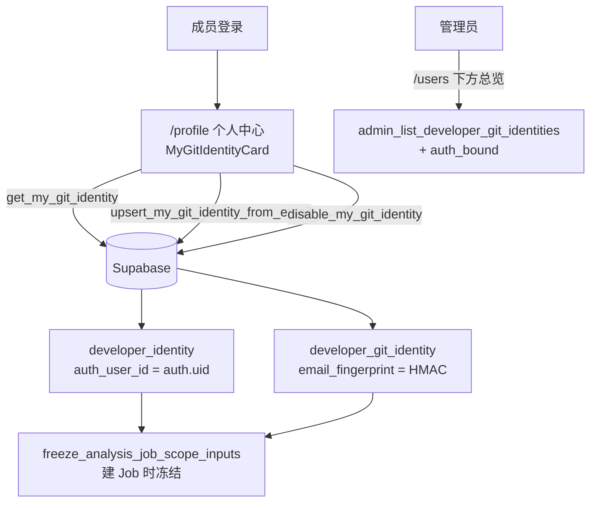

# 需求开发评审一致性平台 V1.12：Git 身份自助维护最终执行方案

## 1. 背景与目标

V1.11 把「需求里的开发人员 ↔ Git 提交作者」这层映射做成了一个 ADMIN 专属页面
（侧边栏「Git 身份」→ `/git-identities`）。实际用起来不对：这份信息的唯一知情人是本人
（他本机 `git config user.email` 到底是什么，只有他知道），却要管理员逐个代录；
人一多就必然漏配、录错、姓名写法不一致，而漏配的后果是作者维度的归属规则整条跳过。

目标：把 Git 身份变成**每个人登录后在「个人中心」自己配置**的东西，管理员页退回成
全员总览与冲突处置入口。

## 2. 范围与非目标

包含：

- 个人中心新增「Git 身份」卡片：本人新增 / 编辑 / 停用自己的 Git 邮箱、作者别名、GitLab 账号；
- 三个自助 RPC（读 / 写 / 停用），边界是 `auth.uid()`，拿不到也改不了别人的记录；
- `developer_identity` 与平台账号建立绑定（`auth_user_id`），并支持本人认领管理员早先代录的行；
- 侧边栏去掉「Git 身份」，管理员总览挪到「用户管理」页下方，多一列「维护方式」；
- 配套修复：删除账号时 append-only 审计表的 `actor_id` 允许被外键置空（见 §8）。

非目标：

- 不改归属规则引擎、不改 Job 冻结逻辑、不改 Worker 代码与镜像；
- 不做邮箱真实性验证（不发验证邮件、不比对 GitLab API），自助填写即 `VERIFIED`；
- 不做管理员批量导入、不做"谁还没配"的提醒推送；
- 不动 `review_skill_version` / `analysis_attribution_rule_version` 上同族的不可变触发器（§8 已知项）。

## 3. 当前实现与问题

- 页面：`src/pages/GitIdentityManagementPage.tsx`，仅 ADMIN 可见，调用
  `admin_list_developer_git_identities()` 与 `admin_upsert_developer_git_identity_from_email(...)`
  （`supabase/migrations/20260919133549_git_identity_admin_entry.sql`）。
- 数据：`developer_identity`（人）+ `developer_git_identity`（邮箱指纹、别名、GitLab 账号），
  原始邮箱只作为 RPC 参数出现，库内用 Vault `analysis_identity_pepper` 算 HMAC。
- 消费方：`freeze_analysis_job_scope_inputs()` 在建 Job 时把
  `status <> 'DISABLED'` 且有效期内的身份冻结进 `analysis_job_identity_snapshot`。

缺口：只有 ADMIN 能写；`developer_identity` 与登录账号之间没有任何关联，
所以"本人维护自己的那条"在数据模型上根本无法表达。

## 4. 需求与验收标准

1. 任意已登录用户在 `/profile` 能看到并维护**自己**的 Git 邮箱列表；未配置时给出明确提示。
2. 只能读写自己的记录：拿别人的 `git_identity_id` 调用返回 `GIT_IDENTITY_NOT_FOUND`。
3. 一个 Git 邮箱只能属于一个人：被他人占用时返回 `GIT_EMAIL_ALREADY_BOUND`。
4. 缺 Vault pepper 时保存明确失败（`IDENTITY_PEPPER_MISSING`），不静默写半条数据。
5. 明文邮箱不进表、不进返回值、不进日志；页面只显示 `x***@domain`。编辑时不回显原邮箱。
6. 管理员早先代录且未被认领的同名同员工号行，由本人保存时**认领**，不撞员工号唯一键。
7. 移除是停用（`DISABLED` + `valid_until`），历史 Job 身份快照仍可追溯；新 Job 不再使用它。
8. 并发编辑用 `revision` 乐观锁，过期返回 `REVISION_CONFLICT`。
9. 管理员仍能在「用户管理」页看到全员身份，并区分"本人维护 / 管理员代录"。
10. 配置过 Git 身份的账号仍然可以被管理员删除，审计行留存且只丢 `actor_id`。

## 5. 总体设计

职责边界没有变：**规则引擎读的仍然是 Job 冻结的身份快照**，自助维护只改"下一次建 Job 时冻结什么"。

## 6. 数据与接口设计

数据库（`supabase/migrations/20260920022754_self_service_git_identity.sql`）：

- `developer_identity.auth_user_id uuid references auth.users(id) on delete set null`
  + 唯一索引 `uq_developer_identity_auth_user`（一个账号最多一条开发人员身份）；
- `analysis_scope_decision_audit.source` 约束扩展出 `'USER'`；
- `get_my_git_identity()` → jsonb：本人身份 + `identities[]`（只含 `masked_email`，不含 fingerprint）；
- `upsert_my_git_identity_from_email(p_git_identity_id, p_display_name, p_employee_code, p_email,
  p_author_name_aliases, p_gitlab_username, p_gitlab_user_id, p_expected_revision)`：
  库内算 HMAC；创建 / 认领 / 更新自己的 `developer_identity`；写审计
  `SELF_IDENTITY_CREATED|CLAIMED|UPDATED`；
- `disable_my_git_identity(p_git_identity_id, p_expected_revision)`：软停用 +
  `valid_until = greatest(now(), valid_from + 1ms)`（绕开 `valid_until > valid_from` 约束在同一事务内的相等情形）；
- `admin_list_developer_git_identities()` 增加 `auth_bound`（其余字段与语义不变）。

三个自助函数 `security definer`，`revoke ... from public, anon` +
`grant ... to authenticated, service_role`。

前端：

- `src/types.ts`：`MyGitIdentityProfile` / `MyGitIdentityRecord` / `SaveMyGitIdentityInput`，
  `DeveloperGitIdentityRecord.auth_bound?`；
- `src/lib/api.ts`：`getMyGitIdentity` / `saveMyGitIdentity` / `disableMyGitIdentity`
  （**必须传满 8 个命名参数**：PostgREST 按参数名组合查 schema cache，缺参数会 `PGRST202`）；
- `src/lib/git-identity.ts`：错误码→中文映射、别名解析、状态标签（可单测，不放在页面文件里）。

Worker / Edge Function / 事件契约：不涉及。`v4-capability-contract.json` 与 manifest 哈希不变。

## 7. 前端与运行时改造

- `src/pages/ProfilePage.tsx`：新增 `MyGitIdentityCard`（表格 + 弹窗 + Popconfirm 停用）。
  编辑时**不回显邮箱**（库里没有明文可回显），提示当前脱敏值；
- `src/App.tsx`：删掉侧边栏「Git 身份」与 `selectedKey` 分支；`/git-identities` 改成
  `Navigate to="/profile"`（旧书签不落空）；`/users` 路由改成"用户管理 + Git 身份总览"两块；
- `src/pages/GitIdentityManagementPage.tsx`：标题改「Git 身份总览（全部成员）」，
  新增「维护方式」列（本人维护 / 管理员代录）；管理员仍可代录与改状态；
- `src/lib/user-deletion.ts`：删除用户弹窗新增两个置空项标签。

运行时：无 Worker 改动，不需要重建镜像。

## 8. 安全、兼容与回滚

- **权限边界在数据库**：三个 RPC 以 `auth.uid()` 取本人身份，前端不传 user_id；
  `developer_identity` / `developer_git_identity` 对 `authenticated` 仍然 `revoke all`，
  只能经 RPC 访问。
- **明文邮箱**：只在参数里出现，库内 HMAC 后丢弃；返回值、表、审计、日志都只有
  `x***@domain`。SQL 测试显式断言返回值与行内容都不包含明文，也不包含 fingerprint。
- **自助即信任的代价**：平台不验证邮箱所有权，所以理论上可以声称同事的邮箱。
  缓解是"先到先得 + 冲突显式失败"（活跃 fingerprint 唯一索引 → `GIT_EMAIL_ALREADY_BOUND`）
  和"管理员总览可见 + 审计留痕（source=USER）"。归属规则本身也只决定提交是否进入分析上下文，
  不代表代码所有权或绩效。

  > **V1.13 起已收紧**：手输邮箱只能存成 `UNVERIFIED`；要得到 `VERIFIED` 必须走
  > 「填 GitLab 用户名 → 反查候选 → 点选」，见
  > `../V1.13-Git提交邮箱反查验证/`。本节描述的是 V1.12 当时的行为。
- **认领语义**：只认领 `auth_user_id is null` 且同名同员工号的行；已被别人认领的行不会被抢走。
  身份被标 `CONFLICT` / `DISABLED` 时自助保存 fail closed（`DEVELOPER_IDENTITY_LOCKED`），交管理员处理。
- **旧数据兼容**：既有管理员代录的行全部保留、继续生效（`auth_bound=false`），
  在途 Job 的冻结快照不受影响。
- **append-only 审计的配套修复**（`supabase/migrations/20260920023955_append_only_audit_actor_nullify.sql`）：
  自助保存会给普通成员写一条 `analysis_scope_decision_audit`，而该表的 `actor_id` 外键是
  `on delete set null`，append-only 触发器又拒绝一切 UPDATE ——
  于是删除账号会在外键的级联 UPDATE 上抛 `APPEND_ONLY_RECORD_IMMUTABLE`（本地实测：GoTrue 返回 500）。
  修复把 `reject_append_only_mutation()` 放宽成：仅允许 `pg_trigger_depth() > 1` 且
  "某一列从非 NULL 变成 NULL、其余列逐字不变"的 UPDATE；人为改写、改成另一个值、
  直接 DELETE 仍然拒绝。同时 `evaluate_user_deletion()` 把
  `developer_identity` 与 `analysis_scope_decision_audit` 列进 `nullify_counts`，删除前可见。
  **已知未修同族问题**（与本次链路无关，只影响发布过技能/规则版本的管理员账号）：
  `review_skill_version.published_by`（`SKILL_VERSION_IMMUTABLE`）与
  `analysis_attribution_rule_version.created_by/published_by`
  （`ATTRIBUTION_RULE_VERSION_IMMUTABLE`）在删除账号时同样会撞"整行不可变"。
- **回滚**：两个迁移都只前滚。前端回滚 = 回退到上一版构建（侧边栏「Git 身份」恢复，
  自助 RPC 留在库里不被调用，已写入的数据继续可用）。
  不要用"再写一个迁移删掉 auth_user_id"的方式回滚：那会丢掉认领关系。

## 9. 实施步骤与文件范围

1. `supabase/migrations/20260920022754_self_service_git_identity.sql`（新增）+
   `supabase/tests/20260920022754_self_service_git_identity_test.sql`（新增）；
2. `supabase/migrations/20260920023955_append_only_audit_actor_nullify.sql`（新增）+
   `supabase/tests/20260920023955_append_only_audit_actor_nullify_test.sql`（新增）；
3. `src/types.ts`、`src/lib/api.ts`、`src/lib/git-identity.ts`（新增）+
   `src/lib/__tests__/git-identity.test.ts`（新增）；
4. `src/pages/ProfilePage.tsx`（新增 Git 身份卡片）；
5. `src/App.tsx`（导航 / 路由 / `/users` 叠放总览）、
   `src/pages/GitIdentityManagementPage.tsx`（总览定位与新列）；
6. `src/lib/user-deletion.ts` + `src/lib/__tests__/user-deletion.test.ts`（置空项标签）。

## 10. 验证结果

本地（Supabase 容器 `supabase_db_codeReviewPlatform`，未动云端）实际执行并通过：

- `supabase migration up --local`：两个新迁移均已应用；第一个迁移重复应用一次仍成功（幂等）。
- SQL 测试：`20260920022754_self_service_git_identity_test.sql`、
  `20260920023955_append_only_audit_actor_nullify_test.sql` 全绿；
  回归 `20260918050615_admin_delete_user_test.sql`、
  `20260919063330_story_commit_attribution_foundation_test.sql`、
  `20260919072610_..._integration_test.sql`、`20260919074759_..._worker_contract_test.sql`、
  `20260919133549_git_identity_admin_entry_test.sql` 全绿。
- 真实 HTTP 链路（本地 PostgREST + 真实 authenticated JWT）：初次读取为空 → 自助新增
  （返回 `s***@example.invalid`）→ 再读取 → 编辑（乐观锁通过 / 过期返回 `REVISION_CONFLICT`）
  → 停用（`DISABLED` 且 `valid_until > valid_from`）→ 重新绑定；
  `anon` 调用被 `42501` 拒绝；普通成员调管理员总览被 `ADMIN role required` 拒绝。
- 删除账号回归：修复前 `delete auth.users` 报 `APPEND_ONLY_RECORD_IMMUTABLE`（GoTrue 500），
  修复后同一账号删除成功，4 条审计行留存且 `actor_id` 全部为 null。
- Worker 侧：`npm run worker:typecheck`、`npm run test:worker`（799 passed / 26 skipped）通过；
  额外以 `RUN_LOCAL_SUPABASE_INTEGRATION=1` 跑通
  `worker/src/__tests__/v111-local-supabase.integration.test.ts`
  （真实 freeze → manifest → scope → finalize），确认改动没有影响 v2 准备链路。
- 前端：`npx tsc -b`、`npm run web:typecheck`、`npm run test:web`（13 文件 / 147 用例）、
  `npm run build`、`npm run lint`（0 error，1 个既有 fast-refresh warning）全部通过。

未验证 / 需要注意：

- **没有做浏览器点击回归**（无页面渲染测试基建）：个人中心卡片的视觉与交互请上线前人工过一遍。
- 本地 Vault 没有 `analysis_identity_pepper`（烟测时临时建过，验证完已删除以恢复原状）。
  缺它时保存会明确返回 `IDENTITY_PEPPER_MISSING`。另外注意：
  `20260919074759` / `20260919133549` 两个既有 SQL 测试会无条件 `vault.create_secret`，
  所以**一旦某个环境真的配置了 pepper，这两个测试在该环境会因唯一键冲突失败**
  （本次新增的测试已改成"有则复用"，不受影响）。
- 云端 Supabase 未推送、未部署、未重启云端 Worker（本次没有 Worker 代码改动，无需重启）。
