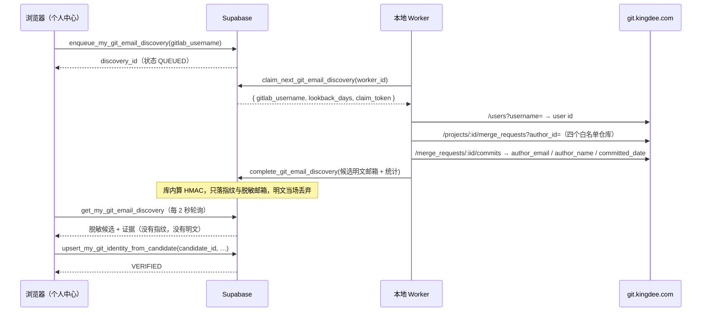

# 需求开发评审一致性平台 V1.13：Git 提交邮箱反查与验证最终执行方案

## 1. 背景与目标

V1.12 把 Git 身份交给本人在个人中心维护，但"填对"这件事没有任何校验：手打
`git config user.email` 填错一个字符不会报错，只会让作者维度的归属规则永远匹配不到他，
而且没人会发现。

本地实测印证了这个风险有多大：被测账号在四个仓库里 41 条提交用的作者邮箱是
`k***@m2607-0072.local`（本机没配 `user.email`，git 退化成 `用户名@主机名.local`）。
如果让他手输，他几乎必然会填成自己的工作邮箱或手机号邮箱 —— 一个字都对不上。

目标：**人不再打字**。填一个 GitLab 用户名，平台去 GitLab 反查"你自己提的合并申请里，
提交作者用的是哪些邮箱"，列出候选让他点选；点选的那一条带着 GitLab 提交作为证据，
存成"生效中"。手输邮箱保留为回退路径，但只能存成"未验证"。

## 2. 范围与非目标

包含：

- 个人中心弹窗改成「填 GitLab 用户名 → 查找 → 点选邮箱 → 保存」；**不提供手输邮箱**；
- 一张队列表 + 一张候选表 + 7 个 RPC；本地 Worker 新增一条反查任务轮询循环；
- 点选保存 = `VERIFIED`；手输那条路从页面和权限两侧一起关闭（见 §8）；
- 候选带上真实作者名、提交数、命中仓库、最近提交时间和来源 MR，并自动回填
  GitLab User ID 与作者别名。

非目标：

- 不校验"这个邮箱能收信"（不发验证邮件）；
- 不做全仓 `git log` 扫描（见 §3 的方案比较）；
- 不改归属规则引擎与 Job 冻结逻辑；
- 不追加"按邮箱查 GitLab 账号"（普通 token 查不到私有邮箱，管理员 token 才行，不引入）。

## 3. 当前实现与问题

- V1.12 的 `upsert_my_git_identity_from_email` 直接把手输邮箱存成 `VERIFIED`，
  等于把"自己声称"当成"已验证"。
- 平台里唯一能证明"这个邮箱真的在提交"的东西是 GitLab / git 仓库，而它们在内网
  （`https://git.kingdee.com`）：**Supabase 云端访问不到，只有本地 Worker 能访问**。
  所以任何真实校验都必须由 Worker 执行，浏览器只能排队 + 轮询。

被否掉的两个方案：

| 方案 | 为什么不用 |
|---|---|
| 查数据库里已冻结的 commit manifest | 覆盖面等于"已经跑过的分析"。本地一条都没有，新仓库/新人永远查不到，硬门禁会把人锁死 |
| Worker 克隆四仓跑 `git log --author` | 要拿到明文邮箱才能过滤，而库里从设计上就没存明文；且首次克隆要几分钟 |

选定方案：**GitLab API 按用户名反查 MR → 读 MR 的提交 → 取 `author_email`**。
现成的 `GitLabReadonlyClient` 已经在做 MR 与 MR-commits 的读取，扩一个方法即可；
实测 40 个 MR 约 6 秒。

## 4. 需求与验收标准

1. 填 GitLab 用户名点「查找我的提交邮箱」→ 数秒内列出候选（脱敏邮箱 + 证据）。
2. 候选只能来自**本人**的查询；拿别人的 `candidate_id` 保存返回
   `GIT_EMAIL_CANDIDATE_NOT_FOUND`。
3. 点选候选保存后 `verification_status='VERIFIED'`，并自动带上 GitLab User ID 与
   提交里真实出现过的作者名。
4. 普通成员**没有**手输邮箱的入口，数据库也不接受（`upsert_my_git_identity_from_email`
   已收回 `authenticated` 的执行权）。真查不到时由管理员在「用户管理」页代录。
5. 用户名不存在 → `GITLAB_USER_NOT_FOUND`；token 缺失 → `GITLAB_API_TOKEN_MISSING`；
   GitLab 不可达 → `MR_METADATA_TIMEOUT` / `MR_METADATA_REQUEST_FAILED`。三者都不静默成
   "没找到"。
6. 候选列表按产品要求**展示邮箱原文**；明文只落在临时候选行，正式身份表
   `developer_git_identity` 仍然只有 HMAC 指纹 + 脱敏形式。
7. 查询结果超过 2 小时不能再用来保存（`GIT_EMAIL_DISCOVERY_EXPIRED`）。
8. 同一个人同时只有一条排队中的查询；10 分钟内最多 20 次。
9. 排队 3 分钟没有 Worker 领取 → 界面明确说"没有可用的 Worker"，不假装在查。
10. 结果不完整（仓库读失败 / MR 被截断）时界面照实说"可能不全"。

## 5. 总体设计

Worker 拿不到请求人是谁（claim 的返回值里没有 `requested_by`），也拿不到 pepper；
浏览器拿不到明文邮箱和指纹。两侧都只知道自己该知道的那一半。

## 6. 数据与接口设计

迁移 `supabase/migrations/20260920032058_git_email_discovery_from_gitlab_username.sql`：

- `git_identity_email_discovery`：`requested_by`（on delete cascade）、`gitlab_username`
  （正则约束）、`lookback_days`、状态机 `QUEUED/RUNNING/SUCCEEDED/FAILED`、
  `attempt`（>=3 自动收口为 `GIT_EMAIL_DISCOVERY_ATTEMPTS_EXHAUSTED`）、
  worker 租约字段（`claim_token_digest` / `lease_expires_at` / `heartbeat_at`）、
  `gitlab_user_id` / `gitlab_display_name` / `merge_request_count` / `candidate_count` /
  `partial` / `error_code`。唯一索引保证"一个人同时只有一条在途"。
- `git_identity_email_candidate`：`email_fingerprint`（64 hex）+ `masked_email` +
  `email_domain` + `author_names[]` + `commit_count` + `last_committed_at` +
  `repositories jsonb` + `merge_request_refs[]`。两张表都 `revoke all`，只能经 RPC 访问。
- 本人侧 RPC：`enqueue_my_git_email_discovery(username, lookback_days)`、
  `get_my_git_email_discovery(id)`（返回里带 `already_bound`，让界面禁掉已被占用的候选）。
- Worker 侧 RPC（service_role）：`claim_next_git_email_discovery`、
  `heartbeat_git_email_discovery`、`complete_git_email_discovery`、
  `fail_git_email_discovery`、`release_git_email_discovery_claim`。
- 保存：`upsert_my_git_identity_from_candidate(candidate_id, …)` → `VERIFIED`。
- `upsert_my_git_identity_from_email(…)` 先改为只写 `UNVERIFIED`，随后在
  `20260920045313_git_email_manual_entry_revoked.sql` 里**收回 `authenticated` 执行权**，
  只留 service_role；函数本身不删（发布窗口里旧前端应当拿到权限错误而不是 404）。

前端：

- `src/types.ts`：`GitEmailDiscovery` / `GitEmailDiscoveryCandidate` /
  `SaveMyGitIdentityFromCandidateInput`；
- `src/lib/api.ts`：`enqueueMyGitEmailDiscovery` / `getMyGitEmailDiscovery` /
  `saveMyGitIdentityFromCandidate`；
- `src/lib/git-identity.ts`：新增 `describeGitEmailDiscoveryPhase`（状态→文案，判据是后端的
  `claimed`，不是前端计时）。候选行最终只显示加粗的脱敏邮箱 + 「已被绑定」标签，
  证据文案（提交数/仓库/MR）按产品要求去掉，对应的 `describeGitEmailCandidate`
  与 `parseAuthorNameAliases` 一并删除，不留死代码。

## 7. Worker 改造

- `worker/src/git/gitlab-readonly-client.ts`：新增 `discoverAuthorCommitEmails()`。
  用户名 → `/users?username=`（**精确**用户名匹配，不接受模糊命中）→ 四个白名单仓库的
  `merge_requests?author_id=` → 取最近 40 个 MR 的 `/commits` → 按邮箱聚合
  （提交按 sha 去重、记录最近提交时间、每仓计数、最多 5 条 MR 引用、最多 50 个候选）。
  单仓失败 / MR 截断 / 候选截断都只置 `partial`，不让整次查找失败。
- `worker/src/db/jobs.ts`：5 个队列 RPC 封装 + `GitEmailDiscoveryClaim`。
- `worker/src/index.ts`：`runGitEmailDiscovery()` + 与模型连接测试并排的
  `gitEmailDiscoveryLoop()`（drain 期间停止领取，停机时释放 claim）。
- `worker/src/config.ts`：`GIT_EMAIL_DISCOVERY_LEASE_SECONDS`（默认 90，45~600）。
- 日志只记数量与 `partial`，**不记邮箱**（脱敏的也不记）。
- `gitEmailDiscoveryErrorCode()`：把数据库抛的稳定错误码（`IDENTITY_PEPPER_MISSING`、
  `TASK_LEASE_LOST`、`GIT_EMAIL_CANDIDATE_LIST_INVALID`、`GIT_EMAIL_DISCOVERY_NOT_FOUND`）
  原样透出。本地实测踩过：pepper 缺失被吞成 `GIT_EMAIL_DISCOVERY_FAILED`，页面只说"请重试"，
  而真正要做的是让管理员去配 Vault secret —— 用户重试一百次都不会好。

## 8. 安全、兼容与回滚

- **明文边界（本版调整过一次，见 `20260920050223`）**：产品要求候选列表展示邮箱原文，
  而候选是 Worker 异步写库、浏览器再读的，所以明文必须落库一次。范围压到最小：
  只有临时表 `git_identity_email_candidate.email_plain` 存明文（下次查找先 delete 旧候选、
  账号删除随 discovery 级联消失、2 小时后连保存都不接受），
  **正式身份表 `developer_git_identity` 一个字节明文都没有**，
  `upsert_my_git_identity_from_candidate` 只读候选的 fingerprint/masked/domain。
  指纹**始终不出库**；Worker 日志、审计表、运行事件一律不记邮箱。
  SQL 测试逐条断言：候选行存规范化明文、浏览器拿不到指纹、身份行不含明文。
- **伪造已验证**：浏览器提交的是 `candidate_id`，指纹取自候选行，前端无法自报一个
  "已验证"的邮箱。候选归属、查询状态、2 小时有效期全部在库内判定。
- **残余风险（如实记录）**：MR 是他提的，不代表 MR 里每条提交都是他写的
  （cherry-pick、代提）。缓解是：① 活跃指纹唯一索引 → 同一邮箱不能被两个人绑定
  （`GIT_EMAIL_ALREADY_BOUND`，界面也会把已被绑定的候选置灰）；② 候选行把真实作者名
  一起显示出来供人核对；③ 审计写 `GITLAB_COMMIT_VERIFIED` + `discovery_id` + 提交数，
  事后可追。这比 V1.12 的"随便输一个就算已验证"严格得多，但不是身份证明。
- **为什么手输必须从权限层关掉**：只在前端隐藏等于把产品规则变成一句约定。
  本仓库一向的立场是"导航能藏，权限不能藏"（见 `src/App.tsx` 里那条注释），所以
  直接 `revoke execute ... from authenticated`。顺带确认过：`UNVERIFIED` 的身份在归属引擎里
  **本来就完全不参与匹配**（`worker/src/pipeline/story-scope.ts:78` 只取
  `verification_status === 'VERIFIED'`），所以手输邮箱一直是个摆设，删掉它没有任何能力损失。
- **行为变更**：V1.12 里手输邮箱得到 `VERIFIED`，本版先改成 `UNVERIFIED`、再关闭入口。
  **已存在的旧数据不动**（不回溯改状态）；受影响的只有之后的手输保存。
  归属规则里 `VERIFIED_IDENTITY_MATCH` 只认 `VERIFIED`，所以"未验证"不会污染分析结论。
  对应地更新了 `supabase/tests/20260920022754_self_service_git_identity_test.sql` 的断言。
- **依赖**：必须配 `GITLAB_API_TOKEN`（只读 `read_api`）。缺失时反查以
  `GITLAB_API_TOKEN_MISSING` 明确失败，手输回退路径不受影响。配上之后 V1.11 的 MR 增强
  规则也一并可用。
- **新旧 Worker 混跑**：旧 Worker 不认识这个队列，请求会一直 `QUEUED`；界面 3 分钟后
  明确提示"没有可用的 Worker"。因此发布顺序必须是 db push → Worker → 前端。
- **回滚**：迁移只前滚。前端回滚到上一版即可（反查 RPC 留在库里不被调用）；
  Worker 回滚到旧镜像后队列只会积压 `QUEUED`，不影响评审主链路。

## 9. 实施步骤与文件范围

1. `supabase/migrations/20260920032058_git_email_discovery_from_gitlab_username.sql`（新增）
   + `supabase/tests/20260920032058_..._test.sql`（新增）；
2. `worker/src/git/gitlab-readonly-client.ts`、`worker/src/db/jobs.ts`、
   `worker/src/index.ts`、`worker/src/config.ts`；
   `worker/src/__tests__/git-email-discovery.test.ts`（新增）；
   5 个既有 worker 测试补 `gitEmailDiscoveryLeaseSeconds` 字段；
3. `src/types.ts`、`src/lib/api.ts`、`src/lib/git-identity.ts`、
   `src/lib/__tests__/git-identity.test.ts`；
4. `src/pages/ProfilePage.tsx`（弹窗改成两步 + 候选单选 + 手输回退）；
5. `supabase/migrations/20260920045313_git_email_manual_entry_revoked.sql`（新增）+
   `supabase/tests/20260920045313_..._test.sql`（新增）；
7. `supabase/migrations/20260920050223_git_email_candidate_plaintext_display.sql`（新增，
   候选加 `email_plain`，`complete_git_email_discovery` / `get_my_git_email_discovery` 同步）；
8. `supabase/migrations/20260920051006_self_service_developer_profile_rename.sql`（新增）+
   同名测试：修实测发现的缺陷 —— 姓名/员工号原本只能在"绑定邮箱"弹窗里改，而保存按钮要求
   必须先选中一个候选，于是"只想把姓名从 17751361028 改成薛宇轩"这件事根本做不到。
   新增 `update_my_developer_profile(display_name, employee_code)` 单独承担改名，
   前端把它拆成卡片上的「修改」入口；表格里那个会误导人的「编辑」操作一并去掉
   （已保存的邮箱库里只有 HMAC，本来就无法回显、无法编辑，只能新增或停用）。
9. `supabase/migrations/20260920052256_identity_name_single_source.sql`（新增）+ 同名测试：
   把「我是谁」收敛成一处。上一步把姓名放进 Git 身份卡片后，同一个人要在"基本资料的用户名"
   和"Git 身份的开发人员姓名"两个地方各写一遍，而它们指的是同一件事 —— 需求表里
   「开发人员」那一栏（真实格式是「向俊杰（41865）」，姓名 + 员工号）。分开维护只会悄悄漂移，
   而漂移后归属规则对不上人却不报错。新 RPC `update_my_identity_profile(display_name, employee_code)`
   一次写 `user_profile.display_name` 与（若已存在的）`developer_identity`；
   `update_my_developer_profile` 随即从 `authenticated` 收回，只留 service_role，不留两个半入口。
   前端把员工号搬到「基本资料」，Git 邮箱弹窗只问 GitLab 用户名，顶部用 Alert 显示
   "将绑定到：<姓名>（员工号 …）"并指回基本资料；用户名为空时在点「查找」那一步就拦住，
   而不是等保存才撞 `DEVELOPER_DISPLAY_NAME_REQUIRED`。
10. `supabase/migrations/20260920053820_self_service_git_identity_edit_delete.sql`（新增）+ 同名测试：
    表格「操作」列补齐编辑与删除。
    - `update_my_git_identity_details(git_identity_id, author_name_aliases[], gitlab_username, expected_revision)`
      只改**用户自己填的那两列**。邮箱三列（指纹/脱敏/域名）一律不碰 —— 它们只能由 GitLab 反查落库，
      要换邮箱是"新增一条 + 停用旧的"。改别名不降级 `verification_status`：邮箱可信度与别名叫什么无关。
      别名做去空白/去重/去空串，上限 10 个、单个 64 字；纯别名行（无邮箱指纹）不允许把别名和
      用户名同时清空（`GIT_IDENTITY_WOULD_MATCH_NOTHING`），否则留下一行永远匹配不到东西的死数据。
      已停用的行不可编辑（`GIT_IDENTITY_DISABLED`）。
    - `delete_my_git_identity(git_identity_id, expected_revision)` 是**真删**。
      `analysis_job_identity_snapshot.source_git_identity_id` 是 `on delete restrict`，
      所以被任何 Job 冻结过的行以 `GIT_IDENTITY_IN_USE` 拒绝并要求改用停用 ——
      不静默降级成停用（用户点删除却得到另一种语义，比报错更糟），也不让裸 FK 错误漏到界面上。
      删除前先把脱敏邮箱写进 append-only 审计（`SELF_GIT_IDENTITY_DELETED`），行没了痕迹还在。
    - 前端操作列：生效中的行是「编辑 / 停用 / 删除」，已停用的行只剩「删除」；
      编辑弹窗顶部固定显示"Git 邮箱：… （不可修改）"。
11. `supabase/migrations/20260920060736_author_alias_normalization_trigger.sql` +
    `20260920061119_author_alias_empty_array_not_null.sql`（新增）+ 同名测试：新增弹窗也放开别名输入后
    补上的两件事。
    - 三条写入路径（候选绑定 / 本人编辑 / 管理员代录）此前对别名宽严不一：候选那条只卡
      `cardinality > 10`，既不去空白也不去重，更不拦 200 字的别名。把清洗与上限收进表上的
      `normalize_git_identity_author_aliases` 触发器，谁写都一样，也不必为改一行校验去
      `replace` 整个 150 行的函数（那种复制粘贴式 replace 本身就是漂移来源）。
      上限统一报 `AUTHOR_ALIAS_LIMIT_EXCEEDED`（与候选路径原有错误码对齐），去重之后才计数。
    - **修 20260920053820 的缺陷**：`author_name_aliases` 是 `not null default '{}'`，
      但那版编辑 RPC 在别名清空时写 NULL，于是"把别名全删掉"会失败在
      `null value in column ... violates not-null constraint` —— 一句用户看不懂、前端也翻不了的报错。
      本地实测确认后修掉：空数组是"没有别名"的唯一表示，触发器也把 NULL 收敛成 `'{}'`；
      `GIT_IDENTITY_WOULD_MATCH_NOTHING` 的判定从 `is null` 改成 `cardinality = 0`，
      免得空数组绕过那道门。
    - 前端：新增弹窗在选中候选后显示别名框，并**自动填入该邮箱在提交里真实出现过的作者名**
      （候选行本来就带 `author_names`），让人看见实际会保存什么，而不是面对一个空框猜"自动"是什么意思；
      留空则传 null，由数据库 coalesce 回候选的作者名。
12. 既有测试适配：`20260920022754`（手输改判 UNVERIFIED，并断言 authenticated 已无权调用）、
   `20260920032058`（手输段不再以 authenticated 角色发起）；
   `20260919133549` 与 `20260919074759` 改成"pepper 有则复用"——它们原来无条件
   `vault.create_secret`，在**已经配过 pepper 的环境**里会因唯一键冲突失败。

## 10. 验证结果

本地（Supabase 容器 + 本地 Worker `codereviewplatform-local`，未动云端）实际执行：

- `supabase migration up --local` 应用新迁移；
- SQL 测试：新增的 `20260920032058_..._test.sql` 全绿（9 组断言：越权、租约、
  HMAC 只存指纹、脱敏候选、点选=VERIFIED、过期拒绝、手输=UNVERIFIED、失败与释放、权限面）；
  回归 `20260920022754`、`20260920023955`、`20260919133549`、`20260918050615` 全绿；
- Worker：`npm run worker:typecheck`、`npm run worker:build`、`npm run test:worker`
  （43 文件 / 806 用例通过）、新增 `git-email-discovery.test.ts` 7 例通过；
- **真实 E2E**（本地 Worker 容器 → 真实 `git.kingdee.com`，真实 authenticated JWT）：
  - `yuxuan_xue` → 10 秒内 `SUCCEEDED`，`gitlab_user_id=2607`，读了 40 个 MR，
    得到 1 个候选 `k***@m2607-0072.local`（41 条提交，四个仓库都有，最近 2026-09-18），
    `partial=true`（MR 数超过 40 上限，界面会照实说"可能不全"）；
  - 点选该候选保存 → `verification_status=VERIFIED`，`gitlab_user_id` 与作者别名
    `yuxuan_xue` 自动回填；
  - 失败路径 `no_such_user_zzz` → 6 秒内 `FAILED / GITLAB_USER_NOT_FOUND`；
  - Worker 日志只有 `git_email_discovery_succeeded` 与计数，**没有任何邮箱**。
- 前端：`npx tsc -b`、`npm run web:typecheck`、`npm run test:web`（13 文件 / 157 用例）、
  `npm run build`、`npm run lint`（0 error）全部通过。

补充验证（第二轮，收口后）：

- 新增 `20260920045313` 迁移与测试通过：`authenticated` 已无权调 `..._from_email`，
  `anon` 依旧不可，`service_role` 保留；反查三个 RPC 与管理员代录入口不受影响。
- 真实 E2E 复跑两次：
  - 修完错误码透出、重建本地 Worker 镜像后：`yuxuan_xue` → 9 秒 `SUCCEEDED`，
    候选 `k***@m2607-0072.local`（41 条提交，四仓分布一致）；
  - 明文展示上线后再跑一次，返回两个候选原文：`kingdee@m2607-0072.local`（40 条）与
    `yuxuan_xue@kingdee.com`（1 条 —— 用户改完 `git config user.email` 之后的第一条提交，
    正好验证了"新邮箱要等提交合并后才会出现"这条预期）。
- 全量 SQL 测试里有 **4 个既有测试在本机为红**：`20260917100000`、`20260917130000`、
  `20260917142829`、`20260919074759`。原因是它们断言**全局计数**，而本地库里已有真实数据
  （`developer_git_identity` 活跃 1 条、`review_skill_version` 2 条、`ai_model_config` 2 条）。
  与本次改动无关，也不会为了让它们变绿去删用户的真实数据；应当由各自功能把断言收敛到自己的
  fixture 范围内。

补充验证（第三轮，缺陷修复后）：

- `20260920051006` 迁移与测试通过：没有身份行时改名返回 `DEVELOPER_IDENTITY_NOT_FOUND`
  （身份只能由"绑定已验证邮箱"创建）；空姓名 / 超长姓名 / 员工号冲突 / 身份被标 CONFLICT
  全部按稳定错误码拒绝；改名只作用于 `auth.uid()` 自己那一行；改名写入
  `SELF_IDENTITY_RENAMED` 审计并保留改名前后的值；`anon` 调用被 42501 拒绝（真实 HTTP 验证）。

补充验证（第四轮，姓名单一来源）：

- `20260920052256` 迁移与测试通过：没有身份行时只改账号资料、**不创建空身份**；
  有身份行时同一次调用把姓名与员工号镜像进去并写 `SELF_IDENTITY_RENAMED` 审计；
  空姓名 / 超 32 字 / 控制字符 / 员工号冲突（不分大小写）/ 身份被锁全部按稳定错误码拒绝，
  且被拒时整个操作回滚（用户名不会被改掉一半）；`anon` 调用被 42501 拒绝（真实 HTTP 验证）。
- `20260920051006` 的测试同步改成"该函数已只剩 service_role"，业务语义断言保留。

补充验证（第五轮，编辑与删除）：

- `20260920053820` 迁移与测试通过，覆盖：别名清洗与去重、用户名 trim、邮箱三列不被触碰且
  `VERIFIED` 不降级、非法用户名/超长别名/超 10 个别名/过期 revision 全部按稳定错误码拒绝、
  纯别名行不能清空到无可匹配、跨账号编辑与删除都表现为 `GIT_IDENTITY_NOT_FOUND` 且原行不变、
  未被引用的行真删并留下脱敏审计、**已被真实 Job 快照引用的行删除报 `GIT_IDENTITY_IN_USE`
  而停用照常成功且行仍在**、已停用行不可编辑。
- 两个新 RPC 经真实 PostgREST 调用返回 42501（函数已在 schema cache 里、参数组合正确），
  而不是 PGRST202。

补充验证（第六轮，别名放开）：

- `20260920060736` / `20260920061119` 迁移与测试通过：insert 与 update 两条路径都做
  去空白/去空串/去重、上限按**去重后**计数、超 10 个与超 64 字与控制字符一律 raise 不静默截断、
  NULL 被收敛成 `'{}'`、纯别名行仍不能被清成无可匹配、保留 GitLab 用户名后可以清别名。
- 回归：清空别名不再撞 NOT NULL（修复前本地实测确为
  `null value in column "author_name_aliases" ... violates not-null constraint`）。
- 固件卫生：`20260920051006` / `20260920052256` 的员工号改用 `V113-TEST-` 前缀。
  `employee_code` 全局唯一，原先写真实值 `69171`，在用户于本地页面保存同一员工号后
  立刻撞 `DEVELOPER_EMPLOYEE_CODE_CONFLICT` —— 测试红在环境而不是逻辑。

未验证 / 需要注意：

- **没有浏览器点击回归**（仓库无页面渲染测试基建）：弹窗两步流程请上线前人工过一遍。
- E2E 期间临时创建了本地 Vault `analysis_identity_pepper` 与一个测试账号，验证完
  已全部删除（`identities=0 discoveries=0 e2e_users=0 pepper=0`）。
- 云端未推送、未部署、未重启云端 Worker。
- 云端 Vault 是否已有 `analysis_identity_pepper` 未确认（缺它反查会以
  `IDENTITY_PEPPER_MISSING` 失败）。

## 11. 修订（V1.13.1）：候选必须是"这个人自己的"提交邮箱

### 11.1 问题与实测证据

反查只按 `author_id` 过滤 **MR**，没有过滤 **MR 里的提交**。审核人（会把
`feature_sit -> release` 这类集成 MR 提出来的人）因此拿到全组人的邮箱。

真实数据（本地脚本直连 `git.kingdee.com`，只读，token 为普通成员 `yuxuan_xue`）：
`jin_gu` 近 365 天自己提的 MR 里，除 18 个单人 revert MR 外还有 4 个集成 MR
（`kdmanage-frontend!821` 96 提交、`kdmanage-backend!1796` 100 提交、
`tmanage-backend!3653` 61 提交、`tmanage-frontend!1835` 36 提交）。聚合后 14 个候选里
`hook_wang@kingdee.com`（156 提交）排在 `jin_gu@kingdee.com`（100 提交）**前面** ——
第一个候选就是别人的邮箱。

### 11.2 归属判据（只用可核对的事实）

对聚合后的每个候选邮箱做一次判定，判据按强度排序：

| 判据 | 依据 | 结论 |
|---|---|---|
| `GITLAB_EMAIL_MATCH` | `GET /users?search=<邮箱>` 命中的 GitLab 账号就是本人 | 保留（最强） |
| — | 命中的是**另一个** GitLab 账号 | **剔除**，其余判据不再看 |
| `AUTHOR_NAME_MATCH` | 提交里的 `author_name` 归一化后等于本人用户名或显示名 | 保留 |
| `EMAIL_LOCAL_MATCH` | 邮箱 local part 归一化后等于本人用户名或显示名 | 保留 |
| `SOLE_AUTHOR_IN_OWN_MERGE_REQUEST` | 在本人提的**非集成** MR（源分支不是 `feature_dev`/`feature_sit`/`release`/`master`/`main`/`develop`）里，该 MR 全部提交只有这一个作者邮箱 | 保留（兜底，救"作者名与用户名对不上且邮箱不在 GitLab"的人） |
| 都不成立 | 只出现在集成 MR 里、且与本人没有任何可核对的联系 | 剔除 |

归一化 = 转小写后去掉除 `a-z0-9` 与 CJK 以外的字符（`Jin Gu` / `jin.gu` / `jin_gu` → `jingu`）。

`GET /users?search=` 用普通成员 token 实测可以命中 `hook_wang@kingdee.com` → `2960:hook_wang`
（本实例的邮箱可被搜到），管理员接口 `/users/:id/emails` 是 403、不依赖它。为了不把"搜到同名
的人"当成归属，只在**返回的账号里有人的用户名等于邮箱 local part**、或**只返回一个账号**时
才承认这条归属；查询本身失败时不做剔除，只把 `partial` 标为 true。

同一次反查最多解析 50 个邮箱（与库里候选上限一致），超出的尾部低频邮箱剔除并标 `partial`。

用这套判据对真实数据复算：`jin_gu` 只剩 1 个候选（`jin_gu@kingdee.com`，
`GITLAB_EMAIL_MATCH`），其余 13 个被剔除；`yuxuan_xue` 仍保留 2 个
（`kingdee@m2607-0072.local` 靠 `AUTHOR_NAME_MATCH`，`yuxuan_xue@kingdee.com` 靠
`GITLAB_EMAIL_MATCH`）—— 也就是说这个功能最初要解决的 `.local` 邮箱没有被过滤掉。

### 11.3 数据与接口变化

迁移 `supabase/migrations/20260921021837_git_email_candidate_commit_attribution.sql`：

- `git_identity_email_candidate.match_reason text`（受 check 约束的四个取值之一，旧行为 null）；
- `git_identity_email_discovery.excluded_candidate_count integer not null default 0`；
- `complete_git_email_discovery`：先 `drop` 旧签名，再建带
  `p_excluded_candidate_count integer default 0` 的新签名（带默认值，发布窗口里旧 Worker
  仍能调用），写入 `match_reason`；重新 `grant` 给 `service_role`；
- `get_my_git_email_discovery`：候选多返回 `match_reason`，顶层多返回
  `excluded_candidate_count`。

Worker `discoverAuthorCommitEmails` 的返回值多 `excludedCandidateCount`，候选多
`match_reason`；`DiscoveredCommitEmail` 与 `JobsDb.completeGitEmailDiscovery` 相应扩字段。
日志只加 `excluded_candidate_count` 计数，**不记邮箱**。

### 11.4 前端

- 每个候选后面显示判据标签（"GitLab 账号邮箱" / "提交作者名一致" / "邮箱前缀一致" /
  "你自己 MR 的唯一作者"），让人看见它为什么在列表里；
- 结果那一句话补上剔除数："从 40 个合并申请里找到 1 个候选邮箱；已剔除 13 个属于他人的提交邮箱"；
- 一个候选都不剩时（读到了 MR 但全被剔除）明确说"读到的提交都不属于这个 GitLab 用户"，
  不再笼统说"没提过合并申请"。

### 11.5 兼容与回滚

- 新列可空 / 有默认值，旧候选行与旧 Worker 都不报错；
- 新 Worker + 旧库：多传的 `p_excluded_candidate_count` 会让 RPC 报参数不匹配，
  因此发布顺序固定为**先 `supabase db push`，再重启 Worker**；
- 回滚：Worker 回旧镜像即可（新列留空不影响旧代码路径），数据库不需要回退。

### 11.6 验证结果（本地，未动云端）

- 静态与单测：`npm run worker:typecheck`、`npm run worker:build`、`npm run test:worker`
  （43 文件 / 811 用例通过，含 `git-email-discovery.test.ts` 12 例 —— 新增"集成 MR 里别人的
  邮箱必须被剔除"与"归属反查失败只标 partial"两例）；`npm run web:typecheck`、`npx tsc -b`、
  `npm run test:web`（13 文件 / 159 用例，含新增的剔除数与依据标签 4 例）、`npm run build`、
  `npm run lint`（0 error）。
- 数据库：`supabase migration up --local` 应用 `20260921021837`；新增
  `supabase/tests/20260921021837_..._test.sql` 通过（旧 8 参重载已消失只剩一个签名、
  依据逐条落库、未知依据降级成 null 而不报错、check 约束拦住非法取值与负数、
  旧 Worker 少传参数仍能完成、错误 claim_token 仍 `TASK_LEASE_LOST`）；
  回归 `20260920032058`（把权限断言改成新签名）、`20260920045313`、`20260920053820`、
  `20260920061119` 全绿。
- **真实 E2E**（本地 Worker 容器 → 真实 `git.kingdee.com`，本地 Supabase）：
  - `jin_gu`：8 秒 `SUCCEEDED`，读 40 个 MR，**候选 1 个** `jin_gu@kingdee.com`
    （89 提交、四仓都有、`GITLAB_EMAIL_MATCH`），`excluded_candidate_count=13`。
    修改前同一个用户名返回 14 个候选，第一个是 `hook_wang@kingdee.com`（156 提交）。
  - `yuxuan_xue`（这个功能最初要解决的场景）：**没有被过滤掉**，仍返回 2 个候选
    `kingdee@m2607-0072.local`（38 提交，`AUTHOR_NAME_MATCH`）与
    `yuxuan_xue@kingdee.com`（3 提交，`GITLAB_EMAIL_MATCH`），剔除 0。
  - `get_my_git_email_discovery` 返回值里带 `match_reason` 与
    `excluded_candidate_count`，且仍然没有指纹。
  - Worker 日志只有 `git_email_discovery_succeeded` 与四个计数，**没有任何邮箱**。
  - 验证用的两条 discovery 行已删除（候选随级联清空）。
- 发布前只读检查：`supabase migration list --local` / `--linked` 历史一致，
  `supabase db push --linked --dry-run --skip-vault` 显示待推送只有 `20260921021837`。

未验证：

- 没有浏览器点击回归（仓库无页面渲染基建）：依据标签与"已剔除 N 个"这句话请上线后人工看一眼。
- 云端未推送迁移、未重启云端 Worker。
