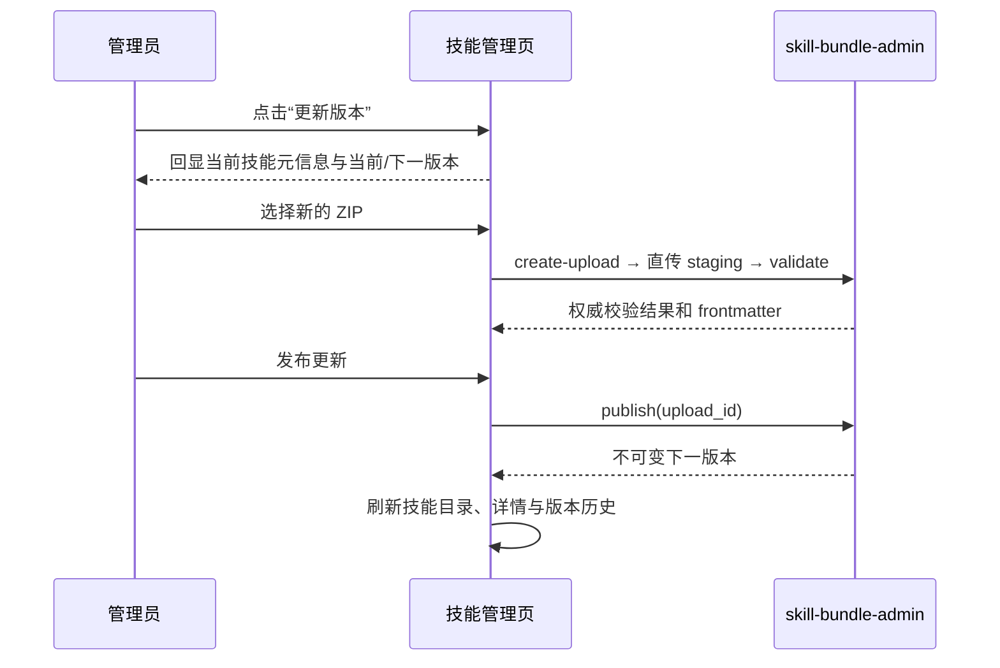

# 需求开发评审一致性平台 V1.14：技能更新版本最终执行方案

## 1. 背景与目标
技能列表现有入口名为“上传新版本”，点击后只显示 ZIP 上传与校验结果。管理员在更新前无法确认目标技能的既有编码、显示名称、描述和当前版本，容易在多条相近技能之间误操作。

本次将入口统一为“更新版本”。打开后先回显目标技能的当前信息及将要生成的版本号，再沿用既有上传、服务端校验和发布链路创建不可变的下一版本。

## 2. 范围与非目标
包含：
- 列表操作从“上传新版本”改为“更新版本”；
- 更新弹窗回显技能编码、显示名称、描述、使用场景、当前版本、当前文件规模和下一版本号；
- 首次打开时将当前已发布 ZIP 显示为已填入状态（当前版本、文件数与 ZIP 大小），并清楚区分它与本次待校验的更新 ZIP；上传新 ZIP 后仍展示服务端校验的文件清单、哈希和 frontmatter；
- 发布成功后刷新列表与已打开的详情/历史查询。

不包含：修改技能编码、显示名称或单独编辑描述；这些信息的权威来源及不可变语义保持不变。也不涉及数据库、RPC、Edge Function、Worker 或存储策略变更。

## 3. 当前实现与问题
- `src/pages/SkillManagementPage.tsx` 的列表操作直接打开“发布新版本”弹窗；该弹窗仅有 ZIP 拖拽区和校验结果。
- `ReviewSkillListItem` 已包含本需求所需的 `name`、`display_name`、`description`、`when_to_use`、`current_version`、文件数和大小，无需新增接口。
- `adminUploadSkillBundle()` 已通过受控的 staging signed URL 上传并请求服务端校验；`adminPublishSkillVersion()` 按服务端分配的递增序号发布版本。

## 4. 需求与验收标准
1. 每条技能操作显示“更新版本”，不再显示“上传新版本”。
2. 点击入口后弹窗标题为“更新版本”，能看到对应技能的编码、显示名称、描述、使用场景、当前版本、下一版本和当前文件规模。
3. 元信息为只读；管理员只能选择新的 ZIP。描述和使用场景仍以新 ZIP 中 `SKILL.md` frontmatter 的服务端解析结果为准。
4. 未选择且通过校验的 ZIP 时，“发布更新”不可用；成功后发布下一不可变版本并刷新页面数据。
5. 前端不自行解 ZIP 做安全准入；仍以后端校验、hash 重算和发布门禁为准。

## 5. 总体设计

## 6. 数据与接口设计
不涉及数据库迁移、RPC、Storage、Edge Function 或类型结构改动。前端使用既有 `ReviewSkillListItem` 字段回显当前信息；下一版本显示值按 `formatSkillVersion((current_version ?? 0) + 1)` 计算，仅作预览，最终版本仍以 `adminPublishSkillVersion()` 返回为准。

## 7. 前端与 Worker/运行时改造
- `src/pages/SkillManagementPage.tsx`：更新入口、弹窗文案和内容；新增只读“当前技能信息”区与“上传更新包”区，并保留原有加载、失败提示、校验清单与发布按钮门禁。
- Worker、DSH、权限、预算、Session 和运行时不涉及变更。

## 8. 安全、兼容与回滚
管理员权限仍由现有页面守卫、RPC 与 Edge Function `requireAdmin` 共同控制。ZIP 仍仅上传 staging，服务端负责解析、拒绝不合法包并将正式对象/版本保持不可变。已冻结 Job 继续引用原快照，不受新版本影响。

本次仅前端展示与交互调整。若需回滚，回滚前端构建即可；不会产生结构或数据迁移。

## 9. 实施步骤与文件范围
1. 修改 `src/pages/SkillManagementPage.tsx`，将操作改为“更新版本”，在既有弹窗中回显目标技能与版本信息，并改为“发布更新”。
2. 更新本文件，记录实际实现与验证结果。
3. 运行前端类型检查、目标测试、lint 与构建。

## 10. 验证结果
- `npm run test:web`：通过，13 个测试文件、159 个用例全部通过（包含 Skill Bundle 预填、容量限制与下载 URL 相关用例）。
- `npx oxlint src/pages/SkillManagementPage.tsx`：0 errors；保留原有 `formatBytes` 与页面组件同文件导出的 Fast Refresh warning，未由本次改动引入。
- `npm run build`：通过；Harness manifest 检查、`tsc -b` 和 Vite 生产构建均成功。Vite 报告原有的大 chunk 提示，但不影响构建产物。
- 未进行真实 ZIP 上传/发布烟测：该操作会向实际技能目录写入 staging 上传与不可变版本，超出本次前端验证范围。
