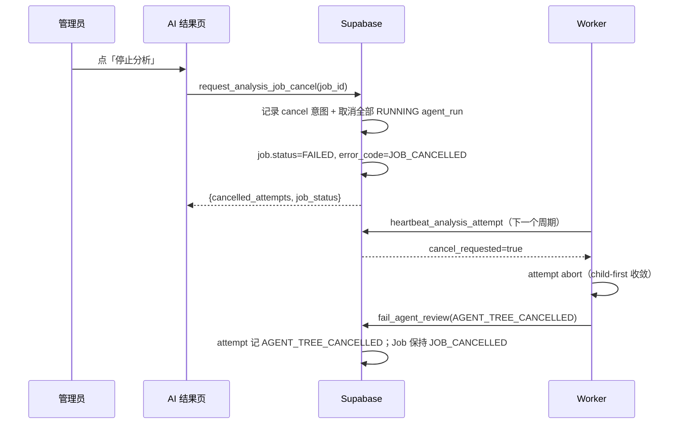

# 需求开发评审一致性平台 V1.15：分析任务停止与批次删除最终执行方案

## 1. 背景与目标

2026-09-22 线上暴露两个互相纠缠的缺口：

1. **停不下来。** 一个批次的分析任务跑起来之后，管理员在界面上没有任何"停止整个分析任务"的入口。
   现存的取消能力只有 `request_analysis_attempt_cancel(p_task_id)` —— 单个需求任务的一次 attempt，
   入口藏在「Agent 运行详情」页。要停一个 26 个需求、8 个并发 attempt 的任务，管理员得逐个点，
   而且已经 PENDING 的任务在 attempt 被取消后仍会被 Worker 继续领取。
2. **删不掉。** 删除批次时数据库抛出原始外键错误：

   ```text
   update or delete on table "review_story" violates foreign key constraint
   "analysis_job_story_snapshot_story_id_fkey" on table "analysis_job_story_snapshot"
   ```

   这不是"运行中不允许删除"的产品判断 —— `delete_review_batch` 里**根本没有**这条判断。
   它是 V1.11 引入 `analysis_job_story_snapshot.story_id ... on delete restrict` 之后留下的缺口：
   只要批次上跑过一次 V1.11（`analysis_context_version = 2`）任务，这个批次就**永久**删不掉了，
   与任务是否在跑无关。

目标：

- 管理员可以一键停止整个分析任务，停止后不再有新的 attempt 被领取，已产生的结果与审计保留；
- 删除批次要么成功，要么给出可理解的业务错误（"先停止分析任务"），不再冒出原始外键报文。

## 2. 范围与非目标

包含：

- 新 RPC `request_analysis_job_cancel(p_job_id, p_reason)` 与 `analysis_job` 上的取消意图列；
- `fail_agent_review` 覆盖：被用户停止的任务，终态原因保持"已停止"，不被 attempt 自身的失败码盖掉；
- `delete_review_batch` 覆盖：活动任务守卫 + 按依赖顺序清理 V1.11 分析链，使删除真正可执行；
- 前端「停止分析」按钮、错误码文案、删除失败提示；
- 新迁移的 SQL 测试。

非目标：

- 不新增 `CANCELLED` 任务状态。停止后的终态沿用 `FAILED` + 稳定错误码 `JOB_CANCELLED`，
  避免改动 `analysis_job_status_check` 牵动 Worker 领取、finalizer、监控台等全部状态分支；
- 不改 Worker 代码。Worker 已经在每次心跳里读 `cancel_requested`（`heartbeat_analysis_attempt`），
  取消会在一个心跳周期内收敛；
- 不改 `analysis_job_story_snapshot.story_id` 等 `on delete restrict` 外键的语义 ——
  它们保护的是"不能把已冻结分析引用的单个需求/身份行删走"，这层保护要留着；
- 不做"停止后自动重跑"。

## 3. 当前实现与问题

停止链路（现状）：

```text
用户 → AgentRunDetailPage「取消当前 Agent 尝试」
     → request_analysis_attempt_cancel(task_id)
     → analysis_agent_run.cancel_requested_at/cancel_reason
     → Worker 下一次 heartbeat_analysis_attempt 读到 cancel_requested
     → attempt abort → fail_agent_review(AGENT_TREE_CANCELLED)
     → fail_agent_review 把整个 Job 置为 FAILED（fail-fast），其余 RUNNING 任务回落 PENDING
```

两个后果：

- 没有 Job 级入口，管理员要逐个 attempt 点；
- 终态错误码是 `AGENT_TREE_CANCELLED`，界面读起来像"Agent 挂了"，看不出是人停的。

删除链路（现状）：`delete_review_batch` 只做权限校验 + 审计 + `delete from review_batch`，
依赖级联。但级联里有多条 `on delete restrict` 边（本地库 `pg_constraint` 实测）：

| 子表 | 列 | 父表 | on delete |
|---|---|---|---|
| `analysis_job_story_snapshot` | `story_id` | `review_story` | RESTRICT |
| `analysis_story_commit_candidate` | `commit_id` | `analysis_repository_commit` | RESTRICT |
| `analysis_commit_diff_archive` | `commit_id` | `analysis_repository_commit` | RESTRICT |
| `analysis_merge_request_commit` | `commit_id` | `analysis_repository_commit` | RESTRICT |
| `analysis_story_commit_access` | `candidate_id` | `analysis_story_commit_candidate` | RESTRICT |
| `analysis_story_commit_relevance_verdict` | `candidate_id` | `analysis_story_commit_candidate` | RESTRICT |

`RESTRICT` 是**立即**检查的（不像 `NO ACTION` 会推迟到语句末尾），所以即使这些行在同一次级联里
稍后也会被删掉，删除仍然当场失败。这就是线上那条报文的机制。

## 4. 需求与验收标准

停止：

1. 有批次管理权限的用户可以停止处于 `QUEUED / PREPARING_CODE / PREPARING_SCOPE / PROCESSING / FINALIZING` 的任务；
2. VIEWER 调用被拒（沿用 `ensure_manage_review_batch`）；未带 JWT 调用被拒；
3. 停止后：`analysis_job.status='FAILED'`、`error_code='JOB_CANCELLED'`、`cancel_requested_at` 非空，
   `claim_next_story_task` 不再领取该任务的需求（它只领 `status='PROCESSING'`）；
4. 所有 `RUNNING` 且未封存的 `analysis_agent_run` 收到 `cancel_requested_at`，Worker 一个心跳周期内收敛；
5. 在途 attempt 随后调用 `fail_agent_review` 时，Job 的 `error_code` 保持 `JOB_CANCELLED`，
   不被 `AGENT_TREE_CANCELLED` 覆盖；attempt 自身仍按实际情况记 `AGENT_TREE_CANCELLED`；
6. 已 `SUCCEEDED` 的任务不受影响（幂等返回 `already_terminal`），已提交的需求结果保留；
7. 重复调用幂等：`cancel_requested_at` 保持第一次的时间。

删除：

8. 批次上存在活动分析任务时，删除以稳定错误 `BATCH_HAS_ACTIVE_ANALYSIS_JOB` 拒绝，前端提示"先停止分析任务"；
9. 批次上只有终态任务（含 V1.11 任务、含提交清单/候选/裁定）时，删除成功，不出现外键报文；
10. 删除仍写 `batch_operation_log`（`BATCH_DELETED`）；权限校验不变。

## 5. 总体设计



停止之所以先把 Job 置为终态（而不是只记一个 flag 等 Worker 收敛），是因为"不再被领取"必须**立即**生效：
`claim_next_story_task` 只领 `PROCESSING` 的 Job，这样 17 个 PENDING 需求不会在收敛期间又被抓走。

## 6. 数据与接口设计

数据库（新迁移 `supabase/migrations/20260922130617_analysis_job_cancel_and_batch_delete.sql`）：

- `analysis_job` 新增 `cancel_requested_at timestamptz`、`cancel_requested_by uuid`、`cancel_reason text`；
- 新函数 `public.request_analysis_job_cancel(p_job_id uuid, p_reason text default 'USER_CANCELLED') returns jsonb`；
- `create or replace public.fail_agent_review(...)`：Job 错误字段在 `cancel_requested_at is not null` 时保留；
- `create or replace public.delete_review_batch(uuid)`：活动守卫 + 按依赖顺序清理；
- 授权：`request_analysis_job_cancel` revoke from public/anon，grant 给 authenticated + service_role。

前端接口：`src/lib/api.ts` 新增 `requestJobCancel(jobId, reason?)`，返回 `{ cancelled_attempts, job_status, already_terminal }`。

Worker：不涉及（沿用 `heartbeat_analysis_attempt` 的 `cancel_requested`）。

## 7. 前端与 Worker/运行时改造

- `src/App.tsx`（`AutoAnalysisSection`）：任务活动中且 `canManage` 时显示 danger 按钮「停止分析」，
  二次确认说明"已完成的需求结果会保留，未开始的需求不再执行"；成功后 `invalidateAll()`；
- `src/components/monitoring/RuntimeBatchList.tsx` + `src/pages/RuntimeMonitoringPage.tsx`：
  监控台的运行批次行增加「停止」按钮（桌面与移动两套渲染都有）。管理员通常是先在监控台看到
  卡住的批次，所以停止入口必须也在那里；按钮 `stopPropagation`，避免行点击顺带触发破坏性动作；
- `src/lib/labels.ts`：新增 `JOB_CANCELLED` 文案（标题「分析任务已被停止」，可重试）；
- `src/lib/api.ts`：`deleteBatch` 改为**先调 RPC、后清 Storage**。原来的顺序（先清 Storage）
  在新守卫拒绝时会留下"附件已删、批次还在"的状态；同时新增 `batchDeleteErrorMessage`，把
  `BATCH_HAS_ACTIVE_ANALYSIS_JOB` 翻成"请先在 AI 结果页停止分析后再删除"。

Worker：不涉及代码改动（沿用 `heartbeat_analysis_attempt` 的 `cancel_requested`）。

## 8. 安全、兼容与回滚

- 权限：停止走 `ensure_manage_review_batch`，与既有 attempt 取消一致；service_role 直通（Worker/运维）；
- 审计：`analysis_job.cancel_requested_by` 记录发起人；attempt 侧 `cancel_reason` 保留；批次删除仍写 `batch_operation_log`；
- 在途任务：停止只在 Job 层置终态 + 给 attempt 发取消意图，不清 task lease ——
  让 Worker 用正常路径把 attempt 收敛并写完审计，避免制造 `TASK_LEASE_LOST` 噪音；
- 旧数据：新列可空，旧 Job 的 `cancel_requested_at` 为 null，`fail_agent_review` 行为与今天完全一致；
- 回滚：迁移只增列 + 覆盖函数。需要回滚时再写一个前进迁移把两个函数 `create or replace` 回旧定义；
  新列留着不影响旧代码（前端不显示停止按钮即可）。

## 9. 实施步骤与文件范围

已落地的文件：

1. `supabase/migrations/20260922130617_analysis_job_cancel_and_batch_delete.sql`（新增）；
2. `supabase/tests/20260922130617_analysis_job_cancel_and_batch_delete_test.sql`（新增）；
3. `src/lib/api.ts`（`requestJobCancel`、`batchDeleteErrorMessage`、`deleteBatch` 顺序修正）；
4. `src/lib/labels.ts`（`JOB_CANCELLED` 文案）；
5. `src/App.tsx`（AI 结果页「停止分析」按钮与二次确认）；
6. `src/components/monitoring/RuntimeBatchList.tsx`、`src/pages/RuntimeMonitoringPage.tsx`（监控台停止入口）；
7. `src/lib/__tests__/v115-job-cancel-and-batch-delete.test.ts`（新增，6 个用例）。

实现过程中相对第 6 节初稿的**一处重要修正**：`delete_review_batch` 最初按
"verdict → access → candidate → commit" 逐表显式删除，本地实测被
`APPEND_ONLY_RECORD_IMMUTABLE` 拒绝 —— `analysis_story_commit_relevance_verdict`、
`analysis_story_commit_access`、`analysis_scope_expansion`、`analysis_scope_decision_audit`
上的 `reject_append_only_mutation` 触发器**只在 `pg_trigger_depth() > 1`（即级联）时放行 DELETE**，
直接删事实行一律拒绝。最终实现改成先删 `analysis_story_task`，让这些事实行与 scope、candidate
走级联消失，再删 `analysis_commit_diff_archive` / `analysis_merge_request_commit` /
`analysis_repository_commit`，最后删 `analysis_job` 与 `review_batch`。

## 10. 验证结果

本地 Supabase（`supabase_db_codeReviewPlatform`）与本地代码，全部实际执行：

| 验证 | 命令 | 结果 |
|---|---|---|
| 迁移应用（可重复） | `psql < supabase/migrations/20260922130617_*.sql`（连续两次） | 通过，第二次仍成功 |
| 迁移从零应用 | 事务内先 `drop function` + `drop column`，再整份应用，最后 `rollback` | 通过，`cancel_cols = 3` |
| SQL 测试 | `psql -v ON_ERROR_STOP=1 < supabase/tests/20260922130617_*_test.sql` | 通过（`DO` + `ROLLBACK`，无 ASSERT FAILED） |
| PostgREST 暴露 | `POST /rest/v1/rpc/request_analysis_job_cancel`（anon key） | HTTP 401 + `42501 permission denied`，说明函数已暴露且 anon 被正确拒绝 |
| 前端单测 | `npm run test:web` | 14 文件 / 169 用例通过（含新增 6 个） |
| 前端类型 | `npx tsc -p tsconfig.app.json --noEmit`、`npm run web:typecheck` | 通过 |
| Lint | `npm run lint` | 0 error（1 个既有无关 warning） |
| 构建 | `npm run build` | 通过 |
| Worker 回归 | `npm run test:worker` | 45 文件 / 814 用例通过、11 文件跳过 |
| 发布前只读检查 | `supabase migration list --local` / `--linked`、`supabase db push --linked --dry-run --skip-vault` | 本地已记录 `20260922130617`；云端历史与本地一致（仅缺该条）；dry-run 显示只会推这一个迁移 |

SQL 测试覆盖的验收点（与第 4 节逐条对应）：

- 取消列存在；`request_analysis_job_cancel` 只授予 `authenticated` / `service_role`，`anon` 无权限；
- 非法 reason → `CANCEL_REASON_INVALID`；未知 job → `job not found`；
- VIEWER → `batch management permission required`；无 JWT → `authentication required`；
- 管理员停止运行中的任务：`status='FAILED'`、`error_code='JOB_CANCELLED'`、
  `cancel_requested_by` 为发起人、运行中的 attempt 拿到 `cancel_requested_at`、
  返回 `cancelled_attempts=1`，且该 Job 不再满足 claim 条件；
- 重复停止：`already_terminal=true` 且第一次的 `cancel_requested_at` / `cancel_reason` 不被改写；
- 在途 attempt 收敛（`fail_agent_review('AGENT_TREE_CANCELLED')`）后 Job 仍是 `JOB_CANCELLED`，
  而 attempt 自身记 `AGENT_TREE_CANCELLED`；对照的未取消 Job 仍按 attempt 错误码落终态；
- 活动任务时删除 → `BATCH_HAS_ACTIVE_ANALYSIS_JOB`；
- 先证明缺口真实存在（直接 `delete from review_story` 仍被 `analysis_job_story_snapshot` 挡住），
  再验证带完整 V1.11 链（story 快照、repository 快照、commit、commit_file、scope、candidate、verdict）
  的批次可以整体删除，且 `batch_operation_log` 里仍留有 `BATCH_DELETED` 审计。

未验证项：

- **云端库未应用本迁移**，也未在云端做过一次真实的"停止 + 删除"。云端 `db push` 与前端部署
  都要由用户手动执行（见发布清单）。
- 未用真实 Worker 做"停止后 attempt 在一个心跳周期内收敛"的端到端演示：本地 Worker 当前连的是
  本地库，而正在跑的那个批次在云端。收敛路径本身没有改动（`heartbeat_analysis_attempt` 的
  `cancel_requested` 是既有机制，`worker/src/index.ts` 已在用），SQL 测试覆盖了数据库侧的状态迁移。
