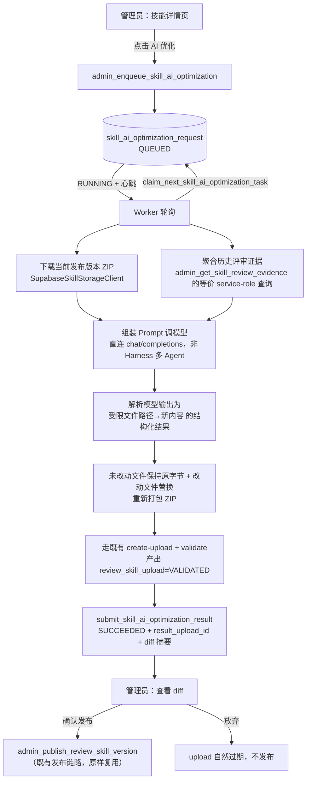

# 需求开发评审一致性平台 V1.19：技能AI优化最终执行方案

> 文档状态：**方案阶段，尚未开始编码**。本文档描述的是准备实施的设计，不是已落地的实现。
> 用户明确要求先出方案、确认后再动代码，因此本版本只完成第 1～9 节的设计，第 10 节按规则
> 标注「未验证」。

## 1. 背景与目标

- **为什么做**：技能（Skill）内容目前完全靠管理员手写 `SKILL.md` 并手工打包上传。技能上线后
  实际效果如何——是否让评审漏判、误判变多——虽然数据库里已经完整记录（`ai_review_result` /
  `human_review` / `analysis_job_skill_snapshot`），但没有任何界面把「这个技能」和「它带来的
  评审结果好不好」关联起来，更没有让 AI 直接依据这些历史结果去改技能内容的能力。改技能全靠
  管理员自己回忆哪里评得不准，效率低、也容易遗漏。
- **完成后提供什么能力**：管理员在技能详情里可以看到该技能历史被引用的 Job 里，评审结论
  （命中/未命中/不确定）与人工复核（对/部分对/错/需讨论）的汇总证据；点一下「AI 优化」，
  由 Worker 侧的模型依据这些证据生成一份新的 `SKILL.md` 内容草稿；管理员可以逐文件看 diff、
  看 AI 给出的修改理由，确认无误后按「发布」把它变成技能的下一个版本。形成
  「历史评审结果 → AI 优化技能 → 再评审」的闭环，且每一步都可回溯、可拒绝。

## 2. 范围与非目标

**本次包含：**

1. 一个只读的「技能历史评审证据聚合」查询（按技能 → 引用过它的 Job → Job 下的评审结论与
   人工复核，汇总计数 + 少量抽样文本）。
2. 一个新的 Worker 异步任务类型「技能 AI 优化」：领取任务 → 下载当前发布版本的技能包 →
   下载证据摘要 → 调模型生成新文本内容 → 用「未改动文件保持原字节、改动文件替换为新内容」
   的方式重新打包 ZIP → 灌入**现有**的 `review_skill_upload` 校验管线（走已存在的
   frontmatter/limits 校验，不新写一套）→ 写回任务结果。
3. 前端：技能详情/管理页新增「AI 优化」入口——展示证据摘要 → 触发优化 → 轮询任务状态 →
   查看逐文件 diff 与 AI 修改理由 → 复用**现有**的「发布」确认弹窗完成发布，或放弃这份草稿。

**明确不包含（非目标）：**

- 不支持 AI 自动发布。发布永远需要管理员在看到完整 diff 后手动点击确认，与「新增/编辑草稿→
  发布」这条平台既有原则一致。
- 不支持 AI 修改二进制/图片资源；AI 只允许改动文本类文件（首版只开放 `SKILL.md` 本体，见
  §6），非文本文件与未被 AI 触碰的文件在重新打包时保持字节级不变。
- 不引入新的多 Agent 编排。不复用 DeepSeek Harness ACP 的评审用多 Agent 树，改用一次性、
  直连模型端点的 `chat/completions` 调用（与 `connectivity-check.ts` 现有的调用方式一致），
  避免把一次文本改写任务的成本和复杂度拉到评审 Agent 树的量级。
- 不做定时/自动触发。每一次「AI 优化」都必须是管理员在界面上手动点出来的一次性动作。
- 不影响历史或在途 Job。技能版本发布只影响「之后新建」的 Job，这条既有边界原样保留，不新增
  「重新冻结」「热更新已跑 Job」之类的能力。
- 不新增「撤销发布」能力。技能版本发布后仍然不可变；如果发布后发现优化效果不好，走「再发一个
  新版本」这条既有路径，不做专门的回滚 RPC。

## 3. 当前实现与问题（已核实的现状）

技能管理已有完整的「上传 → 校验 → 发布」体系（`supabase/migrations/20260917100000_managed_dsh_skill_bundles.sql`
及后续增补迁移）：

- `review_skill` / `review_skill_version`（不可变，发布后禁止 UPDATE）/ `review_skill_upload`
  （staging 校验落点，24h 过期）三张表构成技能身份、版本、待发布草稿。
- 三层 hash（`archive_sha256` 字节完整性、`bundle_hash` 逻辑文件集合、`skill_catalog_hash`
  Job 冻结集合身份）在 SQL / `supabase/functions/skill-bundle-admin/bundle.ts` /
  `worker/src/ai/skills/skill-manifest.ts` 三处各自独立重算，互相校验一致。
- `admin_publish_review_skill_version(actor, upload_id, archive_object_key, acknowledge_scripts)`
  是唯一的发布入口；`description`/`when_to_use` 只从 ZIP 里 `SKILL.md` 的 frontmatter 解析，
  不接受任何其它输入来源。
- `analysis_job_skill_snapshot` 记录了「哪个 Job 冻结过哪个技能版本」（`source_skill_id`，
  `source_version_id`），`SkillManagementPage.tsx` 的 `referenced_by_job` 就是查这张表。
- 评审结论落在 `ai_review_result`（`0001_review_platform.sql`）：按 `story_id` +
  `ai_import_record_id` 记录 `verdict`（`IMPLEMENTED|PARTIAL|NOT_IMPLEMENTED|UNCERTAIN`）、
  `confidence`、`summary`/`implemented_content`/`missing_content`/`risks`/`test_points`。
  人工复核落在 `human_review`：`result`（`CORRECT|PARTIALLY_CORRECT|INCORRECT|NEED_DISCUSSION`）
  + `comment`，前端直接 `client.from('human_review')` 读写，走 RLS 而非 RPC。
- Worker 侧已有「认领 → 心跳续租 → service-role 提交结果」的现成范式，最接近的是
  `claim_next_story_task` / `submit_story_commit_relevance_verdict`（`worker/src/db/jobs.ts`），
  提交类 RPC 一律 `revoke ... from public/anon/authenticated; grant ... to service_role`，
  用 `claim_token` 摘要防止跨 Worker 抢结果。
- 最接近本次「AI 生成内容 → diff → 人工确认发布」诉求的现成先例是归属规则的
  `draft → save(乐观锁) → validate → simulate → publish` 五段状态机
  （`20260919063330_story_commit_attribution_foundation.sql` 等），其「浏览器不能自报模拟通过，
  必须由受信任服务写回」的原则本次直接沿用：AI 优化的结果必须由 Worker（service_role）写回，
  管理员在前端只能看、不能伪造「AI 已生成」。

**当前缺口**：

- 没有任何界面把「一个技能」和「它历史评审结果好不好」关联起来展示。
- 没有触发 AI 修改技能内容的入口，也没有承接这类一次性文本生成任务的 Worker 任务类型。
- 没有 diff 查看能力（现有版本历史只能看文件清单和整包下载，不能逐文件看正文改动）。

## 4. 需求与验收标准

1. 管理员在技能详情里能看到（针对当前已发布版本）：
   - 引用过它的 Job 数量；
   - 这些 Job 下 story 评审结论分布（IMPLEMENTED / PARTIAL / NOT_IMPLEMENTED / UNCERTAIN 各多少条）；
   - 人工复核标记为 INCORRECT / PARTIALLY_CORRECT / NEED_DISCUSSION 的条数，以及最多 20 条抽样
     摘要（`ai_review_result.summary` 或 `human_review.comment` 的截断文本，不展示原始代码
     内容以外的敏感信息）。
   - 技能从未被任何 Job 引用时，明确显示「还没有历史评审证据，暂不建议 AI 优化」而不是空表。
2. 点击「开始 AI 优化」后创建一条优化任务，任务状态可查询：`QUEUED → RUNNING → SUCCEEDED`
   或 `QUEUED → RUNNING → FAILED`。前端每 2～3 秒轮询直至终态（与 `ProfilePage.tsx` 里
   `enqueueMyGitEmailDiscovery`/`getMyGitEmailDiscovery` 的轮询模式一致），超时/失败要给出
   可读的错误码说明（例如没有 Worker 在线、模型未配置、模型返回格式不合规、技能没有任何历史
   评审证据可用）。
3. 同一技能同一时间只允许一个进行中（`QUEUED`/`RUNNING`）的优化任务；重复点击「开始 AI 优化」
   直接复用已存在的进行中任务，不创建第二条。
4. 任务成功后，管理员能看到：
   - 改动了哪些文件路径（首版固定只可能是 `SKILL.md`）；
   - 每个改动文件的逐行 diff（新增/删除行高亮）；
   - AI 给出的一段修改理由摘要（模型输出的一部分，不是凭空生成的说明）。
5. 管理员可以「确认发布」（复用现有发布确认弹窗与脚本确认提示）或「放弃此次优化」；放弃不消耗
   版本号，等价于让这份 staging upload 到期自然失效。
6. 权限：证据查询、触发优化、查看任务状态、确认发布，全链路仅 ADMIN 可见可用；服务端仍需
   `ensure_admin()`/`service_role` 独立校验，不依赖前端隐藏按钮。
7. AI 产出的新 `SKILL.md` 必须先通过与人工上传**完全相同**的 fail-closed frontmatter/容量校验
   （`admin_record_skill_upload_validation`），任何一项不合规直接把任务标记 `FAILED` 并给出
   具体错误码，不允许发布任何未通过校验的内容。

## 5. 总体设计



三段职责划分：

1. **证据聚合（只读，同步）**：新 RPC，按 `analysis_job_skill_snapshot.source_skill_id`
   找到引用过这个技能的 Job，再关联 `review_story` → `ai_import_record`（`is_active`）→
   `ai_review_result` / `human_review` 做计数与抽样。纯查询，不产生任何写入。
2. **AI 优化任务（异步，Worker 执行）**：认领/心跳/提交三段式，照抄
   `submit_story_commit_relevance_verdict` 的 claim_token + service-role 写回模式。Worker
   侧只做「下载现有内容 + 读证据摘要 + 调模型 + 重新打包 + 走现有校验」，**不新发明**打包格式、
   哈希算法或校验规则。
3. **发布（同步，人工确认）**：直接复用 `admin_publish_review_skill_version`，这一步与「管理员
   手工上传 ZIP 后点发布」是完全同一条代码路径——AI 优化任务的产出物本质上就是「帮管理员
   预先填好的一次 ZIP 上传」。

## 6. 数据与接口设计

### 6.1 数据库：新表

```sql
create table public.skill_ai_optimization_request (
  id                 uuid primary key default gen_random_uuid(),
  skill_id           uuid not null references public.review_skill(id) on delete cascade,
  source_version_id  uuid not null references public.review_skill_version(id) on delete restrict,
  requested_by       uuid not null references auth.users(id) on delete set null,
  status             text not null check (status in ('QUEUED','RUNNING','SUCCEEDED','FAILED')),
  worker_id          text,
  lease_expires_at   timestamptz,
  claim_token_digest text,
  heartbeat_at       timestamptz,
  result_upload_id   uuid references public.review_skill_upload(id) on delete set null,
  changed_paths      jsonb not null default '[]'::jsonb,
  ai_summary         text,
  error_code         text,
  error_message      text,
  created_at         timestamptz not null default now(),
  started_at         timestamptz,
  finished_at        timestamptz
);

-- 同一技能只允许一条进行中的任务
create unique index uq_skill_ai_optimization_inflight
  on public.skill_ai_optimization_request(skill_id)
  where status in ('QUEUED','RUNNING');
```

不新增任何存正文/明文的列——`changed_paths` 只存路径列表，实际内容仍然通过
`result_upload_id` 指向 `review_skill_upload.bundle_manifest`/staging 对象，复用现有存储与
下载签名链路，不重复保存一份文本在这张新表里。

### 6.2 数据库：新 RPC（均 `security definer`）

| RPC | 调用方 | 权限 | 作用 |
|---|---|---|---|
| `admin_get_skill_review_evidence(p_skill_id uuid)` | 前端 | `authenticated`（体内 `ensure_admin()`） | 只读聚合证据，见 §5.1 |
| `admin_enqueue_skill_ai_optimization(p_skill_id uuid)` | 前端 | `authenticated`（`ensure_admin()`） | 校验技能已发布、无进行中任务，插入 `QUEUED` 行 |
| `admin_get_skill_ai_optimization_task(p_request_id uuid)` | 前端轮询 | `authenticated`（`ensure_admin()`） | 查任务当前状态/结果，用于轮询 |
| `claim_next_skill_ai_optimization_task(p_worker_id text)` | Worker | `service_role` | 认领一条 `QUEUED` 任务，返回技能当前版本定位信息 + `claim_token` |
| `heartbeat_skill_ai_optimization_task(p_request_id, p_worker_id, p_claim_token)` | Worker | `service_role` | 续租，防止任务被判定为失联 |
| `submit_skill_ai_optimization_result(p_request_id, p_worker_id, p_claim_token, p_upload_id, p_changed_paths, p_ai_summary)` | Worker | `service_role` | 成功写回 |
| `submit_skill_ai_optimization_failure(p_request_id, p_worker_id, p_claim_token, p_error_code, p_error_message)` | Worker | `service_role` | 失败写回 |
| `reclaim_stale_skill_ai_optimization_leases()` | Worker 心跳循环 | `service_role` | 心跳超时后把任务打回 `QUEUED` 或终态 `FAILED`，与现有 story task 续租回收逻辑同模式 |

错误码新增（风格对齐现有 `*_NOT_FOUND`/`*_CONFLICT`/`*_REQUIRED`）：

- `SKILL_NOT_PUBLISHED`：技能没有已发布版本，不能优化。
- `SKILL_OPTIMIZATION_IN_FLIGHT`：已存在进行中任务。
- `SKILL_OPTIMIZATION_NO_EVIDENCE`：技能从未被任何 Job 引用，没有证据可用（前端据此提前禁用按钮，而不是等 Worker 跑完才报错）。
- `SKILL_OPTIMIZATION_MODEL_OUTPUT_INVALID`：模型输出不符合约定结构或改了不允许改的文件。
- `TASK_LEASE_LOST`：claim_token 或租期校验失败，与现有其它 claim 型 RPC 一致。

### 6.3 前端类型（`src/types.ts` 新增）

```ts
export interface SkillReviewEvidence {
  referenced_job_count: number
  verdict_counts: Record<'IMPLEMENTED' | 'PARTIAL' | 'NOT_IMPLEMENTED' | 'UNCERTAIN', number>
  human_review_counts: Record<'CORRECT' | 'PARTIALLY_CORRECT' | 'INCORRECT' | 'NEED_DISCUSSION', number>
  sample_findings: Array<{
    story_code: string
    verdict: string
    summary: string
    human_review_result: string | null
    human_review_comment: string | null
  }>
}

export type SkillAiOptimizationStatus = 'QUEUED' | 'RUNNING' | 'SUCCEEDED' | 'FAILED'

export interface SkillAiOptimizationTask {
  id: string
  skill_id: string
  status: SkillAiOptimizationStatus
  changed_paths: string[]
  ai_summary: string | null
  error_code: string | null
  error_message: string | null
  result_upload_id: string | null
  created_at: string
  finished_at: string | null
}

export interface SkillFileDiff {
  path: string
  before: string | null
  after: string | null
}
```

### 6.4 前端 API（`src/lib/api.ts` 新增）

- `adminGetSkillReviewEvidence(skillId: string): Promise<SkillReviewEvidence>`
- `adminEnqueueSkillAiOptimization(skillId: string): Promise<SkillAiOptimizationTask>`
- `adminGetSkillAiOptimizationTask(requestId: string): Promise<SkillAiOptimizationTask>`
- `adminGetSkillOptimizationDiff(uploadId: string, sourceVersionId: string): Promise<SkillFileDiff[]>`
  —— 内部分别取两侧的文本文件内容用于前端渲染 diff（复用现有下载签名/staging 读取接口，
  不新增存储通道）。

## 7. 前端与 Worker/运行时改造

### 7.1 前端（`src/pages/SkillManagementPage.tsx`）

- 详情弹窗（`detailSkill`）新增一个「历史评审证据」区块：展示 §6.3 的统计和抽样列表；技能
  未发布或从未被引用时显示禁用态说明。
- 新增「AI 优化」按钮（仅当前有已发布版本、且没有进行中任务时可点）：
  1. 点击后调用 `adminEnqueueSkillAiOptimization`，打开一个新 Modal，用 `Steps` 展示
     `排队中 → AI 生成中 → 等待确认` 三段进度，`useQuery` + `refetchInterval` 轮询
     `adminGetSkillAiOptimizationTask`（与 `ProfilePage.tsx` 里 Git 邮箱反查轮询同一模式）。
  2. `SUCCEEDED` 后调用 `adminGetSkillOptimizationDiff` 渲染逐文件 diff（引入轻量 diff 组件，
     见下）+ 展示 `ai_summary`。
  3. 提供「确认发布」（复用现有 `adminPublishSkillVersion({ uploadId: result_upload_id,
     acknowledgeScripts: true })` 与既有发布确认弹窗文案）与「放弃」两个按钮。
  4. `FAILED` 时展示 `error_code`/`error_message` 对应的可读文案。
- **新依赖**：项目目前没有任何 diff 渲染库。计划引入 `diff`（俗称 jsdiff，MIT 协议，周下载量
  千万级、维护活跃，用来做 `diffLines`），锁定精确版本（例如 `"diff": "5.2.0"`），只用于
  这一处逐行 diff 渲染，不引入更重的 diff-viewer 组件库。

### 7.2 Worker（新文件 `worker/src/ai/skills/skill-ai-optimizer.ts` 及配套）

- 轮询循环（与现有 story task 认领循环同级并存，独立的一个 loop）：`claim_next_skill_ai_optimization_task`
  → 心跳 → 执行 → 提交结果/失败。
- 执行步骤：
  1. 用现成的 `SupabaseSkillStorageClient` 下载技能当前发布版本的 ZIP，用现成的
     `zip-archive.ts` 解压，只取 `bundle_manifest` 里标记为文本类的文件内容（首版白名单只有
     `SKILL.md`，其余角色一律不允许改）。
  2. 调用 §6.2 的证据聚合等价 service-role 查询，取回统计与抽样文本。
  3. 组装一个结构化 Prompt（技能当前 `SKILL.md` 正文 + 证据摘要 + 明确要求："只返回 JSON
     `{ "summary": string, "files": { "<path>": "<新正文>" } }`，path 必须是白名单内的现有路径，
     不得新增/删除文件、不得修改 frontmatter 的 `name` 字段"），直连模型 `chat/completions`
     端点（复用现有模型配置解析：模型来自 `model_config` 表 + Vault 密钥，同
     `connectivity-check.ts` 的解析与调用方式），**不经过** DeepSeek Harness ACP 的多 Agent
     编排。
  4. 解析模型输出：JSON 解析失败、路径不在白名单、试图改 `name` 字段、正文超出
     `skill_bundle_limits()` 的单文件/SKILL.md 大小上限——任一命中即 fail closed，提交
     `SKILL_OPTIMIZATION_MODEL_OUTPUT_INVALID` 失败，不产出任何 upload。
  5. 通过校验后：用原 ZIP 里未改动文件的原始字节 + 改动文件的新内容重新打包为一份新 ZIP，
     走**现成的** Edge Function `create-upload` + `validate` action（Worker 以 service-role
     身份调用，不经浏览器），产出一条 `VALIDATED` 状态的 `review_skill_upload`。
  6. 调 `submit_skill_ai_optimization_result` 写回 `result_upload_id`/`changed_paths`/`ai_summary`。
- 复用既有校验，不重复实现：frontmatter 解析用 `worker/src/ai/skills/skill-frontmatter.ts`，
  容量上限用 `worker/src/ai/skills/skill-limits.ts`，manifest/哈希用 `skill-manifest.ts`。

## 8. 安全、兼容与回滚

- **AI 输出必须经过与人工上传完全相同的 fail-closed 校验**，不允许因为「这是 AI 生成的」而走
  任何校验捷径；发布前管理员必须能看到完整 diff 正文，不支持盲发。
- **模型调用成本与滥用防护**：`uq_skill_ai_optimization_inflight` 唯一索引保证同一技能不会
  并发触发多个任务；触发动作仅 ADMIN 可见可用；建议后续视实际使用情况再评估是否需要按时间
  窗口限流（本版本先不做，作为已知的可能后续增强点写在这里，不在本版本实现）。
- **权限边界**：查询/触发/轮询类 RPC 走 `authenticated` + `ensure_admin()`；Worker 写回类
  RPC 一律 `revoke from public/anon/authenticated; grant to service_role`，`claim_token`
  摘要门禁，与平台现有所有 claim 型任务同规格。
- **兼容性**：不修改任何既有表结构或既有 RPC 签名；`admin_publish_review_skill_version`
  原样复用，不新增参数、不改变行为。已发布技能版本、已冻结 Job 快照完全不受影响。
- **回滚**：这是纯新增功能（新表 + 新 RPC + 新 Worker 循环 + 新前端入口），回滚只需要
  停止 Worker 侧的新增循环 + 前端隐藏「AI 优化」入口；已发布的技能版本沿用既有版本回滚方式
  （发新版本覆盖），不需要专门的数据库回滚脚本。新迁移本身只增表/增函数，符合「迁移只增不改」
  的仓库规则。

## 9. 实施步骤与文件范围（计划）

1. **迁移**：新增一个精确到秒的迁移文件（`supabase/migrations/<timestamp>_skill_ai_optimization.sql`），
   建表 `skill_ai_optimization_request` + 全部新 RPC + 错误码，并配套
   `supabase/tests/<timestamp>_skill_ai_optimization_test.sql`。
2. **Edge/Worker**：
   - `worker/src/ai/skills/skill-ai-optimizer.ts`（新）：认领/心跳/执行/提交主循环。
   - `worker/src/ai/skills/skill-optimization-prompt.ts`（新）：Prompt 组装与模型输出解析/校验。
   - `worker/src/index.ts` 或现有任务调度入口：挂载新循环。
   - 单测：`worker/src/__tests__/v119-skill-ai-optimizer.test.ts`（新）。
3. **前端**：
   - `src/types.ts`：新增 §6.3 类型。
   - `src/lib/api.ts`：新增 §6.4 函数。
   - `src/pages/SkillManagementPage.tsx`：证据区块 + AI 优化 Modal + diff 视图。
   - 新增 `diff` 依赖（`package.json`，锁定精确版本）。
   - 单测：`src/lib/__tests__/skill-ai-optimization.test.ts`（新，覆盖 diff 渲染的纯函数部分与状态机文案）。
4. **文档**：本文件持续更新为「已实现」状态；如实现期间发现需要偏离本方案（例如证据聚合
   字段调整、Prompt 结构变化），同步修订本文档。

## 10. 验证结果

**未验证。** 本次任务范围是「出方案」，尚未编写任何迁移、RPC、Worker 代码或前端代码，因此没有
可报告的 `tsc`/`vitest`/`build` 结果。待用户确认本方案（尤其是 §2 的范围边界与 §8 的安全/成本
权衡）后，进入编码阶段并在此节补充真实的类型检查、单测与构建结果。
