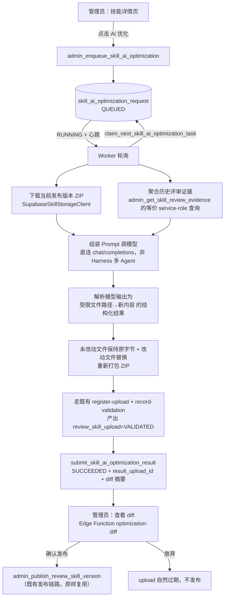

# 需求开发评审一致性平台 V1.19：技能AI优化最终执行方案

> 文档状态：**已实现并本地验证通过**（2026-09-24）。第 1～9 节是实际落地的设计；实现期间
> 相对原方案的偏离逐条记在第 9.1 节，第 10 节是真实的验证结果（不是计划）。
> 云端发布（`db push` / `functions deploy` / 更新云端 Worker）**尚未执行**，由用户手动完成。

## 1. 背景与目标

- **为什么做**：技能（Skill）内容目前完全靠管理员手写 `SKILL.md` 并手工打包上传。技能上线后
  实际效果如何——是否让评审漏判、误判变多——虽然数据库里已经完整记录（`ai_review_result` /
  `human_review` / `analysis_job_skill_snapshot`），但没有任何界面把「这个技能」和「它带来的
  评审结果好不好」关联起来，更没有让 AI 直接依据这些历史结果去改技能内容的能力。改技能全靠
  管理员自己回忆哪里评得不准，效率低、也容易遗漏。
- **完成后提供什么能力**：管理员在技能详情里可以看到该技能历史被引用的 Job 里，评审结论
  （命中/未命中/不确定）与人工复核（对/部分对/错/需讨论）的汇总证据；点一下「AI 优化」，
  由 Worker 侧的模型依据这些证据生成一份新的 `SKILL.md` 内容草稿；管理员可以逐文件看 diff、
  看 AI 给出的修改理由，确认无误后按「发布」把它变成技能的下一个版本。形成
  「历史评审结果 → AI 优化技能 → 再评审」的闭环，且每一步都可回溯、可拒绝。

## 2. 范围与非目标

**本次包含：**

1. 一个只读的「技能历史评审证据聚合」查询（按技能 → 引用过它的 Job → **Job 所属的评审批次**
   → Job 下的评审结论与人工复核，汇总计数 + 批次清单 + 少量抽样文本）。
2. 一个新的 Worker 异步任务类型「技能 AI 优化」：领取任务 → 下载当前发布版本的技能包 →
   下载证据摘要 → 调模型生成**整包**改动（改写 / 新增 / 删除任意文本文件）→ 用「未改动文件
   保持原字节、改动文件替换为新内容、删除的去掉」的方式重新打包 ZIP → **做一次结构自检**
   （灌入**现有**的 `review_skill_upload` 校验管线，走已存在的 frontmatter/角色/扩展名/容量
   校验，不新写一套）→ 自检不通过时把拒绝原因回灌给模型让它继续改（最多 3 次）→ 写回任务结果。
3. 前端：技能详情/管理页新增「AI 优化」入口——展示证据摘要与**用到这个技能的批次清单** →
   触发优化 → 轮询任务状态 → 查看逐文件 diff（含新增/删除/二进制标记）与 AI 修改理由 →
   复用**现有**的「发布」确认弹窗完成发布，或放弃这份草稿。

**明确不包含（非目标）：**

- 不支持 AI 自动发布。发布永远需要管理员在看到完整 diff 后手动点击确认，与「新增/编辑草稿→
  发布」这条平台既有原则一致。
- 不支持 AI 改写二进制/图片资源：它们没法用一个 JSON 字符串表达。AI 可以**删除**图片，
  但不能改写；未被触碰的文件（含图片）在重新打包时保持字节级不变。
- 不放宽任何既有校验。放开到整包**不等于**放开规则：路径规范、目录角色与扩展名对应关系
  （脚本必须在 `scripts/`）、容量上限、frontmatter 要求全部照旧，由同一套 fail-closed
  校验判定，AI 绕不过去。含脚本的草稿在发布时仍需管理员额外确认。
- 不引入新的多 Agent 编排。不复用 DeepSeek Harness ACP 的评审用多 Agent 树，改用一次性、
  直连模型端点的 `chat/completions` 调用（与 `connectivity-check.ts` 现有的调用方式一致），
  避免把一次文本改写任务的成本和复杂度拉到评审 Agent 树的量级。自检不通过时的重写发生在
  **同一个任务内部**，不产生第二条任务。
- 不做定时/自动触发。每一次「AI 优化」都必须是管理员在界面上手动点出来的一次性动作。
- 不影响历史或在途 Job。技能版本发布只影响「之后新建」的 Job，这条既有边界原样保留，不新增
  「重新冻结」「热更新已跑 Job」之类的能力。
- 不新增「撤销发布」能力。技能版本发布后仍然不可变；如果发布后发现优化效果不好，走「再发一个
  新版本」这条既有路径，不做专门的回滚 RPC。

## 3. 当前实现与问题（已核实的现状）

技能管理已有完整的「上传 → 校验 → 发布」体系（`supabase/migrations/20260917100000_managed_dsh_skill_bundles.sql`
及后续增补迁移）：

- `review_skill` / `review_skill_version`（不可变，发布后禁止 UPDATE）/ `review_skill_upload`
  （staging 校验落点，24h 过期）三张表构成技能身份、版本、待发布草稿。
- 三层 hash（`archive_sha256` 字节完整性、`bundle_hash` 逻辑文件集合、`skill_catalog_hash`
  Job 冻结集合身份）在 SQL / `supabase/functions/skill-bundle-admin/bundle.ts` /
  `worker/src/ai/skills/skill-manifest.ts` 三处各自独立重算，互相校验一致。
- `admin_publish_review_skill_version(actor, upload_id, archive_object_key, acknowledge_scripts)`
  是唯一的发布入口；`description`/`when_to_use` 只从 ZIP 里 `SKILL.md` 的 frontmatter 解析，
  不接受任何其它输入来源。
- `analysis_job_skill_snapshot` 记录了「哪个 Job 冻结过哪个技能版本」（`source_skill_id`，
  `source_version_id`），`SkillManagementPage.tsx` 的 `referenced_by_job` 就是查这张表。
- 评审结论落在 `ai_review_result`（`0001_review_platform.sql`）：按 `story_id` +
  `ai_import_record_id` 记录 `verdict`（`IMPLEMENTED|PARTIAL|NOT_IMPLEMENTED|UNCERTAIN`）、
  `confidence`、`summary`/`implemented_content`/`missing_content`/`risks`/`test_points`。
  人工复核落在 `human_review`：`result`（`CORRECT|PARTIALLY_CORRECT|INCORRECT|NEED_DISCUSSION`）
  + `comment`，前端直接 `client.from('human_review')` 读写，走 RLS 而非 RPC。
- Worker 侧已有「认领 → 心跳续租 → service-role 提交结果」的现成范式，最接近的是
  `claim_next_story_task` / `submit_story_commit_relevance_verdict`（`worker/src/db/jobs.ts`），
  提交类 RPC 一律 `revoke ... from public/anon/authenticated; grant ... to service_role`，
  用 `claim_token` 摘要防止跨 Worker 抢结果。
- 最接近本次「AI 生成内容 → diff → 人工确认发布」诉求的现成先例是归属规则的
  `draft → save(乐观锁) → validate → simulate → publish` 五段状态机
  （`20260919063330_story_commit_attribution_foundation.sql` 等），其「浏览器不能自报模拟通过，
  必须由受信任服务写回」的原则本次直接沿用：AI 优化的结果必须由 Worker（service_role）写回，
  管理员在前端只能看、不能伪造「AI 已生成」。

**当前缺口**：

- 没有任何界面把「一个技能」和「它历史评审结果好不好」关联起来展示。
- 没有触发 AI 修改技能内容的入口，也没有承接这类一次性文本生成任务的 Worker 任务类型。
- 没有 diff 查看能力（现有版本历史只能看文件清单和整包下载，不能逐文件看正文改动）。

## 4. 需求与验收标准

1. 管理员在技能详情里能看到（针对当前已发布版本）：
   - 引用过它的 Job 数量；
   - **用到这个技能的评审批次清单**：批次名称、周次、那次冻结的技能版本、该批次的评审结论数、
     以及最近一次分析任务的时间。同一批次重跑过就把次数折进同一行 —— 管理员记得的是
     「第 39 周那个批次评得不准」，Job id 对他没有意义；
   - 这些 Job 下 story 评审结论分布（IMPLEMENTED / PARTIAL / NOT_IMPLEMENTED / UNCERTAIN 各多少条）；
   - 人工复核标记为 INCORRECT / PARTIALLY_CORRECT / NEED_DISCUSSION 的条数，以及最多 20 条抽样
     摘要（`ai_review_result.summary` 或 `human_review.comment` 的截断文本，不展示原始代码
     内容以外的敏感信息）。
   - 技能从未被任何 Job 引用时，明确显示「还没有历史评审证据，暂不建议 AI 优化」而不是空表。
2. 点击「开始 AI 优化」后创建一条优化任务，任务状态可查询：`QUEUED → RUNNING → SUCCEEDED`
   或 `QUEUED → RUNNING → FAILED`。前端每 2～3 秒轮询直至终态（与 `ProfilePage.tsx` 里
   `enqueueMyGitEmailDiscovery`/`getMyGitEmailDiscovery` 的轮询模式一致），超时/失败要给出
   可读的错误码说明（例如没有 Worker 在线、模型未配置、模型返回格式不合规、技能没有任何历史
   评审证据可用）。
3. 同一技能同一时间只允许一个进行中（`QUEUED`/`RUNNING`）的优化任务；重复点击「开始 AI 优化」
   直接复用已存在的进行中任务，不创建第二条。
4. 任务成功后，管理员能看到：
   - 改动了哪些文件路径（可以是包里任意文本文件，含新增与删除）；
   - 每个改动文件的逐行 diff（新增/删除行高亮），并标出这一条是「修改 / 新增文件 /
     删除文件 / 二进制文件（无逐行 diff）」；
   - AI 给出的一段修改理由摘要（模型输出的一部分，不是凭空生成的说明）；
   - **结构检查通过情况**：一次通过，还是自检不通过后 AI 自己重写了几次；
   - 草稿是否含 `scripts/` 下的可执行资源 —— 必须在点「发布」**之前**就看到，而不是被
     `SKILL_SCRIPTS_NOT_ACKNOWLEDGED` 挡住才知道。
5. 管理员可以「确认发布」（复用现有发布确认弹窗与脚本确认提示）或「放弃此次优化」；放弃不消耗
   版本号，等价于让这份 staging upload 到期自然失效。
6. 权限：证据查询、触发优化、查看任务状态、确认发布，全链路仅 ADMIN 可见可用；服务端仍需
   `ensure_admin()`/`service_role` 独立校验，不依赖前端隐藏按钮。
7. **AI 改完必须自检，不通过要继续改。** 产出的整包必须先通过与人工上传**完全相同**的
   fail-closed 校验（路径规范、目录角色与扩展名对应、严格 UTF-8、图片 magic、frontmatter、
   单文件/入口文件/整包容量与压缩比 —— 即 `validateSkillArchive` + `admin_record_skill_upload_validation`）。
   任一项不合规时**不允许产出草稿**：Worker 把具体拒绝原因回灌给模型让它重写，最多 3 次；
   3 次仍不合规才把任务标 `FAILED` 并给出具体错误码。

## 5. 总体设计



三段职责划分：

1. **证据聚合（只读，同步）**：新 RPC，按 `analysis_job_skill_snapshot.source_skill_id`
   找到引用过这个技能的 Job，再关联 `review_story` → `ai_import_record`（`is_active`）→
   `ai_review_result` / `human_review` 做计数与抽样。纯查询，不产生任何写入。
2. **AI 优化任务（异步，Worker 执行）**：认领/心跳/提交三段式，照抄
   `submit_story_commit_relevance_verdict` 的 claim_token + service-role 写回模式。Worker
   侧只做「下载现有内容 + 读证据摘要 + 调模型 + 重新打包 + 走现有校验」，**不新发明**打包格式、
   哈希算法或校验规则。
3. **发布（同步，人工确认）**：直接复用 `admin_publish_review_skill_version`，这一步与「管理员
   手工上传 ZIP 后点发布」是完全同一条代码路径——AI 优化任务的产出物本质上就是「帮管理员
   预先填好的一次 ZIP 上传」。

## 6. 数据与接口设计

### 6.1 数据库：新表

```sql
create table public.skill_ai_optimization_request (
  id                 uuid primary key default gen_random_uuid(),
  skill_id           uuid not null references public.review_skill(id) on delete cascade,
  -- cascade 而不是 restrict：优化请求是技能版本的派生物，不该反过来把技能锁成不可删除。
  source_version_id  uuid not null references public.review_skill_version(id) on delete cascade,
  -- 可空：账号被删时请求人置空，但任务已经跑不下去了（产出物必须以一个 ADMIN 身份走上传校验）。
  requested_by       uuid references auth.users(id) on delete set null,
  status             text not null default 'QUEUED'
                       check (status in ('QUEUED','RUNNING','SUCCEEDED','FAILED')),
  worker_id          text,
  lease_expires_at   timestamptz,
  claim_token_digest text,
  heartbeat_at       timestamptz,
  result_upload_id   uuid references public.review_skill_upload(id) on delete set null,
  changed_paths      text[] not null default '{}'::text[],
  ai_summary         text,
  error_code         text,
  error_message      text,
  -- 入队时冻结的模型：中途改模型配置不影响在途任务。审计事实在下面三列里，
  -- 所以 model_config_id 用 set null，不会把一个用过一次的模型配置锁成不可删除。
  model_config_id              uuid references public.ai_model_config(id) on delete set null,
  base_url_snapshot            text,
  model_name_snapshot          text,
  request_timeout_ms_snapshot  integer,
  network_access_mode_snapshot text,
  created_at         timestamptz not null default now(),
  started_at         timestamptz,
  finished_at        timestamptz
);

-- 同一技能只允许一条进行中的任务
create unique index uq_skill_ai_optimization_inflight
  on public.skill_ai_optimization_request(skill_id)
  where status in ('QUEUED','RUNNING');

alter table public.skill_ai_optimization_request enable row level security;
-- 不建任何策略，并把表级权限收回：浏览器角色连这张表都碰不到。
revoke all on table public.skill_ai_optimization_request from public, anon, authenticated;
```

不新增任何存正文/明文的列——`changed_paths` 只存路径列表，实际内容仍然通过
`result_upload_id` 指向 `review_skill_upload.bundle_manifest`/staging 对象，复用现有存储与
下载签名链路，不重复保存一份文本在这张新表里。

### 6.2 数据库：新 RPC（均 `security definer`）

| RPC | 调用方 | 权限 | 作用 |
|---|---|---|---|
| `admin_get_skill_review_evidence(p_skill_id uuid)` | 前端 | `authenticated`（体内 `ensure_admin()`） | 只读聚合证据，见 §5.1 |
| `admin_enqueue_skill_ai_optimization(p_skill_id uuid)` | 前端 | `authenticated`（`ensure_admin()`） | 校验技能已发布、有证据、无进行中任务，冻结模型快照，插入 `QUEUED` 行；已有在飞任务时**返回那一条**（幂等） |
| `admin_get_skill_ai_optimization_task(p_skill_id uuid)` | 前端轮询 | `authenticated`（`ensure_admin()`） | 查该技能最近一条任务的状态/结果；从未优化过返回 null |
| `claim_next_skill_ai_optimization_task(p_worker_id text)` | Worker | `service_role` | 认领一条 `QUEUED` 任务，返回技能与归档定位、请求人、冻结的模型快照 + `claim_token` |
| `heartbeat_skill_ai_optimization_task(p_request_id, p_worker_id, p_claim_token)` | Worker | `service_role` | 续租，防止任务被判定为失联 |
| `get_model_secret_for_skill_ai_optimization(p_request_id, p_worker_id, p_claim_token)` | Worker | `service_role` | 取 Vault 里的模型 Key（claim_token 门禁，与连接测试同规格） |
| `get_skill_review_evidence_for_optimization(p_request_id, p_worker_id, p_claim_token)` | Worker | `service_role` | 与 `admin_get_skill_review_evidence` **同口径**的证据读取，门禁换成 claim_token（`ensure_admin()` 依赖 `auth.uid()`，service_role 调用时必然被拒） |
| `submit_skill_ai_optimization_result(p_request_id, p_worker_id, p_claim_token, p_upload_id, p_changed_paths text[], p_ai_summary)` | Worker | `service_role` | 成功写回；upload 必须 `VALIDATED`、属于同一技能、`changed_paths` 非空 |
| `submit_skill_ai_optimization_failure(p_request_id, p_worker_id, p_claim_token, p_error_code, p_error_message)` | Worker | `service_role` | 失败写回 |
| `reclaim_stale_skill_ai_optimization_leases()` | Worker 认领前 | `service_role` | 租约超时把任务打回 `QUEUED` |
| `admin_get_skill_optimization_diff_sources(p_actor_id uuid, p_request_id uuid)` | Edge Function | `service_role` + 显式 actor | 只回两侧归档的 bucket/key 与 `changed_paths`，**不回任何正文** |

错误码新增（风格对齐现有 `*_NOT_FOUND`/`*_CONFLICT`/`*_REQUIRED`）：

- `SKILL_NOT_PUBLISHED`：技能没有已发布版本，不能优化。
- `SKILL_OPTIMIZATION_IN_FLIGHT`：已存在进行中任务。
- `SKILL_OPTIMIZATION_NO_EVIDENCE`：技能从未被任何 Job 引用，没有证据可用（前端据此提前禁用按钮，而不是等 Worker 跑完才报错）。
- `SKILL_OPTIMIZATION_MODEL_OUTPUT_INVALID`：模型输出不符合约定结构或改了不允许改的文件。
- `TASK_LEASE_LOST`：claim_token 或租期校验失败，与现有其它 claim 型 RPC 一致。

### 6.3 前端类型（`src/types.ts` 新增）

```ts
export interface SkillReviewEvidence {
  skill_id: string
  referenced_job_count: number
  verdict_counts: Record<'IMPLEMENTED' | 'PARTIAL' | 'NOT_IMPLEMENTED' | 'UNCERTAIN', number>
  human_review_counts: Record<'CORRECT' | 'PARTIALLY_CORRECT' | 'INCORRECT' | 'NEED_DISCUSSION', number>
  sample_findings: Array<{
    story_code: string
    verdict: string
    summary: string
    human_review_result: string | null
    human_review_comment: string | null
  }>
}

export type SkillAiOptimizationStatus = 'QUEUED' | 'RUNNING' | 'SUCCEEDED' | 'FAILED'

/** 刻意不含 worker_id / lease_expires_at / claim_token_digest：浏览器拿到就能伪造心跳。 */
export interface SkillAiOptimizationTask {
  id: string
  skill_id: string
  source_version_id: string
  status: SkillAiOptimizationStatus
  result_upload_id: string | null
  changed_paths: string[]
  ai_summary: string | null
  error_code: string | null
  error_message: string | null
  created_at: string
  started_at: string | null
  finished_at: string | null
}

/** `before === null` 表示新增文件。 */
export interface SkillFileDiff {
  path: string
  before: string | null
  after: string | null
}

export interface SkillOptimizationDiff {
  request_id: string
  skill_name: string
  ai_summary: string | null
  files: SkillFileDiff[]
}
```

### 6.4 前端 API（`src/lib/api.ts` 新增）

- `adminGetSkillReviewEvidence(skillId: string): Promise<SkillReviewEvidence>`
- `adminEnqueueSkillAiOptimization(skillId: string): Promise<SkillAiOptimizationTask>`
- `adminGetSkillAiOptimizationTask(skillId: string): Promise<SkillAiOptimizationTask | null>`
- `adminGetSkillOptimizationDiff(requestId: string): Promise<SkillOptimizationDiff>`
  —— 走既有 Edge Function 的新 action `optimization-diff`：服务端用 service-role 读**两个归档**、
  解出被改动文件的两侧正文再回给前端。浏览器不解 ZIP，也不持有任何对象 key ——
  `skill-bundles` 对 `authenticated` 没有任何策略，它读不到字节，这是设计而不是遗漏。

## 7. 前端与 Worker/运行时改造

### 7.1 前端（`src/pages/SkillManagementPage.tsx`）

- 详情弹窗（`detailSkill`）新增一个「历史评审证据」区块：展示 §6.3 的统计和抽样列表；技能
  未发布或从未被引用时显示禁用态说明。
- 新增「AI 优化」按钮（仅当前有已发布版本、且没有进行中任务时可点）：
  1. 点击后调用 `adminEnqueueSkillAiOptimization`，打开一个新 Modal，用 `Steps` 展示
     `排队中 → AI 生成中 → 等待确认` 三段进度，`useQuery` + `refetchInterval` 轮询
     `adminGetSkillAiOptimizationTask`（与 `ProfilePage.tsx` 里 Git 邮箱反查轮询同一模式）。
  2. `SUCCEEDED` 后调用 `adminGetSkillOptimizationDiff` 渲染逐文件 diff（引入轻量 diff 组件，
     见下）+ 展示 `ai_summary`。
  3. 提供「确认发布」（复用现有 `adminPublishSkillVersion({ uploadId: result_upload_id,
     acknowledgeScripts: true })` 与既有发布确认弹窗文案）与「放弃」两个按钮。
  4. `FAILED` 时展示 `error_code`/`error_message` 对应的可读文案。
- **新依赖**：项目目前没有任何 diff 渲染库。引入 `diff`（俗称 jsdiff，MIT 协议，周下载量
  千万级、维护活跃，用来做 `diffLines`），固定精确版本 `"diff": "9.0.0"`，只用于这一处
  逐行 diff 渲染，不引入更重的 diff-viewer 组件库。选 9.0.0 而不是方案初稿写的 5.2.0：
  9.0.0 已经作为 `@deepseek-ai/dsh` 的传递依赖在依赖树里，而且自带 TypeScript 类型
  （5.x 还要额外装 `@types/diff`）。固定成直接依赖后 `npm ls diff` 显示 deduped。

### 7.2 Worker（新文件 `worker/src/ai/skills/skill-ai-optimizer.ts` 及配套）

- 轮询循环（与现有 story task 认领循环同级并存，独立的一个 loop）：`claim_next_skill_ai_optimization_task`
  → 心跳 → 执行 → 提交结果/失败。
- 执行步骤：
  1. 用现成的 `SupabaseSkillStorageClient` 下载技能当前发布版本的 ZIP，用现成的
     `zip-archive.ts` 解压。文本文件严格解码取正文；图片只留身份（路径 / 大小 / 角色）——
     模型改不了二进制，但要知道它们存在（它可以删）。
  2. 调用 §6.2 的证据聚合等价 service-role 查询，取回统计、**批次清单**与抽样文本。
  3. 组装一个结构化 Prompt（整包结构清单 + 全部文本正文 + 证据摘要 + 明确要求："只返回 JSON
     `{ "summary": string, "files": { "<path>": "<新正文>" }, "deletedFiles": ["<path>"] }`"，
     并把路径规则、目录角色约定、容量上限原样写进去），直连模型 `chat/completions`
     端点（复用现有模型配置解析：模型来自 `model_config` 表 + Vault 密钥，同
     `connectivity-check.ts` 的解析与调用方式），**不经过** DeepSeek Harness ACP 的多 Agent
     编排。
  4. 解析模型输出（fail closed）：JSON 解析失败、路径不规范（`..`/反斜杠/绝对路径/超深）、
     写二进制、扩展名与目录角色不符、试图删 `SKILL.md`、改 `name` 字段、正文为空或含 NUL、
     单文件/入口/整包容量超限、逐字节未改动——任一命中即拒绝这一轮输出。
  5. 通过后：用原 ZIP 里未改动文件的**原始字节** + 改动文件的新内容 + 去掉被删除的文件，
     用 `zip-writer.ts` 重新打包成一份确定性 ZIP，再把它当成一份**陌生上传**重跑
     `validateSkillArchive` —— 这一步就是「结构自检」，它对"现在的结构要求"是唯一权威。
  6. **自检不通过时不失败，而是让 AI 继续改**：把具体拒绝原因回灌进下一轮 Prompt，
     最多 `MAX_MODEL_ATTEMPTS = 3` 轮。用尽仍不合规才终态 `FAILED`，且**不产出任何草稿**。
  7. 自检通过后走与人工上传**完全相同**的两个 RPC
     （`admin_register_skill_upload` + `admin_record_skill_upload_validation`，
     `p_actor_id` = 发起这次优化的管理员），产出一条 `VALIDATED` 的 `review_skill_upload`。
     这里**不**经 Edge Function：它的 `requireAdmin` 需要一个能通过 `auth.getUser()` 的用户
     JWT，而 service-role key 不是用户令牌；这两个 RPC 正是那两个 action 内部调用的东西。
  8. 调 `submit_skill_ai_optimization_result` 写回
     `result_upload_id`/`changed_paths`/`ai_summary`/`model_attempts`。
- 复用既有校验，不重复实现：frontmatter 解析用 `worker/src/ai/skills/skill-frontmatter.ts`，
  容量上限用 `worker/src/ai/skills/skill-limits.ts`，manifest/哈希用 `skill-manifest.ts`。

## 8. 安全、兼容与回滚

- **AI 输出必须经过与人工上传完全相同的 fail-closed 校验**，不允许因为「这是 AI 生成的」而走
  任何校验捷径；发布前管理员必须能看到完整 diff 正文，不支持盲发。
- **模型调用成本与滥用防护**：`uq_skill_ai_optimization_inflight` 唯一索引保证同一技能不会
  并发触发多个任务；触发动作仅 ADMIN 可见可用；建议后续视实际使用情况再评估是否需要按时间
  窗口限流（本版本先不做，作为已知的可能后续增强点写在这里，不在本版本实现）。
- **权限边界**：查询/触发/轮询类 RPC 走 `authenticated` + `ensure_admin()`；Worker 写回类
  RPC 一律 `revoke from public/anon/authenticated; grant to service_role`，`claim_token`
  摘要门禁，与平台现有所有 claim 型任务同规格。
- **兼容性**：不修改任何既有表结构或既有 RPC 签名；`admin_publish_review_skill_version`
  原样复用，不新增参数、不改变行为。已发布技能版本、已冻结 Job 快照完全不受影响。
- **回滚**：这是纯新增功能（新表 + 新 RPC + 新 Worker 循环 + 新前端入口），回滚只需要
  停止 Worker 侧的新增循环 + 前端隐藏「AI 优化」入口；已发布的技能版本沿用既有版本回滚方式
  （发新版本覆盖），不需要专门的数据库回滚脚本。新迁移本身只增表/增函数，符合「迁移只增不改」
  的仓库规则。

## 9. 实施步骤与文件范围（已完成）

1. **迁移**（两个文件，只增不改）：
   - `supabase/migrations/20260924033000_skill_ai_optimization.sql`：建表
     `skill_ai_optimization_request`（含 `uq_skill_ai_optimization_inflight` 部分唯一索引）+
     `assert_skill_ai_optimization_claim` + `admin_get_skill_review_evidence` /
     `admin_enqueue_skill_ai_optimization` / `admin_get_skill_ai_optimization_task` /
     `claim_next_skill_ai_optimization_task` / `heartbeat_...` /
     `submit_skill_ai_optimization_result` / `submit_skill_ai_optimization_failure` /
     `reclaim_stale_skill_ai_optimization_leases`。
   - `supabase/migrations/20260924034553_skill_ai_optimization_model_and_diff.sql`：模型快照列
     + 表级 `revoke` + 外键删除行为修正 + 入队冻结模型 + 认领返回模型快照 +
     `get_model_secret_for_skill_ai_optimization` / `get_skill_review_evidence_for_optimization`
     / `admin_get_skill_optimization_diff_sources`。
   - `supabase/migrations/20260924050153_skill_ai_optimization_full_bundle.sql`（第二轮产品
     反馈）：`model_attempts` 列 + 提交类 RPC 加 `p_model_attempts`（先 drop 旧签名，不留重载）
     + `skill_review_evidence_batches()` 与两个证据 RPC 的 `referenced_batches`
     + diff 取数带 `contains_scripts` / `model_attempts` / `after_file_count`。
   - 测试：`supabase/tests/20260924034553_..._test.sql`（14 组）、
     `supabase/tests/20260924050153_..._test.sql`（6 组）。
2. **Edge Function**（`supabase/functions/skill-bundle-admin/`）：
   - `bundle.ts` 新增 `readArchiveTextEntries`（只解指定路径的文本，路径规范化 + CRC +
     严格 UTF-8 三道闸门保留，拒绝把二进制当文本渲染）。
   - `index.ts` 新增第五个 action `optimization-diff`。
3. **Worker**：
   - `worker/src/ai/skills/zip-writer.ts`（新）：确定性 ZIP 写入。
   - `worker/src/ai/skills/skill-optimization-prompt.ts`（新）：Prompt 组装 + fail-closed 解析。
   - `worker/src/ai/skills/skill-ai-optimizer.ts`（新）：执行体 + 错误码分类。
   - `worker/src/model-connectivity/chat-completion.ts`（新）：代理感知的一次性
     `chat/completions`（`probe.ts` 只回状态码、刻意丢弃正文，不能复用）。
   - `worker/src/ai/skills/skill-storage.ts`：`uploadStagingArchive` + `assertStagingObjectKey`。
   - `worker/src/db/jobs.ts`：`SkillAiOptimizationClaim` 等类型 + 10 个 RPC 适配器。
   - `worker/src/db/client.ts`：登记 12 个新错误码。
   - `worker/src/index.ts`：`runSkillAiOptimizationTask` + `skillAiOptimizationLoop` + 停机等待。
   - 测试：`worker/src/__tests__/v119-skill-ai-optimizer.test.ts`（23 例）、
     `worker/src/__tests__/v119-skill-ai-optimization.integration.test.ts`（2 例，env 门控）。
4. **前端**：`src/types.ts`、`src/lib/api.ts`、`src/lib/skill-ai-optimization.ts`（新）、
   `src/pages/SkillManagementPage.tsx`、`src/App.css`、
   `src/lib/__tests__/skill-ai-optimization.test.ts`（新，19 例）、`package.json` 固定 `diff`。
5. **运维文档**：`worker/OPERATIONS.md` 第 20 节（配置、上线顺序、运行检查 SQL、告警判据、
   错误码表、回滚、复跑命令）。

### 9.1 相对原方案的偏离（逐条）

| 项 | 原方案 | 实际 | 为什么 |
|---|---|---|---|
| Worker 如何产出 upload | 以 service-role 调 Edge Function 的 `create-upload` + `validate` | 直接调 `admin_register_skill_upload` / `admin_record_skill_upload_validation`，`p_actor_id` = 发起优化的管理员 | Edge Function 的 `requireAdmin` 需要一个能通过 `auth.getUser()` 的**用户 JWT**；service-role key 不是用户令牌，必然 401。这两个 RPC 正是那两个 action 内部调用的东西，所以"完全相同的校验"这条承诺不变 |
| diff 取数 | `adminGetSkillOptimizationDiff(uploadId, sourceVersionId)` | Edge Function 新增 `optimization-diff` action，入参 `request_id`；数据库侧 `admin_get_skill_optimization_diff_sources` 只回 bucket/key | 两侧正文既不在数据库里（新表刻意不存正文），浏览器也读不到 `skill-bundles`（对 `authenticated` 没有任何策略）。让浏览器传 uploadId + versionId 等于让它自报要读哪两个对象 |
| 任务查询粒度 | `admin_get_skill_ai_optimization_task(p_request_id)` | `admin_get_skill_ai_optimization_task(p_skill_id)`，返回该技能最近一条 | 前端需要"刷新/重开弹窗后恢复状态"，按 request_id 查要求浏览器自己记住 id |
| `changed_paths` 类型 | `jsonb` | `text[]`（投影时 `to_jsonb`） | 它只是一个路径列表，`text[]` 能让 `array_length = 0` 这条校验写在数据库里 |
| 模型来源 | 未明确 | 入队时冻结"引用过该技能的最近一个 Job 所用的模型配置" | 优化的输入是这些 Job 产出的结论，用同一个模型才可比；而且这个规则是确定的，"随便挑一个启用配置"会随配置变动悄悄换模型 |
| `diff` 版本 | `5.2.0` | `9.0.0` | 9.0.0 已经作为 `@deepseek-ai/dsh` 的传递依赖存在于依赖树里，且自带 TypeScript 类型（5.x 需要额外的 `@types/diff`）。固定成直接依赖后 `npm ls diff` 显示 deduped，没有新增下载 |
| 新增文件 | 只列了 prompt 与 optimizer | 另加 `zip-writer.ts` 与 `chat-completion.ts` | 仓库里只有 ZIP **读**取器（`zip-archive.ts`，故意只读、fail-closed），重新打包需要一个写入器；`probe.ts` 只回状态码并主动丢弃响应体，取回正文必须另写 |
| 外键删除行为 | 未明确 | `source_version_id` → `cascade`，`model_config_id` → `set null` | 本地全链路实测撞到：写成 `restrict` 时一个**曾经被 AI 优化过**的技能再也删不掉，而且报裸外键错误。已在 SQL 测试里加了回归断言 |

## 10. 验证结果

全部在**本地** Supabase（`http://127.0.0.1:54321`）与**本地** Worker
（Compose 项目 `codereviewplatform-local`）上执行。云端未做任何写操作。

### 10.1 静态检查与单测

| 命令 | 结果 |
|---|---|
| `npm run worker:typecheck` | 通过（无输出） |
| `npm run web:typecheck` | 通过（无输出） |
| `npx tsc -b` | 通过（无输出） |
| `npm run worker:build` | 通过；`harness:manifest:check` 报 revision 3 / 34 tools 未变，`dist-worker/ai/skills/skill-ai-optimizer.js` 已产出 |
| `npm test`（含 manifest check + 全部 vitest） | **70 passed / 12 skipped 文件，1106 passed / 28 skipped 用例** |
| `npm run test:web` | **17 文件 / 208 用例通过** |
| `npm run build` | 通过，`✓ built in 266ms`（仅既有的 chunk >500 kB 提示） |
| `npm run lint` | 0 error / 1 warning（既有的 `SkillManagementPage.tsx` 导出 `formatBytes`，非本次引入） |

针对性单测：

- `worker/src/__tests__/v119-skill-ai-optimizer.test.ts`：**34/34**。覆盖确定性 ZIP 写入
  （产物被既有 fail-closed 解析器原样读回、重复打包逐字节相同、高压缩内容退回 store 从而
  不会撞 20:1 闸门）、**整包编辑**（改写 + 新增 + 删除、只删也算一次有效改动）、
  **放开范围但不放宽规则**（拒绝写二进制、路径逃逸/反斜杠/绝对路径/非规范路径、扩展名与目录
  角色不符、删除 `SKILL.md`、同时改又删、按最终集合判定容量）、**结构自检与自动重写**
  （第一次不合规时把原因回灌、第二次通过且 `modelAttempts=2`；用尽 3 次仍不合规则终态失败
  且一个 upload 都不注册；`maxAttempts=1` 时不重写）、以及主流程成功路径（未改动文件与图片
  字节不变 + 校验 RPC 入参形状 + 产物能通过 `validateSkillArchive` + 新增脚本时
  `containsScripts` 传真）。
- `src/lib/__tests__/skill-ai-optimization.test.ts`：**22/22**。覆盖 diff 行模型与双侧行号、
  折叠不吃掉改动行、改动性质判定（修改/新增/删除/二进制）、批次按 batch 归并与倒序、
  状态机三段映射、以及"每一个 Worker 侧会产出的错误码都有对应文案"。

### 10.2 数据库

```bash
supabase migration up --local          # 三个迁移全部应用；Local database is up to date
psql -v ON_ERROR_STOP=1 -f supabase/tests/20260924034553_skill_ai_optimization_model_and_diff_test.sql
psql -v ON_ERROR_STOP=1 -f supabase/tests/20260924050153_skill_ai_optimization_full_bundle_test.sql
```

两个 SQL 测试均静默通过（`begin; ... rollback;`，不留数据）。

`20260924034553` 那份的 14 组断言含：表 RLS + 表级权限对 `anon`/`authenticated` 全部收回；
Worker/Edge RPC 只授 `service_role`；非 ADMIN 查证据与入队被拒；`SKILL_NOT_PUBLISHED`；
`SKILL_OPTIMIZATION_NO_EVIDENCE`；证据口径（Job 计数 / 结论分布 / 人工复核分布 / 抽样把人工
标错的排在前面）；入队幂等且唯一索引只允许一条在飞；模型快照冻结；claim_token fencing
（错 token 与冒名 Worker 一律 `TASK_LEASE_LOST`）；Worker 侧证据与管理员侧同口径；成功提交
必须指向 VALIDATED 且同技能且非空 `changed_paths` 的 upload；提交不可重放；diff 取数只回定位
信息且任务未成功时 `SKILL_OPTIMIZATION_NOT_READY`；租约超时回收；以及"曾被优化过的技能仍然
可删"。

`20260924050153` 那份的 6 组断言含：`referenced_batches` 给出批次名/周次/冻结的技能版本/
结论数且按时间倒序（同一批次重跑会出现多条，前端再归并）；从未被引用的技能返回空数组而不是
null；Worker 侧证据 RPC 返回**同一份**批次数据；`model_attempts` 由提交类 RPC 写入（成功
记 2 = 自检后重写过一次，失败可记 3 = 用尽次数）；加参数后**没有留下旧重载**（旧重载会让
`model_attempts` 永远停在 0），且加宽后的 RPC 仍然只授 `service_role`；diff 取数带
`contains_scripts` / `model_attempts` / `after_file_count` 且仍然一个正文字段都没有。

### 10.3 本地全链路（真实组件，只有模型是假的）

```bash
RUN_V119_LOCAL_INTEGRATION=1 npx vitest run \
  worker/src/__tests__/v119-skill-ai-optimization.integration.test.ts
# ✓ 2 tests
```

用例 1「证据聚合 → 入队 → Worker 执行 → Edge Function diff → 管理员发布 V2」实际做了：

1. 用 Supabase Auth Admin API 建一个真实管理员账号并口令登录拿到**真实 JWT**；
2. 用确定性打包器打一份两文件技能包，经 `admin_register_skill_upload` + 真实 Storage 上传 +
   `admin_record_skill_upload_validation` + `admin_publish_review_skill_version` 发布 V1；
3. `enqueue_analysis_job` 冻结一个 Job（技能进 `analysis_job_skill_snapshot`），写入 2 条
   `ai_review_result` 与 1 条 `INCORRECT` 的 `human_review`；
4. 以管理员身份调 `admin_get_skill_review_evidence`：`referenced_job_count=1`、
   `IMPLEMENTED=1`、`UNCERTAIN=1`、`INCORRECT=1`，抽样第一条就是那条被人工标错的，
   并且 `referenced_batches` 给出了批次名、`2026-W39`、冻结的技能版本 1 与结论数 2；
5. 连续两次入队返回**同一个** id；
6. `claim_next_skill_ai_optimization_task` 返回的归档 key、请求人、模型快照
   （`v119-fake-model` / 冻结的 base_url）全部正确；心跳成功；Worker 侧证据 RPC 与管理员侧
   数字一致（含批次），人工意见原文到位；
7. `runSkillAiOptimization` 跑完，且**第一次故意返回一份不合规输出**（把脚本放到根目录）：
   Worker 拒绝它、把原因回灌进第二轮提示词（断言第二次提示词里确实带着
   "上一次的输出被结构检查拒绝了" 与 `inspect.sh`），第二次才产出草稿 —— `modelAttempts=2`，
   任务行 `model_attempts=2`；第二次的输出是一次**整包改动**：改写 `SKILL.md`、新增
   `templates/checklist.md`、删除 `references/domain-model.md`；
   `review_skill_upload.status = 'VALIDATED'`；
8. 用真实 JWT 调 Edge Function `optimization-diff`：3 个文件各归各位 —— 改写的两侧都有正文、
   新增的 `before` 为 null、删除的 `after` 为 null；`model_attempts=2`、
   `contains_scripts=false`、发布后文件数 2。两侧正文都是从**两个真实归档**里解出来的；
9. 用真实 JWT 调 `publish`：`version = 2`，`review_skill.current_version_id` 指向它，
   `description` 来自新 `SKILL.md` 的 frontmatter，而**已冻结的 Job 快照仍然是 V1**。

用例 2「运行中的 Worker 容器能认领并推进任务到终态」只入队、然后什么都不做，等运行中的
容器处理。结果：约 5 秒内任务被推到 `FAILED` / `MODEL_NETWORK_ERROR`（装置里的 base_url
指向必然拒连的端口），租约与 claim 摘要都已释放。容器日志：

```json
{"level":"warn","worker_id":"worker-49d6f1523520","skill_ai_optimization_id":"32605cd4-…",
 "skill_name":"v119-e2e-6529130d","event":"skill_ai_optimization_failed",
 "error_code":"MODEL_NETWORK_ERROR","model_attempts":1}
```

这一条排除了"参数名写错 / RPC 不存在 / 权限不足"这类只会以通用失败码出现的问题，也证明了
`skillAiOptimizationLoop` 真的挂在 `startWorker` 上。`model_attempts` 停在 1 也是对的：
网络错误不属于"结构自检不通过"，不该烧掉三次重写额度。两个用例结束后按 id 精确清理，复查
残留为 0（用户、技能、优化请求、模型配置、批次、审计行、Storage 对象）。

### 10.4 本地 Worker 容器

```bash
WORKER_ENV_FILE=.docker/worker.local.env docker compose -p codereviewplatform-local \
  -f docker-compose.worker.yml up -d --build --force-recreate --scale worker=4
```

4 个容器全部 `Up`，日志出现 `worker_started`；4 个容器的
`skill_ai_optimization_loop_error` 计数均为 **0**（新循环每个轮询周期都会调
`reclaim_stale_skill_ai_optimization_leases` 与 `claim_next_skill_ai_optimization_task`，
RPC 缺失或签名不符会立刻刷错误日志）。重建前已确认本地库无在途任务。

### 10.5 发布前只读检查

```bash
supabase migration list --local    # …20260924033000 / 20260924034553 均已应用
supabase migration list --linked   # 这两条在云端为空（待推送），其余历史一致
supabase db push --linked --dry-run --skip-vault
# Would push these migrations:
#  • 20260924033000_skill_ai_optimization.sql
#  • 20260924034553_skill_ai_optimization_model_and_diff.sql
```

### 10.6 未执行 / 未覆盖

- **云端全部写操作未执行**：`supabase db push`、
  `supabase functions deploy skill-bundle-admin`、更新云端配置 Worker（`codereviewplatform`
  项目下 4 个容器仍在旧镜像上运行，本次只重建了 `codereviewplatform-local`）。
- **没有用真实模型端点跑过一次**。全链路里模型是注入的假实现；真实模型只会影响"生成的正文
  质量"与"输出是否符合约定结构"，后者的全部拒绝分支已由单测逐条覆盖，前者需要上线后由
  管理员在 diff 里判断。真实模型的连通性本身由既有的「模型连接测试」功能覆盖。
- **前端 UI 未做渲染层自动化测试**。证据区块、Steps 轮询、diff 视图的纯逻辑已单测覆盖，
  组件渲染本身依赖人工点验（本仓库没有前端组件测试基础设施）。
- Edge Function 的 `optimization-diff` 没有 Deno 单测（本机未安装 `deno`）；它的行为由上面
  的本地全链路用例经真实 Edge Runtime 验证。
