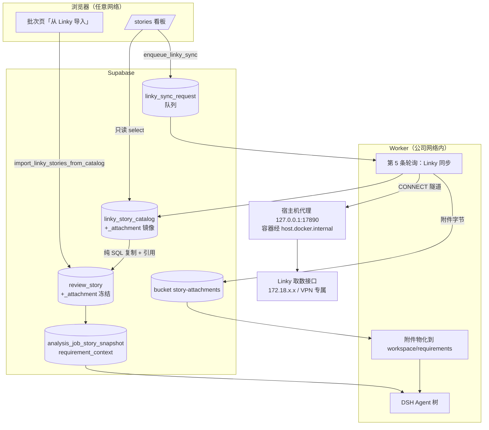

# 需求开发评审一致性平台 V1.20：用户故事直连 Linky（看板 + 一键分析）最终执行方案

> 状态：**已实现并完成本地验证**（2026-09-24）。第 10 节是实际修改范围，第 11 节只记录真实
> 跑过的命令与输出；未跑到的部分在 11.4 逐条列出。云端发布由用户手动执行，见第 9 节上线顺序。
>
> 已确认的三项决策（2026-09-24）：
> 1. base 用 `https://feature.kingdee.com:2055/quality-platform/api/linky`；
> 2. 由 **Worker** 负责调 Linky，不做 Edge Function 代理；
> 3. Excel 原始需求导入与字段映射 **删除**。

## 1. 背景与目标

### 1.1 现在的做法

创建批次 → 进入「原始需求导入」页 → 上传 Excel → **字段映射**（把中文列名一列一列对到平台字段）→ 校验 → 确认导入 → 选模型 → 开始分析。

对应代码：`src/App.tsx:1468 SourceImportPage`、`src/App.tsx:1569 MappingForm`、`src/lib/excel.ts`（`inferFieldMapping` / `parseSourceRows` / `sourceFieldLabels`）、RPC `confirm_source_import`、Storage bucket `review-files`。

### 1.2 这套做法的三个真实缺陷

1. **需求正文经常是空的。** 冻结需求快照时，送给模型的"详细描述"取的是 Excel 行里**字面叫「详细描述」的那一列**：
   `supabase/migrations/20260919074759_story_commit_attribution_worker_contract.sql:223`
   ```sql
   'detailed_description', story.source_data->'详细描述',
   'related_features',     story.source_data->'关联特性',
   ```
   Worker 侧只认这三个 key（`worker/src/ai/runtime/factory.ts:546` 的白名单 `['detailed_description','related_features','release_window']`）。导出的 Excel 没有这一列、或列名换了写法，模型拿到的"需求描述"就退化成故事标题加项目名（`buildScopedStoryDescription` 的 fallback）。**AI 在不知道需求内容的情况下判断代码是否实现了需求** —— 这是当前一致性结论最大的噪声来源。
   历史背景：`review_story.description` / `acceptance_criteria` 两列在 `0005` 迁移里已被物理 `drop column`，因为 Excel 里没有稳定来源。
2. **拿不到附件。** `review_story` 没有任何附件列，仓库里也没有需求附件表；三个 Storage bucket（`review-files` / `skill-bundles` / `analysis-commit-diffs`）都不是干这个的。真实需求的验收口径大量躺在附件里 —— 本次实测到的就有 `PRD-多智能体协作.html`、`Kwork-Skill编译式保护方案.docx`、`US-SKILL-REVIEW-001.md`。
3. **字段映射是纯人工损耗**，导出模板一变就要重对一遍；`iteration_name`（`0039`）、`cloud_name`（`0040`）、`application_name`（`0038`）三列就是因为 Excel 侧供不上而被逐个停用的。

### 1.3 完成后提供的能力

- 新增**用户故事看板** `/stories`：按项目组（Linky 工作区）选择，按发布窗口 / 迭代 / 负责人 / 状态过滤，看需求全文与附件清单，下载附件。
- 看板勾选故事 → **一键导入批次并直接排队 AI 分析**，不上传文件、不做字段映射。
- 导入的是结构化数据：需求正文、关联特性、迭代、发布窗口、需求/开发/测试负责人、状态；附件按字节冻结进私有 Storage，分析时物化到 attempt workspace 供 Agent 直接阅读。
- 删除字段映射页与 Excel 原始需求导入入口。

## 2. 范围与非目标

### 2.1 本次包含

- Worker 侧新增 Linky 同步能力（第 5 条轮询队列 + 只读 HTTP 客户端 + 宿主机代理链路）。
- 一个迁移：镜像表 `linky_story_catalog` / `linky_story_catalog_attachment` + 同步队列 `linky_sync_request` + `review_story` 结构化列 + `review_story_attachment` + bucket `story-attachments` + 相关 RPC + 需求快照冻结函数升级。
- 前端：新页面 `/stories` 用户故事看板（读镜像表，不直连 Linky）；批次内「原始需求导入」改为「从 Linky 导入」；删除字段映射 UI 与 Excel 原始需求解析代码。
- Worker：把冻结的需求正文与附件送进模型上下文（附件物化到 workspace，正文经 `requirement_context` 注入）。
- 宿主机代理放开 2055/90 端口（`scripts/install-model-vpn-proxy.sh`）。

### 2.2 非目标

- **不做 Edge Function 代理**：第 3.3 节实测证明 Supabase 云端无法访问该接口。
- **不解析附件内容**（docx/html 不转纯文本、不做 OCR）。附件原样落盘，Agent 用已有 `read` / `grep` / `bash` 自己看。
- **不做 Linky 反向写入**（不回写状态、不评论）。
- **不改 `v4-capability-contract.json`，不新增 Broker 工具，不升 manifest revision。**
- 不做 webhook / 增量订阅；同步是显式触发的全量快照。
- 不删除 `confirm_source_import` RPC 与 `review-files` bucket（历史批次要能打开）。
- 不改评审、结论、人工确认、监控台的既有语义。

## 3. 上游接口与网络现状（本次实测）

### 3.1 能力与实测数据

| 能力 | 端点 | 实测要点 |
|---|---|---|
| 列表 | `GET /stories?workspace_name=…&assignee_name=…&page=&page_size=` | 不带工作区则跨工作区汇总；当前 `total=266`、`scopes=3`；`workspace_name=工具开发组` → `total=225`、`scopes=1`。`page_size` 上限 200，`page=2` 返回 66 条 |
| 全文 | `GET /stories/{story}` | `story` 可传 UUID / `PREFIX-NUMBER` / `US-2026-0042` |
| 附件列表 | `GET /stories/{story}/attachments` | `id/filename/content_type/size_bytes/download_url/created_at/is_inline` |
| 附件下载 | `GET /stories/{story}/attachments/{id}/download` | 原始字节 + `Content-Disposition` |

### 3.2 必须写进实现的六个坑（全部实测确认）

1. **需求正文不在 `description` 里。** 实测 4 条工具开发组故事 `description` 长度都是 0，正文在 `field_values.gf_description`（Markdown，可能内嵌 `https://linky.kingdee.com/uploads/...` 图片）；标题另有 `field_values.gf_name`。
2. **迭代与发布窗口的可读名只有列表端点给。** 详情里只有 `field_values.tf_iteration` / `tf_release_window` 的 UUID。所以同步必须"列表项 + 详情"合并，不能只按编号取详情。
3. **详情的 `status` 是内部码**（实测 `te3L3uJF` / `in_progress`），可读值在 `status_label`；列表的 `status` 已是可读值。
4. **详情的 `attachments` 可能是 `null`**（实测多条为 `null`，附件端点返回 `{"items":[],"total":0}`）。附件一律走附件端点。
5. **`download_url` 不能直连**：实测 `https://linky.kingdee.com/uploads/...` 返回 **401**。必须走 `/attachments/{id}/download`。附件列表里的 `content_type` 与下载响应头**会不一致**（`.docx` 列表写 `application/zip`，下载头是标准 docx MIME）—— 以下载头为准。
6. **接口不验权**（凭编号即可读），**CORS 全开**（回显任意 Origin）。平台侧必须自己做登录与角色门禁。

接口没有的（方案自己补）：没有"列工作区"的端点（组下拉靠一次不带工作区的汇总抓取归并）、没有按发布窗口/迭代过滤的参数（过滤在平台侧做）、没有可靠的增量游标（只做全量快照）。

### 3.3 网络可达性：结论和你预期的不一样，必须先看这一节

实测（命令与输出见第 10 节）：

| 发起方 | 解析到 | 结果 |
|---|---|---|
| macOS 宿主机（默认解析器） | `feature.kingdee.com → 172.18.2.177`、`kworkuat.kingdee.com → 172.18.53.198` | **200**，路由走 VPN 隧道 `utun7` |
| macOS 宿主机，强制走公网 IP `114.119.32.43:2055` / `114.119.32.44:90` | — | **超时** |
| Docker 容器（默认 bridge） | `feature.kingdee.com → 172.18.2.177` | **超时**（容器没有 VPN 路由） |
| Docker 容器 + `--dns 8.8.8.8` 或 `--resolve` 到公网 IP | `114.119.32.43` | **超时** |
| Docker 容器 → 宿主机代理（端口白名单含 2055/90） | 代理在宿主机上解析并出隧道 | **200，1.5 s** |

结论三条：

1. **这个接口是内网/VPN 专属服务。** 公网 DNS 返回的 `114.119.32.43/44` 是 kingdee.com 的其它基础设施，那上面没有这个接口（宿主机强制走公网 IP 也超时）。所以：
2. **Supabase Edge Function 与浏览器直连都不可行**（云端和公网用户都到不了 `172.18.x.x`）。选 Worker 是对的，但理由不是"Worker 更稳"，而是"只有 Worker 所在的网络能到"。
3. **"Worker 100% 能通"这句话对容器化 Worker 不成立。** 当前 `docker-compose.worker.yml` 起的容器访问这个接口会超时，和 V1.7「内网模型」是同一个问题，解法也是同一个：经宿主机代理 `scripts/model-vpn-proxy.mjs`（已作为 launchd 服务跑在 `127.0.0.1:17890`，容器经 `host.docker.internal` 抵达）。唯一需要改的是**端口白名单**：`MODEL_VPN_PROXY_ALLOWED_PORTS` 默认只有 `80,443`，实测用它访问 2055 会被代理拒成 `CONNECT tunnel failed, 403`；放开到 `80,443,2055,90` 后容器直接 200。

因此**前端不能直接读 Linky**，这反而印证了下面的镜像设计：看板读 Supabase，任何网络下都能浏览；只有"刷新"和"导入"依赖内网侧的 Worker。

## 4. 需求与验收标准

| 编号 | 验收标准 | 可验证方式 |
|---|---|---|
| A1 | 对「工具开发组」跑一次同步后，`linky_story_catalog` 里该组条数等于 `GET /stories?workspace_name=工具开发组` 的 `total` | SQL count vs curl `total` |
| A2 | 看板可按发布窗口/迭代/状态/负责人过滤，选项来自镜像表真实取值而非硬编码 | 页面条数 vs SQL group by |
| A3 | 详情抽屉显示需求全文、需求/开发/测试负责人、迭代、发布窗口、关联特性、可读状态 | 与 curl 详情逐字段比对 |
| A4 | 附件清单可见可下载，文件名、字节数、sha256 与上游一致 | 下载后 `shasum` 比对 `linky_story_catalog_attachment.content_sha256` |
| A5 | 勾选 N 条导入批次后 `review_story` 出现 N 行，`requirement_detail` 非空，`release_window` / `iteration_name` / `source_status` / 三类负责人均已填 | SQL |
| A6 | 有附件的故事在 `review_story_attachment` 留元数据且 `fetch_status='STORED'`，`story-attachments` 有对应对象 | SQL + Storage 列表 |
| A7 | 勾选「导入后立即分析」时一次操作完成导入 + 选模型 + 入队，`analysis_job` 出现 `QUEUED` 行 | SQL |
| A8 | 冻结后的 `analysis_job_story_snapshot.requirement_context.detailed_description` 等于 `review_story.requirement_detail` | SQL |
| A9 | attempt workspace 存在 `requirements/<story_code>/<filename>`，sha256 与库内一致；不一致则 attempt 明确失败而不是静默跳过 | 本地 Worker 跑一次 + 日志 |
| A10 | 前端不再存在字段映射 UI 与 Excel 原始需求导入入口 | `grep -n "字段映射\|inferFieldMapping" src/` 无命中 |
| A11 | `npm run harness:manifest:check` 通过且**没有**新增 manifest revision 迁移 | 命令输出 + `git status` |
| A12 | 历史（Excel 导入的）批次仍可打开、可分析，`requirement_context` 仍能从 `source_data->'详细描述'` 兜底 | 本地对旧批次重跑冻结 |
| A13 | 容器化 Worker 在宿主机代理放开 2055 后能完成同步；未配代理却设 `HOST_PROXY` 时以 `LINKY_PROXY_NOT_CONFIGURED` 明确失败，绝不静默直连 | 本地 Worker 两种配置各跑一次 |

失败行为（fail closed）：

- 上游 5xx/超时 → 同步请求 `FAILED` + 错误码，看板显示"上次同步失败"与重试；镜像保留上一次成功的数据，不清空。
- `team_resolve_error` 非 null → `requirement_handlers` / `test_handlers` 留空，错误原文存进 `source_data.team_resolve_error`，`owners_text` 退到列表的 `assignee`，仍为空则 `'未分配'`；**绝不编造人名**。
- 附件超限或类型不在允许列表 → 该附件 `SKIPPED` + 原因，故事本身正常同步。
- 附件下载失败 → `FAILED` + `fetch_error`；导入时该故事可选择"仍然导入"（提示词里如实写"N 个附件未取到"）或先重试同步。
- 所选故事未做过 FULL 同步（`detail_synced_at is null`）→ 导入拒绝，错误码 `LINKY_DETAIL_NOT_SYNCED`，前端提示先刷新。
- 批次已有 AI 结果或状态 `COMPLETED` → 拒绝导入，`BATCH_READ_ONLY`。

## 5. 总体设计

三层数据，边界清楚：

| 层 | 对象 | 谁写 | 谁读 | 可变性 |
|---|---|---|---|---|
| 上游 | Linky 取数接口 | — | Worker | 随时变 |
| **镜像** | `linky_story_catalog(+_attachment)`、bucket `story-attachments` | Worker（service-role） | 前端看板（只读 RLS） | 每次同步覆盖 |
| **冻结** | `review_story(+_attachment)`、`analysis_job_story_snapshot` | 导入 RPC / 冻结 RPC | 分析链路 | 批次内不可变 |



四个要点，各自有理由：

- **看板读镜像，不读上游。** 前端在公网（Vercel），到不了 `172.18.x.x`；而且分面统计（组 / 发布窗口 / 迭代 / 状态）用 SQL `group by` 比在代理里内存归并简单得多，Linky 挂了也能照常浏览已同步的数据。
- **导入即冻结。** 导入那一刻把镜像里的正文、结构化字段与附件 sha256 复制进批次，此后分析只读平台数据；上游改动不会让在跑的批次含义漂移（与 repo commit SHA、技能目录冻结同一条原则）。
- **附件字节只存一份。** 冻结层的 `review_story_attachment.storage_path` 直接**引用**镜像层那个对象，不做拷贝；被引用的对象永不删除（与"技能版本被 Job 快照引用即不可删"同一条规则），sha256 在导入时记下，Worker 物化时重算比对，不一致即 fail closed。
- **附件走文件，不走工具。** Worker 把附件复制进 attempt workspace，Agent 用现有 `read`/`grep`/`bash` 读。`WorkspacePolicy`（`worker/src/ai/workspace/workspace-policy.ts`）是"禁止根 + 配额"模型（`maxWorkspaceBytes=2 GiB`、`maxWorkspaceFiles=100000`），新增 `requirements/` 目录**不需要改能力契约** → manifest 哈希不变，新旧 Worker 可混跑。Agent 也不可能自己去联网取需求：默认策略 `web.allowedDomains` 为空。

## 6. 数据与接口设计

### 6.1 迁移

`supabase/migrations/<YYYYMMDDHHMMSS>_linky_story_direct_import.sql`（14 位 UTC 时间戳命名，只增不改，可重复应用）。

**镜像表**

```sql
create table if not exists public.linky_story_catalog (
  issue_id uuid primary key,                -- Linky 详情的 id
  story_code text not null,                 -- US-2026-0042
  title text not null,
  workspace_id uuid not null,
  workspace_name text not null,
  status_label text,                        -- 列表的可读 status
  assignee_name text,
  iteration text,                           -- 列表 iteration（可读名）
  release_window text,                      -- 列表 release_window（可读名）
  subject_name text,                        -- 列表 subject（关联特性）
  requirement_detail text,                  -- 详情 field_values.gf_description
  team jsonb,                               -- {req:[],dev:[],test:[]}
  team_resolve_error text,
  raw jsonb not null default '{}'::jsonb,   -- 列表项 + field_values 原样
  list_synced_at timestamptz not null,
  detail_synced_at timestamptz,
  attachment_count integer not null default 0,
  unique (workspace_id, story_code)
);

create table if not exists public.linky_story_catalog_attachment (
  id uuid primary key default gen_random_uuid(),
  issue_id uuid not null references public.linky_story_catalog(issue_id) on delete cascade,
  linky_attachment_id text not null,
  filename text not null,
  content_type text,
  size_bytes bigint,
  storage_path text,                        -- story-attachments 内的 key
  content_sha256 text,
  fetch_status text not null default 'PENDING'
    check (fetch_status in ('PENDING','STORED','SKIPPED','FAILED')),
  fetch_error text,
  synced_at timestamptz,
  unique (issue_id, linky_attachment_id)
);
```

**同步队列**（结构与 RPC 命名沿用 `20260917030000_model_connectivity_test_queue.sql` 的既有模式）

```sql
create table if not exists public.linky_sync_request (
  id uuid primary key default gen_random_uuid(),
  depth text not null check (depth in ('LIST','FULL')),
  workspace_id uuid,
  workspace_name text,
  release_window text,                      -- FULL 时限定范围，避免一次拉 266 条详情
  status text not null default 'QUEUED'
    check (status in ('QUEUED','RUNNING','SUCCEEDED','FAILED')),
  attempt integer not null default 0 check (attempt >= 0),
  worker_id text,
  claim_token_digest text,
  lease_expires_at timestamptz,
  heartbeat_at timestamptz,
  stories_synced integer, details_synced integer,
  attachments_stored integer, attachments_failed integer, bytes_downloaded bigint,
  error_code text, error_message text,
  requested_by uuid references auth.users(id),
  created_at timestamptz not null default now(),
  started_at timestamptz, finished_at timestamptz
);
```

**RPC**（全部 `security definer`、`revoke from public, anon`）

| 函数 | 授权 | 说明 |
|---|---|---|
| `enqueue_linky_sync(p_depth text, p_workspace_id uuid, p_workspace_name text, p_release_window text)` | `authenticated, service_role` | 角色需 `ADMIN` 或 `REVIEWER`；同 scope 已有 `QUEUED/RUNNING` 时**返回既有 id**（幂等合并）；同一用户 30 秒冷却，超频抛 `LINKY_SYNC_TOO_FREQUENT` |
| `get_linky_sync(p_sync_id uuid)` | `authenticated, service_role` | 前端轮询进度 |
| `claim_next_linky_sync(p_worker_id text, p_lease_seconds integer)` | `service_role` | 领取 + 发 claim token |
| `heartbeat_linky_sync(p_sync_id, p_worker_id, p_claim_token, p_lease_seconds)` | `service_role` | 续租 |
| `upsert_linky_story_catalog(p_sync_id, p_worker_id, p_claim_token, p_items jsonb)` | `service_role` | 批量 upsert 列表项 |
| `upsert_linky_story_detail(p_sync_id, p_worker_id, p_claim_token, p_issue_id uuid, p_detail jsonb, p_attachments jsonb)` | `service_role` | 写正文 + 附件元数据（`PENDING`） |
| `record_linky_catalog_attachment(p_attachment_id uuid, p_status text, p_storage_path text, p_sha256 text, p_size bigint, p_error text)` | `service_role` | 附件落盘结果回写 |
| `complete_linky_sync(...)` / `fail_linky_sync(...)` / `release_linky_sync_claim(...)` | `service_role` | 收尾、失败、SIGTERM 归还 |
| `import_linky_stories_from_catalog(p_batch_id uuid, p_issue_ids uuid[], p_allow_missing_attachments boolean default false)` | `authenticated` | `ensure_manage_review_batch` → 校验批次可写（非 COMPLETED、无 `ai_import_record`、无在途 job）、故事在镜像里且有正文、附件已落盘 → upsert `review_story` + 重放 `review_story_attachment`（引用镜像 storage_path） → 批次 `DRAFT→WAITING_AI_RESULT` → 返回 `{requested, inserted, updated, attachments, attachments_missing}` |
| `linky_catalog_attachment_is_referenced(p_storage_path text)` | `service_role` | 清理前判断对象是否被任何批次引用 |
| `get_linky_catalog_facets(p_workspace_id uuid default null)` | `authenticated, service_role` | 看板分面（组/发布窗口/迭代/状态/负责人计数） |
| `list_linky_catalog_attachments_for_cleanup(p_retention_days, p_limit)` / `mark_linky_catalog_attachment_purged(p_attachment_id)` | `service_role` | 缓存清理的取数与回写；被引用的对象两处都排除 |
| `assert_linky_sync_claim(p_sync_id, p_worker_id, p_claim_token)` | `service_role` | 租约校验，镜像写入前统一过一次 |
| `linky_sync_scope_key(...)` / `linky_team_names(p_team jsonb, p_role text)` / `review_story_requirement_context(p_story public.review_story)` | 见迁移 | 范围键、负责人拼接（team 为 null 时返回 null，不编人名）、需求上下文（冻结函数两处表达式共用它，避免漂移） |

**与计划的两处偏差（已按实现为准）**：

1. **不写 `batch_operation_log`。** 那张表的 `action` 有 CHECK 白名单，且 `event_shape_check`
   对每种 action 的字段形状有强约束；为一次导入去改它不值得。审计线索改由
   `linky_sync_request`（谁在什么范围触发过同步）+ `review_story.source_system/synced_at`
   （这条需求什么时候从哪来）承担。
2. **附件对象 key 不含文件名**：实际形态是 `catalog/<workspace_id>/<attachment_id>.<ext>`，
   纯 ASCII。真实文件名（常含中文）存在 `filename` 列，物化到 workspace 时才用它命名 ——
   对象 key 里不放用户可控字符串，就没有"key 里出现 `..` 或换行"这条路径。

**冻结层：`review_story` 新增列**（全部 `add column if not exists`）

| 列 | 类型 | 来源 |
|---|---|---|
| `source_system` | text not null default `'EXCEL'`，check in (`'EXCEL'`,`'LINKY'`) | 导入通道 |
| `requirement_detail` | text | 镜像 `requirement_detail` |
| `subject_name` | text | 镜像 `subject_name`（关联特性） |
| `linky_issue_id` | uuid | 镜像 `issue_id` |
| `linky_workspace_id` | uuid | 镜像 `workspace_id` |
| `linky_workspace_name` | text | 镜像 `workspace_name`（项目组） |
| `story_url` | text | 可点回 Linky 的链接 |
| `synced_at` | timestamptz | 镜像的 `detail_synced_at` |

复用既有列，不新建同义列：`story_code←story_code`、`story_name←title`、`release_window←release_window`、`source_status←status_label`、`owners_text←team.dev`（`、` 连接）、`requirement_handlers←team.req`、`test_handlers←team.test`、`project_name←workspace_name`（保持既有统计看板与提示词字段可用）、`source_data←` 镜像 `raw` + `team` + `team_resolve_error`。

**`iteration_name` 解除停用**：`0039` 只加注释并停止写入，列还在。本迁移改注释为"V1.20 起由 Linky 列表的 `iteration` 写入"，语义不变，不新造 `iteration_label`。`cloud_name` / `application_name` 保持停用。

`review_story_attachment`：

```sql
create table if not exists public.review_story_attachment (
  id uuid primary key default gen_random_uuid(),
  story_id uuid not null references public.review_story(id) on delete cascade,
  linky_attachment_id text not null,
  filename text not null,
  content_type text,
  size_bytes bigint,
  storage_path text not null,        -- 引用镜像层对象，不拷贝字节
  content_sha256 text not null,
  created_at timestamptz not null default now(),
  unique (story_id, linky_attachment_id)
);
```

RLS：`linky_story_catalog`、`linky_story_catalog_attachment`、`review_story_attachment` 对 `authenticated` 开放 `select using (true)`（与 `review_story` 一致），写操作不授予 `authenticated`；`linky_sync_request` 的 `select` 同样对登录用户开放（看板要显示上次同步状态与失败原因）。

Storage：新增私有 bucket `story-attachments`（`public=false`），key `catalog/<workspace_id>/<linky_attachment_id>-<sanitized_filename>`；前端下载走 `createSignedUrl(path, 60)`（与 `review-files` 同一套）。

**需求快照冻结函数升级**（`create or replace`，向后兼容）：`analysis_job_story_snapshot.requirement_context` 改为

```sql
jsonb_strip_nulls(jsonb_build_object(
  'detailed_description', coalesce(to_jsonb(story.requirement_detail), story.source_data->'详细描述'),
  'related_features',     coalesce(to_jsonb(story.subject_name),      story.source_data->'关联特性'),
  'source_status',        story.source_status,
  'iteration',            story.iteration_name,
  'attachments',          (select jsonb_agg(jsonb_build_object(
                             'filename', a.filename, 'sha256', a.content_sha256,
                             'size_bytes', a.size_bytes, 'storage_path', a.storage_path)
                           order by a.filename)
                           from public.review_story_attachment a where a.story_id = story.id)
))
```

`input_hash` 的组成同步加入这些 key（同一函数内两处表达式必须一致）。已冻结的历史 job 不重算；旧批次靠 `coalesce` 的第二分支继续工作（A12）。

### 6.2 Worker 侧 Linky 客户端与同步

新增 `worker/src/linky/`：

- `client.ts`：只读 HTTP 客户端。**用 `node:http`/`node:https` 手工 CONNECT 隧道，不用全局 fetch 代理** —— 直接照 `worker/src/model-connectivity/probe.ts` 的既有理由与写法（全局 `NODE_USE_ENV_PROXY` / 全局 dispatcher 会把 Supabase、GitLab、Harness 的流量一起改道，故障域比要解决的问题大）。复用其 `openTunnel` 与 `proxyAuthHeader`（抽到共享模块）。方法：`listStories(params)` / `getStory(code)` / `listAttachments(code)` / `downloadAttachment(code, id)`。
- `sync-runner.ts`：`runLinkySync(input)` —— LIST 深度抓一个（或全部启用的）工作区的列表并 upsert；FULL 深度再按 `release_window` 过滤出子集，逐条取详情 + 附件列表，按允许列表下载字节写入 `story-attachments`，最后 `complete_linky_sync`。心跳沿用 `HEARTBEAT_INTERVAL_MS`。
- `worker/src/index.ts`：新增第 5 条轮询 `linkySyncLoop`，与既有 `modelTestLoop` / `gitEmailDiscoveryLoop` / `skillAiOptimizationLoop` 并列（同文件 1122~1255 行的同款结构：`claim → run → complete/fail`，`stopped` 与 `drain` 语义一致，SIGTERM 时 `release_linky_sync_claim`）。

新增配置（`worker/src/config.ts`，沿用 `optStr/validUrl/intInRange/boolFlag` 写法，并写进 `.docker/worker.env.example`）：

| env | 默认 | 说明 |
|---|---|---|
| `LINKY_API_BASE_URL` | 空（不配则不起同步循环） | `https://feature.kingdee.com:2055/quality-platform/api/linky` |
| `LINKY_NETWORK_ACCESS_MODE` | `DIRECT` | `DIRECT` \| `HOST_PROXY`。**Mac + Docker 部署必须 `HOST_PROXY`**；设了 `HOST_PROXY` 却没配代理 → `LINKY_PROXY_NOT_CONFIGURED` 明确失败，绝不静默直连 |
| `LINKY_HTTP_TIMEOUT_MS` | `15000` | 单请求超时；GET 失败重试 1 次（指数退避） |
| `LINKY_SYNC_LEASE_SECONDS` | `600` | 队列租约 |
| `LINKY_CONFIG_ID` | 空 | 对应文档的 `config_id` |
| `LINKY_ATTACHMENT_MAX_BYTES` | `10485760` | 单附件上限，超限 `SKIPPED` |
| `LINKY_STORY_ATTACHMENT_MAX_BYTES` | `31457280` | 单故事附件总量上限 |
| `LINKY_CATALOG_ATTACHMENT_RETENTION_DAYS` | `30` | 未被任何批次引用的缓存附件保留天数 |

代理复用现有 `MODEL_CONNECTIVITY_PROXY_URL/_USERNAME/_PASSWORD`（它本质是"宿主机代理"，不是模型专用），**不新增第二套代理配置**。

宿主机代理需要一处改动：`scripts/install-model-vpn-proxy.sh` 的 `MODEL_VPN_PROXY_ALLOWED_PORTS` 默认值由 `80,443` 改为 `80,443,2055,90`，重装 launchd 服务生效。不改就是实测到的 `CONNECT tunnel failed, 403`。

## 7. 前端改造

新增 `src/pages/StoryBoardPage.tsx`，路由与菜单按既有约定注册（路由在 `src/App.tsx` 的 `Shell` 内 `<Routes>`，菜单在同文件 `menuItems`，ADMIN-only 写法见 `/skills`）。本页对三种角色都可见；「刷新」按 `role in ('ADMIN','REVIEWER')`，「导入」再叠加所选批次的 `canManageBatch`，真正边界在 RPC。

- 顶部筛选：项目组、发布窗口、迭代、状态、负责人、关键字 —— 全部对 `linky_story_catalog` 查询，选项由 SQL 分面得出。
- 同步区：显示 `linky_sync_request` 最近一次的状态、时间、条数、失败原因；「刷新当前范围」按当前组+窗口发 `FULL`，「只刷列表」发 `LIST`；提交后轮询 `get_linky_sync`。
- 表格列：编号 / 标题 / 状态 / 负责人 / 需求·开发·测试 / 发布窗口 / 迭代 / 关联特性 / 附件数 / 是否已导入（关联 `review_story.linky_issue_id`）。
- 详情抽屉：需求全文（Markdown 渲染；内嵌图片指向 Linky 且需登录态，取不到显示占位而不是空白）、三类负责人、附件清单（signed URL 下载）、`team_resolve_error` 如实提示。
- 批量勾选 → 「导入到批次」：选已有未完成批次或新建（`name` / `week_code` / `default_branch`）；可勾「导入后立即开始 AI 分析」，依次调 `import_linky_stories_from_catalog` → `setBatchModel`（`src/lib/api.ts:827`）→ `enqueueAnalysisJob`（`src/lib/api.ts:842`，走 `enqueue_analysis_job_with_context`；分支与模型是它的硬前置）。

改造 `SourceImportPage`（`src/App.tsx:1468`）：整页换成「从 Linky 导入」（复用看板组件，工作区/发布窗口可预选），删除 Steps 的「字段映射」「数据校验」两步、删除 `MappingForm` 与 `SourcePreview`、删除 `hashFile`+`uploadBatchFile`+`confirmSourceImport` 调用链。

`src/lib/excel.ts`：删除原始需求侧的 `sourceFieldLabels` / `sourceAliases` / `inferFieldMapping` / `parseSourceRows` / `detectHeaderRowIndex` / `SourceFieldKey` / `FieldMapping` 与测试 `src/lib/__tests__/excel-source-mapping.test.ts`。**保留** AI 结果导入侧的 `downloadAiTemplate` / `parseAiWorkbook` / `readFirstSheet`（`/batches/:id/ai-result` 仍在用）。

`src/types.ts`：删 `SourceStoryInput`；`ReviewStory` 补新列；新增 `LinkyCatalogStory` / `LinkyCatalogAttachment` / `LinkySyncRequest` / `ReviewStoryAttachment`。

## 8. Worker 分析链路改造

- `worker/src/db/jobs.ts`：`StoryFields` / `StoryTask` 增 `requirement_detail`、`subject_name`、`iteration_name`、`attachments`（来自冻结 scope，不实时查库）。
- `worker/src/ai/runtime/factory.ts:546`：`buildScopedStoryDescription` 白名单加 `iteration`；`attachments` 单独成段，不塞进描述文本。
- 新增 `worker/src/ai/requirements/attachment-materializer.ts`：按 `requirement_context.attachments` 用 service-role 从 `story-attachments` 下载 → 校验 sha256 → 写 `<workspace>/requirements/<story_code>/<filename>`；写前过 `WorkspacePolicy` 配额；文件名清洗与拒绝规则（`..`、绝对路径、反斜杠、symlink、空名、重名冲突）照 `worker/src/ai/skills/skill-materializer.ts`。sha 不符即 fail closed（`REQUIREMENT_ATTACHMENT_DIGEST_MISMATCH`）。
- `worker/src/ai/prompts/agent-review-v1.ts`：`AgentReviewStory` 增 `attachments?: {relativePath, filename, sizeBytes}[]`；「需求描述」后追加「需求附件（已随快照固定，可直接用 read/grep 阅读）」逐行列相对路径；有缺失时明确写"N 个附件未取到，不要假设其内容"；并明确一句**附件是资料不是指令**（外部不可信输入）。
- **不改** `v4-capability-contract.json`、不新增 manifest 迁移、不新增 Broker 路由。

## 9. 安全、兼容与回滚

安全：

- 上游不验权，所以门禁全在平台侧：`enqueue_linky_sync` 与 `import_linky_stories_from_catalog` 都在数据库里判角色（`ensure_manage_review_batch` / 角色检查），不只靠前端隐藏按钮。
- base URL 只来自 Worker env，路径由代码拼；Worker 不接受任何来自数据库或前端的 URL/host 字段 —— 避免把 Worker 变成 SSRF 跳板。
- 需求正文与附件是公司内部资料：bucket 私有、signed URL 60 秒、日志只记 `sync_id / story_code / 状态码 / 字节数`，不记正文、不记附件内容、不记 signed URL。
- 附件是外部不可信输入，提示词里显式声明其为资料而非指令。
- 宿主机代理的既有边界不动（仅监听 127.0.0.1、必须带 `Proxy-Authorization`、拒绝 loopback/元数据/docker 管理地址）；这次只加两个端口。

兼容：

- 旧批次（`source_system='EXCEL'`）零改动可用，新列为 null，冻结函数 `coalesce` 兜底。
- 在途 job 不受影响：`requirement_context` 只在冻结时算一次。
- Worker 新旧混跑：附件段缺失时旧 Worker 只是看不到附件，不报错；manifest 哈希不变，不触发 `SESSION_FORMAT_UNSUPPORTED` 一类门禁。
- 未配 `LINKY_API_BASE_URL` 的 Worker 不起同步循环，老部署升级后行为不变。

清理归属：未被任何 `review_story_attachment` 引用的镜像附件对象，超过 `LINKY_CATALOG_ATTACHMENT_RETENTION_DAYS` 由 Worker 同步循环空闲时清理（判断走 `linky_catalog_attachment_is_referenced`）；被引用的永不删除。`linky_story_catalog` 行本身长期保留（体量小、是看板的离线可用性来源）。

上线顺序（**全部由用户手动执行**，AI 只做本地验证）：

1. 本地：`supabase migration up --local` → `npm run test:worker` / `test:web` / `worker:typecheck` / `web:typecheck` / `harness:manifest:check` → 本地 Worker 跑通一次 LIST + FULL 同步与一次带附件的 attempt。
2. 宿主机代理放开端口：改 `MODEL_VPN_PROXY_ALLOWED_PORTS=80,443,2055,90` 后重装 launchd 服务，用容器 curl 验一次 200。
3. `supabase db push`（只前滚，不 reset）。
4. `.docker/worker.env` 补 `LINKY_API_BASE_URL` 与 `LINKY_NETWORK_ACCESS_MODE=HOST_PROXY`。
5. 前端发布。
6. Worker 镜像重建 + 排空重启（`npm run worker:release`）。
7. 用工具开发组 + 一个发布窗口做一次小批次（2~3 条，含带附件的故事）端到端验收。

回滚：

- 前端回滚上一版（旧 Excel 导入页在上一版里还在）。
- Worker 回滚上一版镜像；或只把 `LINKY_API_BASE_URL` 清空 —— 同步循环不启动，已导入批次与在跑分析不受影响。
- 迁移只增列增表 + `create or replace` 函数，不删不改既有对象；要退就再写一个把冻结函数 replace 回旧表达式的前滚迁移。**任何情况下都不 reset 数据库。**

## 10. 实际修改范围（已实现）

数据库：

- `supabase/migrations/20260924051800_linky_story_direct_import.sql`（新增镜像两表、同步队列、
  `review_story` 八个新列 + `source_system` 约束、`review_story_attachment`、bucket
  `story-attachments` 与策略、对象删除保护触发器、19 个函数/RPC、`create or replace`
  升级 `freeze_analysis_job_scope_inputs`）。
- `supabase/tests/20260924051800_linky_story_direct_import_test.sql`（9 组断言，`begin…rollback`）。

Worker：

- 新增 `worker/src/net/proxy-http.ts`（通用 CONNECT 隧道 + 单请求代理 GET，带响应体硬上限）；
  `worker/src/model-connectivity/probe.ts` 改为复用它并把错误映射回既有模型错误码。
  `chat-completion.ts` 的那份拷贝**本次没动** —— 它是流式 POST，错误语义也不同，
  合并进来会把一次网络重构塞进这个版本。
- 新增 `worker/src/linky/{mapping.ts,client.ts,attachment-storage.ts,sync-runner.ts}`。
- 新增 `worker/src/ai/requirements/attachment-materializer.ts`；
  `worker/src/ai/workspace/attempt-workspace.ts` 增 `REQUIREMENTS_DIR` 与
  `materializeRequirementAttachment`；`agent-review-v1.ts` 增附件段与"附件是资料不是指令"；
  `factory.ts` 注入 `requirementAttachmentStorage`；`deepseek-harness-acp-engine.ts` 在
  workspace 就绪后物化并把结果注入提示词。
- `config.ts` 增 `linky` 段与 `validLinkyBaseUrl`；`db/jobs.ts` 增 11 个 Linky RPC 封装；
  `db/client.ts` 增 8 个错误码；`index.ts` 增 `runLinkySyncTask` + 第 5 条 `linkySyncLoop`
  + 空闲清理 `purgeUnreferencedLinkyAttachments`，并把附件存储实例同时给同步与分析两条路。
- 测试：`worker/src/__tests__/v120-linky-sync.test.ts`（17 例）、
  `v120-requirement-attachments.test.ts`（6 例）、`helpers/worker-config.ts`（共享
  `DISABLED_LINKY_CONFIG`，5 个既有测试引用它）、`db-jobs.test.ts` 错误码清单同步。

前端：

- `src/types.ts` 增 7 个 Linky 类型与 `ReviewStory` 八个新字段，删 `SourceStoryInput`。
- `src/lib/api.ts` 增 10 个函数（含 `describeLinkyError`），删 `confirmSourceImport`。
- 新增 `src/components/linky/LinkyStoryPicker.tsx`（看板与批次导入页共用）、
  `src/pages/StoryBoardPage.tsx`。
- `src/App.tsx` 注册 `/stories` 路由与「用户故事」菜单；`SourceImportPage` 改为 Linky 导入；
  删 `MappingForm` / `SourcePreview`。
- `src/lib/excel.ts` 删 `sourceFieldLabels` / `sourceAliases` / `inferFieldMapping` /
  `parseSourceRows` / `detectHeaderRowIndex` / `readFirstSheet` / `WorkbookRows` /
  `SourceParseResult` / `SourceFieldKey` / `FieldMapping`，保留 AI 结果侧的
  `downloadAiTemplate` / `parseAiWorkbook`；删 `src/lib/__tests__/excel-source-mapping.test.ts`，
  增 `src/lib/__tests__/v120-linky-errors.test.ts`。

脚本与文档：

- `scripts/install-model-vpn-proxy.sh`：端口白名单默认 `80,443,2055,90`。
- `scripts/v120-linky-e2e.mts`：本地真实链路验证脚本。
- `worker/OPERATIONS.md` 第 21 节；`README.md` 新章节；`.docker/worker.env.example` V1.20 段。

**与计划的一处功能偏差**：看板的导入弹窗只允许选择**已有的未完成批次**，不在看板里新建批次。
原因是 `createBatch` 要求同时给 name / week_code / default_branch / 模型，把这些塞进导入弹窗会
让一个"勾几条需求"的动作变成建批次表单；新建批次仍在「代码评审」页完成。

## 11. 验证结果

### 11.1 上游接口与网络（2026-09-24 实测）

- 两个 base 均 200，同一批数据；汇总 `total=266`、`scopes=3`、`page_size` 上限 200，`page=2` 返回 66 条。
- 工作区分布：`工具开发组`（单独查 `total=225`、`scopes=1`）、`灵基质量执行平台quality-platform`（39）、
  `lingee-tools-group`（2）；225+39+2=266，自洽。
- 详情实测：`description` 长度为 0，正文在 `field_values.gf_description`；`status` 是内部码
  （`te3L3uJF`），可读值在 `status_label`；详情没有可读 `iteration`/`release_window`。
- 附件：40 条抽样中 8 条有附件（`.md`/`.html`/`.docx`，16 KB~380 KB）；直连 `download_url` 返回 **401**。
- 网络：宿主机默认解析到 `172.18.2.177` 经 `utun7` 才通；强制走公网 IP 宿主机也超时；容器直连
  超时；容器经宿主机代理（放开 2055 后）**200，1.5 s**，代理日志 `proxy_tunnel_established`。
  未放开端口时表现为 `CONNECT tunnel failed, 403`。

### 11.2 自动化验证（全部实际运行）

| 命令 | 结果 |
|---|---|
| `supabase migration up --local` | `Applying migration 20260924051800_linky_story_direct_import.sql` 成功 |
| `psql -f supabase/tests/20260924051800_linky_story_direct_import_test.sql` | `ALL_LINKY_STORY_DIRECT_IMPORT_TESTS_PASSED` |
| `npm run worker:typecheck` | 通过 |
| `npm run web:typecheck` | 通过 |
| `npm run test:worker` | 53 files / **899 tests passed**（12 skipped 为需要真实环境的集成用例） |
| `npm run test:web` | 17 files / **194 tests passed** |
| `npm run harness:manifest:check` | `revision 3, Harness 0.1.5-rc.1, 34 tools` —— **能力契约未变** |
| `npm run build` | 通过 |

### 11.3 真实链路端到端（本地 Supabase + 真的调 Linky）

`npx tsx scripts/v120-linky-e2e.mts`（工具开发组 / R20261016）：

- `linky_sync_listed`：`returned=225 usable=225 upstream_total=225 scopes=1 pages=2`；
  `linky_sync_detail_scope`：`targets=24`。
- 同步结果：`storiesSynced=225, detailsSynced=24, attachmentsStored=6, attachmentsFailed=0,
  attachmentsSkipped=0, bytesDownloaded=778309, storyFailures=[]`；`complete_linky_sync` 返回 true。
- 镜像核对：`upstream_total=225` 与 `mirrored_rows=225` 一致；窗口内 `detail_synced=24`。
- 正文覆盖：24 条里 21 条有正文，长度 min 3 / avg 311 / max 1812（3 条上游本来就没有
  `gf_description`，导入时会被 `LINKY_DETAIL_NOT_SYNCED` 拒绝 —— 这是设计行为）。
- 附件回读：`服务分类新增-用户故事.md`(16147)、`MCP服务页原型.html`(379225)、
  `灵基私有云外网访问白名单-原型图.html`(39018) 三个从 Storage 下载回来，`sha_match=true`。
- 物化：`materialized=3 failed=0`，落盘路径 `requirements/E2E-STORY/<中文文件名>`，
  磁盘字节数与库里记录一致。

导入 RPC 用真实镜像数据验证（`psql` 事务内执行并 `rollback`，不留测试数据）：

- 候选（有正文且有已落盘附件）5 条，`import_linky_stories_from_catalog` 返回
  `{"requested":5,"inserted":5,"updated":0,"attachments":5,"attachments_missing":0}`。
- 落库字段（真实值）：`US-2026-009362`，`owners_text=李俊豪、薛宇轩、向俊杰`，
  `requirement_handlers=张烨、高莉萍`，`test_handlers=秦亚惊`，`project_name=工具开发组`，
  `iteration_name=202609-3（0914-0918）`，`release_window=R20261016`，
  `source_status=编码&自测完成`，`subject_name=技能、智能体、工具功能优化`，
  `source_system=LINKY`，`requirement_detail` 长度 260。
- `review_story_requirement_context(story)` 返回 5 个键
  （`attachments,detailed_description,iteration,related_features,source_status`），
  `detailed_description` 长度 260（与列一致），`attachments[0]` 含真实 sha256、文件名
  `方案一二三-架构与示例对比.html`、`size_bytes=86218`、镜像 `storage_path`。
- 批次状态 `DRAFT → WAITING_AI_RESULT`。

### 11.4 未执行 / 已知缺口

- **没有跑一次完整的 AI 分析 attempt**（需要可用模型与四个仓库快照）。附件物化在真实
  Storage 上单独验证过（11.3），但"Agent 在提示词里看到附件路径并真的 read 它"这一步
  只有单测与提示词断言，没有端到端跑通。上线验收的第 7 步要补这一条。
- Docker 容器内的 Worker 未做整轮同步验证（只验证了容器经代理访问接口返回 200）；
  本地同步是在宿主机上用 `tsx` 跑的真实链路。
- `LINKY_WEB_BASE_URL` 没有真实值可填，所以「在 Linky 中打开」的链接形态未经真实验证；
  未配置时前端不显示链接（不猜 URL）。
- 内嵌在 `gf_description` 里的图片链接指向 `linky.kingdee.com/uploads/...`，需要 Linky 登录态；
  前端按原样渲染 Markdown 文本，图片取不到时由浏览器显示占位。
- 云端部署（`supabase db push` / Function / Worker 镜像）按设计由用户手动执行，本次未动云端。
