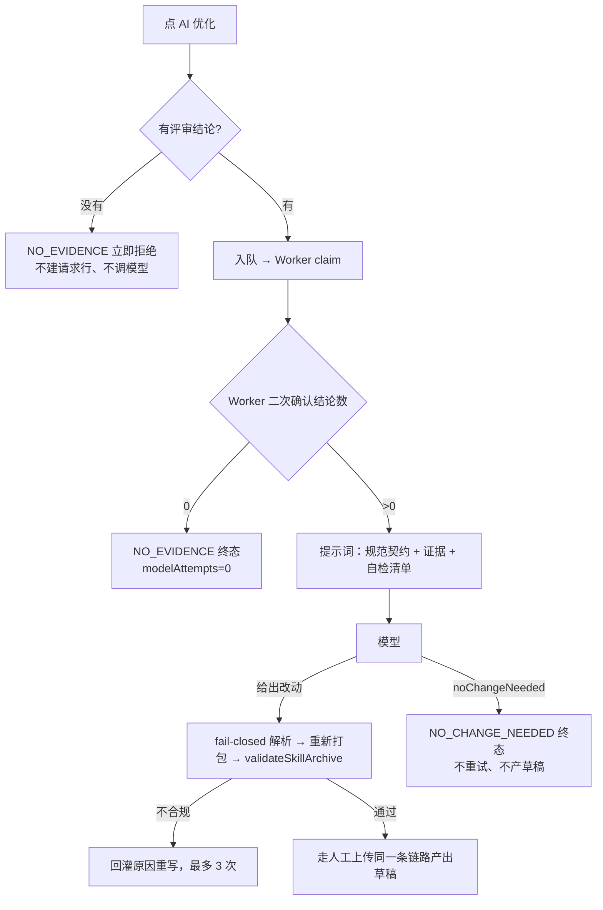

# 需求开发评审一致性平台 V1.22：技能 AI 优化一次写对最终执行方案

> 状态：**已实现并在本地验证通过**（2026-09-24）。云端推送与云端 Worker 更新由使用者手动执行，见第 10 节末尾的发布清单。

## 1. 背景与目标

### 背景（先说清线上到底发生了什么）

管理员在 `/skills` 对 `kwork-skill-engineering` 发起 AI 优化，页面报：

```text
上次优化失败（SKILL_OPTIMIZATION_MODEL_OUTPUT_INVALID）
AI 连续几次写出的技能包都没通过结构检查（路径不合规、放错目录、frontmatter 的 name 被改、
文件或整包超出容量上限之类）。没有产出任何草稿，可以直接重试。
```

查云端 `skill_ai_optimization_request` 的真实终态：

| 字段 | 值 |
|---|---|
| `error_code` | `SKILL_OPTIMIZATION_MODEL_OUTPUT_INVALID` |
| `error_message` | **`the model changed nothing`** |
| `model_attempts` | 3 |

也就是说：**模型并没有写出不合规的技能包**，它一个字都没改。页面上列举的那四条原因，一条都不是真的。

根因是平台自己制造的一个矛盾，三段环环相扣：

1. **入队门禁口径错**。`admin_enqueue_skill_ai_optimization` 数的是
   `count(distinct job_id) from analysis_job_skill_snapshot`，即"这个技能被冻结进过几个 Job"。
   而技能被冻结进 Job 发生在作业创建阶段，与那个 Job 是否产出过评审结论无关。
   截图里的技能：被 1 个分析任务引用过，**0 条评审结论**，verdict 分布全 0、抽样为空 —— 门禁放行。
2. **提示词要求模型别改**。系统提示词第 9 条：「不要编造证据里没有的业务事实；证据不足时宁可少改」。
   模型拿到一份全 0 的统计，照规则办事，返回空的 `files`。
3. **解析器把"没改"判成"写错了"**。`parseSkillOptimizationOutput` 在 `files` 与 `deletedFiles`
   都为空时 `reject('the model changed nothing')`，被当成结构不合规 → 回灌原因让模型重写 →
   证据还是那份全 0 的统计 → 同样的答案 → 3 次用尽，终态失败。

外加一条让诊断变难的实现：`describeOptimizationError` 对已登记的错误码**丢掉** `error_message`，
只显示罐头文案。于是真实原因躺在数据库里，管理员看到的是四条与事实无关的猜测。

### 目标

- AI 按技能包的结构规范**一次写对**，而不是靠"写错再回灌重写"收敛；
- 没有可学习的评审证据时**不进入模型阶段**，而不是烧三次模型调用再失败；
- 模型判断"不该改"是一条**合法终态**，不再伪装成结构错误；
- 失败原因如实显示给管理员。

## 2. 范围与非目标

### 本次包含

- 入队与执行两侧的证据门禁改为"有评审结论"，两个证据函数输出 `review_result_count`；
- 提示词改造：目录/扩展名表由校验器常量生成、frontmatter 原文行、容量现状、输出样例、自检清单；
- 新增终态码 `SKILL_OPTIMIZATION_NO_CHANGE_NEEDED`（模型明确判断不需要改），不重试、不产草稿；
- 前端：按钮可用性判据同步收紧、错误文案带上服务端原文、"不需要改"不再显示成失败；
- SQL 测试、Worker 单测、前端单测、文档。

### 明确不包含

- **不改结构校验规则本身**。`validateSkillArchive` 是最终闸门，一个字没动 —— 这次的问题不是规则太严，
  而是提示词没把规则说清、以及一个不该存在的"空改动=不合规"判定。
- **不放宽 fail-closed**。路径、角色/扩展名、frontmatter、容量、UTF-8、图片 magic 全部照旧拒。
- **不做"局部编辑"协议**（让模型只回 diff）。模型仍然回完整文件全文；输出被截断的风险见第 8 节。
- **不改 dsh 运行时、能力契约或 manifest**。

## 3. 当前实现与问题

```text
点「AI 优化」
  → admin_enqueue_skill_ai_optimization   门禁：被 Job 引用过就行            ← 口径错
  → Worker claim → get_skill_review_evidence_for_optimization
  → buildSkillOptimizationPrompt          散文式规则，无示例、无自检清单      ← 说不清
  → 模型：证据全 0 → 返回空改动集
  → parseSkillOptimizationOutput          "changed nothing" 判为输出不合规    ← 逼它重试
  → 回灌原因重写 ×3 → 终态 FAILED
  → describeOptimizationError             丢掉 error_message，显示四条猜测    ← 看不见真相
```

## 4. 需求与验收标准

| # | 要求 | 验证 |
|---|---|---|
| 1 | 引用数 > 0 但结论数 = 0 时，入队被 `SKILL_OPTIMIZATION_NO_EVIDENCE` 拒绝，不建请求行 | SQL 测试 |
| 2 | 两个证据函数都返回 `review_result_count`，与 `verdict_counts` 同源 | SQL 测试 |
| 3 | 有结论后同一技能可入队，Worker 侧读到同一个计数 | SQL 测试 |
| 4 | Worker 在结论数为 0 时**不调模型**（`modelAttempts = 0`） | Worker 单测 |
| 5 | 数据库还没升级（无 `review_result_count`）时按结论分布求和判定 | Worker 单测 + 前端单测 |
| 6 | 提示词含目录/扩展名表，且表由 `SKILL_ROLE_EXTENSIONS` 生成（与校验器同源） | Worker 单测遍历常量断言 |
| 7 | 提示词贴出 frontmatter `name:` 行原文并要求逐字保留 | Worker 单测 |
| 8 | 提示词给出容量现状（当前字节 + 上限 + 中文字节换算）、输出样例、自检清单 | Worker 单测 |
| 9 | 模型走 `noChangeNeeded` 出口时：调一次、不重试、不产草稿、理由写回 | Worker 单测 |
| 10 | 前端按钮在 0 结论时禁用；失败文案带服务端原文；NO_CHANGE_NEEDED 不显示成错误 | 前端单测 + 类型检查 |

## 5. 总体设计



保留重试机制，但它从"主要收敛手段"降级成"兜底"：规范现在写在提示词里。

## 6. 数据与接口设计

迁移 `supabase/migrations/20260924095026_skill_ai_optimization_require_review_results.sql`，
三个 `create or replace`，签名全不变，无表结构变化：

| 对象 | 变化 |
|---|---|
| `admin_get_skill_review_evidence(uuid)` | 输出加 `review_result_count` |
| `get_skill_review_evidence_for_optimization(uuid, text, uuid)` | 输出加 `review_result_count` |
| `admin_enqueue_skill_ai_optimization(uuid)` | 门禁从"有引用"改为"有 ≥1 条 `ai_review_result`"，口径与证据函数的 `evidence` CTE 逐字一致 |

Worker / 前端类型：`SkillReviewEvidenceSnapshot.review_result_count?: number`、
`SkillReviewEvidence.review_result_count?: number`（可选 = 兼容未升级的后端）。

新错误码：`SKILL_OPTIMIZATION_NO_CHANGE_NEEDED`。状态仍沿用 `FAILED`，不新增状态枚举 ——
前端按错误码把它渲染成 warning 而不是 error，避免改数据库枚举与既有查询。

## 7. 前端与 Worker/运行时改造

Worker：

| 文件 | 改动 |
|---|---|
| `worker/src/ai/skills/skill-manifest.ts` | `ROLE_EXTENSIONS` 导出为 `SKILL_ROLE_EXTENSIONS`，供提示词生成同源表 |
| `worker/src/ai/skills/skill-optimization-prompt.ts` | 新增 `renderPathSpec` / `renderBudget` / `findFrontmatterNameLine`；提示词重写成契约 + 样例 + 自检清单；新增 `SkillOptimizationNoChangeError` 与 `noChangeNeeded` 解析；空改动集的拒绝原因改为指向出口 |
| `worker/src/ai/skills/skill-ai-optimizer.ts` | 证据门禁按结论数 fail fast（带旧数据库回退）；`NO_CHANGE_NEEDED` 终态不重试；新增两个日志事件 |

前端：

| 文件 | 改动 |
|---|---|
| `src/types.ts` | `SkillReviewEvidence.review_result_count?` |
| `src/lib/skill-ai-optimization.ts` | `reviewResultCount` / `canOptimizeFromEvidence` 收紧；`describeEvidenceUnavailable` 区分两种不可用；错误文案重写并附服务端原文（截断 400 字） |
| `src/pages/SkillManagementPage.tsx` | 证据不可用时的 Alert 改用 `describeEvidenceUnavailable`；`NO_CHANGE_NEEDED` 渲染成 warning |

提示词新增内容（节选，真实渲染）：

```text
## 路径与文件类型（这张表由校验器生成，不是建议）

- SKILL.md（根目录，唯一入口，必须存在） → 角色 ENTRY，只允许扩展名：md
- references/<名>.<扩展名> → 角色 REFERENCE，只允许扩展名：md / txt / json / yaml / yml / csv / xml
- scripts/<名>.<扩展名> → 角色 SCRIPT，只允许扩展名：sh / js / mjs / cjs
- assets/<名>.<扩展名> → 角色 ASSET，只允许扩展名：png / jpg / jpeg / webp / gif（二进制，只能删除，不能改写或新增）
…
- SKILL.md 必须以 `---` 开头，frontmatter 里这一行必须**逐字保留**：`name: kwork-skill-engineering`

## 容量
- SKILL.md：当前 4213 字节，上限 65536 字节
- 估算方式：中文按 1 字 ≈ 3 字节、英文按 1 字符 ≈ 1 字节；不要贴近上限写。

## 「不需要改」出口
{"noChangeNeeded": true, "summary": "<中文说明为什么现在不该改，以及需要什么证据才能改>"}
```

## 8. 安全、兼容与回滚

- **没有放宽任何校验**。`validateSkillArchive` 仍是最终闸门；脚本仍然只能在 `scripts/` 下、
  仍然触发 `contains_scripts` 与发布页额外确认；图片仍然只能删。
- **`noChangeNeeded` 不能被用来绕过什么**：它的唯一效果是"本次不产出草稿"。
- **门禁收紧的代价**：只被引用、还没产出结论的技能现在**不能**发起优化。这是有意的 ——
  那种状态下优化没有任何输入。页面会说清是"没被引用过"还是"引用过但还没有结论"。
- **旧数据/未升级后端**：`review_result_count` 缺席时两端都回退到结论分布求和，口径一致，
  因此数据库与 Worker/前端可以分别发布，顺序不敏感。
- **已存在的失败行不受影响**：历史 `FAILED` 行照旧显示，只是文案里会多出服务端原文。
- **已知缺口（本次不修）**：平台无法判断模型回写的文件正文是否被**截断**。
  提示词明确要求"完整全文、不许省略号占位"，但如果模型在输出中途被 token 上限截断，
  JSON 会解析失败（可发现）；若它主动写了个更短但语法完整的版本，则会作为正常改动进入草稿 ——
  这就是"必须人工看 diff 再发布"这条产品约束存在的理由。
- **回滚**：写一个新迁移把三个函数覆盖回 20260924050153 的版本（禁止编辑既有迁移），
  Worker 与前端回滚上一版。三者可独立回滚。

## 9. 实施步骤与文件范围

1. 查云端失败行拿到真实 `error_message`（诊断，只读）；
2. 新迁移 + SQL 测试，本地应用并跑通；
3. Worker：常量导出 → 提示词契约 → `noChangeNeeded` 解析 → 优化器门禁与终态；
4. 前端：类型、判据、文案、页面渲染；
5. 测试：Worker 单测 11 例、前端单测 +7 例；
6. `worker:typecheck` / `worker:build` / `test:worker` / `test:web` / `web:typecheck` / `tsc -p tsconfig.app.json` / `npm run build`；
7. 本地 Worker 镜像重建并确认 `worker_started`；
8. 文档：本文件 + `worker/OPERATIONS.md` 第 23 节。

新增：

- `supabase/migrations/20260924095026_skill_ai_optimization_require_review_results.sql`
- `supabase/tests/20260924095026_skill_ai_optimization_require_review_results_test.sql`
- `worker/src/__tests__/v122-skill-optimization-guidance.test.ts`
- `代码评审平台需求文档/V1.22-技能AI优化一次写对/需求开发评审一致性平台-V1.22技能AI优化一次写对-最终执行方案.md`

修改：

- `worker/src/ai/skills/skill-manifest.ts`、`skill-optimization-prompt.ts`、`skill-ai-optimizer.ts`
- `src/types.ts`、`src/lib/skill-ai-optimization.ts`、`src/pages/SkillManagementPage.tsx`
- `src/lib/__tests__/skill-ai-optimization.test.ts`
- `worker/OPERATIONS.md`

## 10. 验证结果

| 验证 | 命令 | 结果 |
|---|---|---|
| 线上根因取证 | 只读查询云端 `skill_ai_optimization_request` | `error_message = "the model changed nothing"`，`model_attempts = 3`；另一条为 `the model output contains no JSON object` |
| 迁移应用（含重复应用） | `psql < 迁移` 后 `supabase migration up --local` | 两次都成功，迁移历史已记录 |
| SQL 契约测试 | `psql < supabase/tests/20260924095026_*_test.sql` | `ALL_SKILL_AI_OPTIMIZATION_EVIDENCE_GATE_TESTS_PASSED`（含"引用 1 / 结论 0 被拒"这条线上场景复现） |
| Worker 类型检查 | `npm run worker:typecheck` | 通过 |
| Worker 构建 + manifest | `npm run worker:build` | 通过，`revision 3, 34 tools`（能力契约未变） |
| Worker 全量单测 | `npm run test:worker` | 56 文件 / **935 passed**、32 skipped、0 failed |
| 本次新增 Worker 单测 | `npx vitest run worker/src/__tests__/v122-skill-optimization-guidance.test.ts` | 11 passed |
| 前端单测 | `npm run test:web` | 18 文件 / **216 passed** |
| 前端类型 + 构建 | `npm run web:typecheck`、`tsc -p tsconfig.app.json --noEmit`、`npm run build` | 全部通过 |
| 本地 Worker | 本地 compose `up -d --build --force-recreate --scale worker=1` | 容器 `Up`，日志 `worker_started` |

未执行：

- **真实跑一次成功的 AI 优化**（需要一个有评审结论的技能 + 模型额度）。因此"新提示词能让模型一次写对"
  这件事目前由单测保证提示词内容与契约同源，**没有**线上成功样本。首次真实运行时看
  `model_attempts`：1 表示一次写对，>1 表示还在靠回灌重写。
- 云端数据库推送、云端 Worker 与前端发布。

### 你手动发布

```bash
# 1. 提交代码
git status

# 2. 推送迁移（三个 create or replace）
supabase migration list --linked
supabase db push --linked --dry-run --skip-vault
supabase db push

# 3. 云端 Worker（确认无在途任务后）
WORKER_ENV_FILE=.docker/worker.env docker compose -p codereviewplatform \
  -f docker-compose.worker.yml up -d --no-build --force-recreate --scale worker=4

# 4. 前端按现有方式发布（本次改了 /skills 页面文案与按钮可用性）
npm run build
```

Edge Function 无改动。数据库与 Worker/前端的发布顺序不敏感（第 8 节）。
