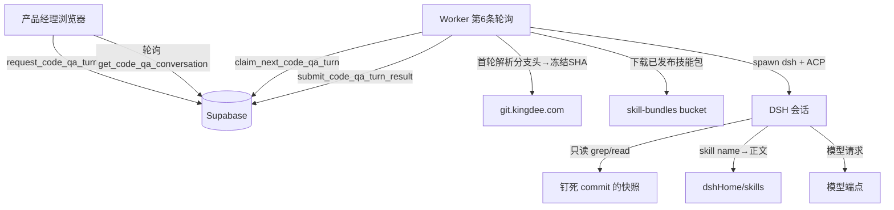
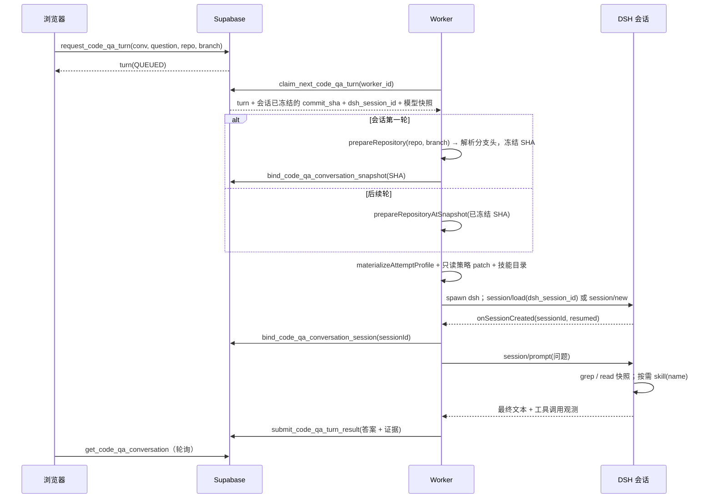

# 需求开发评审一致性平台 V1.23：产品代码问答最终执行方案

## 1. 背景与目标

### 1.1 现在产品经理拿不到的东西

平台已经有五个被评审仓库的**分支快照能力**（`worker/src/git/prepare.ts` 能把任意
白名单仓库的任意允许分支冻结到精确 commit）、有**受管技能包**（`/skills` 维护的多文件
Skill Bundle，正文躺在私有 bucket 里）、有**模型接入**（`ai_model_config` + Vault Key +
`worker/src/model-connectivity/chat-completion.ts`）。

但这三样东西目前**只服务于一件事**：对一条已经写完的需求做「需求↔代码一致性评审」。
它的输入是 `review_story`，输出是 `ai_review_result`，触发点是批次里的分析任务。

产品经理在**写需求之前**的那个问题没有任何入口：

> 「kdmanage-backend 的 release 分支上，工单转派之后原受理人的待办是怎么处理的？」

今天他只有两条路：找开发口头问，或者自己去 GitLab 翻代码。前者占用开发时间且口径随人
而异，后者对不熟悉工程细节的人基本不可行。结果是需求里的验收标准经常与现有实现脱节 ——
而那正是这个平台事后才会发现的那类不一致。

### 1.2 这一版提供什么

首页变成一个对话窗口（形态参考豆包 / ChatGPT）。产品经理选「仓库 + 分支」，可选勾几个
模块技能，然后用自然语言提问。平台在**内网侧**拉取该分支的真实代码快照，检索出与问题相关
的文件，连同技能正文一起交给模型，返回一段带**文件路径引用**的解释。

三条必须成立的事实：

- 答案基于**那个分支此刻的真实代码**，并在回答里写清用的是哪个 commit；
- 引用的文件路径是快照里真实存在的路径，产品可以拿着路径去找开发确认；
- 检索不到相关代码时**说检索不到**，不允许凭模型常识编一段看起来合理的业务逻辑。

## 2. 范围与非目标

### 2.1 本次包含

- 新首页 `/ask`：多会话的对话窗口，左侧会话列表、右侧消息流，与 `/batches` 并列在导航里，
  并作为登录后的默认落地页；
- 会话与轮次持久化：刷新、换浏览器、第二天回来都能看到历史问答；
- 每一轮可独立选择「仓库 + 分支」与「参与回答的技能」；
- Worker 第 6 条轮询：认领问答轮次 → 冻结分支快照 → 检索相关代码 → 调模型 → 写回答案；
- 答案里附「本次实际用到的证据」：commit SHA、检索到的文件清单、参与的技能清单；
- 三种角色（ADMIN / REVIEWER / VIEWER）都能用，每个人只能看到自己的会话。

### 2.2 明确不包含

- **不复用 `DeepSeekHarnessAcpEngine`。** 那个类（`worker/src/ai/runtime/deepseek-harness-acp-engine.ts`，
  约 1600 行）是**评审 attempt 的编排器**：它的入参要求 `story: AgentReviewStory`，要求
  `commitReview()` 回调，带 coverage 策略、评审提交工具、Agent 树治理和冻结能力策略对账。
  拿它跑问答等于为每个产品提问伪造一条 `review_story`，并把"必须产出评审结论"这个契约拖进
  聊天里。问答复用的是它**下面**那一层（见 §5.1）。
- **不做流式逐字输出。** ACP 的 `session/update` 本身是流式的，但浏览器到 Worker 之间没有
  长连接（§3.2），所以这一版把 update 折叠成阶段进度 + 一次性答案。
- **不写代码、不提 MR、不改仓库。** 问答会话的工具面是**只读**的（§7.3）。
- **不新增仓库或分支。** 仍是 `analysis_repository_catalog()` 那五个仓库与三个分支。
- **不做跨仓库联合提问。** 一轮一个仓库。

## 3. 当前实现与问题

### 3.1 现有可复用的三条链路

```text
分支代码   prepareRepository(repo, branch)  → 解析分支头 → 浅克隆到精确 SHA
           → <cacheRoot>/<repo>/<sha>/ 只读工作树          （worker/src/git/prepare.ts）

技能正文   review_skill_version.archive_object_key
           → skill-bundles 私有 bucket → readSkillArchive() → SKILL.md 正文
                                                （worker/src/ai/skills/*）

模型调用   ai_model_config（base_url / model_name / 超时 / 网络类型）
           + Vault 里的 Key → requestChatCompletion()
                                   （worker/src/model-connectivity/chat-completion.ts）
```

三条链路各自都完整，但**没有任何一个入口把它们组合成"回答一个问题"**。现有的组合方式只有
`analysis_job` → `analysis_story_task` → Harness attempt 这一条，而它要求输入是一条冻结的
`review_story`，产出是结构化评审结论，单次耗时以分钟计。

### 3.2 为什么不能让浏览器直接问模型

模型端点与 Key 都不在浏览器可达范围内：

- 三个线上模型里有内网端点，浏览器所在网络不保证可达（这正是 V1.7 引入宿主机代理的原因）；
- Key 存在 Vault，只有 `service_role` 能解密（`get_model_secret_for_*` 全部
  `revoke ... from authenticated`）；
- 分支代码只能由内网侧的 Worker 从 `git.kingdee.com` 拉取。

所以问答必须走「浏览器只提交问题 → Worker 取数并调模型」这条路。这与 V1.20 导入需求时
「前端只提交组+窗口+编号，正文由 Worker 取」是同一个边界，理由也相同：浏览器提供的内容
平台无从判断来源。

## 4. 需求与验收标准

### 4.1 功能要求

| 编号 | 要求 | 验证方式 |
|---|---|---|
| F1 | 登录后默认落在 `/ask`，页面呈现对话窗口 | 前端路由断言 + 手工打开 |
| F2 | 可新建会话、切换会话、删除自己的会话 | RPC 测试 + 手工 |
| F3 | 提问时必须已选仓库与分支，否则前端禁止发送 | 前端单测 |
| F4 | 一轮问答落库为 `code_qa_turn`，状态 QUEUED→RUNNING→SUCCEEDED/FAILED | SQL 测试 |
| F5 | 答案携带 commit SHA、Agent 实际读过的文件、调用过的技能 | SQL 测试 + Worker 单测 |
| F6 | 只能看到自己的会话，别人的会话读不到也删不掉 | SQL 测试（换 `auth.uid()`） |
| F7 | 同一会话同一时刻只允许一轮在飞 | SQL 唯一索引测试 |
| F8 | 第二轮起复用 DSH 会话（`resumed=true`），无法续跑时明确失败不静默新建 | Worker 单测 |
| F9 | 未配启用模型 / 无 Key 时入队即失败并给稳定错误码 | SQL 测试 |
| F10 | 问答会话的工具面是只读，不含任何写工具与评审提交工具 | Worker 单测 |

### 4.2 边界与失败行为

- **Worker 不在线**：轮次停在 QUEUED，页面显示「排队中，等待分析服务」。不伪造进度。
- **分支拉取失败**（内网不可达、分支不存在）：`CODE_QA_SNAPSHOT_FAILED`，一行原因。
- **DSH 会话无法续跑**（session id 在卷上已被清理、技能目录身份变了）：不静默从零开始，
  报 `CODE_QA_SESSION_RESUME_FAILED`，页面给「基于最新代码重开会话」。静默新建的后果是
  模型忘了上文而用户以为它记得 —— 比明确失败更难发现。
- **模型失败**：沿用既有错误码（`MODEL_TIMEOUT`、`MODEL_HTTP_*`、`MODEL_PROXY_UNREACHABLE`），
  不收敛成"回答失败"。
- **租约失联**：`reclaim_stale_code_qa_turn_leases()` 回收，轮次重回 QUEUED。
- **轮次超时**：到达上限即终态失败，不无限续租。

### 4.3 这一版能力的诚实边界

回答由 Agent 在只读快照上自己检索得出（grep / 读文件 / 按需调技能），所以它能处理
"这个功能怎么实现的"这类需要顺着调用链走几跳的问题 —— 这是接 DSH 换来的。仍然存在的边界：

- **没有跨仓库视野。** 一个会话只挂一个仓库的快照；前后端联动的问题要分两个会话问。
- **快照是会话级冻结的。** 会话开始后分支上的新提交不会进来（§5.4）。
- **答案必须可核对。** 证据里如实列出 Agent 读过的文件与调用过的技能；没读到支撑代码时
  要求它明确说不确定，而不是用通用工程常识补一段听起来合理的解释。

## 5. 总体设计

### 5.0 结论先写：DSH 已经有现成的对话能力，这一版直接接它

调研结果（`deepseekharness/deepseek-harness/`）：

| 能力 | 出处 | 是否已在本平台接通 |
|---|---|---|
| 持久会话：创建 / 列出 / **恢复** / 关闭 | `packages/acp/acp` | 部分：Worker 已有 resume |
| 多轮提示词 `session/prompt`（文本+图片） | `packages/acp/acp` | 是，但每 attempt 只发一轮 |
| 语义更新流 `session/update` | `packages/acp/acp` | 是（已用于运行监控插桩） |
| 单连接多会话多路复用 | `packages/acp/acp` | 未用 |
| 会话 JSONL 持久化 | `packages/session/session-persistence-jsonl` | 是（`AGENT_SESSION_ROOT` 命名卷） |
| 会话自动起标题 | `packages/session/session-title-llm` | 未用 |
| 技能渐进披露（先 name+description，调用后才给正文） | `packages/skill/skill-filesystem` | 是（V1.6 受管技能） |
| 只读代码检索工具（grep / read / 目录树） | `worker/src/harness-plugins/snapshot-tools` | 是（绑定冻结 commit） |

**Worker 侧已经写好的复用点**：`worker/src/ai/acp/acp-client.ts` 的
`runSingleAcpTurn(options)` 已经支持

- `resumeSessionId` → 先试 `session/resume`（不重放）或 `session/load`（重放历史），
  能力缺失时**明确失败而不静默降级**成 `session/new`；
- `onSessionCreated(sessionId, resumed)` → 拿到 session id 才能定位磁盘 JSONL；
- `mcpServers` → 挂只读快照工具；
- `permittedTools` 白名单 → 默认只批准评审提交工具，问答模式换成空集合（纯只读）。

所以"产品问代码"这件事**不需要新写一个模型调用链路**。它等于：一个 DSH 会话 +
一个钉死在某个 commit 的只读快照 Workspace + 平台已发布的技能目录，每个提问是一次
`session/prompt`，下一轮靠 `resumeSessionId` 续上。模型自己决定 grep 哪个关键字、读哪个
文件、调哪个技能 —— 这比平台替它做关键词检索强得多，也正是产品真正需要的。

### 5.1 复用边界：用中间层，不用编排器

```text
不复用  DeepSeekHarnessAcpEngine          ← 评审 attempt 编排器（要 story / commitReview /
                                             coverage / 评审提交工具 / Agent 树治理）
─────────────────────────────────────────────────────────────────────
复用    runSingleAcpTurn()                 worker/src/ai/acp/acp-client.ts
        materializeAttemptProfile()        worker/src/ai/acp/profile-materializer.ts
        buildAttemptPatch(spec, skills)    同上（问答用只读策略变体）
        spawn dsh (ACP)                    worker/src/ai/acp/acp-process-supervisor.ts
        prepareRepository()                worker/src/git/prepare.ts
        snapshot-tools MCP                 worker/src/harness-plugins/snapshot-tools
        技能下载与校验 + cache              worker/src/ai/skills/*
        requestChatCompletion()            仅用于会话起标题，不用于回答
```

`buildAttemptPatch` 接受 `policy: V4CapabilityPolicy` 并按角色解析工具面，所以问答用一个
**收窄到只读**的策略即可，不需要改 `v4-capability-contract.json`。契约哈希只在评审
attempt 那条路上与数据库冻结值对账（`recordProfile`），问答不走那条路，**manifest revision
仍是 3，新旧 Worker 可混跑**。

### 5.2 组件与职责



职责边界不变（浏览器只提交问题，Worker 独占内网 Git / 私有 bucket / 模型端点），
变化的是 Worker 内部：从"平台替模型检索"变成"模型自己检索"。

### 5.3 一轮问答的时序



### 5.4 两个关键取舍

**会话级冻结 commit，不是每轮重新解析分支头。** 第一轮解析出 SHA 就写进会话行，后续轮次
复用它。理由：多轮对话里"你刚才说的那个方法"必须指向同一份代码，而分支在对话中途会前进 ——
每轮重新解析会让上一轮的引用悄悄失效。想看最新代码就开新会话（页面上给一键"基于最新代码
重开"）。

**为什么不流式。** ACP 的 `session/update` 是流式的，但浏览器到 Worker 之间没有长连接，
而建一个常驻流式中转服务要把 Vault Key 交给它。对"少等十几秒"这个收益来说不成比例。
这一版把 update 折叠成四个阶段（排队中 / 拉取分支 / 检索代码 / 生成回答）写进轮次行，
页面显示真实阶段而不是假进度条。

## 6. 数据与接口设计

### 6.1 新表

迁移文件：`supabase/migrations/20260924104500_code_qa_conversation.sql`

```text
public.code_qa_conversation
  id, owner_id(auth.users), title
  repository, branch                      ← 会话级：一个会话钉一个仓库+分支
  commit_sha                              ← 首轮解析分支头后冻结，后续轮复用（§5.4）
  dsh_session_id                          ← DSH 会话 id，后续轮靠它 session/load 续上
  skill_catalog_hash                      ← 首轮物化的技能目录身份；不一致时不续跑
  created_at, updated_at, last_turn_at
  RLS: 开启；owner 自己可 select/update/delete（auth.uid() = owner_id）

public.code_qa_turn                       ← 它同时是队列行
  id, conversation_id, asked_by
  question                                ← 用户原文
  status QUEUED|RUNNING|SUCCEEDED|FAILED
  stage  QUEUED|PREPARING_CODE|EXPLORING|GENERATING  ← 页面显示的真实阶段
  worker_id, claim_token_digest, lease_expires_at, heartbeat_at
  model_config_id, base_url_snapshot, model_name_snapshot,
    request_timeout_ms_snapshot, network_access_mode_snapshot, max_output_tokens_snapshot
  answer text                             ← Agent 最终文本
  evidence jsonb                          ← commit_sha / files_read[] / skills_used[] /
                                            tool_calls / resumed / update_count
  error_code, error_message
  created_at, started_at, finished_at
  RLS: 开启，无策略 —— 只走 security definer RPC
  唯一索引: 同一会话只允许一条 QUEUED/RUNNING
```

`repository` / `branch` 从轮次上移到**会话**上，是 §5.4 那条取舍的直接结果：同一个会话里
换仓库等于换了讨论对象，而 DSH 会话的历史是连续的 —— 那会让模型带着 A 仓的上下文解释 B 仓
的代码。换仓库就开新会话。

### 6.2 RPC 清单

| RPC | 授权 | 作用 |
|---|---|---|
| `code_qa_catalog()` | authenticated | 仓库、分支、可用技能（名称+描述）三份清单 |
| `create_code_qa_conversation(title,repo,branch)` | authenticated | 新建会话（钉仓库+分支） |
| `list_code_qa_conversations()` | authenticated | 自己的会话列表 |
| `get_code_qa_conversation(id)` | authenticated | 会话 + 全部轮次（含答案与证据） |
| `rename_code_qa_conversation(id,title)` | authenticated | 改标题 |
| `delete_code_qa_conversation(id)` | authenticated | 删自己的会话 |
| `request_code_qa_turn(conv,question)` | authenticated | 入队一轮；同时冻结模型快照 |
| `claim_next_code_qa_turn(worker_id)` | service_role | 认领（带回会话的 SHA 与 session id） |
| `heartbeat_code_qa_turn(...)` | service_role | 续租 |
| `report_code_qa_turn_stage(...)` | service_role | 上报真实阶段 |
| `bind_code_qa_conversation_snapshot(...)` | service_role | 首轮把解析出的 commit SHA 冻结到会话 |
| `bind_code_qa_conversation_session(...)` | service_role | 把 DSH session id 写回会话，供后续轮续跑 |
| `get_model_secret_for_code_qa_turn(...)` | service_role | 发 Key |
| `submit_code_qa_turn_result(...)` | service_role | 写答案 + 证据 |
| `submit_code_qa_turn_failure(...)` | service_role | 写终态失败 |
| `reclaim_stale_code_qa_turn_leases()` | service_role | 回收失联租约 |

模型选择规则：**最早创建的启用配置**（`order by created_at, id limit 1`）。与技能优化那条
"跟着产出证据的那个模型"不同，因为问答没有"证据出自哪个模型"这层因果；要的是确定性 ——
同一时刻所有问答落在同一个模型上，答案口径一致。没有启用配置或没有 Key 时**入队即失败**
（`MODEL_CONFIG_NOT_FOUND` / `MODEL_SECRET_MISSING`），不让轮次进队列等一个永远不会好的条件。

### 6.3 不涉及

- V4 能力契约与 `v4-capability-contract.json`：**一字不动**，manifest revision 仍是 3。
- `analysis_job` / `analysis_story_task` / 评审结论链路：不改。
- Edge Function：不新增、不改。
- Storage bucket：不新增。技能包读的是既有 `skill-bundles`。

## 7. 前端与 Worker/运行时改造

### 7.1 前端

| 文件 | 改动 |
|---|---|
| `src/pages/CodeQaPage.tsx` | 新增。会话列表 + 消息流 + 提问框；新建会话时选仓库/分支 |
| `src/lib/code-qa.ts` | 新增。阶段文案、证据渲染、发送前校验等纯逻辑（可单测） |
| `src/lib/api.ts` | 新增 7 个 authenticated RPC 封装 |
| `src/types.ts` | 新增会话/轮次/证据/目录类型 |
| `src/App.tsx` | 导航加「代码问答」；`/` 默认跳 `/ask`；`/ask` 路由 |
| `src/App.css` | 对话窗口样式（消息气泡、粘底输入区、证据折叠） |

轮询策略：有 QUEUED/RUNNING 轮次时 2 秒一次，全部终态后停。不用 Realtime —— 这张表走
security definer RPC，没有 RLS 策略可供 Realtime 授权。

### 7.2 Worker

| 文件 | 改动 |
|---|---|
| `worker/src/ai/code-qa/qa-policy.ts` | 新增。只读能力策略（问答工具面）+ 纯函数，可单测 |
| `worker/src/ai/code-qa/qa-prompt.ts` | 新增。会话 system 提示词 + 引用规则（纯函数） |
| `worker/src/ai/code-qa/qa-session-runner.ts` | 新增。一轮问答：物化 profile → spawn dsh → resume/new → prompt → 收答案 |
| `worker/src/db/jobs.ts` | 新增 claim/heartbeat/stage/bind-snapshot/bind-session/secret/submit/fail/reclaim |
| `worker/src/index.ts` | 第 6 条轮询 `codeQaLoop` + 关闭时纳入 `Promise.allSettled` |
| `worker/src/config.ts` | `CODE_QA_ENABLED`、轮次超时、租约秒数 |

**回答由 Agent 自己检索得出**，平台不做关键词召回。Agent 拿到的是：

- Workspace = 钉死在 `commit_sha` 的只读快照（`snapshot-tools` MCP 绑定同一个 SHA）；
- `dshHome/skills/` = 平台已发布且启用的技能目录，首轮只披露 name + description，
  Agent 调 `skill(name)` 才读到正文（DSH `skill-filesystem` 的既有行为）；
- system 提示词里写清三条硬规则：① 结论必须给出快照内的真实文件路径；② 没读到支撑代码时
  必须说不确定，禁止用通用工程常识补全；③ 面向产品经理用业务语言解释，不堆术语。

阶段上报复用既有心跳通道：`report_code_qa_turn_stage` 在拉取分支前、`session/prompt` 前
各写一次，页面显示的是**事实阶段**，不是计时器猜的。

### 7.3 运行时安全

- **工具面只读。** 问答策略不含写工具、不含 `submit_review_result`；`permittedTools`
  传空集合，任何请求写权限的工具调用都被拒绝（`decidePermission` 默认拒绝）。
- 快照目录与评审那条路同样以只读方式挂载，`forbiddenRoots` 照旧禁止触及代码 cache 根；
- 答案与证据里的路径全部是**快照内相对路径**，绝不写绝对路径（会暴露容器布局）；
- Key 只存在于 runner 的局部变量，`finally` 置空，不进日志；
- 日志字段沿用 allowlist：只记 `turn_id` / `conversation_id` / `repository` / `branch` /
  `commit_sha` / `resumed` / `tool_call_count` / `latency_ms` / `error_code`，
  **不记问题原文、不记答案正文、不记代码片段**。

## 8. 安全、兼容与回滚

### 8.1 权限

- 会话归属由 `auth.uid()` 判定，RPC 内部逐条校验 owner，不依赖前端；
- `code_qa_turn` 不开任何 RLS 策略，浏览器无法直连读写；
- Worker 侧 RPC 全部 `revoke ... from authenticated`，只授 `service_role`；
- 仓库与分支在数据库侧用 CHECK + `analysis_allowed_repository_names()` 校验，
  Worker 侧再用 `assertRepositoryName` / `assertBranch` 校验一次（双侧，不互相信任）。

### 8.2 兼容

- 全部是新表新 RPC，不改任何既有表、函数签名或迁移文件；
- **能力契约与 manifest 哈希不变**：问答用收窄的只读策略走 `buildAttemptPatch`，不经过
  `recordProfile` 与 `analysis_job` 冻结对账，所以 revision 仍是 3，新旧 Worker 可混跑；
- 旧 Worker 不认识第 6 条轮询，表现为问答轮次停在 QUEUED（页面如实显示排队中），
  不影响它继续跑评审任务；
- 问答会话的 JSONL 与评审 attempt 共用 `AGENT_SESSION_ROOT` 卷，但目录前缀独立
  （`code-qa/<conversation_id>/`），清理与保留期各自计算。

### 8.3 回滚

1. 前端回滚：把默认首页改回 `/batches`、摘掉导航项即可，数据库可以留着；
2. Worker 回滚：`CODE_QA_ENABLED=false` 滚动重启，轮次停在 QUEUED；
3. 数据库不回滚（只增不改，留着不影响任何既有链路）。

## 9. 实施步骤与文件范围

1. 迁移 + SQL 测试（表、RLS、16 个 RPC）→ 本地 `supabase migration up --local` 并跑测试；
2. 前端类型 + api 封装 + 纯逻辑 + 单测 → `web:typecheck` / `test:web`；
3. 页面与路由接线 → 构建；
4. Worker 只读策略与提示词纯函数 + 单测；
5. Worker `qa-session-runner` + `jobs.ts` 方法 + 第 6 条轮询 → `worker:typecheck` /
   `test:worker`；
6. 本地端到端：本地 Supabase + 本地 Worker 跑通一轮真实问答与一次续跑。

## 10. 验证结果

> 只记录**真实执行过**的结果。未运行的项明确标注。

### 10.1 已通过（2026-09-24 本地）

**数据库层**

两个迁移（第二个是修 bug + 补 Worker 通道，见下）：

```bash
docker exec -i supabase_db_codeReviewPlatform psql -v ON_ERROR_STOP=1 -U postgres -d postgres \
  < supabase/migrations/20260924104500_code_qa_conversation.sql        # OK（连跑三次幂等）
docker exec -i supabase_db_codeReviewPlatform psql -v ON_ERROR_STOP=1 -U postgres -d postgres \
  < supabase/migrations/20260924111603_code_qa_skill_catalog.sql       # OK（连跑两次幂等）
# 两份 SQL 测试：
# NOTICE: V1.23 code QA conversation test: all assertions passed
# NOTICE: V1.23b code QA skill catalog test: all assertions passed
supabase migration up --local                                         # 两个都已登记
```

- SQL 测试共 17 + 6 组断言，覆盖 §4.1 的 F2/F4/F5/F6/F7/F9 与全部授权边界；
- `git status supabase/` 只有 4 个 `??` 新文件，**没有任何 `M`**（符合
  `supabase-migration-naming` 的"只增不改"；第二个迁移就是"前滚修复"而不是改第一个）。

测试中抓到并修掉的三个真实缺陷：

1. 模型选型断言在本地库上失败 —— 本地已有更早创建的启用配置会赢。测试改为把
   `ai_model_config.created_at` backdate 到 1970。
2. `code_qa_conversation_to_jsonb` 保留了新函数默认的 PUBLIC execute 授权，`anon`
   可执行。已显式 revoke。
3. **`code_qa_catalog()` 过滤了不存在的状态值 `'ENABLED'`。** `review_skill.status` 的
   合法值是 DRAFT / VALIDATING / PUBLISHED / DISABLED / VALIDATION_FAILED，所以那个
   条件永远匹配不到任何行 —— 问答页的「可用模块技能」会**永远是空的且没有任何错误码**。
   由迁移 `20260924111603` 前滚修正为 `status = 'PUBLISHED'`，口径与
   `current_skill_catalog_entries()` 统一，并由用例断言两者集合逐字相等（防止再次漂移）。

**前端**

```bash
npm run web:typecheck     # 通过
npm run test:web          # 19 个文件 239 个用例全部通过（含新增 code-qa 22 个）
npx tsc -b && npx vite build   # built in 266ms，无错误
```

**Worker**

```bash
npm run worker:typecheck   # 通过
npm run worker:build       # V4 Harness manifest OK: revision 3, Harness 0.1.5-rc.1, 34 tools
npm run test:worker        # 59 个文件 1014 个用例全部通过（13 文件 32 用例 skipped：需真实 dsh）
```

新增 Worker 用例 67 个，分三组：

| 测试文件 | 用例 | 钉住什么 |
|---|---|---|
| `v123-code-qa-policy-and-prompt.test.ts` | 38 | 只读工具面、提示词硬规则、路径归一 |
| `v123-acp-update-observations.test.ts` | 15 | Agent 正文与工具入参的捕获（问答拿到答案的唯一出口） |
| `v123-code-qa-session-runner.test.ts` | 14 | 代码基线解析（首轮冻结/后续复用/并发服从）、错误分类 |

解析出来的问答工具面（由用例钉住）：
`exit_plan_mode, find_snapshot_files, glob, grep, read, read_image, read_snapshot_code,
search_snapshot_code, skill, todo_write` —— 不含 `write` / `edit` / `bash` /
`submit_review_result`，不含 `subagent` / `workflow` / `ralph`，不含需要 `review_story` 的
`list_story_commits` / `read_story_commit_diff`。

`npm run worker:build` 打印 `revision 3` 是**能力契约未被改动**的直接证据；
`v19-worker-drain.test.ts` 的日志里出现 `code_qa_disabled`，证明第 6 条轮询已接线并且
`CODE_QA_ENABLED` 开关真的生效。

实现中需要明确决定的三件事：

1. **`runSingleAcpTurn` 原来不返回 Agent 正文。** 评审的结论通过 `submit_review_result`
   工具经 Broker 落库，正文从不经过 ACP 客户端；而问答**没有提交工具**，回答就是 Agent
   说的话本身。为此给 `AcpSessionOptions` 增加了两个**可选**回调
   （`onAgentMessageChunk` / `onToolCallDetail`），并把两条 update 路径
   （`session/new` 的 builder 循环与 resume 的低层 notification）统一到一个
   `dispatchUpdateObservations`。additive 改动，既有 5 处调用不传这两个回调，行为不变。
   顺带修掉一处既有分叉：resume 路径原来少上报一类观测。
2. **契约把 `todo_write` 标成 `mutating`**，而它改的只是 Agent 自己的待办清单。没有放宽
   断言，而是加了逐项列举的例外名单 `CODE_QA_ALLOWED_AGENT_LOCAL_MUTATIONS`，并由用例
   同时钉住名单本身 —— 否则这条断言以后炸不出真正的写工具回流。
3. **问答用"当前"技能目录而不是冻结目录。** 评审要求同一批次前后可比，问答没有批次可
   冻结，而产品问的就是"现在"。会话行记着首轮的 `skill_catalog_hash`，技能中途发版后
   续跑会被它拦下，而不是静默换一套知识。技能物化失败**不让这一轮失败**（降级成空技能
   目录），否则一次技能包发布事故会连带打掉首页功能。

### 10.2 端到端实测（本地 Supabase + 本地 Worker 容器）

**这一节是真实跑出来的，不是推演。**

```bash
WORKER_ENV_FILE=.docker/worker.local.env docker compose -p codereviewplatform-local \
  -f docker-compose.worker.yml up -d --build --force-recreate --scale worker=1
# 日志：worker_started → code_qa_enabled{lease_seconds:600, turn_timeout_ms:900000}
```

三轮真实问答（`kdmanage-backend` 的 `release` 分支，commit `e63ae4f6`）：

| 轮 | 问题 | 结果 | resumed | 读过文件 | 工具调用 |
|---|---|---|---|---|---|
| 1 | 这个仓库的代码整体是怎么组织的？ | SUCCEEDED（15s） | false | 1 | 16 |
| 2 | 审批流相关的代码在哪些文件里？ | SUCCEEDED（20s） | false | 2 | 7 |
| 3 | **你刚才提到的第一个文件**，最关键的方法是做什么的？ | SUCCEEDED（15s） | **true** | 1 | 3 |

第 3 轮是多轮对话的关键验证：它没有重复任何上下文，Agent 自己把"你刚才提到的第一个文件"
解析成第 2 轮答案里的 `PublishReviewController.java`，然后读 `PublishReviewAppService.java`
给出带行号的解释。`resumed: true` 证明走的是 `session/load`，不是重新开始。

Worker 日志的阶段序列（每一条都是真实转换点）：

```text
code_qa_skills_provisioned  skill_catalog_count=2  cache_hits=2  cache_misses=0
code_qa_snapshot_ready      repository=kdmanage-backend branch=release
                            commit_sha=e63ae4f6…  cached=true
code_qa_inert_tools_exposed tools=[list_story_commits, read_story_commit_diff]
code_qa_profile_ready       skill_catalog_count=2  tool_count=13  resume_target=new|load
code_qa_turn_observed       stop_reason=end_turn  answer_chars>0
```

答案质量（第 1 轮节选，说明它真的读了代码而不是套模板）：

> 这个仓库是金蝶 Kwork 管理后台（kdmanage）的 Java 17 / Spring Boot 3.5 + MyBatis-Plus
> Maven 多模块工程……根 `pom.xml`（`com.kingdee.kwork:manage-parent`）声明了 4 个子模块……
> `kdmanage-backend/pom.xml` 第 28、33、38 行分别依赖 common、meter、operation

它还自己发现 `bash 在当前环境不可用，我改用文件工具来探索` —— 只读沙箱按设计生效，
而 Agent 自行降级到只读工具，没有因此失败。

### 10.3 端到端跑出来的三个真实缺陷（都已修）

这三个都**不会被任何单测抓到**，只有真跑才会暴露：

1. **根 Agent 拿到的是评审角色的工具面。** `materializeAttemptProfile` 把
   `rootTools` 硬编码成 `resolveToolsForRole({ role: 'root-reviewer' })`，而那个集合
   经过问答策略过滤后仍然含 `submit_review_result` / `create_goal` / `send_message`
   （它们不受任何 capability 开关控制）。
   **我的 `assertCodeQaToolsReadOnly` 在 spawn 之前拦下了这一轮**（错误码
   `CODE_QA_TOOL_SURFACE_NOT_READ_ONLY`）—— 这正是那道 fail-closed 存在的理由。
   修法：给 `AttemptProfileSpec` 加**可选** `rootRole`（缺省 `root-reviewer`，评审链路
   行为一字不变），问答传 `research-child`。契约文件不动，manifest 仍是 revision 3。
   修后实测工具面是 13 个，无写工具、无提交工具、无委派工具。
2. **模型选型规则"确定地选错"。** 第一版是"最早创建的启用配置"。本地与云端都有早期创建、
   后来弃用但没停用的配置，Key 是占位串。实测选中了 `kimi-k3`（18 字节占位 Key），而平台
   最近 5 个分析任务全在用 `glm5.3-flash`。表现是 dsh 启动后报
   `the API key … contains characters no HTTP header can carry` —— 运维会以为是链路问题。
   修法（迁移 `20260924113303`）：改成**平台实际在跑的那个** —— 最近一个分析任务用过的
   启用且有 Key 的配置，回退到最近创建的启用且有 Key 的配置；两条都要求有 Key，
   并把"没有启用配置"与"有配置但没 Key"分成两个错误码。
3. **证据里的文件路径不可用。** `files_read` 记成
   `cache/kdmanage-backend/e63ae4f…/pom.xml` —— 产品拿着它在 GitLab 上找不到文件。
   原因是旧实现靠在路径里找 `workspace|snapshot|code` 标记**猜**快照根，而真实根是
   `/workspace/cache/<repo>/<sha>/`。修法：把真实快照根（Agent 的 cwd）传进
   `collectReadFiles`，用精确前缀剥离，不在快照内的绝对路径直接丢弃。
   修后实测：`kdmanage-backend/src/main/java/com/kingdee/kwork/manage/controller/PublishReviewController.java`。

### 10.4 尚未做 / 已知边界

- **`list_story_commits` / `read_story_commit_diff` 仍然出现在问答工具面里。** 它们不受
  任何 capability 开关控制，策略层去不掉。后果有界：两者都经 Broker 路由，而问答的 Broker
  没有 `analysisScope`，调用会被直接拒绝。已按 `code_qa_inert_tools_exposed` 记进日志，
  不是静默的。彻底移除需要给 `buildAttemptPatch` 加显式工具白名单，留作后续。
- **Agent 实测没有主动调用 `skill()`**（三轮的 `skills_used` 都是空）。技能目录确实挂上了
  （`skill_catalog_count=2`），是模型判断当前问题不需要。要不要在提示词里更强地要求它先看
  技能，需要产品侧试用后再定 —— 现在没有证据支持哪一种更好。
- 云端：**未推送迁移、未部署任何东西。**

