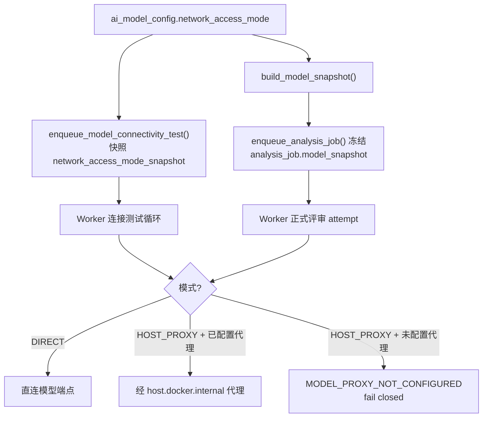
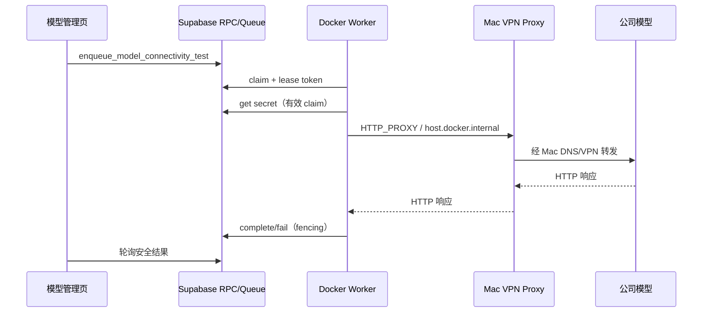

# 需求开发评审一致性平台 V1.7：内网模型连接最终执行方案

> 本文档包含两个阶段。**阶段一**（已落地）把模型连接测试改成数据库排队 + 本地 Worker 执行 + Mac 宿主机代理。**阶段二**（本次）修掉阶段一实测出来的缺陷：代理的适用范围原本靠"目标域名白名单"判断，这既误伤公网模型，也没覆盖正式评审链路。阶段二用模型级的**网络类型**替代白名单。

---

# 阶段二：模型网络类型（DIRECT / HOST_PROXY）

## 0. 阶段一实测出来的缺陷

`worker/src/index.ts` 的连接测试循环**无条件**把 `config.modelConnectivityProxy` 传给探测器；而 `scripts/model-vpn-proxy.mjs` 只允许 `MODEL_VPN_PROXY_ALLOWED_HOSTS`（默认只有 `ai.zenithal.ai`）里的目标主机。两者叠加的后果是：

- **公网模型被误伤。** 测试 DashScope 时请求照样被送进代理，代理发现主机不在白名单 → 返回 `HTTP 403`。用户看到的是"模型返回 403"，而真正的拒绝方是我们自己的代理。
- **正式评审链路根本没走代理。** 代理只接在"测试连接"这一条路径上。也就是说内网模型能测通、真跑评审时必然失败——最坏的一种不一致：绿灯之后才失败。
- **白名单是错误的抽象。** 每加一个内网模型都要改代理的环境变量并重启 launchd 服务，而"这个模型走不走代理"本来是模型自己的属性。

## 1. 背景与目标

用**模型级的网络类型**取代目标域名白名单：

| 模型网络类型 | 访问方式 |
|---|---|
| 公网模型 `DIRECT` | Worker 直接请求，保持原有逻辑 |
| 内网模型 `HOST_PROXY` | Worker 经 `host.docker.internal:17890` 本机代理请求 |

默认 `DIRECT`，保证已有配置兼容——这也直接修掉 DashScope 的 403。

新增模型时只需在页面上选一次网络类型，不再需要改代理配置。

## 2. 范围与非目标

包含：模型配置新增 `network_access_mode`；随 Job 冻结进模型快照；连接测试与**正式评审链路**统一按该模式决定是否走代理；代理删除域名白名单并补齐 SSRF 防护；Worker 未配置代理却选了内网模型时明确 fail closed；数据库/Edge Function/前端/Worker/测试全链路改造。

不包含：把内网模型暴露到公网；改公司 DNS/VPN；让代理成为通用互联网代理；改变代码评审任务状态机；给 Agent 新增模型工具或 Broker 路由。

## 3. 需求与验收标准

1. 模型管理页可选「公网模型 / 内网模型」，`name` 之外的其余字段行为不变。
2. 数据库 `ai_model_config.network_access_mode ∈ {DIRECT, HOST_PROXY}`，默认 `DIRECT`；既有行全部为 `DIRECT`。
3. 连接测试按模型的网络类型决定是否使用代理：`DIRECT` 直连（DashScope 不再 403），`HOST_PROXY` 走代理。
4. **正式评审链路遵守同一规则**：`HOST_PROXY` 的模型，dsh 子进程的模型请求经本机代理发出。
5. 网络类型随 Job 一起冻结进 `model_snapshot`，任务执行期间改配置不影响在跑的 Job。
6. Worker 未配置本机代理却领到 `HOST_PROXY` 的任务时，必须以稳定错误码 `MODEL_PROXY_NOT_CONFIGURED` 明确失败，**不得偷偷直连**。
7. 代理删除目标域名白名单，但保留：用户名密码认证、仅监听本机、仅允许合法 HTTP/HTTPS 端口、拒绝 localhost / Docker 管理地址 / 云元数据地址、日志不含 API Key / Authorization / 请求正文。
8. 连接测试的失败原因能区分"模型端点的问题"与"代理/网络的问题"。

## 4. 总体设计



两条链路用**同一个判定函数**，不各写一遍——阶段一的缺陷正是因为两条链路的行为分叉。

## 5. 数据与接口设计

数据库（新时间戳迁移，只增不改既有文件）：

- `ai_model_config` 增列 `network_access_mode text not null default 'DIRECT' check (in ('DIRECT','HOST_PROXY'))`；
- `model_connectivity_test` 增列 `network_access_mode_snapshot`，与既有的 `base_url_snapshot` 同源同语义；
- `build_model_snapshot()` 增加 `network_access_mode` 字段（`create or replace`）；
- `admin_create_model_config` / `admin_update_model_config` 增加 `p_network_access_mode` 参数：签名变化必须 `drop function if exists <精确旧签名>` 再建并重新 `grant`，否则会留下一个不接收网络类型的旧重载；
- `enqueue_model_connectivity_test()` 与 `claim_next_model_connectivity_test()` 透传快照字段；
- 模型操作审计记录网络类型变更。

前端：`AiModelConfigSummary` 与表单增加 `network_access_mode`，列表加一列。

Edge Function `admin-model-config`：`create` / `update` 接收并透传 `network_access_mode`，取值非法即拒。

Worker：

- `ModelSnapshot` 与 `ModelConnectivityTestClaim` 增加该字段；
- 新增 `worker/src/model-connectivity/network-mode.ts`：把「模式 + 是否配置了代理」解析成「用不用代理 / 直接拒绝」，两条链路共用；
- `factory.ts` 按冻结快照决定是否给 dsh 子进程下传代理环境。

## 6. 正式评审链路怎么走代理

`llm-pi-ai` 没有 per-provider 代理配置，底层 `@earendil-works/pi-ai` 也没有自定义 fetch 钩子（已 grep 确认）。可行机制只有 Node 的环境代理：

```text
NODE_USE_ENV_PROXY=1 + HTTPS_PROXY/HTTP_PROXY  →  dsh 子进程的 fetch 走代理
```

实测确认（三组对照）：不设变量 → `ENOTFOUND`（直连 DNS）；只设 `HTTPS_PROXY` → 仍 `ENOTFOUND`（Node 24 必须显式 opt-in）；两者都设 → `ECONNREFUSED`（确实去连代理了）。

**已知代价，必须写明白**：`@deepseek-ai/dsh-subprocess` 的 `scrubbedParentEnv()` 只按 `/KEY|PASSWORD|SECRET|TOKEN/i` 与 `DSH_*` 过滤变量名，所以 `HTTPS_PROXY` 会**被 Agent 的 `bash` 继承**（用真实 dsh 进程实测过：bash 里能看到 `HTTPS_PROXY` / `NODE_USE_ENV_PROXY`）。也就是说选了内网模型的 attempt，Agent 的 Shell 命令也能经这条代理访问公司内网。

评估与取舍：

- 容器本来就有**公网**出口，Shell 的网络访问与 platform-web 的白名单不等价，这一点 V1.6 §7.4 已经明确承担；本次的增量是**内网可达性**。
- 缓解措施：仅 `HOST_PROXY` 模型的 attempt 才下传（公网模型完全不受影响）；代理保留认证；代理拒绝 loopback / Docker 管理地址 / 云元数据地址；`agent_attempt_started` 日志带上 `model_network_access_mode`，让这件事在审计里可见。
- 被否决的替代方案：在 Worker 里起一个 loopback 模型网关，让 `baseURL` 指向它再由 Worker 转发。它能避免 Shell 继承，但要在每一次模型请求的热路径上新增 SSE 流式透传、鉴权与错误映射——那里出 bug 会让**所有**评审失败。以"更大的新风险换更小的旧风险"不做。

## 7. 代理改造

删除 `MODEL_VPN_PROXY_ALLOWED_HOSTS`。保留并补强：

- 认证：`Proxy-Authorization` Basic，凭据由安装脚本随机生成，`timingSafeEqual` 比较；
- 仅监听 `127.0.0.1`；
- 仅允许端口 80 / 443（可由 `MODEL_VPN_PROXY_ALLOWED_PORTS` 覆盖）；
- **SSRF 防护**（替代白名单的那一层）：拒绝 loopback（`127.0.0.0/8`、`::1`、`localhost`）、链路本地与云元数据（`169.254.0.0/16`、`fd00:ec2::254`）、Docker 管理地址（`host.docker.internal`、`docker.for.mac.*`、`172.17.0.1`）以及 `0.0.0.0`/`[::]`；主机名形态非法一律拒绝；
- 日志仍只记录事件、主机名与状态码。

`isDeniedTarget()` 抽成纯函数并单测，这样"哪些目标被拒"有可执行的定义而不是散落在两处分支里。

## 8. 安全、兼容与回滚

- 既有模型全部默认 `DIRECT`，行为与本次改造前一致；DashScope 的 403 因此消失。
- 冻结进快照后，任务执行期间改模型配置不影响在跑的 Job（与 policy / manifest 的冻结语义一致）。
- `HOST_PROXY` 但 Worker 未配置代理 → `MODEL_PROXY_NOT_CONFIGURED`，连接测试与正式评审都 fail closed。
- 代理凭据只在 launchd 环境与被 Git 忽略的 `.docker/worker.env` 里，不进仓库、不进日志。
- Agent Shell 继承代理环境这一点见 §6，属于已知且有边界的暴露，写进 `worker/OPERATIONS.md`。
- 回滚：把模型的网络类型改回公网即可（无需改代码）；彻底回滚则回退 Worker 镜像与前端，数据库列保留（`DIRECT` 默认值使其成为 no-op）。不做 destructive down migration。

## 9. 实施步骤与文件范围

1. 新时间戳迁移：增列、改 `build_model_snapshot`、重建两个 admin RPC 签名、透传测试快照字段、授权。
2. Edge Function 接收并校验 `network_access_mode`。
3. 前端类型、API、表单与列表列。
4. Worker：共用判定模块、连接测试按模式取用代理、正式链路下传代理环境、`MODEL_PROXY_NOT_CONFIGURED` fail closed。
5. 代理脚本删白名单、补 SSRF 与端口防护；安装脚本移除白名单变量。
6. 测试：代理 SSRF 纯函数单测、快照冻结与签名唯一性 SQL 测试、Worker fail-closed 单测、真实 dsh 进程验证代理环境按模式下传。
7. 全门禁复跑并更新本文档第 10 节。

主要文件：

- `supabase/migrations/20260917130000_model_network_access_mode.sql`（新增）
- `supabase/tests/20260917130000_model_network_access_mode_test.sql`（新增）
- `supabase/functions/admin-model-config/index.ts`
- `src/types.ts`、`src/lib/api.ts`、`src/App.tsx`
- `worker/src/model-connectivity/network-mode.ts`（新增）、`worker/src/model-connectivity/probe.ts`
- `worker/src/db/jobs.ts`、`worker/src/index.ts`、`worker/src/config.ts`
- `worker/src/ai/runtime/factory.ts`、`worker/src/ai/acp/profile-materializer.ts`、`worker/src/ai/acp/acp-process-supervisor.ts`
- `scripts/model-vpn-proxy.mjs`、`scripts/install-model-vpn-proxy.sh`
- `worker/OPERATIONS.md`、`.docker/worker.env.example`

## 10. 阶段二验证结果

### 10.1 端到端（本地 Supabase + 本地 Worker 容器 + 真实 launchd 代理）

fixture：两个模型（一个 `DIRECT`、一个 `HOST_PROXY`）指向同一个 mock 端点。地址是刻意分开的
—— 公网模型用 `host.docker.internal:18801`（容器可达），内网模型用 LAN 地址
`172.20.212.66:18801`（只有宿主机上的代理可达，正好复现"内网域名只在 Mac 上解析得到"）。

| 场景 | 模型 | 结果 | 证据 |
|---|---|---|---|
| A 公网模型直连 | `DIRECT` | `SUCCEEDED` / 200 | 日志 `network_access_mode":"DIRECT","via_host_proxy":false` |
| B 内网模型经代理 | `HOST_PROXY` | `SUCCEEDED` / 200 / 16ms | 代理日志 `proxy_forwarded host=172.20.212.66 status_code=200` |
| B' 端口不在放行列表 | `HOST_PROXY` | `FAILED` / 403 | 默认只放 80/443，18801 被端口守卫拒 |
| C Worker 未配置代理 | `HOST_PROXY` | `FAILED` / `MODEL_PROXY_NOT_CONFIGURED` | 错误文案指向 Worker 配置，未发生直连 |

场景 A 就是本次要修的缺陷：**公网模型不再被送进代理，403 消失**。场景 B 的代理日志里出现
`172.20.212.66` —— 这个地址从未在任何白名单里，是"白名单已删除且转发正常"的硬证据。

### 10.2 端到端过程中发现并修掉的真实缺陷

`JobsDb.claimNextModelConnectivityTest` 是**逐字段构造**返回对象的。给
`ModelConnectivityTestClaim` 加了 `network_access_mode_snapshot` 但没在 mapper 里映射，
编译通过、单测全绿，运行时该字段永远是 `undefined` —— 于是**内网模型被当成公网模型直连**。

第一次端到端跑出来的日志是两条 `"network_access_mode":"DIRECT"`（其中一条本该是
`HOST_PROXY`），正是它暴露的。已修，并补了 mapper 回归用例
（`v17-model-network-mode.test.ts` 的 `claim mapper carries the frozen mode`）——
这类"类型加了、映射漏了"的缺口只有端到端能抓到。

### 10.3 自动化测试

| 命令 | 结果 |
|---|---|
| `vitest run worker/src/__tests__/v17-model-network-mode.test.ts` | 37 passed |
| `RUN_ACP_INTEGRATION=1 vitest run worker/src/__tests__/v17-model-network-dsh.test.ts` | 3 passed（真实 dsh 进程） |
| `psql -f supabase/tests/20260917130000_model_network_access_mode_test.sql` | EXIT=0 |
| 迁移应用（本地库） | EXIT=0，既有模型全部 `DIRECT`，快照带 `network_access_mode` |

真实 dsh 用例逐条断言：`DIRECT` 的 attempt 里**不出现**任何代理变量；`HOST_PROXY` 的
attempt 里 `HTTPS_PROXY` 与 `NODE_USE_ENV_PROXY` 确实抵达子进程；以及 Shell 继承代理这一
**代价**（写成断言而不是注释，Harness 哪天改了过滤规则会立刻变红）。

### 10.4 实施过程中撞到的两条既有约束

两条都是约束本身在正确工作，记录下来避免以后重复踩：

1. **`batch_operation_log_safe_values_check`** 限定审计的 `old_values` / `new_values` 键与
   `changed_fields` 元素只能来自一份允许列表。新增被审计字段必须显式扩这份列表，不能绕过 ——
   不扩的话改网络类型的 update 会整个 `check_violation` 失败。
2. **`admin_update_model_config` 有一整套逐字段 diff。** 凭记忆重写这个函数会静默丢掉模型
   配置的审计能力，而没有任何测试会报错。所以迁移里的三个 RPC 都是以
   `pg_get_functiondef()` 原文为底**增量插入**，不是重写；SQL 测试专门断言"改一个无关字段
   仍然只记那一个字段"。

### 10.5 全门禁

`worker:typecheck` / `worker:build` / `test:worker` / `web:typecheck` / `test:web` / `build` /
`lint` 全部 EXIT=0（具体计数见提交时的命令输出）。

---

# 阶段一：连接测试排队与 Mac 代理（已落地）

## 1. 背景与目标

模型管理页当前由托管 Supabase Edge Function 直接请求模型端点。公司提供的 `ai.zenithal.ai` 仅能通过公司 DNS/VPN 解析到内网地址，公网 Edge Function 无法访问；Mac 能访问，但 Docker Worker 不能直接进入 macOS 的 VPN 路由。

本版本提供两项能力：

- 模型连接测试改为数据库排队、由本地 Worker 领取执行并回传安全结果。
- 在 macOS 宿主机常驻一个受限 HTTP 代理，让 Docker Worker 通过 `host.docker.internal` 使用 Mac 的公司 VPN；代理由 `launchd` 自动启动和保活。

## 2. 范围与非目标

包含：模型测试任务状态机、安全 RPC、前端轮询、Worker 独立测试循环、模型探测、Mac 代理、launchd 安装/卸载、Docker 环境配置及真实连通性验证。

不包含：把公司模型暴露到公网；修改公司 DNS/VPN；代理任意互联网流量；在浏览器或数据库中暴露 API Key；改变现有代码评审任务状态机。

## 3. 当前实现与问题

现有调用链为 `src/App.tsx` → `src/lib/api.ts::adminTestModelConfig` → `supabase/functions/admin-model-config` → `<base_url>/chat/completions`。请求从托管 Edge Function 发出，无法解析公司内网域名。

实测 Mac 系统可将 `ai.zenithal.ai` 解析为公司内网地址并收到 HTTP 403（无 Key 探测的预期响应），Docker Worker 的普通网络和 `--network host` 均无法进入 Mac 的 VPN 路由。

## 4. 需求与验收标准

1. ADMIN 点击“测试连接”后创建测试任务，不再由 Edge Function直接请求模型。
2. Worker 独立领取测试任务，不占用故事分析槽位；多 Worker 不得重复执行同一 claim。
3. Worker 仅在有效租约和 claim token 下读取对应 Vault Key，Key 不落库、不落盘、不进日志。
4. 页面显示排队、测试中、成功延迟或安全失败原因，并在终态停止轮询。
5. Mac 代理仅允许配置的模型主机，要求代理认证，不开放为通用代理。
6. Docker Worker 经代理能访问 `ai.zenithal.ai`；VPN 断开时返回明确网络失败，恢复后无需重启代理。
7. Mac 登录后代理自动启动，异常退出后由 `launchd` 重启。
8. 原 create/update/delete 模型配置功能保持兼容；旧 Edge 同步测试入口移除。

## 5. 总体设计



## 6. 数据与接口设计

新增 `public.model_connectivity_test`：保存模型配置引用、无密钥快照、`QUEUED/RUNNING/SUCCEEDED/FAILED` 状态、租约、claim token 摘要、HTTP 状态、延迟和稳定错误码。同一模型最多一个活动测试。

浏览器 RPC（ADMIN）：

- `enqueue_model_connectivity_test(uuid) returns uuid`
- `get_model_connectivity_test(uuid) returns jsonb`

Worker RPC（仅 `service_role`）：

- `claim_next_model_connectivity_test(text, integer) returns jsonb`
- `heartbeat_model_connectivity_test(uuid, text, uuid, integer) returns boolean`
- `get_model_secret_for_connectivity_test(uuid, text, uuid) returns text`
- `complete_model_connectivity_test(uuid, text, uuid, integer, integer) returns boolean`
- `fail_model_connectivity_test(uuid, text, uuid, text, text, integer, integer) returns boolean`
- `release_model_connectivity_test_claim(uuid, text, uuid) returns boolean`

所有终态写、续租和取 Key 均校验 worker、未过期租约和 token digest。

## 7. 前端与 Worker/运行时改造

前端提交任务 ID 后每秒轮询；每行显示当前测试状态，活动状态禁止重复点击。

Worker 增加与故事任务隔离的单并发测试循环。探测固定使用 OpenAI-compatible `POST /chat/completions`，只发送 `ping` 和 `max_tokens: 1`，不保存响应体。

代理采用 Node.js 标准库实现的认证 HTTP/CONNECT forward proxy，运行在 macOS 而非 Docker。Docker 设置 `HTTP_PROXY`、`NO_PROXY` 和 Node 环境代理开关，使 HTTP 内网模型请求经宿主机代理；Supabase/GitLab 的 HTTPS 流量不改道。代理目的主机使用 allowlist。

## 8. 安全、兼容与回滚

- 代理凭据由安装脚本随机生成，分别写入权限受限的 launchd 环境和已忽略的 `.docker/worker.env`，不提交仓库。
- 代理拒绝无认证请求、非 allowlist 主机和非法目标端口；日志不含 Authorization、API Key、请求正文。
- 数据库测试结果不含完整响应体、API Key、secret UUID 或 claim 明文。
- 回滚时停止并卸载 launchd 服务，移除 Worker 代理环境变量，回滚前端/Worker；测试表可保留审计结果，不影响分析任务。
- 现有模型正式调用会继承 Worker 的 HTTP 代理，从而与测试使用同一网络路径；HTTPS 公网模型保持直连。

## 9. 实施步骤与文件范围

1. 新增迁移和数据库队列/RPC授权。
2. 新增前端类型、API、轮询与状态展示，移除 Edge 同步测试。
3. 新增 Worker DB adapter、探测执行器和独立调度循环。
4. 新增 `scripts/model-vpn-proxy.mjs`、安装/卸载脚本及 npm 命令。
5. 更新 `.docker/worker.env.example`、本机 `.docker/worker.env` 和 Compose 运行配置。
6. 应用迁移、安装 launchd 服务、重建 Worker。
7. 执行 SQL/TypeScript/前端测试、类型检查、构建和真实模型连通性验证。

主要文件：

- `supabase/migrations/20260917030000_model_connectivity_test_queue.sql`
- `src/types.ts`、`src/lib/api.ts`、`src/App.tsx`
- `supabase/functions/admin-model-config/index.ts`
- `worker/src/db/jobs.ts`、`worker/src/index.ts`、`worker/src/config.ts`
- `worker/src/model-connectivity/probe.ts`
- `scripts/model-vpn-proxy.mjs`、`scripts/install-model-vpn-proxy.sh`、`scripts/uninstall-model-vpn-proxy.sh`
- `.docker/worker.env.example`、`docker-compose.worker.yml`、`package.json`

## 10. 验证结果

实现前状态：Mac 直连公司模型端点可达；托管 Edge Function 无法解析内网域名；Docker 普通网络及 host 网络请求公司模型失败。

实现后的测试、构建、迁移、launchd 状态与真实连通性结果将在落地后更新，未执行项不得标记为通过。
