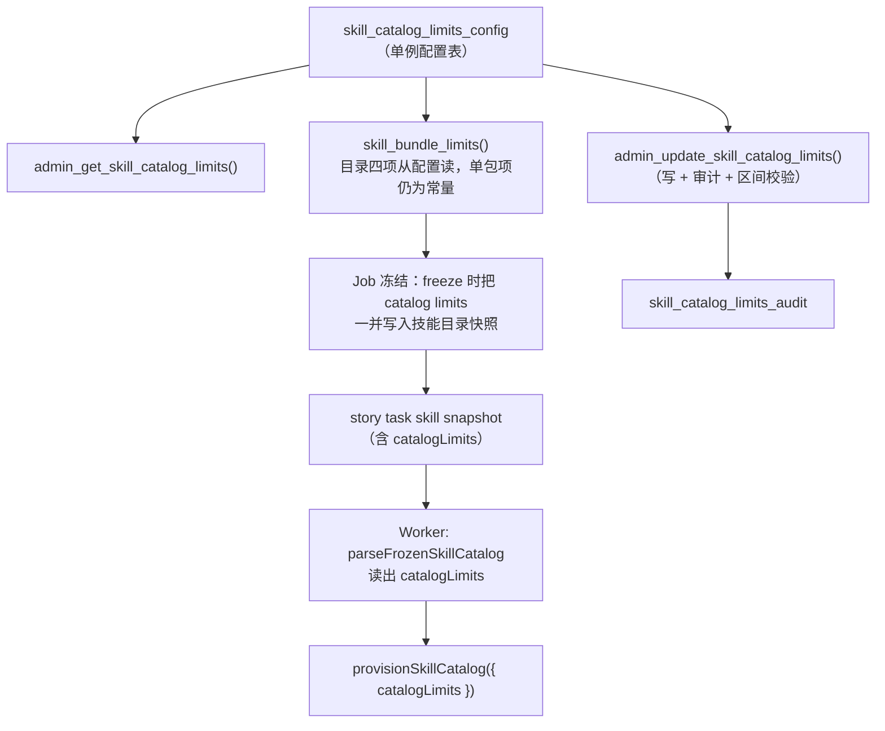

# 需求开发评审一致性平台 V1.8：技能容量上限平台级可配置最终执行方案

> 把技能目录的四个容量上限（`catalogBundles` / `catalogRenderBytes` / `catalogArchiveBytes` /
> `catalogExpandedBytes`）从写死的常量，改成管理员在界面上可配置的平台级设置。核心难点不是
> UI，而是消除「三处数值必须一致」的历史约束——本方案让 **Worker 运行时从数据库读取生效的
> limits**，而不再依赖编译进镜像的常量，从根上避免「界面改了、Worker 没改，批次起不来」。

---

## 0. 为什么不能照搬「默认能力策略」的做法

默认能力策略（0037）的值只在**创建新 Job 时**冻进 `capability_policy_snapshot`，Worker 用的是
快照，改配置只影响之后的 Job。技能上限**不同**：`skill-provisioner.ts` 明确写着「上限属于运行时
资源，必须由要花掉这些资源的一方（Worker）自己确认」——数据库冻结时算一遍，**Worker 启动时
再算一遍**。当前这两遍用的是同一组写死的数字（SQL `skill_bundle_limits()` 与 TS
`SKILL_CATALOG_LIMITS`），并有一致性测试 `src/lib/__tests__/skill-limits-consistency.test.ts`
逐字面量比对。

因此「把值做成界面可配」若不解决 Worker 的取值来源，就会引入危险不一致：管理员把归档上限从
100 MiB 改成 500 MiB 存进数据库，但 Worker 镜像里的常量还是 100 MiB → 数据库放行 300 MiB 的
目录冻结，Worker 启动时用 100 MiB 校验直接 fail closed → **绿灯之后批次起不来**。

## 1. 背景与目标

- 目标：管理员可在界面调整技能目录的四个容量上限，无需改代码、无需重新部署 Worker 镜像。
- 生效语义：改配置只影响**之后新建的 Job**；已冻结/在跑的 Job 用它冻结时的 limits，不受影响。
- 一致性保证：同一个 Job 的「数据库冻结校验」与「Worker 启动重算校验」用**同一份 limits**，
  该 limits 随 Job 一起冻结进快照，杜绝三处分叉。

## 2. 范围与非目标

包含：
- 新增平台级技能 limits 配置的存储（单例配置表）、读写 RPC、RLS、审计表；
- 让 `skill_bundle_limits()` 从配置表读取「目录四项」的当前值（单包上限暂不放开，见 §3）；
- **Job 冻结时把生效的 catalog limits 一并冻进技能目录快照**；
- Worker 从冻结快照读取 catalog limits 注入 `provisionSkillCatalog`，不再用编译常量；
- 前端在「默认能力策略」页（或技能页）新增可编辑区块；
- 一致性测试形态改造：从「常量字面量相等」改为「Worker 默认值 = 配置表出厂默认值」，
  并新增「Job 快照携带 limits 且 Worker 用快照值」的测试。

非目标：
- 不放开**单包**上限（`archiveBytes` / `expandedBytes` / `entryCount` / `fileBytes` /
  `entryFileBytes` / 路径深度 / 压缩比 / `validateMs`）。这些是 Edge Function 上传校验、SQL 冻结、
  Worker cache-miss 三处都用的安全边界，放开面更大，本期只放开**目录四项容量**。
- 不改 `SKILL_CACHE_MAX_BYTES`（卷容量）本身；但 UI 要对 `catalogExpandedBytes` 做「不得超过
  当前 cache 卷容量」的软校验提示（见 §6）。
- 不改技能的发布/冻结/物化流程本身，只改「上限从哪里来」。

## 3. 关键设计决策（需确认）

| # | 决策点 | 方案 | 备选/理由 |
|---|---|---|---|
| D1 | 配置粒度 | **平台级单例**（全局一份），非 per-model | 技能目录是全平台共享的一份，与模型无关；不像能力策略挂在模型上 |
| D2 | 放开范围 | 只放开**目录四项** | 单包/路径/压缩比等属于安全边界，放开风险大，本期不动 |
| D3 | Worker 取值 | **随 Job 冻结**，Worker 读快照 | 若 Worker 每次现查配置表，会与「Job 冻结时算的那次」产生时间窗不一致；随 Job 冻结是唯一能保证两遍用同值的方式 |
| D4 | 出厂默认值 | 与现值相同（50 / 32KiB / 100MiB / 256MiB） | 升级后行为零变化，纯 expand-only |
| D5 | 校验方向 | 只允许在**安全区间**内调整（设下限与硬上限） | 防止管理员把 render 调到几 MB 直接吃爆模型上下文，或 expanded 调到超过卷容量 |

**安全区间（建议初值，待确认）：**
- `catalogBundles`：1 – 200
- `catalogRenderBytes`：8 KiB – 128 KiB（硬上限保护模型上下文）
- `catalogArchiveBytes`：10 MiB – 1 GiB
- `catalogExpandedBytes`：50 MiB – 2 GiB（且 UI 提示 ≤ 当前 `SKILL_CACHE_MAX_BYTES`）

## 4. 总体设计

要点：数据库冻结校验用的 `skill_bundle_limits()` 目录四项、以及 Worker 重算用的
`catalogLimits`，**都来自同一次冻结写进快照的那份值**，因此永远一致。

## 5. 数据与接口设计

数据库（新时间戳迁移，14 位 UTC 命名，只增不改既有文件；`create or replace` 覆盖函数）：

1. `skill_catalog_limits_config` 单例表（`id smallint primary key default 1 check (id=1)`，四列
   `bigint`/`int`，出厂默认 = 现值），RLS：`authenticated` 只读、写入走 security definer RPC。
2. `skill_catalog_limits_audit`（old/new jsonb + changed_by + created_at），仿 0037 审计表。
3. `admin_get_skill_catalog_limits()` / `admin_update_skill_catalog_limits(...)`（`ensure_admin()`，
   区间校验，写审计）。
4. `skill_bundle_limits()` 改为：单包项保持常量字面量，目录四项 `select ... from
   skill_catalog_limits_config`。保持 `stable`（不再 `immutable`，因为读表）。
5. **Job 冻结点**（`freeze_analysis_job_skill_catalog` / 技能快照生成处）：把当前目录四项 limits
   一并写进快照 JSON（新增 `catalog_limits` 字段）。

Worker：
- `parseFrozenSkillCatalog` 解析出 `catalogLimits`（缺失时回退编译默认，兼容历史快照）；
- `factory.ts` 调 `provisionSkillCatalog` 时把 `catalogLimits` 传进去（当前没传，用默认）。

前端（`types.ts` + `api.ts` + 页面）：
- 新增 `SkillCatalogLimitsConfig` 类型与两个 API；
- 「默认能力策略」页新增「技能目录容量上限」可编辑卡片（`InputNumber` + 区间校验 + 保存）。

## 6. 前端交互

- 展示四项当前值（带单位友好显示：KiB/MiB）；
- 编辑态用 `InputNumber`，`min`/`max` 取安全区间；
- `catalogExpandedBytes` 若超过部署侧 `SKILL_CACHE_MAX_BYTES` 的读值（若前端可得）给黄色提示：
  「超过当前缓存卷容量，attempt 可能必然 cache miss」；
- 保存成功 toast「已更新；仅影响之后新建的批次」。

## 7. 一致性测试改造

- 原 `skill-limits-consistency.test.ts`：目录四项不再断言「SQL 字面量 == TS 常量」，改为断言
  「配置表出厂默认 == Worker 编译默认 == 现值」；单包项仍断言字面量相等（未放开）。
- 新增 SQL 测试：`admin_update_skill_catalog_limits` 区间校验、审计落行、`skill_bundle_limits()`
  目录项随配置变化。
- 新增 Worker 测试：`parseFrozenSkillCatalog` 读出快照里的 `catalogLimits`；历史快照（无该字段）
  回退默认；`provisionSkillCatalog` 用快照值而非常量。

## 8. 验收标准

1. 管理员在界面能读到并修改四个上限，越界被拒（前端 + RPC 双重校验）。
2. 修改只影响**之后新建**的批次；在跑/已冻结批次用其冻结值。
3. 同一批次的数据库冻结校验与 Worker 启动重算用**同一份 limits**（快照携带）。
4. 历史 Job（快照无 `catalog_limits`）仍能正常启动（回退编译默认）。
5. 出厂默认与升级前完全一致（零行为变化的 expand-only 升级）。
6. 全部一致性/SQL/Worker 测试通过；`npm test` 绿。

## 9. 迁移与回滚

- 迁移 expand-only：新增表/函数覆盖/快照增字段，既有迁移不改。
- 回滚：`admin_update_*` 把值改回出厂默认即可恢复行为；快照新增字段对旧 Worker 无害（旧 Worker
  忽略未知字段，用编译默认——数值恰等于出厂默认，故不产生不一致）。

## 10. 实施顺序（本地验证优先）

1. 迁移（表 + 审计 + RPC + `skill_bundle_limits()` 改造 + 冻结点写快照）→ 本地 `supabase db reset`。
2. SQL 测试 → 本地跑通。
3. Worker：`parseFrozenSkillCatalog` + `factory.ts` 注入 + Worker 测试 → `npm run test:worker`。
4. 前端类型/API/页面 → `npm run web:typecheck` + `npm run test:web`。
5. 一致性测试改造 → `npm test` 全绿。
6. 整理发布清单（commit / `supabase db push` / Function 无需动 / 云端 Worker 无需改 env）交用户手动执行。
