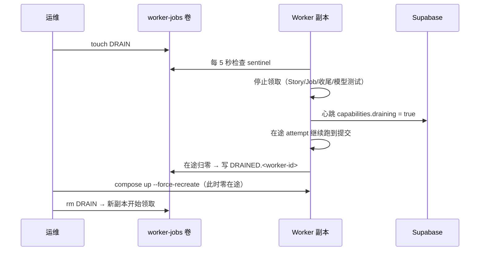
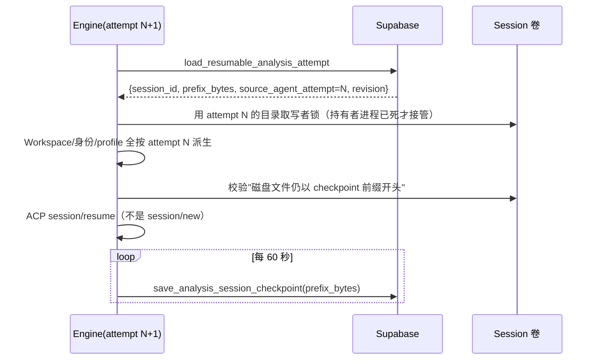

# 需求开发评审一致性平台 V1.9：不中断发布与 Session 续跑最终执行方案

## 1. 背景与目标

### 1.1 现象

线上（Mac Docker，8 副本，连云端 Supabase）出现同一批需求任务反复重跑：既耗时间又耗 token。
用户的原话是"Worker 重建，可是我没有手动去重建"和"volume 不是可以持久化保存执行结果吗，
重启之后应该可以继续执行吧"。

### 1.2 取证结论（全部有工具输出为证，见 §10）

| # | 事实 | 证据 |
|---|---|---|
| 1 | 8 个 worker 容器 `RestartCount=0`、`OOMKilled=false`、`StartedAt` 全部是 `2026-09-17T11:59:29Z`（19:59 CST） | `docker inspect` |
| 2 | 那一刻执行过 `docker compose ... up -d --no-build --force-recreate --scale worker=4`，随后又执行 `--scale worker=8` | `~/.zsh_history` 末两条 |
| 3 | 云端库 8 行 `analysis_agent_run` 判 `WORKER_LOST`，`finished_at` 全部是 `11:59:50`（新容器起来 22 秒后第一次 `reclaimStaleStoryTaskLeases`），累计浪费 **47.9 分钟模型时间**；112 条 run 里 12 条 `agent_attempt>1` | PostgREST 查询 |
| 4 | `entrypoint` 走 `docker-init → npm → sh → node` 三层，SIGTERM 到不了 node：`docker stop -t 30` **0.115 秒**返回、`exit=143`、日志里没有 `worker_shutdown_requested`。改成 `exec node` 后同一镜像打印 `worker_shutdown_requested → worker_stopped`、`exit=0` | 隔离容器对照实验 |
| 5 | 整张 `analysis_session_checkpoint` 只有 **1 行**（10:14 那条），而 Session 卷上已有 **414 个 attempt 目录、225MB JSONL** | PostgREST + `docker exec du` |
| 6 | `load_resumable_analysis_attempt` 只查 `agent_attempt = task.agent_attempt` 的 run，而 `claim_next_story_task` 每次领取都 `agent_attempt+1` 并新建 run → 候选恒为空 | 迁移 0027 第 1483 行、`20260917100000` 第 1601 行 |
| 7 | `sessionDirectoryName` / `mintRootIdentity` / `AttemptWorkspace` 全按 `(taskId, agentAttempt)` 派生 → attempt 一变，目录和 profile hash 全变，恢复门禁必然拒绝 | `session-registry.ts`、`deepseek-harness-acp-engine.ts` |
| 8 | 接管判据只看 `analysis_worker_heartbeat` 的 20 秒窗口（心跳 5 秒一次，只容 4 次），完全不看 `analysis_story_task.heartbeat_at` | 迁移 0026 / 0027 |

一句话：**任务没有"自己"重跑，是发布命令把在途容器摧毁了；而"重启后继续"从来没有真正成立过 ——
卷里的字节一直都在，数据库里却没有任何一行指向它们，就算有也会被 attempt 号和 profile hash 挡掉。**

### 1.3 目标

1. 发布/重启不再摧毁在途 attempt（drain）；
2. 真的被强杀时能续跑，而不是从零重跑（在途 checkpoint + 跨 attempt 恢复）；
3. 心跳抖动不再触发误接管。

## 2. 范围与非目标

包含：Worker 调度器 drain、容器 entrypoint 信号链修复、发布脚本、接管判据收紧、
在途 checkpoint、跨 attempt 恢复、对应迁移与测试、运维文档。

不包含（明确不做）：
- 不改 `v4-capability-contract.json`（manifest hash 不变，新旧 Worker 可混跑）；
- 不改前端页面（`draining` 只进心跳 capabilities，供后续页面可选消费）；
- 不改模型速度本身（一次 attempt 20~40 分钟里 99% 是 `model_ms`，那是模型/内网代理的吞吐问题，属另一个议题）；
- 不做"恢复时压缩历史再续跑"的 token 优化。

## 3. 当前实现与问题

```text
claim_next_story_task           → agent_attempt+1，新建 analysis_agent_run
engine.runReview()
  ├─ mintRootIdentity(task, attempt)          ← 按 attempt 派生
  ├─ SessionRegistry(task, attempt).acquire() ← 按 attempt 派生目录
  ├─ AttemptWorkspace.create(task, attempt)   ← 按 attempt 派生 cwd
  ├─ materializeAttemptProfile(...)           ← hash 覆盖上面两个根
  ├─ resolveResume()  → load_resumable_analysis_attempt(当前 attempt) → 恒为 null
  ├─ runTurn()  ← 20~40 分钟；被 kill 就永远不返回
  └─ turn 返回后（且未提交）才写一次 checkpoint  ← 所以库里只有 1 行
```

叠加两条运维侧缺陷：容器 SIGTERM 到不了 node（优雅关停从未发生），以及接管判据只有 20 秒容错。

## 4. 需求与验收标准

| # | 需求 | 验收 |
|---|---|---|
| A1 | 发布前可以让全池停止领取新任务，且**不打断**在途 attempt | 写 `WORKSPACE_ROOT/DRAIN` 后 5 秒内不再发出任何 `claim_*` RPC；在途归零时写出 `DRAINED.<worker-id>` |
| A2 | drain 状态可观测 | 日志 `worker_drain_started` / `worker_drain_complete` / `worker_drain_lifted`；心跳 capabilities 带 `draining` 与 `active_attempts` |
| A3 | 删除 sentinel 后恢复领取，并清掉 DRAINED 标记 | 单测断言 |
| A4 | 容器停止时 node 真的收到 SIGTERM | `docker stop` 后日志出现 `worker_shutdown_requested`、`exit=0` |
| B1 | turn 进行中就有 checkpoint | 单测断言"turn 还在跑时已落库"，且带 `prefix_bytes` |
| B2 | checkpoint 落库后日志继续增长，仍可恢复 | 单测：追加完整记录 + 残尾后仍 resume |
| B3 | 上一次 attempt 的 checkpoint 能被下一次 attempt 续跑 | 单测 + SQL 测试；`resumeSessionId` 被传给 ACP |
| B4 | 恢复时 Session 目录、Workspace cwd、root 身份、profile hash 与被恢复 attempt 一致 | 单测比对 `profileHash` / `rootAgentId` 真值 |
| B5 | 已提交结果绝不重跑 | SQL 测试：任一 attempt COMMITTED → 候选为 null |
| B6 | 跨 attempt 候选被拒绝时不失败整个 attempt | 单测：错误码不是 `SESSION_FORMAT_UNSUPPORTED`，改开新会话跑完 |
| B7 | 旧 attempt 进程还活着时绝不接管写者锁 | 单测：锁不被抢，attempt 用自己的目录 |
| C1 | 两条心跳同时陈旧才接管 | SQL 测试 5 个场景 |

## 5. 总体设计





## 6. 数据与接口设计

迁移（新增三个文件，既有迁移一字未动）：

- `supabase/migrations/20260917143805_reclaim_requires_two_stale_heartbeats.sql`
  - `reclaim_stale_story_task_leases()`：worker 心跳 >60s **且** `task.heartbeat_at` >90s（或为空）才接管；
    `error_message` 带上两个陈旧时长；签名保持 0 参（避免 PostgREST 空 body 多候选）。
- `supabase/migrations/20260917143806_session_resume_across_attempts.sql`
  - `analysis_session_checkpoint.prefix_bytes bigint`（可空，带 `>= 0` 约束）+ 列注释；
  - `save_analysis_session_checkpoint`：drop 旧 13 参签名，新签名多 `p_prefix_bytes`，upsert 时前进 `prefix_bytes`；
  - `load_resumable_analysis_attempt`：候选改为"同一 task 全部 run 里最新的可用 checkpoint"，
    返回多带 `prefix_bytes` / `source_agent_attempt` / `source_agent_run_id`；`resume_count` 沿链累加；
    `session_revision = greatest(当前 run, checkpoint+1)`；任一 attempt COMMITTED / task SUCCEEDED /
    当前 run 已封存或已取消 / policy 关闭 resume → 一律 null。
- `supabase/migrations/20260917143807_resume_cross_attempt_opt_in.sql`
  - 跨 attempt 判定改成**显式 opt-in**：drop 3 参签名，新签名多 `p_allow_cross_attempt boolean default false`。
    这一层是发布窗口的保护：`supabase db push` 之后、Worker 重建之前，旧 Worker 仍在领任务，
    而它不认识 `source_agent_attempt`（会按自己的 attempt 派生路径 → profile hash 不匹配 →
    fail closed 终止 attempt），一份历史 checkpoint 会把这个 task 的每一次新 attempt 都毒死。
    默认 false 让旧 Worker 保持迁移前语义；新 Worker 显式传 true。

Worker 侧接口：
- `WorkerRuntime` 增加 `drain(source)` / `undrain()` / `drainStatus()`；导出 `DRAIN_SENTINEL`、
  `workerDrainSentinel()`、`workerDrainedMarker()`；`startWorker(config, { jobsDb })` 支持注入（仅测试用）。
- `AcpSessionOptions.onSessionCreated(sessionId, resumed)`：turn 开始前就交出 session id。
- `SessionRegistryOptions.sessionAttempt` / `allowTakeover`；新导出 `describeSessionLog()`（返回 `prefixBytes`）。
- `inspectSessionLog(path, hash, { prefixBytes })`：前缀判定；无 `prefixBytes` 时保持整文件比对的旧语义。
- `RuntimeEventReporterLike.setSessionRevision?()`：恢复后同步 fencing 水位，避免终态事件整批被拒。

## 7. 前端与 Worker/运行时改造

前端：不涉及（心跳 capabilities 多两个字段，页面按需消费）。

Worker/运行时：
1. `worker/src/index.ts`：drain 状态机（sentinel 文件为主通道 + SIGUSR1/SIGUSR2 为辅），
   drain 期间不领取 Story 任务、不准备 Job、不收尾 Job、不领模型连接测试、不跑 reclaim；
   在途归零写 `DRAINED.<worker-id>`；启动时清掉上一条命的残留标记。
2. `docker-compose.worker.yml`：`entrypoint` 改为 `exec node dist-worker/index.js`（绕开 npm/sh 两层）。
3. `scripts/worker-drain-restart.sh` + `npm run worker:release` / `worker:drain` / `worker:drain:lift`。
4. `deepseek-harness-acp-engine.ts`：恢复候选前置到派生路径之前；`continuityAttempt` 统一驱动
   Session 目录 / Workspace / 身份 / profile；每 60 秒写在途 checkpoint（可注入间隔）；
   跨 attempt 拒绝退回新会话，同 attempt 拒绝仍 fail closed。
5. `session-registry.ts` / `session-recovery.ts`：目录接管 + 前缀哈希。

## 8. 安全、兼容与回滚

- **已提交结果绝不重跑**：数据库对任一 COMMITTED attempt 直接返回 null（SQL 测试覆盖）。
- **绝不并发写同一份 JSONL**：接管写者锁前要求三条证据都表明没人在写 ——
  同 Worker 的 PID 已死、锁文件超过 45 秒没被 touch（持有者每 10 秒 touch 一次）、
  且目录里的 `session.v*.jsonl` 超过 45 秒没被写过。
  **PID 判活不能跨容器**（不同容器 PID 空间不可比），所以后两条才是主判据；第三条尤其重要，
  因为写日志的是 dsh 自己，与持有者是哪个版本的 Worker 无关。
  最危险的场景是"旧容器与 Supabase 断网 → 任务被 reclaim 交给新副本 → 旧容器进程仍活着仍在写"：
  数据库 fencing 拦不住它（DB 只能拒绝数据库写入，拦不住文件字节），只有文件系统时间能。
  判活拒绝时抛 `SESSION_FENCED`，引擎退回新会话（等于改造前行为），不损坏任何东西。
- **fencing 只前进**：`session_revision` 取 `greatest`，迟到的旧 attempt 写入必然被拒。
- **不制造毒药 checkpoint**：跨 attempt 拒绝只放弃续跑，不失败 attempt（否则任务永远做不完）。
- **契约不变**：`v4-capability-contract.json` 未改，manifest hash 不变，新旧 Worker 可混跑同一批次。
- 兼容旧数据：`prefix_bytes` 为空的历史 checkpoint 走整文件比对；`source_agent_attempt` 缺失按"同 attempt"处理。
- 回滚：drain 只依赖一个文件，删掉即恢复旧行为；entrypoint 可改回 npm（会重新失去优雅关停）；
  迁移按仓库硬约束**只前滚**，不写反向删除。

## 9. 实施步骤与文件范围

1. 取证（docker + 云端只读查询 + 信号链对照实验）— 已完成；
2. 迁移 A + SQL 测试（接管判据）；
3. Worker drain + entrypoint 修复 + 发布脚本 + 单测；
4. 迁移 B + SQL 测试（前缀 + 跨 attempt 候选）；
5. Worker 在途 checkpoint + 跨 attempt 恢复 + 单测；
6. 本地 Supabase 应用迁移、本地单副本 Worker 端到端验证；
7. 文档与发布清单。

新增/修改文件：

```text
新增 supabase/migrations/20260917143805_reclaim_requires_two_stale_heartbeats.sql
新增 supabase/migrations/20260917143806_session_resume_across_attempts.sql
新增 supabase/migrations/20260917143807_resume_cross_attempt_opt_in.sql
新增 supabase/migrations/20260917143808_freeze_parallel_task_ceiling.sql
新增 supabase/migrations/20260917143809_trend_model_latency_per_request.sql
新增 supabase/tests/20260917143805_reclaim_requires_two_stale_heartbeats_test.sql
新增 supabase/tests/20260917143806_session_resume_across_attempts_test.sql
新增 supabase/tests/20260917143807_resume_cross_attempt_opt_in_test.sql
新增 supabase/tests/20260917143808_freeze_parallel_task_ceiling_test.sql
新增 supabase/tests/20260917143809_trend_model_latency_per_request_test.sql
新增 scripts/worker-drain-restart.sh
新增 worker/src/__tests__/v19-worker-drain.test.ts
新增 worker/src/__tests__/v19-session-resume-across-attempts.test.ts
改   worker/src/index.ts
改   worker/src/ai/runtime/deepseek-harness-acp-engine.ts
改   worker/src/ai/session/session-registry.ts
改   worker/src/ai/session/session-recovery.ts
改   worker/src/ai/acp/acp-client.ts
改   worker/src/monitoring/runtime-event-reporter.ts
改   worker/src/db/jobs.ts
改   worker/src/__tests__/v4-session-lifecycle.test.ts（前缀语义）
改   scripts/runtime-report.mjs（趋势报表渲染每请求延迟）
改   docker-compose.worker.yml（entrypoint / 注释）
改   package.json（worker:release / worker:drain / worker:drain:lift）
改   worker/OPERATIONS.md（§15.9 全面改写：drain、信号链、接管判据、续跑观测）
改   需求开发评审一致性平台/docker命令/Docker Worker 启动命令手册.md
```

## 10. 验证结果

### 10.1 已实际执行

| 项 | 命令 | 结果 |
|---|---|---|
| 类型检查 | `npm run worker:typecheck` | 通过（无输出） |
| Worker 全量单测 | `npm run test:worker` | **730 passed / 24 skipped，0 failed**（35 文件） |
| drain 单测 | `npx vitest run worker/src/__tests__/v19-worker-drain.test.ts` | 3/3 通过 |
| 续跑单测 | `npx vitest run worker/src/__tests__/v19-session-resume-across-attempts.test.ts` | 14/14 通过 |
| 变异验证（续跑） | 把 `pathAttempt` 改回 `this.options.agentAttempt` | 3 条用例变红 → 断言有效 |
| 变异验证（前缀） | 关掉 `inspectSessionLog` 的前缀分支 | 1 条用例变红 → 断言有效 |
| 变异验证（跨容器判活） | 把 `holderAlive` 改回只看 PID | 2 条用例变红 → 断言有效 |
| 迁移 A 应用 | psql 直接应用 + `supabase migration up --local` | 成功，可重复应用 |
| 迁移 A 测试 | `psql < supabase/tests/20260917143805_..._test.sql` | 通过；变异（把期望接管数改成 99）确实报 ASSERT FAILED |
| 迁移 B 应用 | 同上（两次应用验证幂等） | 成功；`save_analysis_session_checkpoint` 重载数 = 1 |
| 迁移 B 测试 | `psql < supabase/tests/20260917143806_..._test.sql` | 通过；变异（把候选期望改成 null）确实报 ASSERT FAILED |
| 迁移 C 应用 | `supabase migration up --local` | 成功；`load_resumable_analysis_attempt` 重载数 = 1 |
| 迁移 C 测试 | `psql < supabase/tests/20260917143807_..._test.sql` | 通过（3 键调用拿不到跨 attempt 候选、4 键能拿到）；变异确实报 ASSERT FAILED |
| 三个 SQL 测试回归 | 依次重跑 805 / 806 / 807 | 全部 PASS |
| Lint | `npm run lint` | 0 errors（1 个既有的 react 警告，与本次无关） |
| Worker 构建 | `npm run worker:build` | 成功（manifest hash 未变：revision 2 / 30 tools） |
| 信号链对照实验 | 同一镜像两种 entrypoint + `docker stop -t 30` | `npm` 版 0.115s/exit=143/无关停日志；`node` 版打印 `worker_shutdown_requested → worker_stopped`/exit=0 |
| 本地 Worker 端到端 | 见 §10.2 | 见 §10.2 |

### 10.2 本地 Supabase + 本地 Worker（实际执行）

环境：本地 Supabase（`supabase_db_codeReviewPlatform`，三个迁移已 `supabase migration up --local`
记录）+ `codereviewplatform-local` 单副本 Worker（`.docker/worker.local.env`，指向
`http://host.docker.internal:54321`）。

| 项 | 观测 |
|---|---|
| 镜像重建 + 单副本重建 | `up -d --build --force-recreate --scale worker=1` 成功，日志 `worker_started` |
| entrypoint 生效 | 容器内 `ps` 为 `docker-init(1) → node dist-worker/index.js(7)`，中间没有 npm/sh |
| 优雅关停 | `docker stop -t 30` 1.6s 返回、`exit=0`，日志 `worker_shutdown_requested` → `worker_stopped` |
| drain 脚本全流程 | `已写入 /workspace/jobs/DRAIN` → `已排空 1/1` → `重建容器` → `已删除 DRAIN sentinel` |
| drain 日志三段 | `worker_drain_started(SENTINEL_FILE)` → `worker_drain_complete(active_attempts=0)` → `worker_drain_lifted` |
| 新副本继承 drain 并被解除 | 新容器起来时 sentinel 还在 → 先 drain，脚本删 sentinel 后 10 秒内 `worker_drain_lifted` |
| 历史标记清理 | 脚本打印 `清理历史标记 DRAINED.worker-abb3562f3a8a（该副本已不存在）`，之后卷上无 `DRAIN*` 残留 |
| 新 RPC 经 PostgREST 可调用 | `load_resumable_analysis_attempt` 4 键调用 → HTTP 200 `null`；3 键调用（旧 Worker 形态）→ HTTP 200 `null`；`save_analysis_session_checkpoint` 14 键调用 → 进入函数体并按预期以 `TASK_LEASE_LOST` 拒绝 |

这一步同时验证了"库先升级、Worker 后升级"和"旧 Worker 调用新库"两种形态都不会因为签名
变化而报 404 / 多候选。

### 10.4 独立审计与后续修复

实现完成后由一个不参与实现的子代理做过一次独立审计（只读，禁止碰云端）。它确认三件事在
代码与本地验证层面都成立，并发现一个**高危缺陷**，已在本次修复：

- **跨容器接管只看 PID 必然误判。** `holderAlive` 原来写成
  `holder.workerId === 本 worker && isProcessAlive(pid)`，短路的结果是"持有者属于另一个容器"
  时恒判为已死。触发路径：旧容器与 Supabase 断网 → 两条心跳都陈旧 → 任务被 reclaim 交给
  新副本 → 但旧容器进程还活着、dsh 仍在向共享卷上同一份 JSONL 追加 → 新副本"成功"接管锁
  并 resume 同一个会话 → 两个 dsh 交错 append，日志不可安全重放（不可逆损坏，且数据库
  fencing 拦不住文件字节）。
  修复：判活改成三条证据（同 Worker 的 PID 存活、锁文件 45 秒内被 touch 过、Session 日志
  45 秒内被写过），持有者每 10 秒 touch 一次锁文件；任一条命中即拒绝接管并退回新会话。
  新增 5 条用例覆盖（含"把判活改回只看 PID"的变异验证：2 条用例变红）。
- 低危（未修，已记录）：单独重放 `20260917143806` 而不接着跑 `20260917143807` 会临时留下
  3 参重载。正常 `supabase db push` 按序应用不会出现；仓库既有迁移也都遵循"按序应用"的前提。

### 10.5 未验证项

- **云端未做任何写操作**：只做了只读查询取证。迁移推送、镜像重建、云端 Worker 重启全部留给用户手动执行（见 §11）。
- **真实模型下的续跑闭环未观测**：本地库里没有任何 batch/job（`analysis_story_task` 为空表），
  而构造一个真实 Job 需要 GitLab 凭据与内网模型。因此"被 kill → 下一次 attempt 真的接上上一次
  上下文"这条链路的**装配**由单测逐条断言（含变异验证），**真实模型下的端到端**要等云端发布后
  用一次真实长任务观察 `attempt_rollup.resumed=true` / `resume_count>0` 才算闭环。
- 恢复对 token 的净收益未量化：续跑会把历史带回上下文，节省的是重复检索与重复推理，代价是更大的输入。
  一次 attempt 20~40 分钟、13~32 次模型请求的量级下，续跑优于从零重跑，但没有 A/B 数据。
- 未改动模型侧性能：`attempt_rollup` 显示 wall_ms 的 99% 是 `model_ms_union`（内网模型经 Mac 代理），
  这次改动不会让单次 attempt 变快，只会让它**不必重跑**。

## 11. 发布清单（由用户手动执行）

> 取证时（2026-09-17 21:2x CST）云端 `analysis_story_task` 的 `RUNNING` 数为 **0**
> （最后一批 Job 于 13:17Z SUCCEEDED），所以此刻发布不会损失任何在途工作。
> 但仍建议走 drain 流程 —— 它顺手把"确认没有在途"这一步变成机器判定，而不是人工目测。

> **首次发布的例外（只此一次）。** 当前线上跑的容器是**不支持 drain 的旧镜像**
> （自检：`docker exec <容器> sh -c 'grep -c worker_drain_started dist-worker/index.js'`
> 返回 0）。它们永远不会写出 `DRAINED` 标记，所以 `npm run worker:release` 只会白等到
> 超时并拒绝重建。这一次要用 `--skip-drain`，并且**必须先自己确认没有在途任务**。
> 装上这版镜像之后，以后每次发布都用不带 `--skip-drain` 的正常流程。

```bash
# 0) 确认没有在途任务（两个数都必须是 0 / 空）
docker exec $(docker ps -q -f label=com.docker.compose.project=codereviewplatform | head -1) \
  ls /workspace/jobs
#    在 /monitoring 页面确认没有「分析中」的批次，或直接查库：
#    RUNNING 需求任务 = 0，未完结 Job = 0

# 1) 提交代码（AI 不提交）
git status && git add -A && git commit -m "V1.9: 不中断发布与 Session 续跑 + 并发闸门与延迟归因"

# 2) 推送迁移（**必须在重建 Worker 之前**；dry-run 通过后再执行）
supabase migration list --linked          # 应看到 143805~143809 五个待推
supabase db push --linked --dry-run --skip-vault
supabase db push

# 3) 重建镜像（本机共享镜像模式）
docker compose -f docker-compose.worker.yml build worker

# 4) 首次发布：跳过 drain（旧镜像不支持），确认无在途任务后执行
npm run worker:release -- --scale 8 --skip-drain
#    以后每次发布改用：npm run worker:release -- --scale 8

# 5) 校验
docker compose -p codereviewplatform -f docker-compose.worker.yml ps
docker logs --tail 30 $(docker ps -q -f label=com.docker.compose.project=codereviewplatform | head -1)
#   期望：worker_started
docker exec $(docker ps -q -f label=com.docker.compose.project=codereviewplatform | head -1) \
  sh -c 'ps -eo pid,ppid,args | head -3'
#   期望：docker-init(1) → node dist-worker/index.js(7)，中间没有 npm / sh
docker exec $(docker ps -q -f label=com.docker.compose.project=codereviewplatform | head -1) \
  sh -c 'grep -c worker_drain_started dist-worker/index.js'
#   期望：> 0（新镜像已支持 drain，下次发布可用正常流程）

# 6) 下一批任务跑起来之后，确认续跑与新报表真的生效
npm run monitor:trend -- --group-by model_label --since 1d --remote
#   期望：能看到「每次模型请求 p50」这一行
```

不涉及 Edge Function 部署。

### 11.1 发布顺序为什么是硬约束

- 先库后 Worker：新 Worker 会调用 14 参的 `save_analysis_session_checkpoint` 与 4 参的
  `load_resumable_analysis_attempt`。库没升级时这两个调用找不到函数，checkpoint 写入会以
  `session_checkpoint_failed` 记日志（不影响业务结果），但续跑不生效。
- 反过来（库升级、Worker 还是旧的）也安全：跨 attempt 判定默认关闭，旧 Worker 拿到的
  行为与升级前完全一致。这层保护就是迁移 `20260917143807` 的全部目的。

## 12. V1.9.1：单任务 40 分钟的归因与并发闸门

### 12.1 现象

监控台上出现单个需求任务运行 47 分钟仍在"模型编排中"（25 次模型请求、44 次工具调用、
输入 82.6 万 token）。用户判断"很离谱"，需要定位到底慢在哪一层。

### 12.2 取证：同一套平台、三个模型，差 5.7 倍

26 个需求、同一批仓库快照、同一套 prompt 与工具面、同一条内网代理链路：

| 模型 | 整批耗时 | 需求/分钟 | 单次模型请求中位数 | 每次请求输入 token | 请求次数中位数 | 实测并发峰值 |
|---|---|---|---|---|---|---|
| qwen3.6-flash（公网直连） | **11.1 分** | 2.34 | —(无 rollup) | — | — | 8 |
| glm5.3-flash（内网代理） | **16.8 分** | 1.55 | **5.9 秒** | 36810 | 36 | 8 |
| kimi-k3（内网代理） | 63.0 分 | 0.46 | **27.0 秒** | 26176 | 22 | 7~8 |
| kimi-k3（配置改成 16 并发） | 63.1 分 | 0.41 | **65.7 秒** | 26176 | 22 | 16 |

两个结论，都由数据直接支撑：

1. **主因是 kimi-k3 端点自身的单请求延迟。** 它的请求次数**更少**（22 vs 36）、上下文
   **更小**（26K vs 37K token/请求），却比 glm5.3-flash 慢 4 倍。两者走同一个 Mac 代理、
   同一套工具、同一份 prompt，所以平台侧、网络侧、上下文侧都无法解释这个差距。
   平台改不动它 —— 只能换模型，或接受这个耗时。
2. **给 kimi-k3 加并发是负收益。** 8 → 16 并发之后：吞吐 0.46 → 0.41 需求/分钟（略降），
   单请求延迟 27 → 65.7 秒（2.4 倍），于是单个 attempt 从 ~15 分钟变成 40~55 分钟，
   还顺带触发租约接管与重跑。这是"服务端已饱和"的典型特征：超过容量之后额外并发只产生
   排队延迟，不产生吞吐。

### 12.3 顺带查出的缺陷：并发闸门读实时配置

`claim_next_story_task` 的并发判定读 `ai_model_config.max_parallel_tasks` 的**实时值**，
而这个 Job 的其它一切（capability policy、模型路由、技能目录、Harness manifest）都按 Job
冻结。后果实测到了：job `189a4302` 的 `model_snapshot.max_parallel_tasks` 是 8，但配置在它
执行途中被改成 16，于是实测并发峰值就是 16 —— 一个已经在跑的批次被静默放大到冻结值的两倍，
而放大的结果就是上表最后一行。

修复（迁移 `20260917143808`）：闸门取 `least(冻结上限, 实时闸门)`。两个方向刻意不对称：

- **调高实时值不能突破 Job 冻结的上限** —— 在途批次的执行包络必须稳定；
- **调低实时值立刻生效，包括在途批次** —— 模型端被打满时必须能马上限流。

快照缺该字段的旧 Job 退回实时值；两者都缺仍是 4。领取结果的 `model` 里多返回
`effective_max_parallel_tasks`，让"为什么只有 N 个在跑"不需要靠猜。

### 12.4 让"模型慢"一眼可见

迁移 `20260917143809` 给 `get_analysis_run_trend` 增加四个口径，并在
`npm run monitor:trend` 里渲染：

- `model_ms_per_request_p50 / _p95` —— 单次模型请求耗时（**模型端速度**，平台改不动）；
- `model_requests_p50` —— 一次 attempt 的模型往返次数（**编排效率**）；
- `input_tokens_per_request_p50` —— 单次请求输入规模（**上下文膨胀**）。

三者相乘约等于 `model_ms_union`，所以任何一次变慢都能落到具体一项上。分位数是**先按 run
做除法再取中位数**，不是"先求和再除"—— 后者会把少数超长请求抹平（测试用 2000ms vs 2333ms
两个值把这条口径钉住）。

判读顺序写进了报表头部：先看每次模型请求 p50，它正常而 wall 很大时再看次数与上下文。

### 12.5 建议的运维动作（需要用户决定）

按预期收益排序：

1. **把 kimi-k3 的最大并发从 16 调回 8**（`/models` 页面「最大并发」字段）。
   预期：单请求 66 → 27 秒，单任务 40~55 分钟 → 15~27 分钟，整批吞吐不降。
   这是纯配置动作，无需发布。
2. **想要整批更快就换模型**：glm5.3-flash 16.8 分钟 / qwen3.6-flash 11.1 分钟 vs
   kimi-k3 63 分钟（同样 26 个需求）。这是模型选择的取舍，不是平台缺陷。
3. **kimi-k3 的 `request_timeout_ms` 从 360000 调到 180000**（与另两个模型一致），
   避免一次卡住的请求独占 6 分钟。
4. 不建议为此改 prompt 或砍工具输出：数据显示 kimi-k3 的上下文比 glm **更小**却更慢，
   上下文不是主因，砍它换不来速度，只会损失评审信息量。

### 12.6 验证结果

| 项 | 命令 | 结果 |
|---|---|---|
| 迁移 20260917143808 | `supabase migration up --local` | 成功；`claim_next_story_task` 重载数 = 1 |
| 闸门 SQL 测试 | `psql < supabase/tests/20260917143808_..._test.sql` | 通过（实时>冻结按冻结封顶 / 实时<冻结立刻收窄 / 旧 Job 回退 / 单重载）；变异（把"第三次领取应被拒"改成"应成功"）确实报 ASSERT FAILED |
| 迁移 20260917143809 | 同上 | 成功；`get_analysis_run_trend` 重载数 = 1 |
| 趋势 SQL 测试 | `psql < supabase/tests/20260917143809_..._test.sql` | 通过；变异（把 p50 期望改成"先求和再除"的 2333）确实报 ASSERT FAILED |
| 五个 SQL 测试回归 | 依次重跑 805/806/807/808/809 | 全部 PASS |
| 全量测试 | `npm test` | 839 passed / 0 failed |
| Lint / 类型 | `npm run lint`、`npm run worker:typecheck` | 0 errors |
| CLI 语法 | `node --check scripts/runtime-report.mjs` | 通过 |

未验证：`monitor:trend` 对**云端**库的实际输出（新 RPC 还没推到云端；推送后
`npm run monitor:trend -- --group-by model_label --since 7d --remote` 即可直接看到上表口径）。


