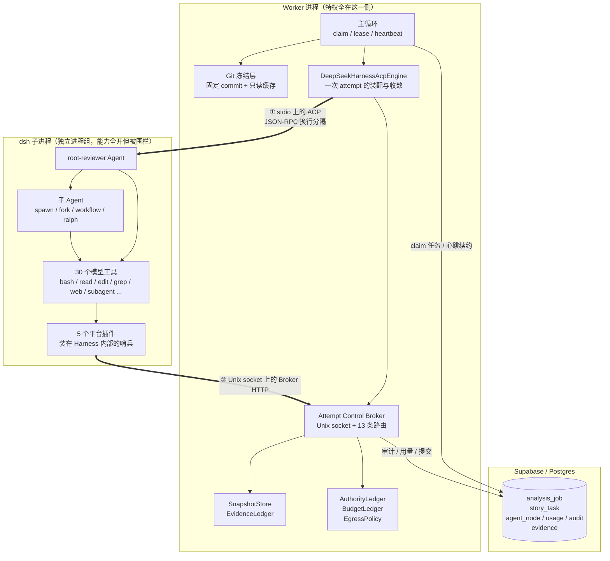
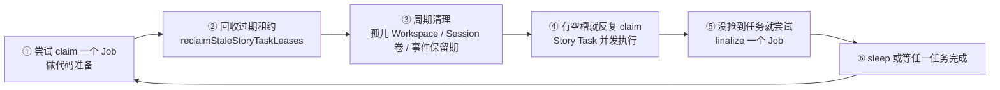
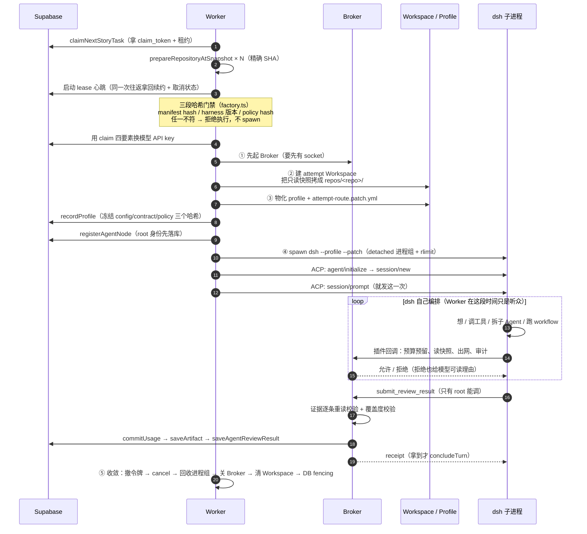
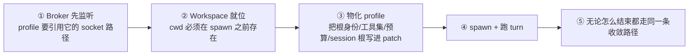
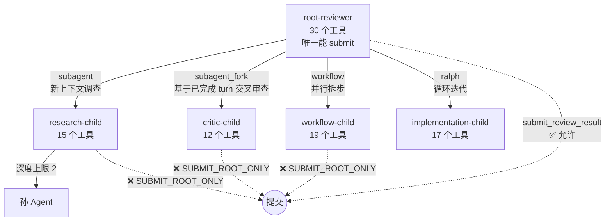
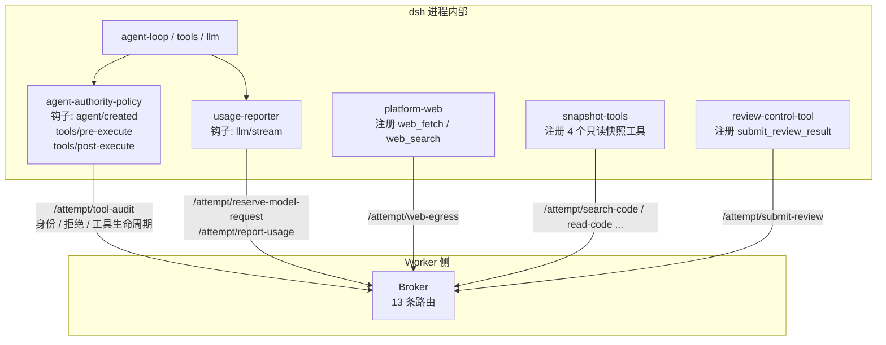
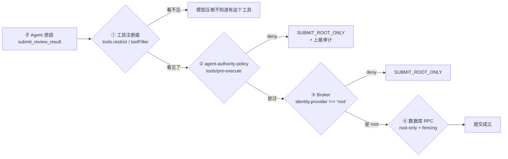
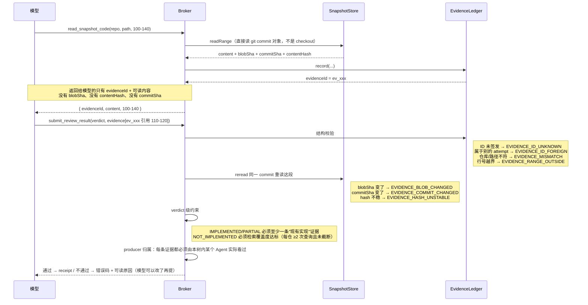
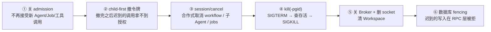
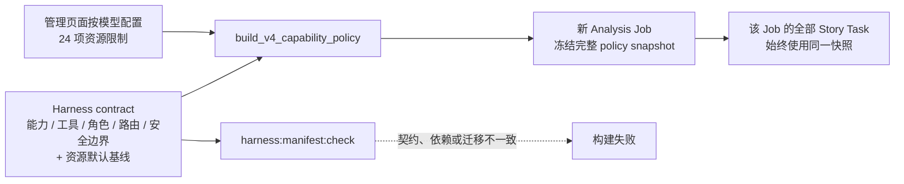

# DeepSeek Harness 在本项目里到底是怎么用的

> 面向问题：**是 dsh 自己编排，还是 Worker 编排？Worker 到底做了什么？**
>
> 本文所有结论都来自当前代码，关键位置附了文件路径，可以逐条核对。

---

## 0. 一句话结论

**编排是分层的，两边各管一半，而且互不越界：**

| | 谁在编排 | 编排的是什么 |
|---|---|---|
| **内层** | **DSH 自己**（`@deepseek-ai/dsh` 子进程） | Agent 怎么想、下一步调哪个工具、要不要拆子 Agent、要不要跑 workflow / job、什么时候压缩上下文 |
| **外层** | **Worker**（`worker/src/**`） | 任务从哪来、代码冻结在哪个 commit、允许用哪些工具、能烧多少预算、结论算不算数、什么时候必须停 |

换句话说：

- Worker **从不**告诉模型"下一步去搜哪个关键词"。没有固定的检索阶段，`../../worker/src/ai/prompts/agent-review-v1.ts` 里写得很明确：检索顺序、深度、何时收敛全由 Agent 自己决定。
- DSH **从不**持有任何特权。它拿不到数据库凭据、拿不到快照根目录、发不出网络请求、也不能自己决定"提交成功"。

一句更精确的说法：**Worker 编排的是"一次 attempt 的生命周期与权力边界"，DSH 编排的是"这一次 attempt 内部的思考过程"。**

---

## 1. 全景图：三个进程、两条边界



**跨进程通道有且只有两条**，这是整套安全模型的地基：

1. **ACP（stdio）** — Worker 当 ACP client，dsh 当 ACP agent。Worker 用它做三件事：开 session、发一次 prompt、必要时发 `session/cancel`。见 `../../worker/src/ai/acp/acp-client.ts`。
2. **Broker（Unix domain socket）** — dsh 进程内的插件回头请求 Worker。socket 文件 0600、所在目录 0700，请求要带 Bearer token + 每个 Agent 自己的 capability token。见 `../../worker/src/ai/control/attempt-control-broker.ts`。

dsh 子进程手里只有三样东西：一个 0700 的私有目录、一个 socket 路径、两个经**环境变量**下传的令牌。凭据绝不写进 patch 文件 —— `profile-materializer.ts` 里有一道机械闸门 `assertPatchHasNoCredentials()`，patch 里出现任何形似凭据的键就直接拒绝启动。

---

## 2. 对照表：谁负责哪一件事

| 事情 | Worker | DSH |
|---|---|---|
| 任务排队、claim、租约续约、取消传播 | ✅ | ❌ |
| 把 4 个仓库冻结到精确 commit SHA | ✅ | ❌ |
| 决定模型路由（baseUrl / model / key） | ✅ 每 attempt 指定 | ❌ 不许有第二个来源 |
| **决定下一步调哪个工具** | ❌ | ✅ |
| **决定要不要拆子 Agent、拆几个** | ❌ | ✅ |
| **Workflow / Job / Ralph 的调度** | ❌ | ✅ 全在进程内 |
| 上下文自动压缩（compaction） | ❌ | ✅ |
| 每个角色**能看见**哪些工具 | ✅ 生成 allow 名单 | 执行收窄 |
| 每次调用**能不能调** | ✅ 最终判定在 Broker | 插件先拦一次 |
| 模型请求配额（含子 Agent 共享总额） | ✅ 调 provider 之前拦 | ❌ |
| 读代码 | ✅ 唯一通道 | 只能经 Broker |
| 出网 | ✅ Worker 代发 | 原生 web 工具被禁用 |
| 判定结论是否成立（证据校验） | ✅ | ❌ |
| 结束时回收进程树 / 撤令牌 / 数据库 fencing | ✅ | ❌ |

---

## 3. Worker 做了啥：一个任务的完整时间线

Worker 是个**轮询型**长驻进程（`../../worker/src/index.ts`），每轮固定做这些事：



### 3.1 Job 阶段：先把代码冻住（`../../worker/src/pipeline/prepare-job.ts`）

对 4 个白名单仓库逐个跑 `prepareRepository()`：

1. `git ls-remote` 解析目标分支的 head SHA；
2. 浅拉这个精确 SHA 到临时目录；
3. `checkout --detach` 后**严格断言** checkout 出来的 SHA 等于想要的 SHA，不等就抛 `GIT_SHA_MISMATCH` —— 绝不回落到"分支最新"；
4. `rename` 原子发布到 `<cacheRoot>/<repo>/<sha>/`，然后整棵树 chmod 成 0555/0444 只读；
5. 4 个仓库的 SHA 落库，Job 从 `PREPARING_CODE` 推进到 `PROCESSING`。

之后**任何副本**处理这个 Job 的任何需求，都只走 `prepareRepositoryAtSnapshot()`：只认精确 SHA，拿不到就失败。这就是"同一批次里所有需求看到的是同一份代码"的来源。

> 认证细节：deploy token 走 `-c http.extraHeader=Authorization: Basic ...`，**不进 URL**，所以不会被日志带出去。

### 3.2 Task 阶段：一个需求 = 一次 attempt



**注意第 ④⑤ 步之间那个 loop：Worker 在这段时间不做任何编排决策。** 它只提供服务、执行拒绝、记账。模型下一步做什么，完全由 dsh 内部的 agent-loop 决定。

---

## 4. 起 dsh 之前，Worker 铺的三样东西（顺序本身就是安全属性）

`../../worker/src/ai/runtime/deepseek-harness-acp-engine.ts` 的注释把这点说得很直白 —— 顺序不能换：



### profile 长什么样

每个 attempt 一棵**独立**的目录树（0700，用完删掉）：

```
<attemptsRoot>/attempt-XXXX/
└── dsh-home/                      ← 子进程的 HOME 和 DSH_HOME
    ├── attempt-route.patch.yml     ← 本次 attempt 的覆盖层（21 行配置，无凭据）
    └── profiles/code-review-acp/
        ├── package.json            ← 从 worker/harness/code-review-acp/ 拷来
        ├── cordis.patch.yml        ← 同上，profile 自己的基线补丁层
        ├── pnpm-workspace.yaml
        └── node_modules/@codereview/harness-*/   ← 5 个插件的 re-export shim
```

**两层 patch 的分工很清楚：**

- `../../worker/harness/code-review-acp/cordis.patch.yml`（进 git 的模板）：只做与 attempt 无关的事 —— 禁掉重复的 `llm-deepseek` adapter、禁掉外部 telemetry、禁掉 PowerShell、把 Harness 原生 web 工具换成平台网关、插入 5 个平台插件。**里面没有任何秘密。**
- `attempt-route.patch.yml`（运行时生成）：写入本次 attempt 的模型路由、broker socket 路径、根 Agent id、角色工具集、各项数值上限、session 根目录。

**凭据一律走环境变量**，而且变量名必须命中 Harness 自己的凭据剥离正则 `/KEY|PASSWORD|SECRET|TOKEN/i` —— `acp-process-supervisor.ts` 里的 `assertCredentialEnvIsScrubbed()` 在启动路径上机械检查这一点。这是"模型可见的 Shell 读不到凭据"的唯一依据。

### 进程隔离细节

```
spawn("/bin/sh", ["-c", "ulimit ...; exec node .../dsh/lib/bin.js --profile ... --patch ..."], {
  cwd:      attempt workspace,
  env:      从零构建（不继承 Worker 环境），PATH 只有 node 目录 + /usr/bin + /bin,
  detached: true,          ← 独立进程组，这一位决定能否回收整棵进程树
})
```

- `exec` 让 dsh 顶替 sh，pid 仍是进程组组长，`kill(-pid)` 语义不变；
- rlimit 靠继承生效，所以设在 dsh 上就等于设在 Sandbox Shell 和 Jobs 起的每个构建/测试进程上；
- 刻意**不设** `ulimit -t`：那会在累计 CPU 时间到点时杀掉整个 Harness，单条命令的超时交给 `bash-sandbox.commandTimeoutMs`。

---

## 5. DSH 内部的编排：Agent Tree 是怎么长出来的

Worker 只发**一次** prompt，只驱动**一个** root turn。树是模型自己长出来的：



冻结策略（`v4-capability-contract.json` 的 `defaultPolicy`）给的上限：

| 项 | 值 |
|---|---|
| 一次 attempt 最多 Agent 数 | 8（含 root） |
| 委派深度 | 2 |
| 并发子 Agent | 4 |
| 并行工具调用 | 8（mutation 类强制串行） |
| 模型请求总额 | 160（root 80 / child 32 / retry 12 / compaction 8） |
| Shell 单条命令超时 | 60s |
| Workspace 上限 | 2 GiB / 10 万文件 |
| Web | 20 次请求 / 单响应 2 MiB / 总 20 MiB / 仅 443 端口 / 禁私网 |

**20 项能力默认全开**（instructions / skills / goal / plan / todo / ralph / subagent / workflow / jobs / shell / filesystem / web / 并行工具 / 自动压缩 / session 持久化与恢复 / artifacts）。运维只在事故时用熔断环境变量收窄：`V4_BREAKER_DISABLE_WEB`、`_SHELL_WRITE`、`_SUBAGENTS`、`_WORKFLOW`。

### 30 个工具 = 5 个平台工具 + 25 个 Harness 原生工具

| 来源 | 工具 |
|---|---|
| **平台（经 Broker）** | `search_snapshot_code` `find_snapshot_files` `read_snapshot_code` `list_snapshot_commits` `submit_review_result` |
| **Harness 原生（进程内直接执行）** | `bash` `read` `read_image` `write` `edit` `grep` `glob` `skill` `todo_write` `create_goal` `update_goal` `get_goal` `ralph` `subagent` `subagent_fork` `send_message` `interrupt_agent` `list_agents` `workflow` `job_list` `job_output` `job_kill` `web_search` `web_fetch` `exit_plan_mode` |

这个区分很重要：**25 个原生工具根本不经过 Broker**。所以监控和权限如果只做在 Broker 侧，就完全看不见 `bash` / `edit` / `grep` —— 而实现型 Agent 的大部分时间恰恰花在这些上面。这就是下一节 5 个插件存在的理由。

---

## 6. 平台怎么在 dsh 内部装哨兵：5 个插件

这 5 个插件是**平台自己写的 Cordis 插件**（源码在 `../../worker/src/harness-plugins`），通过 profile 的 `node_modules` shim 加载进 dsh 进程，挂在 Harness 的生命周期钩子上。它们是"Worker 的手伸进 Harness 内部"的方式。



| 插件 | 挂在哪 | 干什么 |
|---|---|---|
| **agent-authority-policy** | `agent/created`、`tools/pre-execute`（global + prepend）、`tools/post-execute` | 身份与权限的中枢。新子 Agent 一出现就 `tools.restrict()` 收窄工具面；每次工具调用前按注册身份的 allow 名单默认 deny；顺带把**全部 30 个工具**的生命周期上报给 Broker |
| **usage-reporter** | `llm/stream`（global + prepend） | 在 `next()` 之前先向 Broker 预留额度。拒绝时**provider 永远不会被联系上**，模型收到一段可读的终止 chunk 自己停下 |
| **platform-web** | `ctx.tools.register` | 注册**同名**的 `web_fetch` / `web_search`（原生的已在模板 patch 里禁掉）。请求交 Worker 代发：HTTPS 限定、域名白名单、DNS 解析后复查、逐跳 redirect 重校验、大小与总字节配额 |
| **snapshot-tools** | `ctx.tools.register` | 4 个只读检索/阅读工具。`read_snapshot_code` 返回的 `evidenceId` 是提交时唯一可引用的凭据 |
| **review-control-tool** | `ctx.tools.register` | 唯一的终结工具。拿到 receipt 才 `exec.concludeTurn()`；被拒时**不结束 turn**，Agent 继续改 |

### 三层拦截，同一个不变量说三遍

`submit_review_result` 只属于 root，这条在**三个不同的地方**各校验一次：



这种冗余是刻意的。代码注释里记了一条真实教训：`workflow-worker-thread` 的 `startAgent()` **不转发 toolFilter**，所以 workflow 子 Agent 实测拿到了跟 root 一样的 30 个工具（含提交工具）。第 ① 层在那条路径上是漏的 —— 靠的是第 ②③④ 层顶住。

---

## 7. Broker 的 13 条路由

传输是 Unix socket 上的普通 HTTP POST，body 上限 1 MiB。每个请求过 5 道检查：Bearer token（`timingSafeEqual`）→ 是否已撤销 → 租约是否还在 → taskId/agentAttempt 是否匹配本 attempt → 路由对应的 capability 能否被这个 Agent 的 capability token 授权。**未知路由一律 404 fail closed。**

| 路由 | capability | 作用 |
|---|---|---|
| `/attempt/search-code` | snapshotRead | 检索固定 commit，同时写"检索覆盖度台账" |
| `/attempt/find-files` | snapshotRead | glob 找文件 |
| `/attempt/read-code` | snapshotRead | 读代码并**签发 evidenceId** |
| `/attempt/list-commits` | snapshotRead | 列提交 |
| `/attempt/snapshot-pins` | snapshotRead | 回本次固定的仓库+SHA |
| `/attempt/register-agent` | agentRegister | 注册子 Agent，返回它自己的 capability token + 角色 + 工具集 |
| `/attempt/finish-agent` | agentRegister | 只能给**自己**收尾（否则等于给了它取消同级的原语） |
| `/attempt/reserve-model-request` | usageReport | 调 provider **之前**的原子额度预留 |
| `/attempt/report-usage` | usageReport | 落真实 token 用量 |
| `/attempt/tool-audit` | usageReport | 审计 + 拒绝记录 + 30 个工具的生命周期事件 |
| `/attempt/web-egress` | webEgress | Worker 代发网络请求 |
| `/attempt/save-artifact` | artifactWrite | 登记 Workspace 产物元数据 |
| `/attempt/submit-review` | submitReview | 校验并提交（幂等） |

**关键设计：身份只按 capability token 查，请求体里自报的 `agentId` 仅用于比对。** 所以"子 Agent 伪造 root id 直接请求 Broker"在结构上不成立 —— 它拿不到 root 的令牌。

---

## 8. 证据链：为什么模型编不出结论

这是整个平台最硬的不变量。



几个"堵死"的细节：

- **模型看不到 blobSha 和 contentHash**，所以没法伪造一条"看起来能过校验"的证据。
- **EvidenceLedger 是纯内存、per-attempt 的**。上一次 attempt 的 evidenceId 一律被拒。
- **Workspace 里生成的东西不能当"现有实现"证据**。模型写的补丁、测试报告只能作为 `analysis_artifact`，`evidence_origin` 固定是 `PINNED_SNAPSHOT`。
- **最终汇总只读 `verified_evidence`**（`finalize-job.ts`）。模型自报但未通过校验的路径永远进不了批次结果。

---

## 9. 停下来同样是 Worker 的活

五条终止路径（提交成功 / attempt 失败 / 用户取消 / 租约丢失 / Worker 关停）最终走**同一条**收敛路径，顺序不能换（`attempt-tree-controller.ts`）：



反过来做（先杀进程再撤令牌）会留一个窗口：进程还没死透，令牌仍然有效，迟到的工具调用还能写入。

**取消原因要分得开**：`USER_CANCELLED`（产品行为）/ `LEASE_LOST`（被别的副本接管）/ `WORKER_SHUTDOWN`（滚动重启）/ `BUDGET_EXHAUSTED`。三者运维含义完全不同，全报成 `USER_CANCELLED` 等于事故复盘时无从判断。

### Session 恢复

Session JSONL 明文（`compression: none`）落在**持久卷**上。Worker 重启后可以 `session/resume` 继续同一个未提交会话，并发写入由本地单写者锁 + 数据库 `session_revision` 双重 fencing。恢复判定失败时**明确终止 attempt，不静默降级成新建会话** —— 那会让人以为恢复了，其实从零开始，长任务的 Todo / Goal / 已完成取证全部白做。

---

## 10. 防漂移：为什么改一行能力配置会让构建失败

这里要区分**能力契约**和**运行资源限制**，它们不是同一层配置：

- `../../worker/harness/code-review-acp/v4-capability-contract.json` 是 Harness **能力契约**的唯一人工维护入口：Harness 版本、20 个能力开关、插件和工具清单、角色工具权限、Broker 路由、错误码以及安全边界均由它锁定；前端不能修改。
- 管理页面 `/harness-policy` 可以按模型维护 **24 项运行资源限制**：Agent 数量与深度、模型请求预算、Shell/Workflow/Job 超时、并发数、Workspace 容量、Web 配额与域名、Session 保留期等。这些值写入 `ai_model_config`，不会修改 manifest。



因此，新 Job 的最终策略是：**manifest 中固定的能力/安全基线 + 前端为所选模型保存的资源限制**。保存前端配置只影响之后创建的 Job；在途和历史 Job 使用已冻结快照，不会被改写。

`harness:manifest:check` 检查的是能力契约及部署副本是否漂移，例如 Harness 版本、工具/插件/角色权限、manifest 数据库迁移不一致；它不会阻止管理员正常修改资源限额。运行时还有第二道：`factory.ts` 在 spawn 前比对 manifest hash、Harness 版本和 Job 冻结的 policy hash，任一不符就拒绝执行，避免旧任务被新 Worker 按新规则继续运行。

---

## 11. 回到最初的问题

**"是 dsh 自己去编排，还是 worker 里面去实现编排？"**

dsh 编排 Agent 的行为，Worker 编排 dsh 的一生。

- Worker **不**做 prompt 链、不做检索阶段、不做工具调用顺序 —— 这些 V3 时代的编排逻辑在 V4 已经全部交给了 Harness 的 agent-loop、workflow、subagent、jobs。
- Worker 保留的是**不能交出去的那部分**：代码冻结、模型路由、工具权限、配额、出网、证据校验、提交决定、收敛回收、审计落库。

用一句话概括 Worker 的角色：**它不是编排器，而是这次 attempt 的操作系统** —— 分配资源、执行权限、记账、在必要时把进程杀掉。

---

## 附：关键文件索引

| 关心什么 | 看哪里 |
|---|---|
| 主循环、claim、租约、并发槽、关停 | `../../worker/src/index.ts` |
| 仓库冻结到精确 SHA | `../../worker/src/git/prepare.ts`、`verify.ts`、`repositories.ts` |
| Job 准备 / 批次汇总 | `../../worker/src/pipeline/prepare-job.ts`、`finalize-job.ts` |
| Engine 装配与收敛顺序 | `../../worker/src/ai/runtime/deepseek-harness-acp-engine.ts` |
| 三段哈希门禁、依赖注入 | `../../worker/src/ai/runtime/factory.ts` |
| profile / attempt patch 生成、configHash | `../../worker/src/ai/acp/profile-materializer.ts` |
| dsh 启动、最小环境、进程组回收 | `../../worker/src/ai/acp/acp-process-supervisor.ts` |
| ACP turn、resume、权限判定 | `../../worker/src/ai/acp/acp-client.ts` |
| Broker 13 条路由与鉴权 | `../../worker/src/ai/control/attempt-control-broker.ts` |
| 身份令牌 / 分层预算 / 收敛 | `worker/src/ai/control/*.ts` |
| 5 个平台插件 | `worker/src/harness-plugins/*/index.ts` |
| 证据签发与校验 | `../../worker/src/ai/snapshot/evidence-ledger.ts`、`deterministic-verifier.ts` |
| 能力契约（唯一人工入口） | `../../worker/harness/code-review-acp/v4-capability-contract.json` |
| profile 模板补丁层 | `../../worker/harness/code-review-acp/cordis.patch.yml` |
| 根 Agent 的 system prompt | `../../worker/src/ai/prompts/agent-review-v1.ts` |
| 运维手册 | `../../worker/OPERATIONS.md`（§15 V4、§16 监控） |
