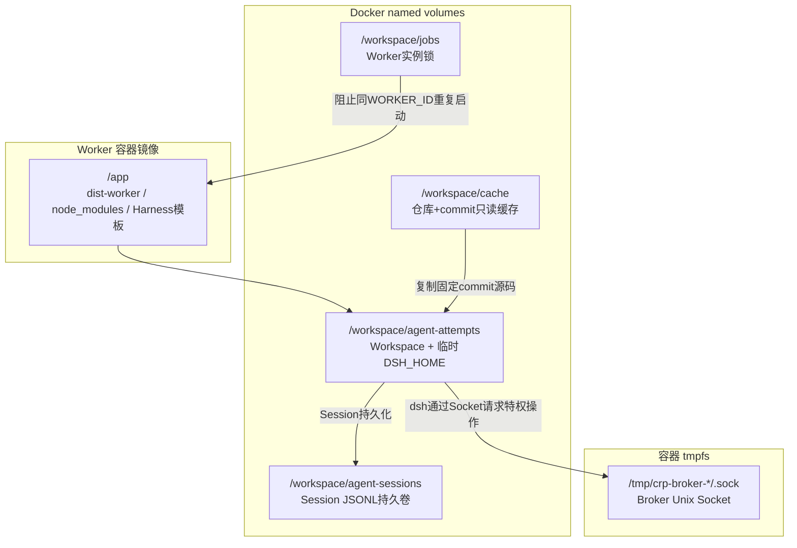
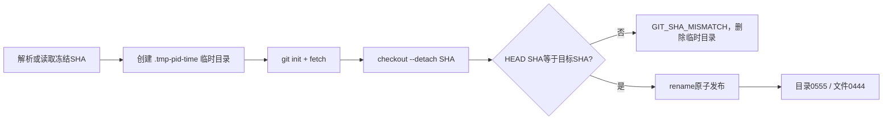
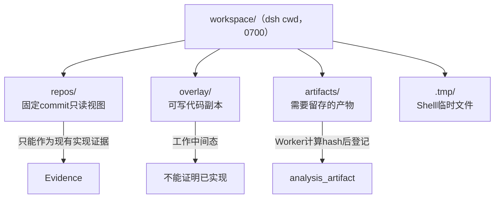
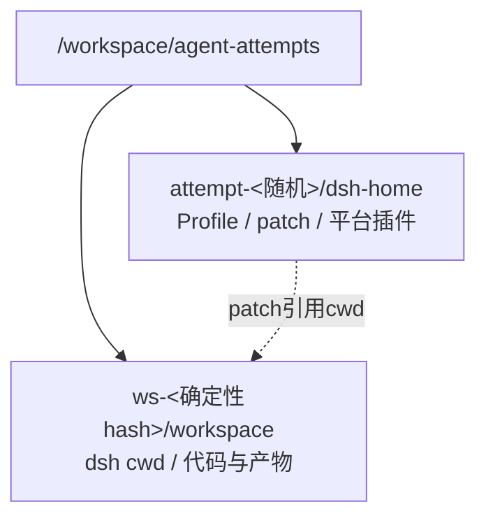
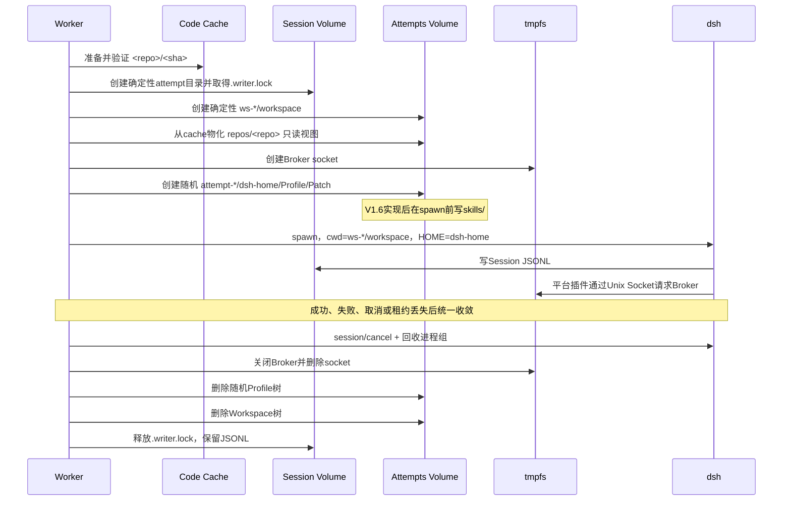
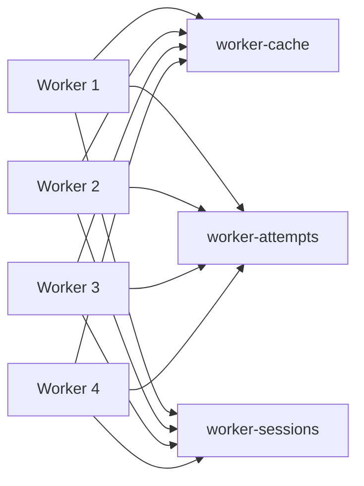

# 需求开发评审一致性平台：Worker 运行目录架构图文说明

> 本文说明当前 Worker 在容器和本地运行时使用的目录、文件用途、权限、持久化与清理方式。
>
> 文档基于当前代码：`worker/src/config.ts`、`worker/src/git/prepare.ts`、`worker/src/ai/workspace/attempt-workspace.ts`、`worker/src/ai/acp/profile-materializer.ts`、`worker/src/ai/session/session-registry.ts`、`worker/src/ai/control/attempt-control-broker.ts`、`docker-compose.worker.yml` 和 `Dockerfile.worker`。

---

## 1. 先看结论：Worker 运行数据不是一个 Workspace

时序图为了简洁，曾把 `Workspace / Profile` 画在同一列。真实文件系统中至少有六块独立区域：

| 区域 | 默认路径 | 核心用途 |
|---|---|---|
| Worker 程序 | `/app` | 编译后的 Worker、依赖、Harness Profile 模板 |
| 实例锁 | `/workspace/jobs` | 同一 `WORKER_ID` 的进程单实例锁 |
| Git 快照缓存 | `/workspace/cache` | 按仓库和 commit SHA 保存共享只读快照 |
| Attempt 临时树 | `/workspace/agent-attempts` | Agent Workspace 与每次 dsh 的临时 `DSH_HOME` |
| Session 持久卷 | `/workspace/agent-sessions` | Session JSONL、单写者锁、Worker 重启恢复 |
| Broker IPC | `/tmp/crp-broker-*` | dsh 插件回调 Worker 的 Unix Socket |

其中：

```text
Workspace   ≠ DSH_HOME
Workspace   ≠ SessionRoot
Workspace   ≠ CodeCacheRoot
DSH_HOME    ≠ .kiro/skills
```

可以用下面这张图建立整体认识：



---

## 2. Docker 默认目录和挂载

`docker-compose.worker.yml` 明确设置：

```yaml
WORKSPACE_ROOT: /workspace/jobs
CODE_CACHE_ROOT: /workspace/cache
AGENT_ATTEMPTS_ROOT: /workspace/agent-attempts
AGENT_SESSION_ROOT: /workspace/agent-sessions
```

对应四个 named volume：

```yaml
worker-jobs     -> /workspace/jobs
worker-cache    -> /workspace/cache
worker-attempts -> /workspace/agent-attempts
worker-sessions -> /workspace/agent-sessions
```

`Dockerfile.worker` 在镜像构建时提前创建这四个根目录，所有者是非 root 的 `worker` 用户，根目录权限为 `0700`。

容器没有监听端口，只主动访问 Supabase、GitLab 和模型服务；`/tmp` 是 tmpfs，Broker Socket 随容器消失。

### 2.1 `/workspace/jobs` 名字容易误解

`WORKSPACE_ROOT=/workspace/jobs` 当前主要用于保存 Worker 实例锁，并不是 Agent 的代码工作目录。

实例锁路径类似：

```text
/workspace/jobs/
└── worker-worker-abcd1234-6f72a09c.lock
```

锁文件内容：

```json
{
  "workerId": "worker-abcd1234",
  "pid": 12,
  "startedAt": "2026-09-16T10:00:00.000Z"
}
```

锁文件使用 `open(..., "wx")` 原子创建，权限 `0600`。同一个 `WORKER_ID` 的第二个进程会拒绝启动；进程已不存在时，陈旧锁可被新进程接管。

---

## 3. 容器内完整目录树

下面是当前实现的完整逻辑结构。`skills/` 用虚线标为 V1.6 规划，当前代码尚未创建。

```text
/
├── app/                                             # Worker程序镜像内容
│   ├── dist-worker/                                 # 编译后的Worker
│   ├── node_modules/                                # 精确锁定的依赖
│   │   └── @codereview/harness-*/                   # 指向dist-worker插件的链接
│   ├── worker/
│   │   └── harness/code-review-acp/                 # Profile模板与能力契约
│   ├── scripts/
│   └── supabase/migrations/
│
├── workspace/
│   ├── jobs/                                        # worker-jobs volume
│   │   └── worker-<worker-id>-<hash>.lock           # 实例锁，0600
│   │
│   ├── cache/                                       # worker-cache volume
│   │   └── <repository>/
│   │       └── <40位commit-sha>/
│   │           ├── .git/                            # 缓存中保留
│   │           └── 源码...                          # 目录0555、文件0444
│   │
│   ├── skill-cache/                                 # 【V1.6规划：worker-skill-cache volume】
│   │   └── <bundle-hash>/
│   │       ├── bundle.zip                           # 已验证原始归档
│   │       ├── manifest.json                        # 规范文件清单与hash
│   │       └── files/                               # 原子发布的只读展开树
│   │           ├── SKILL.md
│   │           ├── references/...
│   │           ├── assets/...
│   │           ├── templates/...
│   │           └── scripts/...
│   │
│   ├── agent-attempts/                              # worker-attempts volume
│   │   ├── ws-<task+attempt的32位摘要>/              # 确定性Workspace树
│   │   │   └── workspace/                           # dsh进程cwd
│   │   │       ├── repos/
│   │   │       │   ├── <repository-a>/              # 固定commit，只读，无.git
│   │   │       │   ├── <repository-b>/
│   │   │       │   └── ...
│   │   │       ├── overlay/
│   │   │       │   └── <repository>/                # 按需创建的可写副本
│   │   │       ├── artifacts/                       # Patch/报告/日志
│   │   │       └── .tmp/                            # Shell的TMPDIR
│   │   │
│   │   └── attempt-<随机字符>/                       # 随机Profile树
│   │       └── dsh-home/                            # 子进程HOME和DSH_HOME
│   │           ├── attempt-route.patch.yml          # 本次attempt动态配置，0600
│   │           ├── profiles/
│   │           │   └── code-review-acp/
│   │           │       ├── package.json
│   │           │       ├── cordis.patch.yml
│   │           │       ├── pnpm-workspace.yaml
│   │           │       └── node_modules/
│   │           │           └── @codereview/
│   │           │               ├── harness-agent-authority-policy/
│   │           │               ├── harness-usage-reporter/
│   │           │               ├── harness-platform-web/
│   │           │               ├── harness-snapshot-tools/
│   │           │               └── harness-review-control-tool/
│   │           └── skills/                          # 【V1.6规划，当前未实现】
│   │               └── <skill-name>/
│   │                   ├── SKILL.md                 # DSH发现入口
│   │                   ├── references/...           # 文本/结构化参考资料
│   │                   ├── assets/...               # 图片等资源
│   │                   ├── templates/...            # 输出模板
│   │                   └── scripts/...              # 受控脚本资源，不自动执行
│   │
│   └── agent-sessions/                              # worker-sessions volume
│       └── attempt-<task+attempt的32位摘要>/
│           ├── .writer.lock                         # Session单写者锁，0600
│           └── <workspace-slug>/                    # 由Harness根据cwd生成
│               └── <session-id>/
│                   └── session.vN.jsonl             # 当前配置compression:none
│
└── tmp/                                             # tmpfs
    └── crp-broker-<随机字符>/
        └── <8位随机名>.sock                         # Unix Socket，0600
```

---

## 4. Git 快照缓存：`/workspace/cache`

目录形态：

```text
/workspace/cache/<repository>/<commit-sha>/
```

例如：

```text
/workspace/cache/backend/0123456789abcdef.../
├── .git/
├── src/
├── package.json
└── ...
```

创建流程：



关键性质：

- Job 准备阶段解析分支 head，然后冻结精确 SHA；
- Story Task 阶段只使用已冻结 SHA，不重新取分支最新值；
- 缓存命中时仍然执行 `rev-parse HEAD` 验证；
- 发布目录保留 `.git`，因为 Worker 的 `SnapshotStore` 需要读取 Git 对象；
- 缓存是多 Worker 共享的 named volume；并发发布时，输掉 rename 竞争的一方删除自己的临时目录并复用胜出目录；
- 当前周期清理处理 attempt 和 Session，不自动清理 Git cache，需要单独制定容量治理策略。

---

## 5. Agent Workspace：`ws-<hash>/workspace`

### 5.1 Workspace 为什么使用确定性名字

目录名：

```text
ws-<sha256(taskId:agentAttempt)前32位>
```

同一个 `taskId + agentAttempt` 在 Worker 重启后会得到同一个 cwd。Harness 的 `session/resume` 会校验 cwd，一旦路径变化就拒绝恢复。

因此：

- Workspace 名字必须确定；
- Profile 的临时 `attempt-*` 可以随机；
- Session attempt 目录也必须确定。

### 5.2 Workspace 四块区域



#### `repos/`：固定 Commit 只读视图

```text
workspace/repos/<repository>/
```

Worker 从 cache 拷贝源码，但明确跳过 `.git`，然后把目录设为 `0500`、文件设为 `0400`。`WorkspacePolicy` 同时把 `repos/` 加入 forbidden roots，所以有文件权限和策略两层保护。

`repos/` 中的代码可以作为 `PINNED_SNAPSHOT` 证据。

#### `overlay/`：可写副本

```text
workspace/overlay/<repository>/
```

Workspace 创建时先创建空 `overlay/`；具体仓库副本由 `AttemptWorkspace.createOverlay()` 按需复制。复制不用 hardlink/reflink，防止写入回流到只读视图。

这里的修改只能表示建议方案，不能证明固定 commit 已经实现。

#### `artifacts/`：需要留存的输出

```text
workspace/artifacts/
```

建议补丁、测试报告、构建日志、静态分析结果和说明文件放这里。Worker 在提交前或失败收敛时扫描非空普通文件，自己计算：

- 相对路径；
- SHA-256；
- 文件大小；
- 生产 Agent。

然后写入 `analysis_artifact`。`overlay/` 不会整棵自动登记，避免把依赖和构建垃圾全部保存。

#### `.tmp/`：Shell 临时区

```text
workspace/.tmp/
```

作为 dsh、Shell 和构建命令的临时目录。它受同一个 Workspace 字节数、文件数和进程资源限制。

---

## 6. DSH_HOME 与 Profile：`attempt-*/dsh-home`

`materializeAttemptProfile()` 每次创建：

```text
/workspace/agent-attempts/attempt-<随机字符>/dsh-home/
```

`HOME` 与 `DSH_HOME` 都指向这里，但 dsh 的 cwd 指向另一棵 `ws-*/workspace`。两棵树是兄弟关系：



### 6.1 `attempt-route.patch.yml`

运行时生成，写入：

- 模型 provider、base URL、model name；
- Broker Socket 路径；
- `taskId`、`agentAttempt`；
- root Agent/Session ID；
- root 与 child 工具面；
- Sandbox、Agent、Workflow、Jobs、预算、Web、Session 数值；
- Workspace cwd 和 Session root。

文件不允许出现 API Key、Token、Password、Capability 等凭据值。模型 API Key、Broker Bearer token 和 root capability token 只走子进程环境变量。

### 6.2 `profiles/code-review-acp/`

Profile 模板来源：

```text
/app/worker/harness/code-review-acp/
```

运行时复制三个基础文件，并为五个平台插件生成很小的 re-export shim：

```text
node_modules/@codereview/harness-*/
├── package.json
└── index.mjs -> /app/dist-worker/harness-plugins/<plugin>/index.js
```

它们不是插件源码副本，只是让独立 dsh 进程能解析 Worker 构建产物。

### 6.3 `skills/` 与 Skill Cache：V1.6 规划，不是当前事实

V1.6 规划新增两层目录：

```text
/workspace/skill-cache/<bundle-hash>/
├── bundle.zip
├── manifest.json
└── files/
    ├── SKILL.md
    ├── references/...
    ├── assets/...
    ├── templates/...
    └── scripts/...

<per-attempt-dsh-home>/skills/<skill-name>/
├── SKILL.md
├── references/...
├── assets/...
├── templates/...
└── scripts/...
```

`skill-cache` 是多 Worker 共享的不可变本地缓存：对象存储下载的 ZIP 经 archive hash、manifest、文件 hash、路径和容量校验后原子发布。每个 attempt 再把只读缓存复制到自己的私有 `DSH_HOME`；不能使用 hardlink，也不能把 Bundle 放进代码 Workspace。

DSH 只自动发现 `SKILL.md`。调用 `skill(name)` 后返回完整正文和 `resourceBase`，Agent 再通过 `read`、`read_image`、`grep`、`glob` 或有权限的 `bash` 按需访问伴随资源；资源和脚本不会因加载 Skill 自动执行。

当前 `profile-materializer.ts` 尚未创建 Skill Cache、下载对象、校验 ZIP、复制多文件树或把 catalog hash 纳入恢复，因此这些目录不能写成“已实现”。

实现后仍应与 Kiro Skill 和代码 Workspace 隔离：

```text
项目/.kiro/skills/                 给Kiro IDE使用
/workspace/skill-cache/             Worker共享不可变Bundle缓存
临时DSH_HOME/skills/                给运行中的dsh使用
ws-*/workspace/                     被评审代码、overlay和artifacts
```

---

## 7. Session 持久卷：`/workspace/agent-sessions`

Session 不能放在临时 Profile 目录，因为正常收敛会删除 Profile；Worker 重启恢复必须依赖持久卷。

目录形态：

```text
/workspace/agent-sessions/
└── attempt-<sha256(taskId:agentAttempt)前32位>/
    ├── .writer.lock
    └── <workspace-slug>/
        └── <session-id>/
            └── session.vN.jsonl
```

说明：

- attempt 目录是确定性的，Worker 重启后能重新定位；
- `.writer.lock` 使用 `O_EXCL` 原子创建，阻止同一目录出现两个本地写者；
- 跨 Worker 竞争再由数据库 `session_revision` fencing 阻止；
- `<workspace-slug>` 由 Harness 根据 cwd 生成，Worker 不复制它的算法，而是递归查找 session ID；
- 当前 Profile 设置 `compression: none`，因此正常文件为明文 JSONL；代码仍兼容识别带压缩扩展名的格式；
- 数据库 checkpoint 只保存 locator、hash、格式版本、事件数，不保存 Session 正文；
- 默认保留期 7 天；卷容量默认上限 20 GiB；
- Worker 每 10 分钟最多执行一次保留期和容量清理。

Session 中可能包含真实源码和模型输出，因此 named volume 所在磁盘应启用静态加密。

---

## 8. Broker Socket：`/tmp/crp-broker-*`

每次 attempt 创建：

```text
/tmp/crp-broker-<随机字符>/
└── <8位随机>.sock
```

权限：

```text
Socket父目录：0700
Socket文件：0600
```

`/tmp` 是容器 tmpfs，不进入 named volume。Profile patch 只记录 socket 路径；调用时还必须携带：

- HTTP Bearer attempt token；
- Agent capability token；
- 正确的 task ID 与 attempt；
- 当前仍有效的数据库租约。

正常结束时 Worker 关闭 HTTP server、删除 socket，再删除父目录。容器强杀时 `/tmp` 随容器消失。

---

## 9. 创建与清理时序

当前代码的目录相关顺序可以归纳为：



### 正常结束

```text
撤销Agent令牌
→ session/cancel
→ 回收dsh进程组
→ 关闭并删除Broker Socket
→ 删除attempt-*/dsh-home
→ 删除ws-*/workspace
→ 释放Session .writer.lock
→ 保留Session JSONL和共享Git cache
```

### Worker或容器异常退出

可能留下：

```text
/workspace/agent-attempts/ws-*
/workspace/agent-attempts/attempt-*
/workspace/agent-sessions/attempt-*/.writer.lock
```

处理方式：

- `ws-*` 和 `attempt-*` 只清理这两个受管前缀；
- 周期任务每 10 分钟最多扫描一次；
- 目录 mtime 超过 `ORPHAN_WORKSPACE_MAX_AGE_MS` 才清理，默认 6 小时；
- Session 同 Worker/同 attempt 重启可接管自己的 writer lock；其他 Worker 会得到 `SESSION_FENCED`；
- Session JSONL 按保留期和卷容量清理；
- Git cache 当前没有同类周期淘汰逻辑。

---

## 10. 持久化、权限与可信级别矩阵

| 区域 | 默认权限 | 正常结束是否删除 | 容器重建后是否保留 | 可信级别/用途 |
|---|---:|---:|---:|---|
| `/app` | 镜像所有者控制 | 否 | 随镜像重新创建 | Worker 程序与模板 |
| `/workspace/jobs` | 根0700，锁0600 | 锁正常释放 | named volume 保留 | Worker 实例协调 |
| `/workspace/cache/<repo>/<sha>` | 目录0555、文件0444 | 否 | named volume 保留 | 共享固定代码源 |
| `ws-*/workspace/repos` | 目录0500、文件0400 | 是 | named volume可能残留 | attempt只读代码视图 |
| `ws-*/workspace/overlay` | Worker用户可写 | 是 | named volume可能残留 | 可写中间态 |
| `ws-*/workspace/artifacts` | Worker用户可写 | 是，元数据已落库 | named volume可能残留 | 需留存产物 |
| `attempt-*/dsh-home` | 父目录0700，敏感配置0600 | 是 | named volume可能残留 | dsh Profile/Patch |
| `agent-sessions/attempt-*` | 目录0700、锁0600 | JSONL保留 | named volume保留 | Session恢复依据 |
| `/tmp/crp-broker-*` | 目录0700、socket0600 | 是 | tmpfs不保留 | 本地IPC |

注意：容器使用非 root `worker` 用户、`no-new-privileges`、`pids_limit: 512`、内存 6 GiB、core dump 关闭。当前生产 Sandbox 使用 Landlock 级别，主要限制写路径，不应把“目录不可写”误解成“目录内容对同 UID 绝对不可读”。凭据不落盘仍是必要规则。

---

## 11. 多副本下的目录共享

默认拓扑是 4 个 Worker 副本，四个 named volume 均可共享：



不会相互覆盖的依据：

- cache 按 `repository + commit SHA` 寻址并原子发布；
- Workspace 按 `taskId + agentAttempt` 确定性寻址；
- Profile 使用随机 `attempt-*`；
- Session 按 `taskId + agentAttempt` 寻址，并由锁文件 + 数据库 revision 双层控制；
- Broker Socket 使用随机临时目录和随机短文件名；
- Worker 实例锁按 `WORKER_ID + hash` 命名。

---

## 12. 出问题时应该看哪个目录

| 现象 | 优先检查 |
|---|---|
| 仓库 SHA 不对或 fetch 重复 | `/workspace/cache/<repo>/<sha>` |
| Agent 读不到代码 | `ws-*/workspace/repos/<repo>` |
| 构建/修改结果找不到 | `ws-*/workspace/overlay`、`artifacts` |
| dsh Profile 加载失败 | `attempt-*/dsh-home/profiles/code-review-acp` |
| attempt patch 配置错误 | `attempt-*/dsh-home/attempt-route.patch.yml`，注意脱敏 |
| 平台插件解析失败 | `/app/dist-worker/harness-plugins` 与 Profile shim |
| Session 无法恢复 | `agent-sessions/attempt-*/.writer.lock` 与 `session.vN.jsonl` |
| Broker 不可达 | `/tmp/crp-broker-*/<id>.sock` 和子进程环境变量 |
| 磁盘被临时目录占满 | `agent-attempts/ws-*`、`attempt-*` 和孤儿清理日志 |
| Session 卷持续增长 | `agent-sessions/`、保留期和 20 GiB 容量配置 |
| Skills 目录为空 | 当前属于预期：V1.6 尚未实施 Worker Skill 物化 |

排障日志中不要直接打印源码、Session 正文、完整 patch、API Key、Token 或宿主绝对路径。

---

## 13. 当前事实与 V1.6 规划对照

| 能力 | 当前状态 |
|---|---|
| Git cache 按 commit SHA 持久化 | 已实现 |
| Workspace 的 repos/overlay/artifacts/.tmp | 已实现 |
| 每 attempt 私有 DSH_HOME/Profile/Patch | 已实现 |
| Broker Unix Socket | 已实现 |
| Session JSONL 持久化与恢复 | 已实现 |
| attempt/Workspace 孤儿清理 | 已实现 |
| Session 保留期和卷容量治理 | 已实现 |
| 私有 `skill-bundles` 对象存储 | **V1.6 规划，未实现** |
| `/workspace/skill-cache/<bundle-hash>` | **V1.6 规划，未实现** |
| `<DSH_HOME>/skills/<name>/` 多文件Bundle | **V1.6 规划，未实现** |
| Skill版本/manifest/hash与Job冻结 | **V1.6 规划，未实现** |
| ZIP安全校验、cache和恢复门禁 | **V1.6 规划，未实现** |

因此，看到下面的目录时必须区分语态：

```text
当前真实存在：
dsh-home/attempt-route.patch.yml
dsh-home/profiles/code-review-acp/

V1.6规划新增：
/workspace/skill-cache/<bundle-hash>/
dsh-home/skills/<skill-name>/SKILL.md
dsh-home/skills/<skill-name>/references/...
dsh-home/skills/<skill-name>/assets/...
dsh-home/skills/<skill-name>/templates/...
dsh-home/skills/<skill-name>/scripts/...
```

---

## 14. 关键源码索引

| 主题 | 文件 |
|---|---|
| 四个运行根和默认值 | `worker/src/config.ts` |
| Docker named volumes | `docker-compose.worker.yml` |
| 非 root 用户与目录权限 | `Dockerfile.worker` |
| Git cache 和精确 SHA | `worker/src/git/prepare.ts` |
| Workspace 布局 | `worker/src/ai/workspace/attempt-workspace.ts` |
| Workspace 路径策略 | `worker/src/ai/workspace/workspace-policy.ts` |
| Profile/DSH_HOME 物化 | `worker/src/ai/acp/profile-materializer.ts` |
| dsh 进程 cwd/env/进程组 | `worker/src/ai/acp/acp-process-supervisor.ts` |
| Broker Socket | `worker/src/ai/control/attempt-control-broker.ts` |
| Session 目录与 writer lock | `worker/src/ai/session/session-registry.ts` |
| Session 保留期 | `worker/src/ai/session/session-retention.ts` |
| attempt 孤儿清理 | `worker/src/ai/workspace/overlay-cleaner.ts` |
| Worker 实例锁 | `worker/src/coordination/instance-lock.ts` |
| 创建、运行和收敛总流程 | `worker/src/ai/runtime/deepseek-harness-acp-engine.ts` |
