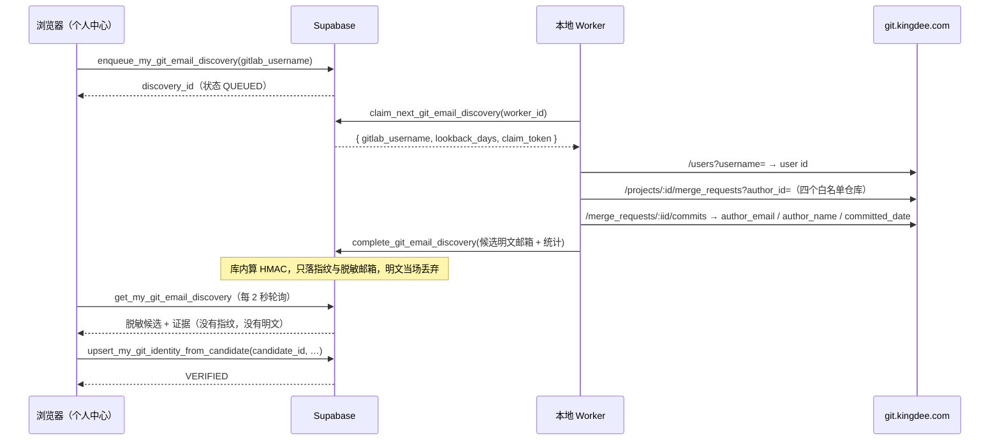

# 需求开发评审一致性平台 V1.13：Git 提交邮箱反查与验证最终执行方案

## 1. 背景与目标

V1.12 把 Git 身份交给本人在个人中心维护，但"填对"这件事没有任何校验：手打
`git config user.email` 填错一个字符不会报错，只会让作者维度的归属规则永远匹配不到他，
而且没人会发现。

本地实测印证了这个风险有多大：被测账号在四个仓库里 41 条提交用的作者邮箱是
`k***@m2607-0072.local`（本机没配 `user.email`，git 退化成 `用户名@主机名.local`）。
如果让他手输，他几乎必然会填成自己的工作邮箱或手机号邮箱 —— 一个字都对不上。

目标：**人不再打字**。填一个 GitLab 用户名，平台去 GitLab 反查"你自己提的合并申请里，
提交作者用的是哪些邮箱"，列出候选让他点选；点选的那一条带着 GitLab 提交作为证据，
存成"生效中"。手输邮箱保留为回退路径，但只能存成"未验证"。

## 2. 范围与非目标

包含：

- 个人中心弹窗改成「填 GitLab 用户名 → 查找 → 点选邮箱 → 保存」，含手输回退入口；
- 一张队列表 + 一张候选表 + 7 个 RPC；本地 Worker 新增一条反查任务轮询循环；
- 点选保存 = `VERIFIED`；手输保存 = `UNVERIFIED`（改变了 V1.12 的行为，见 §8）；
- 候选带上真实作者名、提交数、命中仓库、最近提交时间和来源 MR，并自动回填
  GitLab User ID 与作者别名。

非目标：

- 不校验"这个邮箱能收信"（不发验证邮件）；
- 不做全仓 `git log` 扫描（见 §3 的方案比较）；
- 不改归属规则引擎与 Job 冻结逻辑；
- 不追加"按邮箱查 GitLab 账号"（普通 token 查不到私有邮箱，管理员 token 才行，不引入）。

## 3. 当前实现与问题

- V1.12 的 `upsert_my_git_identity_from_email` 直接把手输邮箱存成 `VERIFIED`，
  等于把"自己声称"当成"已验证"。
- 平台里唯一能证明"这个邮箱真的在提交"的东西是 GitLab / git 仓库，而它们在内网
  （`https://git.kingdee.com`）：**Supabase 云端访问不到，只有本地 Worker 能访问**。
  所以任何真实校验都必须由 Worker 执行，浏览器只能排队 + 轮询。

被否掉的两个方案：

| 方案 | 为什么不用 |
|---|---|
| 查数据库里已冻结的 commit manifest | 覆盖面等于"已经跑过的分析"。本地一条都没有，新仓库/新人永远查不到，硬门禁会把人锁死 |
| Worker 克隆四仓跑 `git log --author` | 要拿到明文邮箱才能过滤，而库里从设计上就没存明文；且首次克隆要几分钟 |

选定方案：**GitLab API 按用户名反查 MR → 读 MR 的提交 → 取 `author_email`**。
现成的 `GitLabReadonlyClient` 已经在做 MR 与 MR-commits 的读取，扩一个方法即可；
实测 40 个 MR 约 6 秒。

## 4. 需求与验收标准

1. 填 GitLab 用户名点「查找我的提交邮箱」→ 数秒内列出候选（脱敏邮箱 + 证据）。
2. 候选只能来自**本人**的查询；拿别人的 `candidate_id` 保存返回
   `GIT_EMAIL_CANDIDATE_NOT_FOUND`。
3. 点选候选保存后 `verification_status='VERIFIED'`，并自动带上 GitLab User ID 与
   提交里真实出现过的作者名。
4. 手输邮箱仍可保存，但一律 `UNVERIFIED`，页面显式标注"平台没有证据"。
5. 用户名不存在 → `GITLAB_USER_NOT_FOUND`；token 缺失 → `GITLAB_API_TOKEN_MISSING`；
   GitLab 不可达 → `MR_METADATA_TIMEOUT` / `MR_METADATA_REQUEST_FAILED`。三者都不静默成
   "没找到"。
6. 明文邮箱不进浏览器、不进任何表；候选只有指纹 + `y***@domain`。
7. 查询结果超过 2 小时不能再用来保存（`GIT_EMAIL_DISCOVERY_EXPIRED`）。
8. 同一个人同时只有一条排队中的查询；10 分钟内最多 20 次。
9. 排队 3 分钟没有 Worker 领取 → 界面明确说"没有可用的 Worker"，不假装在查。
10. 结果不完整（仓库读失败 / MR 被截断）时界面照实说"可能不全"。

## 5. 总体设计

Worker 拿不到请求人是谁（claim 的返回值里没有 `requested_by`），也拿不到 pepper；
浏览器拿不到明文邮箱和指纹。两侧都只知道自己该知道的那一半。

## 6. 数据与接口设计

迁移 `supabase/migrations/20260920032058_git_email_discovery_from_gitlab_username.sql`：

- `git_identity_email_discovery`：`requested_by`（on delete cascade）、`gitlab_username`
  （正则约束）、`lookback_days`、状态机 `QUEUED/RUNNING/SUCCEEDED/FAILED`、
  `attempt`（>=3 自动收口为 `GIT_EMAIL_DISCOVERY_ATTEMPTS_EXHAUSTED`）、
  worker 租约字段（`claim_token_digest` / `lease_expires_at` / `heartbeat_at`）、
  `gitlab_user_id` / `gitlab_display_name` / `merge_request_count` / `candidate_count` /
  `partial` / `error_code`。唯一索引保证"一个人同时只有一条在途"。
- `git_identity_email_candidate`：`email_fingerprint`（64 hex）+ `masked_email` +
  `email_domain` + `author_names[]` + `commit_count` + `last_committed_at` +
  `repositories jsonb` + `merge_request_refs[]`。两张表都 `revoke all`，只能经 RPC 访问。
- 本人侧 RPC：`enqueue_my_git_email_discovery(username, lookback_days)`、
  `get_my_git_email_discovery(id)`（返回里带 `already_bound`，让界面禁掉已被占用的候选）。
- Worker 侧 RPC（service_role）：`claim_next_git_email_discovery`、
  `heartbeat_git_email_discovery`、`complete_git_email_discovery`、
  `fail_git_email_discovery`、`release_git_email_discovery_claim`。
- 保存：`upsert_my_git_identity_from_candidate(candidate_id, …)` → `VERIFIED`；
  `upsert_my_git_identity_from_email(…)` 改为 `UNVERIFIED`（签名不变，`create or replace`）。

前端：

- `src/types.ts`：`GitEmailDiscovery` / `GitEmailDiscoveryCandidate` /
  `SaveMyGitIdentityFromCandidateInput`；
- `src/lib/api.ts`：`enqueueMyGitEmailDiscovery` / `getMyGitEmailDiscovery` /
  `saveMyGitIdentityFromCandidate`；
- `src/lib/git-identity.ts`：新增 `describeGitEmailDiscoveryPhase`（状态→文案，判据是后端的
  `claimed`，不是前端计时）与 `describeGitEmailCandidate`（证据一句话）。

## 7. Worker 改造

- `worker/src/git/gitlab-readonly-client.ts`：新增 `discoverAuthorCommitEmails()`。
  用户名 → `/users?username=`（**精确**用户名匹配，不接受模糊命中）→ 四个白名单仓库的
  `merge_requests?author_id=` → 取最近 40 个 MR 的 `/commits` → 按邮箱聚合
  （提交按 sha 去重、记录最近提交时间、每仓计数、最多 5 条 MR 引用、最多 50 个候选）。
  单仓失败 / MR 截断 / 候选截断都只置 `partial`，不让整次查找失败。
- `worker/src/db/jobs.ts`：5 个队列 RPC 封装 + `GitEmailDiscoveryClaim`。
- `worker/src/index.ts`：`runGitEmailDiscovery()` + 与模型连接测试并排的
  `gitEmailDiscoveryLoop()`（drain 期间停止领取，停机时释放 claim）。
- `worker/src/config.ts`：`GIT_EMAIL_DISCOVERY_LEASE_SECONDS`（默认 90，45~600）。
- 日志只记数量与 `partial`，**不记邮箱**（脱敏的也不记）。

## 8. 安全、兼容与回滚

- **明文边界**：明文邮箱只出现在 GitLab 响应（Worker 内存）与 `complete_git_email_discovery`
  的参数里，与既有 `match_analysis_git_identities` 完全同构；库内算完 HMAC 即丢弃。
  SQL 测试显式断言候选行与返回值都不含明文、不含指纹。
- **伪造已验证**：浏览器提交的是 `candidate_id`，指纹取自候选行，前端无法自报一个
  "已验证"的邮箱。候选归属、查询状态、2 小时有效期全部在库内判定。
- **残余风险（如实记录）**：MR 是他提的，不代表 MR 里每条提交都是他写的
  （cherry-pick、代提）。缓解是：① 活跃指纹唯一索引 → 同一邮箱不能被两个人绑定
  （`GIT_EMAIL_ALREADY_BOUND`，界面也会把已被绑定的候选置灰）；② 候选行把真实作者名
  一起显示出来供人核对；③ 审计写 `GITLAB_COMMIT_VERIFIED` + `discovery_id` + 提交数，
  事后可追。这比 V1.12 的"随便输一个就算已验证"严格得多，但不是身份证明。
- **行为变更**：V1.12 里手输邮箱得到 `VERIFIED`，本版改成 `UNVERIFIED`。
  **已存在的旧数据不动**（不回溯改状态）；受影响的只有之后的手输保存。
  归属规则里 `VERIFIED_IDENTITY_MATCH` 只认 `VERIFIED`，所以"未验证"不会污染分析结论。
  对应地更新了 `supabase/tests/20260920022754_self_service_git_identity_test.sql` 的断言。
- **依赖**：必须配 `GITLAB_API_TOKEN`（只读 `read_api`）。缺失时反查以
  `GITLAB_API_TOKEN_MISSING` 明确失败，手输回退路径不受影响。配上之后 V1.11 的 MR 增强
  规则也一并可用。
- **新旧 Worker 混跑**：旧 Worker 不认识这个队列，请求会一直 `QUEUED`；界面 3 分钟后
  明确提示"没有可用的 Worker"。因此发布顺序必须是 db push → Worker → 前端。
- **回滚**：迁移只前滚。前端回滚到上一版即可（反查 RPC 留在库里不被调用）；
  Worker 回滚到旧镜像后队列只会积压 `QUEUED`，不影响评审主链路。

## 9. 实施步骤与文件范围

1. `supabase/migrations/20260920032058_git_email_discovery_from_gitlab_username.sql`（新增）
   + `supabase/tests/20260920032058_..._test.sql`（新增）；
2. `worker/src/git/gitlab-readonly-client.ts`、`worker/src/db/jobs.ts`、
   `worker/src/index.ts`、`worker/src/config.ts`；
   `worker/src/__tests__/git-email-discovery.test.ts`（新增）；
   5 个既有 worker 测试补 `gitEmailDiscoveryLeaseSeconds` 字段；
3. `src/types.ts`、`src/lib/api.ts`、`src/lib/git-identity.ts`、
   `src/lib/__tests__/git-identity.test.ts`；
4. `src/pages/ProfilePage.tsx`（弹窗改成两步 + 候选单选 + 手输回退）；
5. `supabase/tests/20260920022754_self_service_git_identity_test.sql`（手输改判 UNVERIFIED）。

## 10. 验证结果

本地（Supabase 容器 + 本地 Worker `codereviewplatform-local`，未动云端）实际执行：

- `supabase migration up --local` 应用新迁移；
- SQL 测试：新增的 `20260920032058_..._test.sql` 全绿（9 组断言：越权、租约、
  HMAC 只存指纹、脱敏候选、点选=VERIFIED、过期拒绝、手输=UNVERIFIED、失败与释放、权限面）；
  回归 `20260920022754`、`20260920023955`、`20260919133549`、`20260918050615` 全绿；
- Worker：`npm run worker:typecheck`、`npm run worker:build`、`npm run test:worker`
  （43 文件 / 806 用例通过）、新增 `git-email-discovery.test.ts` 7 例通过；
- **真实 E2E**（本地 Worker 容器 → 真实 `git.kingdee.com`，真实 authenticated JWT）：
  - `yuxuan_xue` → 10 秒内 `SUCCEEDED`，`gitlab_user_id=2607`，读了 40 个 MR，
    得到 1 个候选 `k***@m2607-0072.local`（41 条提交，四个仓库都有，最近 2026-09-18），
    `partial=true`（MR 数超过 40 上限，界面会照实说"可能不全"）；
  - 点选该候选保存 → `verification_status=VERIFIED`，`gitlab_user_id` 与作者别名
    `yuxuan_xue` 自动回填；
  - 失败路径 `no_such_user_zzz` → 6 秒内 `FAILED / GITLAB_USER_NOT_FOUND`；
  - Worker 日志只有 `git_email_discovery_succeeded` 与计数，**没有任何邮箱**。
- 前端：`npx tsc -b`、`npm run web:typecheck`、`npm run test:web`（13 文件 / 157 用例）、
  `npm run build`、`npm run lint`（0 error）全部通过。

未验证 / 需要注意：

- **没有浏览器点击回归**（仓库无页面渲染测试基建）：弹窗两步流程请上线前人工过一遍。
- E2E 期间临时创建了本地 Vault `analysis_identity_pepper` 与一个测试账号，验证完
  已全部删除（`identities=0 discoveries=0 e2e_users=0 pepper=0`）。
- 云端未推送、未部署、未重启云端 Worker。
- 云端 Vault 是否已有 `analysis_identity_pepper` 未确认（缺它反查会以
  `IDENTITY_PEPPER_MISSING` 失败）。
