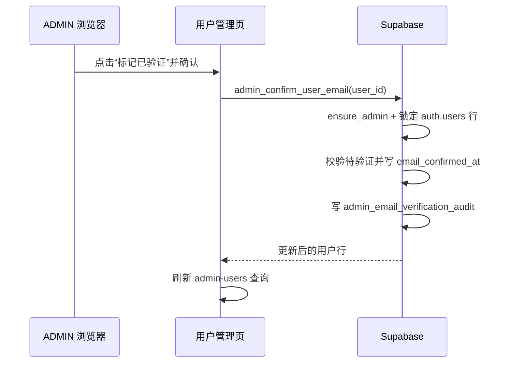

# 需求开发评审一致性平台 V1.24：管理员手动邮箱验证最终执行方案

## 1. 背景与目标

用户管理页已能显示 `auth.users.email_confirmed_at`，但待验证账号只能依赖用户自行重发邮件，或由运维进入 Supabase 后台确认。本次为现有 ADMIN 角色（产品语义中的“超级管理员”）提供受控的手动确认入口：在确认真实邮箱归属后，将待验证账号标记为已验证。

## 2. 范围与非目标

**本次包含：**

- 新增仅 ADMIN 可调用的 `admin_confirm_user_email(uuid)` RPC；
- 记录操作者、目标账号和确认时间的不可由前端伪造的审计事实；
- 用户管理表对待验证账号显示“标记已验证”二次确认操作；
- 新增迁移 SQL 测试，并执行本地 Supabase 与前端静态验证。

**不包含：**

- 不发送邮件、不修改注册或重发验证邮件流程；
- 不新增 `SUPER_ADMIN` 数据库角色，沿用现有 `ADMIN` 权限边界；
- 不为已验证账号提供撤销或重复确认操作；
- 不改 Worker、Edge Function 或云端数据库。

## 3. 当前实现与问题

`src/App.tsx` 的 `AdminUsersPage` 经 `src/lib/api.ts` 调用 `admin_list_users()`，该 SECURITY DEFINER RPC 已将 `auth.users.email_confirmed_at` 返回给前端。页面可筛选、展示“待验证/已验证”，但提示管理员需要到 Supabase 后台处理。

现有 `public.ensure_admin()` 是所有用户管理 RPC 的真实服务端权限边界；前端 `isAdmin` 仅为界面门禁。当前没有一个受审计的产品内接口可以更新 `auth.users.email_confirmed_at`。

## 4. 需求与验收标准

| 编号 | 要求 | 验证方式 |
|---|---|---|
| F1 | ADMIN 可将一个存在且待验证的账号标记为已验证 | SQL 测试 + 前端调用 |
| F2 | REVIEWER、VIEWER、anon 不能执行该操作 | SQL 测试（模拟 JWT 与函数授权） |
| F3 | 已验证账号及不存在账号被拒绝，且不产生重复审计 | SQL 测试 |
| F4 | 成功后 `auth.users.email_confirmed_at` 非空，并留下目标与操作者快照审计 | SQL 测试 |
| F5 | 前端仅为待验证账号显示操作，并在二次确认后刷新列表 | 代码审查 + TypeScript 检查 |

## 5. 总体设计



独立 RPC 以 `SECURITY DEFINER` 执行，调用前必经 `public.ensure_admin()`；不要相信前端对角色或待验证状态的判断。目标 `auth.users` 行使用 `FOR UPDATE` 锁定，避免并发点击产生多次确认；已验证账号稳定返回 `EMAIL_ALREADY_CONFIRMED`。

## 6. 数据与接口设计

### 6.1 迁移

本次实际新增两份前滚迁移：

1. `supabase/migrations/20260925022240_admin_manual_email_confirmation.sql`
   - 创建 `public.admin_email_verification_audit`，保存目标用户、邮箱/显示名快照、操作者、操作者快照与创建时间；
   - 启用 RLS 并撤销 `public`、`anon`、`authenticated` 对审计表的一切直接权限：审计不在本次 UI 对外读取，客户端也不能伪造或篡改记录；
   - 创建并授权 `public.admin_confirm_user_email(p_user_id uuid)` 给 `authenticated`，函数内以 `ensure_admin()` 作服务端角色判定；对 `anon` 和 `public` 显式撤销；
   - 锁定目标 `auth.users` 行，只允许待验证状态转换，写审计后返回与 `admin_list_users()` 一致的单条用户行。
2. `supabase/migrations/20260925022517_fix_admin_manual_email_confirmation.sql`
   - 前滚替换同一 RPC，限定 `UPDATE auth.users AS auth_user ... WHERE auth_user.id = p_user_id`；修复 PL/pgSQL 返回表 OUT 列 `id` 与未限定 `WHERE id` 的名称歧义；
   - 重新执行授权，保证从零迁移和已经应用第一份迁移的环境都落到相同最终函数。

### 6.2 前端接口

`src/lib/api.ts` 增加 `adminConfirmUserEmail(userId)`，调用 RPC 后按 `AdminUserListItem` 解包。`src/App.tsx` 增加 mutation 与 `Popconfirm`：只在 `email_confirmed_at` 为空时渲染“标记已验证”，成功后提示并使 `admin-users` 查询失效；请求中禁用全部确认按钮，避免重复提交。

### 6.3 测试

新增两份同名迁移 SQL 测试：

- `supabase/tests/20260925022240_admin_manual_email_confirmation_test.sql`：成功确认、状态变更、审计、重复确认、预先已验证账号、非 ADMIN、未知账号和授权边界；
- `supabase/tests/20260925022517_fix_admin_manual_email_confirmation_test.sql`：回归验证限定列名后的 RPC 可更新并返回确认时间。

前端复用现有 API/mutation 模式，不新增纯逻辑模块。

## 7. 前端与 Worker/运行时改造

前端操作位于现有用户管理“操作”列；它必须经过二次确认，明确说明只有核实邮箱确属该账号使用者时才能执行，并提示会留下管理员审计。请求期间确认按钮不可再次提交。

不涉及 Worker、DSH、模型、Edge Function、Storage 或运行配置。

## 8. 安全、兼容与回滚

- 真正权限只在数据库 `ensure_admin()`，前端隐藏按钮不是安全边界；
- 不接受邮箱、时间戳或操作者等客户端参数，全部从受保护的库表和 `auth.uid()` 取得；
- 每次成功确认写审计；重复确认拒绝，避免伪造“又确认了一次”的审计；
- 审计表禁止所有客户端直接读写，本次不增加审计浏览页面；
- 仅新增表和函数，不修改历史迁移、既有用户数据或函数签名；
- 回滚采用前滚：如需停用入口，后续迁移撤销 RPC 对 `authenticated` 的授权并移除前端按钮，审计与已确认状态保留。

## 9. 实施步骤与文件范围

1. 已新建主迁移及其回滚事务 SQL 测试；
2. 完整 SQL 测试发现函数返回 OUT 列与未限定 `id` 的真实歧义后，已按只增不改规则新建前滚修复迁移与回归测试；
3. 已在 `src/lib/api.ts` 增加 RPC 封装；
4. 已在 `src/App.tsx` 接入二次确认按钮、mutation、防重复提交与列表刷新；
5. 已在本地 Supabase 应用、重复应用迁移并执行两份 SQL 测试；
6. 已执行前端类型检查、测试、lint 与生产构建。

主要文件：

- `supabase/migrations/20260925022240_admin_manual_email_confirmation.sql`（新增）
- `supabase/migrations/20260925022517_fix_admin_manual_email_confirmation.sql`（新增）
- `supabase/tests/20260925022240_admin_manual_email_confirmation_test.sql`（新增）
- `supabase/tests/20260925022517_fix_admin_manual_email_confirmation_test.sql`（新增）
- `src/lib/api.ts`（修改）
- `src/App.tsx`（修改）
- `需求开发评审一致性平台/V1.24-管理员手动邮箱验证/需求开发评审一致性平台-V1.24管理员手动邮箱验证-最终执行方案.md`（新增）

## 10. 验证结果

### 10.1 已通过（2026-09-25，本地）

- `supabase status`：本地 Supabase 正在运行；在迁移前已备份本地库至 `.local-db-backups/local-20260925-102447.sql`；
- `supabase migration up --local`：两份迁移均已前滚应用；`supabase migration list --local` 显示 `20260925022240` 与 `20260925022517` 已登记；
- 两份迁移原文件随后按顺序再次通过 `psql` 应用，`CREATE TABLE IF NOT EXISTS`、策略重建和 `CREATE OR REPLACE FUNCTION` 均成功，验证可重复应用；
- 两份 SQL 测试均以 `psql -v ON_ERROR_STOP=1` 通过。完整测试覆盖 ADMIN 成功确认、`email_confirmed_at` 写入、审计快照、`EMAIL_ALREADY_CONFIRMED`、`USER_NOT_FOUND`、非 ADMIN 拒绝、anon 无执行权及客户端不可插入审计；
- `npm run web:typecheck`：通过；
- `npm run test:web`：19 个文件、241 个测试全部通过；
- `npm run lint`：0 errors；仓库已有 9 个 React warning（本次新增代码未产生错误）；
- `npm run build`：通过，Harness manifest revision 3 / 34 tools 校验通过；仅有既有的大 chunk 提示，无构建错误；
- `git diff --check`：通过。

### 10.2 未执行

- 未进行浏览器人工点击烟测；已由前端编译、类型检查和服务端 SQL 测试覆盖代码路径；
- 未执行 linked/云端迁移检查、`supabase db push`、Edge Function 部署或 Worker 重启；未修改任何云端数据库或配置。

## 11. 手动发布清单

本次不由 AI 执行云端写操作。发布人应先审阅并提交代码，再在确认目标 Supabase 项目正确后执行：

```bash
supabase migration list --linked
supabase db push --linked --dry-run --skip-vault
supabase db push
```

不涉及 Edge Function 部署或 Worker 重启。发布后以 ADMIN 登录 `/users`，选择一条待验证账号，点击“标记已验证”并确认；验证状态应刷新为“已验证”，且由数据库保留审计记录。
