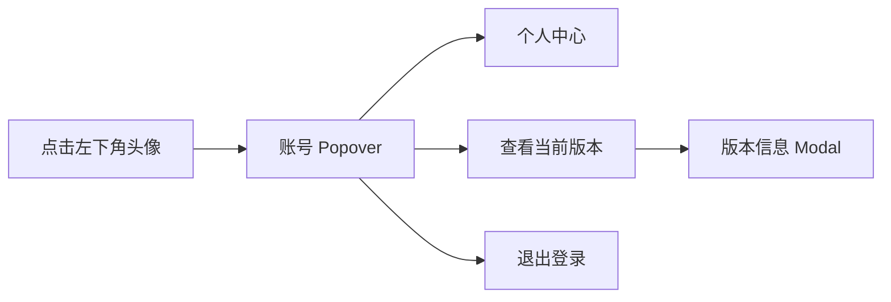

# 需求开发评审一致性平台 V1.26：账号菜单与版本查看最终执行方案

## 1. 背景与目标
当前“个人中心”同时出现在评审侧栏和左下角头像菜单，入口重复；当前版本 `V1.7` 则固定显示在顶栏右侧。目标是将账户相关能力收敛到底部头像菜单：个人中心只从该菜单进入，且用户可以在同一菜单中主动查看当前版本信息。

## 2. 范围与非目标
- 包含：移除评审侧栏的“个人中心”项；移除顶栏版本文本；在账号菜单增加“查看当前版本”；点击后以弹窗展示当前版本。
- 包含：保留现有头像菜单中的个人中心、审核者申领管理员和退出登录行为。
- 不包含：修改版本号来源、发布流程、后端接口、角色权限、数据库结构或 Worker 行为。

## 3. 当前实现与问题
`src/App.tsx` 的 `Shell` 组件在 `reviewMenuItems` 中提供 `/profile` 的“个人中心”导航；同一组件的头像 `Popover` 也提供“个人中心”按钮，形成重复入口。`Header` 右侧直接渲染 `版本 V1.7`，没有按需查看的交互。

## 4. 需求与验收标准
1. 评审侧栏不再显示“个人中心”，但直接访问 `/profile` 路由仍可正常渲染个人中心。
2. 顶栏不再显示版本号。
3. 点击左下角头像打开账号菜单后，可见“个人中心”“查看当前版本”和“退出登录”；审核者仍可见“申领管理员”。
4. 点击“查看当前版本”打开弹窗，弹窗明确展示“当前版本 V1.7”；关闭弹窗后不影响当前页面或登录会话。
5. 不新增接口、持久化数据或权限判断；前端生产构建通过。

## 5. 总体设计
`Shell` 继续拥有账号菜单和页面导航状态。菜单动作只更新组件本地的版本弹窗开关；当前版本在弹窗内展示为 `V1.7`，不再占用顶栏空间。

## 6. 数据与接口设计
不涉及数据库、Supabase RPC、Edge Function、Worker、外部 API 或配置变化。当前版本为前端展示常量，不持久化、不请求服务端。

## 7. 前端与 Worker/运行时改造
- `src/App.tsx`：删除侧栏“个人中心”菜单项与顶栏版本文本；新增版本弹窗本地状态，并在头像菜单加入查看动作和 `Modal`。
- Worker、DSH、权限、预算、Session、工具契约均不涉及改动。

## 8. 安全、兼容与回滚
不改变现有认证、角色校验或退出登录调用。个人中心路由保持可访问，旧书签不受影响。回滚仅需恢复 `Shell` 的菜单项和顶栏版本文本；不涉及数据回滚。

## 9. 实施步骤与文件范围
1. 在 `Shell` 中新增统一的版本常量和版本弹窗状态。
2. 删除 `reviewMenuItems` 的 `/profile` 项及 `Header` 右侧版本文本。
3. 为账号 Popover 添加“查看当前版本”操作和版本 `Modal`。
4. 补充必要样式并运行生产构建。

主要修改文件：
- `src/App.tsx`
- `src/index.css`（如弹窗内容需补充样式）
- `需求开发评审一致性平台/V1.26-账号菜单与版本查看/需求开发评审一致性平台-V1.26账号菜单与版本查看-最终执行方案.md`

## 10. 验证结果
- 已完成 `src/App.tsx` 改造：侧栏移除“个人中心”；顶栏不再渲染版本文本；底部头像菜单新增“查看当前版本”，点击后打开显示“代码评审平台 / 当前版本：V1.7”的弹窗。
- 个人中心 `/profile` 路由及头像菜单的“个人中心”、审核者“申领管理员”、退出登录均保留。
- 已执行 `npm run build`：Harness manifest（revision 3）检查通过，`tsc -b` 与 Vite 生产打包均通过。构建仅报告既有的主 bundle 体积提示（gzip 约 587.23 kB），不影响功能。