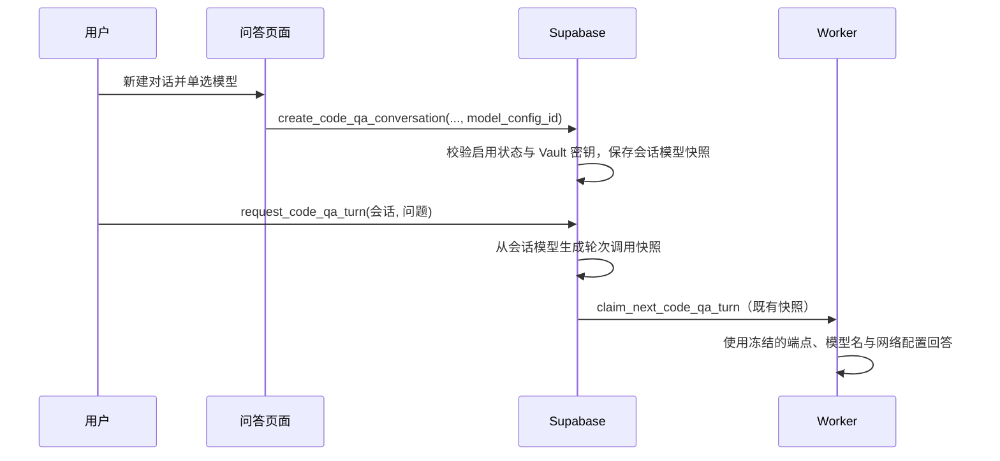

# 需求开发评审一致性平台 V1.27：代码问答会话模型选择最终执行方案

## 1. 背景与目标
产品代码问答目前由 `request_code_qa_turn` 在每次提问时自动解析可用模型。用户无法在新建会话时指定模型，且不同轮次可能受平台默认选型变化影响。目标是在新建对话配置中提供单选模型，锁定该会话后续所有问答使用同一模型。

## 2. 范围与非目标
- 包含：新建代码问答会话时列出启用且已配置密钥的模型，并要求单选一项。
- 包含：将选中的模型 ID 与当时显示名保存到会话；后续轮次从该会话模型冻结现有 Worker 所需快照。
- 包含：旧会话保持原自动选型兼容行为；已选择的会话绝不静默改用其他模型。
- 不包含：修改模型端点、Vault 密钥、Worker/DSH 调用协议、既有评审批次模型规则；不提供会话创建后的换模型功能。

## 3. 当前实现与问题
`src/pages/CodeQaPage.tsx` 的“新建对话”仅收集仓库与分支。`public.request_code_qa_turn` 目前在入队时自行解析模型，`code_qa_turn` 虽会冻结模型调用快照，但会话没有模型选择事实。因此用户无法明确控制本次会话使用哪个模型，也不能保证后续轮次始终使用最初希望的模型。

## 4. 需求与验收标准
1. 打开“新建对话”可看到“问答模型（单选）”下拉框，候选仅来自启用且有可用密钥的模型。
2. 不选模型不得创建会话；控件不支持多选。
3. 创建 RPC 在服务端再次校验模型存在、启用且密钥可用，不能信任浏览器提交的 ID。
4. 会话保存模型 ID 和显示名快照；每个新轮次只能使用该 ID 生成调用快照。
5. 已选模型被停用、删除密钥或不可用时，入队明确失败，不自动回退到别的模型。
6. 历史会话没有会话模型时保持既有自动选择逻辑，避免升级后不可继续提问。
7. 数据库 SQL 测试、前端类型检查/测试和生产构建通过。

## 5. 总体设计

## 6. 数据与接口设计
新增 `code_qa_conversation.selected_model_config_id`（引用 `ai_model_config`）及 `selected_model_display_name`。会话创建 RPC 扩展模型参数并改为新签名；旧签名会显式删除，避免留下绕过模型校验的重载。会话 JSON 投影返回这两个字段。

`request_code_qa_turn` 对有 `selected_model_config_id` 的会话只使用该配置，并校验启用状态和 Vault 密钥；对历史空值会话保留既有“最近实际使用 / 最近创建”自动选型。已有的 `code_qa_turn` 快照、Worker claim 及模型密钥 RPC 无需改动。

## 7. 前端与 Worker/运行时改造
- `src/pages/CodeQaPage.tsx`：读取可选模型；在新建对话表单新增必填单选 `Select`，并将 ID 交给创建请求。
- `src/lib/api.ts`：创建会话输入与 RPC 参数加入 `modelConfigId`。
- `src/types.ts`：会话摘要加入模型选择快照字段。
- `worker/src/ai/code-qa/qa-session-runner.ts`：保留 `MODEL_AUTH_FAILED` 错误码，避免无效 API Key 被收敛成泛化的问答内部错误。
- Worker 的模型调用、DSH 协议和轮次快照消费方式不变：它继续严格使用 `code_qa_turn` 入队时冻结的模型配置。

## 8. 安全、兼容与回滚
前端模型清单不包含 API Key；服务端对 ID、启用状态和密钥状态二次校验。模型引用使用受限外键，防止删除仍被会话使用的配置；模型端点/名称在被会话引用后也应保持不可变。模型不可用时失败而不降级，防止用户误以为仍在使用所选模型。

数据库变更仅新增列和前滚替换 RPC；回滚前端后旧会话仍可读取，数据库事实保留。云端迁移、Worker 更新与数据库推送均不由本次本地开发直接执行。

## 9. 实施步骤与文件范围
1. 新增幂等 Supabase 迁移与配套事务 SQL 测试，写入会话模型、更新 RPC 与模型配置引用保护。
2. 更新问答创建 API、类型和新建对话单选模型界面。
3. 运行本地迁移、SQL 测试、前端测试、类型检查和生产构建；按需修正。
4. 将实际文件与验证结果回填本方案。

主要修改文件：
- `supabase/migrations/20260926010207_code_qa_conversation_model_selection.sql`
- `supabase/tests/20260926010207_code_qa_conversation_model_selection_test.sql`
- `src/pages/CodeQaPage.tsx`
- `src/lib/api.ts`
- `src/types.ts`
- `需求开发评审一致性平台/V1.27-代码问答会话模型选择/需求开发评审一致性平台-V1.27代码问答会话模型选择-最终执行方案.md`

## 10. 验证结果

### 已完成的本地验证
- 已执行 `npm run db:backup:local`，本地备份为 `.local-db-backups/local-20260926-090521.sql`；未执行任何 reset、truncate 或云端写操作。
- 已执行 `supabase migration up --local`，本地应用 `20260926010207_code_qa_conversation_model_selection.sql` 成功；`supabase migration list --local` 显示该版本已登记。
- 已直接重复执行迁移 SQL，`add column/index` 的跳过提示与函数/触发器重建均成功；随后再次运行配套 SQL 测试成功，证明迁移可重复应用。
- 已执行 `docker exec ... psql ... < supabase/tests/20260926010207_code_qa_conversation_model_selection_test.sql`，事务内断言通过并 rollback。覆盖：必选模型、旧重载删除、会话 ID/显示名快照、首轮与后续轮次固定同一模型、停用不回退、模型身份不可变和授权。
- 已执行 `npm run web:typecheck`、`npm run worker:typecheck`、`npm run test:web`（19 个文件、241 项通过）、`npx vitest run worker/src/__tests__/v123-code-qa-session-runner.test.ts`（14 项通过）、`npm run test:worker`、`npm run build`、`npm run worker:build`、`npm run lint`。构建与测试均通过；lint 仅报告既有 React Hook 警告、无 error。生产前端构建仅有既有 bundle 体积警告。
- 本地 Worker 更新前查询 `code_qa_turn`、`analysis_job`、`analysis_story_task` 的在途数均为 0；随后以 1 副本重建 `codereviewplatform-local` Worker。容器状态为 `Up`，日志包含 `worker_started` 与 `code_qa_enabled`。

### 未执行
- 未用真实模型 API Key 发起外部问答：本次通过数据库创建/两轮入队/快照断言验证模型锁定，且 Worker 沿用已验证的轮次快照协议。
- 未执行 `supabase db push`、未部署 Edge Function、未重启云端配置 Worker、未提交或推送代码。