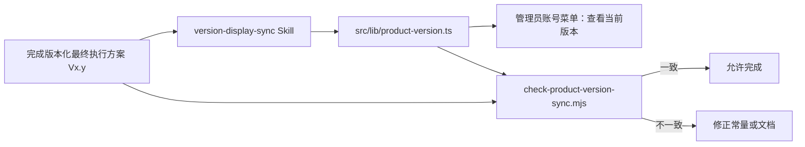

# 需求开发评审一致性平台 V1.28：版本展示同步技能最终执行方案

## 1. 背景与目标
管理员账号菜单中的“查看当前版本”曾在 `src/App.tsx` 直接写死 `V1.7`，而工作区已经持续产出 V1.23、V1.24…等版本化最终执行方案，导致产品显示版本与需求文档事实脱节。目标是建立一个工作区级 Skill：每次完成版本化需求文档后，将管理员查看的当前版本同步为该文档版本，并通过可执行检查阻止遗漏。

## 2. 范围与非目标
- 包含：新增 `version-display-sync` Skill；新增唯一版本常量；管理员版本弹窗读取该常量；新增文档版本与常量一致性检查脚本。
- 包含：本次以 V1.28 文档为事实来源，将当前展示版本同步为 V1.28。
- 不包含：数据库、RPC、Worker、版本发布、自动生成 git tag、历史需求文档回写或云端部署。

## 3. 当前实现与问题
`Shell` 的版本弹窗直接渲染 `当前版本：V1.7`，没有与版本化需求文档建立关联。即使新需求文档已经完成，管理员仍只能看到旧版本；且没有校验流程提醒开发者同步。

## 4. 需求与验收标准
1. 工作区存在一个 Skill，明确要求在版本化最终执行方案完成后同步产品版本。
2. 管理员“查看当前版本”只读取一个前端版本常量，不再硬编码版本字符串。
3. 校验脚本从指定最终执行方案标题解析 `Vx.y`，并验证它与版本常量逐字相同；不一致时返回非零退出码。
4. 本次 V1.28 方案、版本常量和管理员弹窗一致显示 V1.28。
5. 前端类型检查、版本校验脚本和生产构建通过。

## 5. 总体设计



## 6. 数据与接口设计
不涉及数据库、Supabase RPC、Edge Function、Storage、Worker 或外部 API。版本事实只存在于版本化最终执行方案与 `src/lib/product-version.ts`，不持久化到用户或业务数据。

## 7. 前端与运行时改造
- `src/lib/product-version.ts`：导出唯一 `PRODUCT_VERSION` 常量，本次值为 `V1.28`。
- `src/App.tsx`：管理员版本 Modal 从常量渲染当前版本。
- `scripts/check-product-version-sync.mjs`：读取指定最终执行方案标题和版本常量，检查一致性。
- `.kiro/skills/version-display-sync/SKILL.md`：规定触发条件、更新顺序与校验命令。

## 8. 安全、兼容与回滚
版本仅为非敏感展示字符串，不访问密钥、用户数据或远程服务。旧历史文档不修改；回滚某次功能时应新建前滚需求文档并同步到新的版本事实，而不是修改已经完成的历史方案。

## 9. 实施步骤与文件范围
1. 创建版本同步 Skill，约束未来完成版本化最终执行方案时的同步动作。
2. 创建唯一产品版本常量并替换管理员弹窗的硬编码文本。
3. 创建本地一致性校验脚本与 npm 命令。
4. 使用本 V1.28 文档执行校验，并运行前端检查和构建。

主要文件：
- `.kiro/skills/version-display-sync/SKILL.md`
- `src/lib/product-version.ts`
- `src/App.tsx`
- `scripts/check-product-version-sync.mjs`
- `package.json`
- `需求开发评审一致性平台/V1.28-版本展示同步技能/需求开发评审一致性平台-V1.28版本展示同步技能-最终执行方案.md`

## 10. 验证结果
- 已执行：
  ```bash
  npm run version:check -- "需求开发评审一致性平台/V1.28-版本展示同步技能/需求开发评审一致性平台-V1.28版本展示同步技能-最终执行方案.md"
  ```
  输出“需求文档版本：V1.28”“管理员展示版本：V1.28”“版本同步校验通过”。
- 已执行 `npm run web:typecheck`：通过。
- 已执行 `npm run build`：Harness manifest 检查、TypeScript 与 Vite 生产构建通过；仅有既有主 bundle 体积提示。
- 已执行 `git diff --check`：通过。
- 未执行云端部署、数据库迁移、git commit 或 git push。