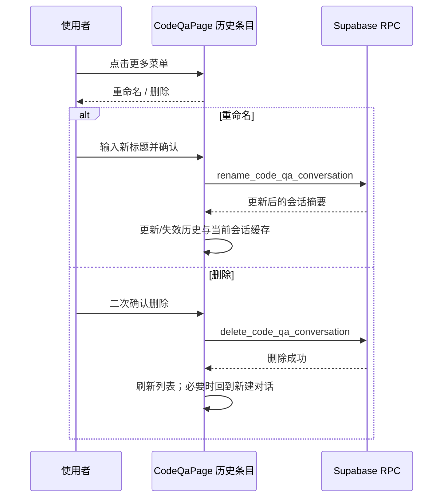

# 需求开发评审一致性平台 V1.29：代码问答会话管理最终执行方案

## 1. 背景与目标
代码问答页当前把“删除”放在对话内容区右上角，历史对话条目没有操作入口；这与使用者在历史列表中管理会话的预期不一致，也无法修改自动生成或过于简略的会话名。

本版本将会话管理聚合到历史对话条目的“更多”菜单：提供重命名和删除，操作位置与参考交互一致，减少内容区无关操作。

## 2. 范围与非目标
- 包含：历史对话条目的更多菜单、重命名弹窗、删除确认、删除后列表与当前会话状态同步。
- 包含：移除对话内容区右上角的删除按钮。
- 不包含：置顶、归档、分享、分组、批量管理、会话模型/仓库/分支修改。
- 不涉及：数据库结构、Supabase migration、Worker、DSH、权限模型或运行策略变更。

## 3. 当前实现与问题
- `src/pages/CodeQaPage.tsx` 通过 `listCodeQaConversations` 加载历史对话，通过 `deleteCodeQaConversation` 在内容顶栏执行删除。
- `src/lib/api.ts` 已提供 `renameCodeQaConversation({ conversationId, title })`，对应既有 `rename_code_qa_conversation` RPC，但页面尚未暴露入口。
- 历史项当前整行点击选中，缺少可发现且不会误触发选中行为的操作控件。

## 4. 需求与验收标准
1. 每个历史对话条目右侧有“更多”按钮；点击按钮不得切换当前对话。
2. 菜单提供“重命名”和“删除”；删除使用危险样式，且须二次确认。
3. 重命名弹窗回填当前标题；空白标题不得提交；成功后历史列表与当前顶部标题立即更新。
4. 删除成功后刷新历史列表；若删除的是当前会话，回到新建对话状态；删除其它会话不干扰当前会话。
5. 内容区顶栏不再出现删除入口。
6. 原有 RPC 权限和服务端校验继续生效；浏览器不新增任何绕过服务端的持久化逻辑。

## 5. 总体设计

## 6. 数据与接口设计
- 复用 `src/lib/api.ts` 的 `renameCodeQaConversation` 与 `deleteCodeQaConversation`。
- 请求参数：会话 UUID、重命名标题；返回值和错误均沿用既有 RPC 定义。
- 不新增表、字段、RPC、RLS、Storage 或 migration。

## 7. 前端与运行时改造
- `src/pages/CodeQaPage.tsx`
  - 在历史项渲染右侧的更多菜单按钮，阻止点击和键盘事件冒泡。
  - 新增重命名目标与受控表单状态，调用既有重命名 API。
  - 删除从内容顶栏迁移到历史项菜单；删除 mutation 根据被删项是否为当前项调整状态。
- `src/index.css` / `src/App.css`
  - 为历史项标题与更多按钮提供悬停显现、焦点可见和菜单触发器布局。
- Worker/DSH/运行时：不涉及。

## 8. 安全、兼容与回滚
- 服务端 RPC 是授权与输入校验的唯一可信边界；前端只展示和调用已有接口。
- 删除仍不可恢复，保留二次确认。
- 历史会话数据和既有会话链接兼容；不改变 ID、模型冻结、仓库或分支。
- 回滚只需回退前端代码和产品展示版本；没有数据库回滚步骤。

## 9. 实施步骤与文件范围
1. 创建 V1.29 方案并确认既有 rename/delete RPC 可复用。
2. 改造 `CodeQaPage` 历史项操作菜单和重命名弹窗，移除顶栏删除。
3. 补充历史项的更多按钮样式与键盘焦点样式。
4. 将 `src/lib/product-version.ts` 同步为 `V1.29`，并校验版本文档与展示版本一致。
5. 运行前端类型检查、构建和相关测试；把真实结果回写本节。

主要文件：
- `需求开发评审一致性平台/V1.29-代码问答会话管理/需求开发评审一致性平台-V1.29代码问答会话管理-最终执行方案.md`
- `src/pages/CodeQaPage.tsx`
- `src/index.css`
- `src/lib/product-version.ts`

## 10. 验证结果
- `npm run build`：通过。输出包含 Harness manifest 校验、`tsc -b` 和 Vite 生产打包；仅保留既有的 chunk 大小提示。
- 手工代码核对：历史条目菜单调用既有 `renameCodeQaConversation` / `deleteCodeQaConversation`；删除仅在菜单确认后执行，且当前会话被删时才回到新建状态。
- 未运行浏览器端到端自动化测试：仓库当前未提供代码问答菜单的 E2E 用例。