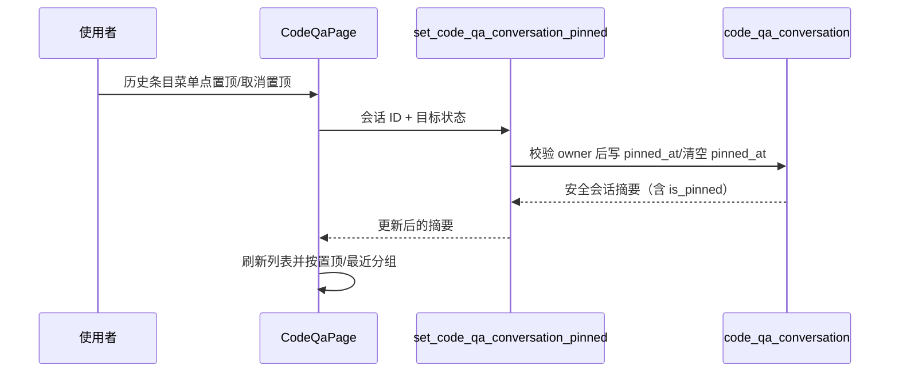

# 需求开发评审一致性平台 V1.30：代码问答会话置顶最终执行方案

## 1. 背景与目标
代码问答的历史会话已有重命名和删除，但重要会话会被新的提问挤出可见范围。参照用户提供的历史对话交互，本版本允许使用者置顶会话，并在侧栏独立展示置顶分组。

## 2. 范围与非目标
- 包含：单个会话的置顶/取消置顶、跨刷新持久化、历史侧栏的“置顶”和“最近对话”分组。
- 包含：置顶菜单项按当前状态切换为“置顶”或“取消置顶”。
- 不包含：共享、归档、手工分组、批量置顶和跨用户置顶。

## 3. 当前实现与问题
`CodeQaPage` 通过 `list_code_qa_conversations` 获取按最近活动排序的历史会话；V1.29 的更多菜单仅有重命名和删除。现有 `code_qa_conversation` 没有置顶事实，浏览器排序无法在刷新或换设备后保留。

## 4. 需求与验收标准
1. 每个历史会话在更多菜单中可执行“置顶”；置顶后菜单改为“取消置顶”。
2. 置顶状态写入数据库，刷新页面、重新登录后仍然存在；每名用户只能操作自己的会话。
3. 已置顶会话显示在“置顶”分组，按最近置顶时间倒序；其他会话显示在“最近对话”分组，按最近提问/创建时间倒序。
4. 取消置顶后，会话从置顶分组移回最近对话；重命名、删除和问答流程不受影响。
5. 旧会话默认未置顶，兼容原有数据与 Worker 处理链路。

## 5. 总体设计

## 6. 数据与接口设计
- `code_qa_conversation.pinned_at timestamptz null`：非空表示已置顶，时间值决定置顶组内顺序；历史行默认 `null`。
- `code_qa_conversation_to_jsonb` 增加布尔投影 `is_pinned`，不会把内部置顶时间返回给浏览器。
- `list_code_qa_conversations` 先按 `pinned_at desc nulls last`，再按最近活动排序。
- 新增 authenticated RPC `set_code_qa_conversation_pinned(uuid, boolean)`；复用 `assert_code_qa_conversation_owner`，未授权与不存在统一为既有错误码。
- Worker、DSH、Storage 与外部 API：不涉及。

## 7. 前端与运行时改造
- `src/lib/api.ts` 新增 RPC 封装；`src/types.ts` 的会话摘要增加 `is_pinned`。
- `src/lib/code-qa.ts` 提供可测试的会话置顶分组函数。
- `src/pages/CodeQaPage.tsx` 在 V1.29 更多菜单中加入状态化置顶操作，刷新查询缓存，并将侧栏拆成置顶与最近对话分组。
- `src/index.css` 补充分组标题与间距；不改 Worker。

## 8. 安全、兼容与回滚
- 置顶写入只能通过 security definer RPC；所有操作首先校验 `auth.uid()` 与 owner，浏览器没有表级更新权限。
- 旧会话 `pinned_at = null`，自然落入最近对话分组；既有列表调用仍可解析新增 JSON 键。
- 回滚方式为前滚迁移：清空逻辑或前端入口，不删除会话数据。数据库绝不 reset；本地验证前按仓库规范备份。

## 9. 实施步骤与文件范围
1. 新建幂等迁移和事务回滚 SQL 测试，增加字段、投影、排序和授权 RPC。
2. 扩展 API、类型和可测试分组逻辑。
3. 在历史菜单加入置顶动作，并渲染置顶/最近对话分组及样式。
4. 同步 `PRODUCT_VERSION` 为 `V1.30` 并运行版本一致性检查。
5. 应用本地迁移，执行 SQL 测试、前端单测、类型检查与生产构建；将真实结果回写本节。

主要文件：
- `supabase/migrations/20260926070711_code_qa_conversation_pinning.sql`
- `supabase/tests/20260926070711_code_qa_conversation_pinning_test.sql`
- `src/lib/api.ts`
- `src/lib/code-qa.ts`
- `src/lib/__tests__/code-qa.test.ts`
- `src/types.ts`
- `src/pages/CodeQaPage.tsx`
- `src/index.css`
- `src/lib/product-version.ts`

## 10. 验证结果
- 本地数据库已先备份至 `.local-db-backups/local-20260926-151243.sql`，随后 `supabase migration up --local` 成功应用 `20260926070711_code_qa_conversation_pinning.sql`。
- `docker exec -i supabase_db_codeReviewPlatform psql -v ON_ERROR_STOP=1 -U postgres -d postgres < supabase/tests/20260926070711_code_qa_conversation_pinning_test.sql`：通过；覆盖默认未置顶、持久化置顶、置顶优先排序、取消置顶、跨用户隔离与 authenticated 授权。
- 迁移文件已直接重复执行成功；另在 `BEGIN … ROLLBACK` 本地事务中移除 V1.30 对象后重放成功，未保留测试性改动。
- `npm run test:web`：通过，19 个测试文件、242 个用例；包含置顶分组保序用例。
- `npm run web:typecheck`：通过。
- `npm run build`：通过；Harness manifest 校验通过。仅有既有的 Vite chunk 大小提示。
- `npm run version:check -- "需求开发评审一致性平台/V1.30-代码问答会话置顶/需求开发评审一致性平台-V1.30代码问答会话置顶-最终执行方案.md"`：通过，文档与产品展示均为 `V1.30`。
- 已执行 `supabase migration list --local`、`supabase migration list --linked` 和 `supabase db push --linked --dry-run --skip-vault`；dry-run 显示云端仅缺少本次 V1.30 迁移。未执行任何云端写入或发布。