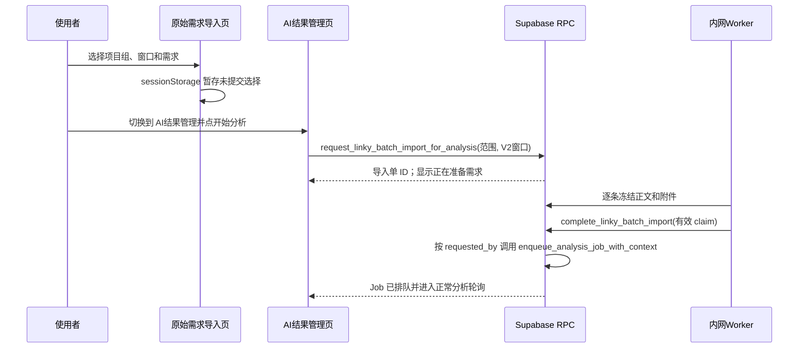

# 需求开发评审一致性平台 V1.31：分析前需求自动冻结最终执行方案

## 1. 背景与目标
现有流程要求使用者在“原始需求导入”页点击“确认导入并冻结”，留在该页等待 Worker 导入完成，再手动进入“AI 结果管理”点击“开始分析”。这把一次业务动作拆成两次操作，也让使用者在导入页停留等待。

V1.31 将需求冻结纳入 AI 结果管理页的“开始分析”流程：使用者在原始需求页只负责选择范围，随后进入 AI 结果管理点击“开始分析”；该按钮先提交 Linky 冻结单，AI 页面原地展示准备状态，Worker 完成冻结后服务端自动创建分析 Job。分析 Job 绝不早于冻结完成创建。

## 2. 范围与非目标
- 包含：跨页保留尚未提交的需求选择、开始分析时创建自动冻结单、完成后自动创建 V2 分析 Job、真实等待和失败状态。
- 包含：自动入队失败后保留正确冻结的需求，并允许既有开始分析路径重试。
- 不包含：改变 Linky 的实时看板、浏览器直写需求正文、改变 Worker 的抓取逻辑、重跑历史导入单或改变既有 Job 的快照。

## 3. 当前实现与问题
`SourceImportPage` 调用 `request_linky_batch_import`，Worker 通过 `complete_linky_batch_import` 完成冻结，随后使用者才在 `AutoAnalysisSection` 调用 `enqueue_analysis_job_with_context`。导入队列没有记录“此单完成后应启动哪种分析”的意图，因此关闭页面或跳转页面会中断浏览器侧串联方案。

## 4. 需求与验收标准
1. 原始需求页不再显示“确认导入并冻结”；该页只保留待分析的选择范围。
2. 选择范围在当前浏览器页签跨“原始需求导入”与“AI 结果管理”保留；它不是已冻结业务事实。
3. AI 结果管理的“开始分析”同时提交需求冻结与 V2 分析意图；没有选择时仍沿用对既有冻结需求的普通入队行为。
4. Worker 成功冻结至少一条需求后，完成 RPC 以原请求人身份创建 Job；Job 不得早于需求快照完成创建。
5. AI 页在导入期间显示“正在准备需求”，不假装 Job 已经运行；导入或自动入队失败显示实际错误。
6. 权限、活动 Job 唯一性、claim fencing、模型/分支/密钥/规则校验和历史只读约束均不被绕过。

## 5. 总体设计

## 6. 数据与接口设计
- `linky_batch_import_request` 增加不可变的分析编排投影：`analysis_context_version`、`commit_window_days`、`analysis_status`、`analysis_job_id`、`analysis_error_code`、`analysis_error_message`。非自动导入单保持 `NOT_REQUESTED`，历史数据兼容。
- 新增 authenticated RPC `request_linky_batch_import_for_analysis(...)`：沿用现有导入范围/权限/活动任务校验，并在导入单上冻结 V2 和 7/14/21/28 天窗口。
- `complete_linky_batch_import` 在受 claim token 保护的完成事务中，在设为原请求人 JWT 上下文后调用既有 `enqueue_analysis_job_with_context`。失败写入导入单的分析失败投影，不回滚已经正确完成的需求快照。
- 既有 `request_linky_batch_import` 与 Worker TypeScript RPC 形状保留，兼容已有或历史导入流程。

## 7. 前端与 Worker/运行时改造
- `src/lib/linky-analysis-selection.ts` 将未提交选择保存于当前页签 `sessionStorage`；刷新同页签或切换批次页签不丢失，未提交内容绝不写库。
- `SourceImportPage` 删除确认导入按钮，仅同步选择到会话存储；已冻结清单、历史导入状态和只读门禁不变。
- `AutoAnalysisSection` 消费会话选择：点击“开始分析”时调用自动导入 RPC，并在 `QUEUED`/`RUNNING`/`PENDING` 阶段展示“正在准备需求”、轮询并禁止重复提交；自动入队失败后显示错误。
- Worker 不改代码：既有 `completeLinkyBatchImport` 调用会触发升级后的数据库编排。

## 8. 安全、兼容与回滚
- 浏览器只能调用 authenticated RPC；Worker-only claim/commit/complete 仍不授予 authenticated。
- 伪造请求人不可行：`requested_by` 只由 `auth.uid()` 在 security definer RPC 内写入，完成 RPC 仅在有效 Worker claim 下读取它。
- 分析 Job 只在所有逐条写入完成后创建；导入全失败时 runner 调用失败 RPC，绝不创建 Job。
- 历史导入单的分析状态默认为 `NOT_REQUESTED`；已创建/运行/完成的 Job 不改写。
- 回滚采用前滚迁移或撤回前端入口；不删除批次、需求、导入单或 Job，绝不重置数据库。

## 9. 实施步骤与文件范围
1. 新增可重复应用迁移和事务回滚 SQL 测试，扩展导入单、创建启动 RPC、覆盖完成 RPC 和授权。
2. 扩展前端类型/API；将需求选择器动作改为开始分析并立即导航。
3. 在自动分析卡片增加自动导入等待、失败和轮询状态。
4. 同步 `PRODUCT_VERSION` 为 `V1.31`，运行版本一致性检查。
5. 先备份本地库，应用本地迁移，运行 SQL 测试、前端测试、类型检查、构建与本地 Worker/业务验证；将真实结果回写本节。

主要文件：
- `supabase/migrations/<UTC>_linky_import_auto_enqueue_analysis.sql`
- `supabase/tests/<UTC>_linky_import_auto_enqueue_analysis_test.sql`
- `src/lib/api.ts`
- `src/types.ts`
- `src/App.tsx`
- `src/lib/product-version.ts`
- `需求开发评审一致性平台/V1.31-分析前需求自动冻结/需求开发评审一致性平台-V1.31分析前需求自动冻结-最终执行方案.md`

## 10. 验证结果
- 本地库已先备份至 `.local-db-backups/local-20260927-125931.sql`；`supabase migration up --local` 成功应用 V1.31 迁移。
- `20260927045147_linky_import_auto_enqueue_analysis_test.sql` 通过：覆盖授权、冻结意图、完成前无 Job、claim 后冻结、自动 V2 Job 创建、原请求人与分析窗口保留。
- 迁移重复直接执行成功。
- `npm run web:typecheck`、`npm run test:web`（19 文件/242 用例）、`npm run build`、`npm run worker:typecheck`、`npm run worker:build`、`npm run test:worker` 均通过；构建仅有既有 chunk 体积提示。
- 本地 `codereviewplatform-local-worker-1` 为 Up；日志确认 `worker_started`、Linky 导入完成及随后领取分析 Job。未修改或重建 Worker 镜像。
- 云端未执行任何写操作。