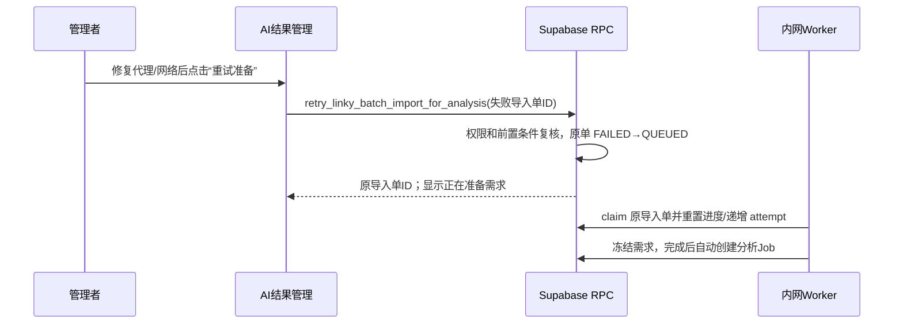

# 需求开发评审一致性平台 V1.32：失败需求准备重试最终执行方案

## 1. 背景与目标
V1.31 中，AI 结果管理的“开始分析”会创建 Linky 需求冻结单并在冻结完成后自动入队分析。首次提交后，浏览器会清除临时选择；若 Worker 因宿主机代理或 Linky 网络暂时不可用而把导入单标记为 `FAILED`，页面只能展示“需求准备失败”，原“开始分析”又因为没有待提交选择而不可用。

本版本为这类自动需求准备失败提供清晰、可执行的“重试准备”操作。使用者在网络或代理恢复后无需回到需求页重新筛选，直接重用原导入单已冻结的范围重新排队。

## 2. 范围与非目标
- 包含：仅针对自动分析链路、且状态为 `FAILED` 的 Linky 需求准备单显示重试按钮；按钮重新排队同一张导入单。
- 包含：服务端复核批次管理权限、批次/AI 结果/活动 Job、模型启用状态和 Vault 密钥；并防止与其他活动导入单并发。
- 包含：重试期间沿用既有真实轮询、Worker claim fencing、进度归零和完成后自动创建分析 Job 的链路。
- 不包含：自动无限重试、修改 Linky Worker 抓取逻辑、恢复失败前的临时浏览器选择、删除或复制已有需求/导入单、重试已经成功冻结但自动入队失败的单子。

## 3. 当前实现与问题
- `src/App.tsx` 的 `AutoAnalysisSection` 首次调用 `requestLinkyBatchImportForAnalysis` 成功后执行 `clearPendingLinkyAnalysisSelection`；失败时 `pendingSelection` 已为空，前置条件“请先在原始需求导入选择至少一条需求”阻止“开始分析”。
- `linky_batch_import_request` 已保存原项目组、发布窗口、需求编号、自动分析上下文和分析窗口；Worker 每次 `claim_next_linky_batch_import` 都会清空统计/错误投影并递增 `attempt`，可安全复跑同一张单。
- 现有 `request_linky_batch_import_for_analysis` 只创建新导入单，不接受失败单 ID；因此需要一个最小的新 authenticated RPC，不能由浏览器直接更新队列状态。

## 4. 需求与验收标准
1. 仅当最新导入单是 V1.31 自动分析单且 `status='FAILED'` 时，拥有管理权限且批次尚可分析的使用者能看到“重试准备”按钮；普通“开始分析”不再成为该失败态的伪入口。
2. 点击后必须重新使用同一张导入单、同一组 `story_codes`、同一项目组、同一发布窗口和已冻结的 `analysis_context_version`/`commit_window_days`，不生成重复导入单。
3. RPC 必须校验操作者有批次管理权限、失败单属于该批次且是自动分析单、批次未完成、没有 AI 结果/活动 Job、模型可用且密钥存在，以及当前没有其他 `QUEUED`/`RUNNING` 导入单。
4. 成功重试后失败错误立即清除、状态变为 `QUEUED`，页面显示“正在准备需求”并继续既有轮询；Worker claim 后才重置详细进度并递增尝试次数。
5. 重试失败时页面展示可读错误，不改变原失败单的选择范围或已经冻结的数据；未恢复的 `LINKY_PROXY_UNREACHABLE` 可再次提示代理不可用。
6. `authenticated` 只获得专用重试 RPC；Worker-only 的 claim、完成与失败 RPC 权限不变。

## 5. 总体设计

## 6. 数据与接口设计
- 不新增表或列，也不改变 `LinkyBatchImportRequest` 的返回结构。
- 新增 `retry_linky_batch_import_for_analysis(p_request_id uuid) returns uuid`：在事务锁与 advisory lock 下将合格的失败自动导入单重新置为 `QUEUED`，清理失败错误和 Worker claim 字段，保持原始范围与分析意图。
- RPC 对并发活动导入单报出稳定错误 `LINKY_IMPORT_RETRY_ACTIVE`；对非失败/非自动单分别报出稳定错误，前端通过 `describeLinkyError` 翻译。
- 新增 `retryLinkyBatchImportForAnalysis` 前端 API 封装；不向客户端暴露任何 Worker claim token。

## 7. 前端与 Worker/运行时改造
- `AutoAnalysisSection` 增加重试 mutation 和条件按钮。按钮只在需求准备失败状态替换通用开始入口；loading 期间防止重复请求。
- 重试成功后失效相同的批次、导入单和分析任务查询，并立即刷新导入单；既有 `importPreparing` 状态、2 秒轮询和 Worker 逻辑无需改动。
- Worker 不改代码：其 claim 逻辑已负责每次运行清理累计进度及错误，完成 RPC 已负责自动入队。

## 8. 安全、兼容与回滚
- 队列状态只能经 `security definer` RPC 改写，浏览器没有表更新权限；重试再次执行模型/密钥与批次可写性检查，不把失败时的旧授权当作当前授权。
- 不删除已冻结需求、附件、导入单或 Job；已有成功/历史手动导入不受影响。
- 回滚使用新的前滚迁移撤销新 RPC 的授权或前端入口，不重置数据库；已重新排队的单可由既有 Worker 正常收敛。
- 云端迁移与发布不由本次开发直接执行；仅在本地 Supabase 验证后提供手动发布清单。

## 9. 实施步骤与文件范围
1. 新增可重复执行的 Supabase 迁移与同名事务 SQL 测试，创建并授权重试 RPC。
2. 在 `src/lib/api.ts` 添加 RPC 封装和错误码文案。
3. 在 `src/App.tsx` 添加失败态重试 mutation/按钮及查询失效逻辑。
4. 将 `src/lib/product-version.ts` 更新为 `V1.32`，运行版本一致性校验。
5. 本地应用迁移、运行 SQL 测试、前端类型检查/测试/构建；按实际结果回写本节。

主要文件：
- `supabase/migrations/20260927102351_retry_failed_linky_analysis_import.sql`
- `supabase/tests/20260927102351_retry_failed_linky_analysis_import_test.sql`
- `src/lib/api.ts`
- `src/App.tsx`
- `src/lib/product-version.ts`
- `需求开发评审一致性平台/V1.32-失败需求准备重试/需求开发评审一致性平台-V1.32失败需求准备重试-最终执行方案.md`

## 10. 验证结果
- 已先备份本地数据库至 `.local-db-backups/local-20260927-182513.sql`；仅执行 `supabase migration up --local`，成功前滚 `20260927102351_retry_failed_linky_analysis_import.sql`，未重置数据库也未进行云端写入。
- 再次以 `psql` 在本地 Supabase 容器执行同一迁移成功，确认迁移可重复应用；`20260927102351_retry_failed_linky_analysis_import_test.sql` 通过（输出 `ALL_V132_LINKY_IMPORT_RETRY_TESTS_PASSED`）。覆盖 authenticated 授权、无管理权限拒绝、同一失败单 ID 重排、范围/上下文/窗口保留，以及下一次 Worker claim 的第二次 attempt 和进度重置。
- `npm run web:typecheck` 通过；`npm run test:web -- src/lib/__tests__/v120-linky-errors.test.ts` 通过（1 文件、8 用例）；`npm run build` 通过。构建仅报告既有的 chunk 体积警告。
- `npm run lint` 通过（0 error）；有 10 条既有 React Hooks/Fast Refresh warning，均位于未修改的 `LinkyStoryPicker.tsx`、`CodeQaPage.tsx`、`SkillManagementPage.tsx` 与原有 `App.tsx` 依赖写法。
- `npm run version:check -- "需求开发评审一致性平台/V1.32-失败需求准备重试/需求开发评审一致性平台-V1.32失败需求准备重试-最终执行方案.md"` 通过，文档与管理员展示版本均为 `V1.32`。
- 未进行本地 Worker 对真实 Linky 的端到端复跑：本次没有 Worker 代码改动，而该路径需要可用的内网 Linky/宿主机代理和专用测试需求；当前失败场景正是代理不可用。云端迁移、代码发布和 Worker 重启均未执行。
