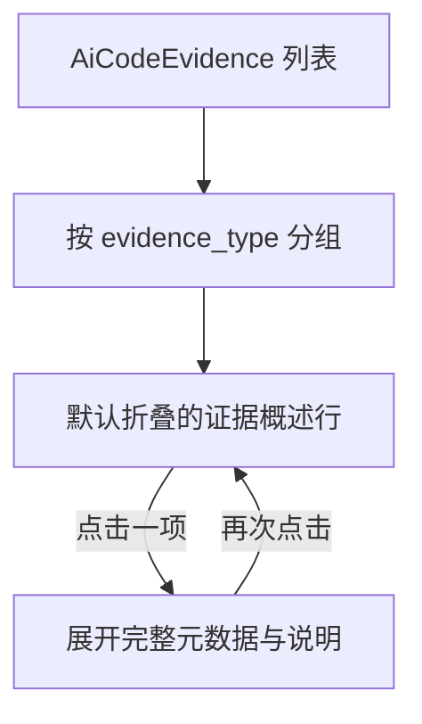

# 需求开发评审一致性平台 V1.33：代码证据概述最终执行方案

## 1. 背景与目标
评审详情中的“代码证据”按类型连续展示每一条证据的仓库、完整文件路径、Commit、行号和长说明。单条需求可能有数十条证据，长页会掩盖真正需要先判断的证据范围，也让进入人工确认前的浏览成本过高。

V1.33 将代码证据改为“概述列表 + 按需详情”：默认只展示能快速定位的仓库、文件、符号/行号和证据类型；使用者点击某一项后才展开完整路径、Commit、行范围与 AI 说明。

## 2. 范围与非目标
- 包含：评审详情 `AiResultCard` 的代码证据区域；按现有“现有实现 / 缺失依据 / 风险依据”分组展示；每条证据可独立展开/收起。
- 包含：概述行的单行截断与摘要字段，展开区的完整元数据和说明；每个证据类型分组独立分页，每页 10 条。
- 不包含：变更 `ai_code_evidence` 数据、证据生成、Agent/Worker、数据库 API、导出 Excel 或人工确认规则。
- 不包含：默认自动展开、服务端持久化用户展开状态或跨页面记忆展开状态。

## 3. 当前实现与问题
`src/App.tsx` 的 `AiResultCard` 将 `BatchWorkspace['evidence']` 依证据类型分组，随后为每条 `AiCodeEvidence` 直接渲染完整 `file_path`、`commit_sha`、行号和 `description`。当证据数量达到 25 条时，内容连续堆叠导致评审页过长。

`AiCodeEvidence` 已含有概述和详情所需的全部字段：`repository_name`、`file_path`、`symbol_name`、`start_line`、`end_line`、`commit_sha`、`evidence_type` 和 `description`，无需增加数据模型。

## 4. 需求与验收标准
1. 默认进入评审详情时，每条代码证据仅显示一行概述；完整说明不应占用页面高度。
2. 概述必须保留证据类型分组、仓库、文件末段/路径摘要及可用的符号或行号，便于不展开即可快速判断证据范围。
3. 点击某一概述行可展开该证据的完整路径、完整 Commit、符号、精确行范围和 AI 说明；再次点击可收起。
4. 一条证据的展开/收起不得影响其它证据，也不应改变现有证据分组和顺序。
5. 无证据时继续显示“暂无代码证据”；缺失 Commit、符号或行号时仍应平稳展示，不显示无效占位信息。
6. 页面交互应提供可访问的原生 Ant Design `Collapse` 语义，不以手写不可访问的点击 `div` 代替。

## 5. 总体设计

每个分组保留类型 Tag。组内的 Ant Design `Collapse` 默认没有 active key：header 为概述行，content 为详情。概述路径使用 CSS 单行省略，详情保留原始全量文字，保证信息不会因收紧页面而丢失。

## 6. 数据与接口设计
- 不涉及数据库表、迁移、RPC、RLS、Storage、Worker 或 API 改动。
- 继续使用 `BatchWorkspace['evidence']` 和 `AiCodeEvidence` 现有响应；展开状态只存在于组件渲染生命周期中。

## 7. 前端改造
- `src/App.tsx`：在 `AiResultCard` 引入 Ant Design `Collapse`，将现有证据项改造为概述 header 和详情 content；增加证据概述标签构造，保留原顺序与分组。
- `src/App.css`：新增紧凑概述行、路径省略、元数据与展开详情的样式，移除不再使用的全量证据项布局规则。
- 无 Worker、模型、权限、Session、预算或运行时改动。

## 8. 安全、兼容与回滚
- 所有证据仍来自既有批次工作区查询；本次不新增浏览器输入、权限边界或敏感数据暴露。
- 历史 AI 结果兼容：字段缺失时按现有空值规则隐藏相应元数据。
- 回滚只需前端前滚修复为原静态展示；不删除任何证据或修改数据库。

## 9. 实施步骤与文件范围
1. 在 `AiResultCard` 保留现有分组逻辑，改为默认折叠的证据概述/详情结构。
2. 编写对应 CSS，使概述一行可扫读、详情全量可查。
3. 将 `PRODUCT_VERSION` 同步至 `V1.33`，运行版本一致性检查。
4. 运行前端类型检查、相关前端测试和生产构建，并回写本节的实际结果。

主要文件：
- `src/App.tsx`
- `src/App.css`
- `src/lib/product-version.ts`
- `需求开发评审一致性平台/V1.33-代码证据概述/需求开发评审一致性平台-V1.33代码证据概述-最终执行方案.md`

## 10. 验证结果
- 已实现 `AiResultCard` 的代码证据概述/详情交互：每个类型分组内的证据默认折叠，概述行展示仓库、截断路径、符号和行号；展开后展示完整路径、完整 Commit、符号、精确行范围与 AI 说明。每个证据类型独立按每页 10 条分页，超过 10 条时显示分页控件。
- 未修改数据库、API、Worker、Agent 或既有证据排序/分组逻辑；空证据仍显示“暂无代码证据”。
- `npm run web:typecheck` 通过。
- `npm run test:web` 通过：19 个测试文件、243 个用例。
- `npm run version:check -- "需求开发评审一致性平台/V1.33-代码证据概述/需求开发评审一致性平台-V1.33代码证据概述-最终执行方案.md"` 通过，文档与管理员展示版本均为 `V1.33`。
- `git diff --check` 与 `npm run build` 通过；构建仅报告既有 chunk 体积提示。
- 未执行数据库或云端写操作。
