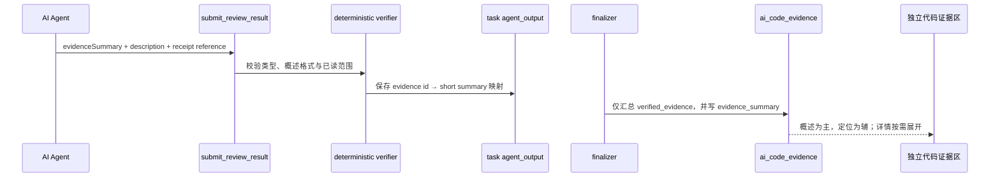

# 需求开发评审一致性平台 V1.34：代码证据短概述最终执行方案

## 1. 背景与目标
当前代码证据列表将 AI 的完整 `description` 截断后当作列表标题，或以仓库和长文件路径为主。两者都没有回答评审者最先需要知道的问题：**这条代码证据证明了什么**。同时，代码证据嵌在“AI 分析”卡片末尾，混淆了结论概览与可追溯依据。

V1.34 要求后续 AI 为每条证据生成独立、简短、面向评审者的“证据概述”，并将代码证据从 AI 分析概览中拆为评审详情的独立证据区。概述列表以该短概述为主，仓库、文件和行号仅作辅助定位；完整说明仅在展开详情显示。

## 2. 范围与非目标
- 包含：为 `ai_code_evidence` 新增可空 `evidence_summary`；后续自动分析要求模型提交 8–80 字短概述；Worker 将概述随已验证证据安全汇总入库。
- 包含：评审详情将“代码证据”从 `AiResultCard` 拆成独立 `CodeEvidenceCard`；按现有证据类型 Tab、独立分页和行级展开保留。每个类型 Tab 始终显示与技能列表一致的“共 N 条 / 页码 / 每页条数”分页栏。
- 包含：历史自动分析和人工 Excel 导入无短概述时，以完整说明首句作为只读兼容降级。
- 不包含：回填或篡改历史证据、改变证据类型词表、修改 Agent 的代码读取权限、改变人工确认流程或新增模型调用。

## 3. 当前实现与问题
- `submit_review_result` 只要求每条证据提供 `description`。`deterministic-verifier.ts` 验证引用范围后，把长说明一路带到 `analysis_story_task.agent_output`；`finalize-job.ts` 再汇总进 `complete_analysis_job`。
- `ai_code_evidence` 没有面向列表的短概述字段。前端只好截断 `description`，造成截图中的冗长、重复和不清晰列表。
- `AiResultCard` 同时承担 AI 结论与证据列表，导致“分析摘要 / 分析详情”与“代码依据”混在一个卡片中。

## 4. 需求与验收标准
1. 后续自动分析的每条证据必须携带 `evidenceSummary`：去除首尾空白、无换行、8–80 个字符，描述“这段代码证明的结论”，不能只复述仓库名、路径、符号或行号。
2. Worker 验证 short summary 后，将其写入任务输出；最终化时按已验证 evidence id 匹配并写入 `ai_code_evidence.evidence_summary`。未在已验证账本中的模型证据仍不能进入最终结果。
3. `ai_code_evidence.evidence_summary` 可为空以兼容历史结果和人工 Excel 导入；新自动分析的字段由模型工具契约和 verifier 保证存在。
4. 评审详情中的 AI 分析卡只展示判断、摘要与分析详情；独立“代码证据”卡展示证据类型 Tab、每类独立 10 条分页和可展开的完整证据。
5. 证据概述是列表主内容；仓库、文件末段、符号和行号是辅助定位。展开后展示完整路径、Commit、完整说明。
6. 历史空概述应优雅降级到完整说明的首句/前 80 字，不因新字段为空导致空白列表。

## 5. 总体设计

## 6. 数据与接口设计
- 新迁移给 `public.ai_code_evidence` 增加 `evidence_summary text`，并以 CHECK 允许 `NULL` 或 8–80 字且不含换行。空值保留给历史/人工证据。
- 新迁移覆盖 `public.complete_analysis_job(uuid,text,jsonb,jsonb)`，将 `p_evidence[].evidence_summary` 写入新列；旧调用未提供时自然写为 `NULL`。
- `ReviewSubmission.evidence`、Harness `submit_review_result` 参数、verifier 的 `VerifiedEvidence` 与 Worker 任务输出增加 `evidenceSummary`/映射。概述本身不替代 source receipt，原有验证不放宽。
- `AiCodeEvidence` 前端类型增加 `evidence_summary: string | null`；浏览器继续用既有 `select('*')` 查询。

## 7. 前端与 Worker/运行时改造
- Worker：工具 schema 明确要求短概述；verifier 返回稳定错误码 `EVIDENCE_SUMMARY_INVALID`；`toAgentResultRow` 持久化每个已验证 evidence id 的短概述映射；finalizer 只取 verified evidence 并写入关联概述。
- 前端：`AiResultCard` 不再接收/渲染代码证据；新增独立 `CodeEvidenceCard`。Tab、分页和详情交互保留，主行使用 `evidence_summary`，历史数据使用安全降级文本。
- 不改变 Harness capability manifest 中的工具清单；仅扩展已有 `submit_review_result` 的输入字段。

## 8. 安全、兼容与回滚
- 证据来源、精确 Commit、blob/hash 和已读 receipt 校验仍由现有 verifier 与数据库执行；AI 的短概述仅是展示文字，不能独立构成代码证据。
- 历史与人工结果可读取；不回填、不删除、不重写既有证据。
- 回滚使用前滚迁移或前端降级，保留已写短概述；绝不重置数据库。
- 云端迁移和 Worker 重启不由本次开发直接执行。

## 9. 实施步骤与文件范围
1. 新增 UTC 命名、可重复应用的数据库迁移与回滚事务 SQL 测试。
2. 扩展 Harness 提交 schema、verifier、Worker 持久化映射、finalizer 汇总和相关 Worker 测试。
3. 改造评审详情为独立证据区，短概述为主、定位与完整详情为辅，兼容空概述。
4. 同步 `PRODUCT_VERSION` 为 `V1.34`，运行版本一致性、数据库、Worker、前端验证。

主要文件：
- `supabase/migrations/20260927114745_code_evidence_short_summary.sql`
- `supabase/tests/20260927114745_code_evidence_short_summary_test.sql`
- `worker/src/ai/snapshot/deterministic-verifier.ts`
- `worker/src/harness-plugins/review-control-tool/index.ts`
- `worker/src/index.ts`
- `worker/src/pipeline/finalize-job.ts`
- `worker/src/db/jobs.ts`
- `worker/src/__tests__/snapshot-and-broker.test.ts`
- `worker/src/__tests__/finalize.test.ts`
- `src/types.ts`
- `src/App.tsx`
- `src/App.css`
- `src/lib/product-version.ts`

## 10. 验证结果
- 已新增 `20260927114745_code_evidence_short_summary.sql`：`ai_code_evidence` 增加兼容历史空值的 `evidence_summary`，约束非空值必须为单行 8–80 字；覆盖 `complete_analysis_job` 将最终化 JSON 的 `evidence_summary` 写入结果证据。
- 已新增同名事务 SQL 测试并在本地 Supabase 容器通过，输出 `ALL_V134_CODE_EVIDENCE_SUMMARY_TESTS_PASSED`；覆盖列存在、合法短概述可写、过短概述被约束拒绝、最终化函数包含概述映射。
- Worker 的 `submit_review_result` 要求 `evidenceSummary`；deterministic verifier 以 `EVIDENCE_SUMMARY_INVALID` 拒绝非单行或不在 8–80 字范围的概述。仅在 receipt、Commit、blob/hash 校验成功后，Worker 才将 evidence id → summary 映射放入 task output；finalizer 仍只汇总 verified evidence。
- 评审详情将代码证据从 `AiResultCard` 拆为独立 `CodeEvidenceCard`。概述为主、仓库/文件末段/符号/行号为辅助，类型 Tab、每类 10 条分页和展开详情保留；历史或人工证据的空概述降级为原说明前 80 字。
- 已备份本地数据库至 `.local-db-backups/local-20260927-195729.sql`，执行 `supabase migration up --local` 前滚成功；同一迁移在容器中重复执行成功。
- `npm run worker:typecheck`、`npm run worker:build`、`npm run test:worker` 均通过；Worker 测试覆盖 verifier 的短概述拒绝和 finalizer 的概述汇总。 
- `npm run web:typecheck`、`npm run test:web`（19 文件 / 243 用例）、`npm run build` 通过；构建仅有既有 chunk 体积提示。`npm run version:check` 通过，文档与产品展示均为 `V1.34`。
- 本地 `codereviewplatform-local-worker-1` 当前为 Up，但未重建或重启：本次新 Worker 合约需要新镜像和真实模型/Linky 业务单端到端验证，而重建会中断在途任务。云端数据库、前端和 Worker 均未发布。
