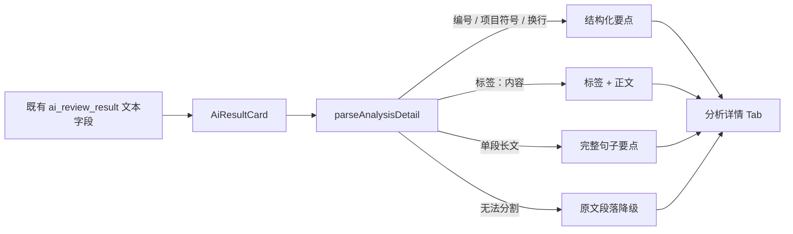

# 需求开发评审一致性平台 V1.36：分析详情结构化展示最终执行方案

## 1. 背景与目标
评审详情的 AI 分析卡已将“已实现内容、缺失内容、风险、建议测试点、AI 备注”分为 Tab，但每个 Tab 内仍直接输出一整段自由文本。评审者必须自行在长段落中找结论、行动项与边界，阅读效率低，也不符合代码评审平台应有的清晰、可扫描的呈现标准。

V1.36 在不改变现有 AI 评审数据契约的前提下，将各 Tab 内的自由文本安全拆为结构化段落与要点；保留 AI 原意、完整内容及历史数据兼容，令评审者先看到可扫描的结论单元。

## 2. 范围与非目标
- 包含：识别换行段落、项目符号、编号、中文/英文冒号标签和中文/英文句末分隔符，并渲染为层级化的要点列表或段落。
- 包含：为结构化内容增加仅作用于 AI 分析 Tab 的扫描样式、窄屏适配与长文本换行规则。
- 包含：为解析器补充纯逻辑单元测试，覆盖列表、标签、长段落、混合格式和空白输入。
- 不包含：修改数据库列、AI 提交 RPC、Excel 模板、Worker 提示词、模型输出格式或对历史数据回写。
- 不包含：对 AI 结论作语义改写、推断或删减；前端只重排原文字串。

## 3. 当前实现与问题
- `src/App.tsx` 中的 `AiResultCard` 将每个分析字段直接作为 `<Text>{section.value}</Text>` 放入 Tab Panel。
- `implemented_content`、`missing_content`、`risks`、`test_points`、`ai_remark` 是可空自由文本；Worker `submit_review_result` 只说明字段含义，没有固定 Markdown 或 JSON 契约。
- `src/App.css` 的 `.review-ai-tab-panel .ant-typography` 仅依赖 `white-space: pre-wrap`，一整段无换行的历史或模型结果仍是连续文本。

## 4. 需求与验收标准
1. 用户打开任一非空分析 Tab 时，显式项目符号、编号和换行段落必须以清晰的列表/分段呈现。
2. 单段长文本可按完整句末标点与分号拆为多个阅读要点；不得按逗号、代码路径、URL 或任意字符切断内容。
3. 形如“结论：内容”的单元应展示为标签加正文；标签仅用于视觉层级，不改写正文。
4. 原文无法可靠拆分时保留为单个段落；所有原文字串仍可见，不产生空白或丢失。
5. 结构化渲染不使用 `dangerouslySetInnerHTML`，不解析或执行 Markdown/HTML，避免模型文本成为脚本或样式输入。
6. 已有 Tab、结论色彩、空态和数据读取行为保持不变；无数据库、Worker、API 或权限变化。
7. 新增解析器测试，并通过版本一致性、前端类型检查、前端测试及构建。

## 5. 总体设计

解析器返回展示模型而非 HTML：每个 block 是段落或要点组，每个要点保留可选标签与原文正文。界面使用克制的左侧色条、序号/圆点与标签芯片形成阅读锚点；不强行制造表格，不为每句添加多余卡片。

## 6. 数据与接口设计
不涉及数据库、类型持久化、API/RPC、Worker、事件或配置变更。`AiReviewResult` 的现有五个自由文本字段继续原样读取；结构化模型仅在浏览器内即时计算，不写回数据库。

## 7. 前端与 Worker/运行时改造
- 新增 `src/lib/analysis-detail.ts`：规范化空白、识别项目符号/编号/标签、保守拆分句子并产出可测试的展示 block。
- 新增 `src/lib/__tests__/analysis-detail.test.ts`：验证常见和历史兼容输入，不依赖 React 渲染。
- `src/App.tsx`：`AiResultCard` 以安全 React 节点渲染解析后的段落和要点，不改变 Tab 数据源与顺序。
- `src/App.css`：在 `.review-ai-tab-panel` 范围内新增结构化内容样式、窄屏间距、标签和长词换行规则。
- Worker、DeepSeek Harness、Session、能力契约、权限和运行策略不涉及。

## 8. 安全、兼容与回滚
- 文本以 React 插值输出，不使用 HTML 注入；模型和历史文本均视为不可信展示数据。
- 保守解析无法识别的文本会保留为原文段落，避免历史分析详情空白或信息丢失。
- 本次仅改变浏览器展示。回滚只需回退解析器、`AiResultCard`、样式和版本常量；不需要数据库操作，绝不重置数据库。
- 历史自动分析、人工 Excel 导入、正在运行任务均继续使用同一字段，不需要重跑。

## 9. 实施步骤与文件范围
1. 新增可单测的分析详情解析器，定义 block/item 模型和保守降级规则。
2. 新增解析器单测，覆盖结构化与历史长段落输入。
3. 改造 `AiResultCard` 的 Tab 内容渲染，按 block 使用语义化列表与段落。
4. 增加隔离的结构化详情 CSS 与响应式规则。
5. 同步 `PRODUCT_VERSION` 为 `V1.36`，运行版本一致性、Web 类型检查、测试与生产构建。

主要文件：
- `src/lib/analysis-detail.ts`
- `src/lib/__tests__/analysis-detail.test.ts`
- `src/App.tsx`
- `src/App.css`
- `src/lib/product-version.ts`
- `需求开发评审一致性平台/V1.36-分析详情结构化展示/需求开发评审一致性平台-V1.36分析详情结构化展示-最终执行方案.md`

## 10. 验证结果
- 已新增 `src/lib/analysis-detail.ts`：将既有自由文本保守解析为段落或要点组，识别项目符号、编号、多行段落、完整中文句末/分号与“标签：正文”；URL、路径和无法可靠分割的文本保持原文，不使用 HTML/Markdown 注入。
- 已新增 `src/lib/__tests__/analysis-detail.test.ts`，覆盖显式列表与标签、历史长段落、空行分段、多行人工文本、URL/路径降级和空白输入，共 5 个用例。
- `AiResultCard` 已改用安全的语义化段落与列表渲染每个分析详情 Tab；原有数据读取、五个 Tab、结论色彩与空态均保持不变。`App.css` 增加局限在分析详情区域的项目单元、标签、长词换行与窄屏样式。
- 已将 `src/lib/product-version.ts` 更新为 `V1.36`。`npm run version:check -- "需求开发评审一致性平台/V1.36-分析详情结构化展示/需求开发评审一致性平台-V1.36分析详情结构化展示-最终执行方案.md"` 通过，输出文档版本和管理员展示版本均为 `V1.36`。
- 聚焦验证 `npx vitest run -c vitest.web.config.ts src/lib/__tests__/analysis-detail.test.ts` 通过（5/5）。
- `npm run web:typecheck` 通过。
- `npm run test:web` 通过：20 个测试文件、248 个用例全部通过。
- `npm run build` 通过，并确认 Harness manifest revision 3 / 34 tools 校验通过；构建仅输出既有的单个产物超过 500 kB 提示，未产生构建错误。
- 未进行线上发布或云端数据操作；本次不涉及数据库、Worker、Supabase 迁移或任何数据回写。
