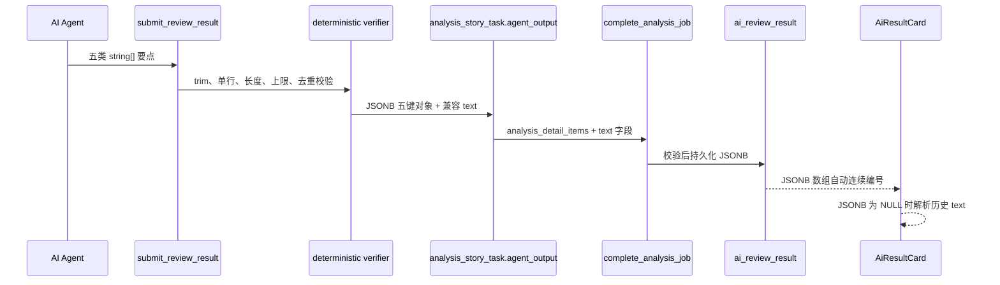

# 需求开发评审一致性平台 V1.37：AI分析详情结构化要点最终执行方案

## 1. 背景与目标
V1.36 在浏览器端按项目符号、换行和句末标点兼容拆分历史自由文本，但模型输出的 `1)`、全角空格和不规则缩进仍会让前端猜测结构，导致编号、空白和阅读层级不一致。

V1.37 将结构化责任前移：Agent 按五类结论提交单行要点数组，Worker 做确定性校验，最终化 RPC 持久化 JSONB，前端仅按数组自动编号。历史自动分析与 Excel/人工导入继续保留原 text 字段及 V1.36 安全降级，不回填或篡改历史行。

## 2. 范围与非目标
- 已包含：`ai_review_result.analysis_detail_items jsonb`、固定五键 DB 校验、最终化 RPC 写入、Harness/Worker 五数组契约、JSONB 优先前端渲染、版本同步和本地验证。
- 已包含：兼容旧五个 text 列；每类数组拼接为换行文本，保留现有读取和 Excel 兼容性。
- 不包含：回写历史行、变更 Excel 模板、改变评审结论、Evidence 校验、Agent 权限、模型调用次数或人工确认流程。

## 3. 原实现与本次落地
改造前，Agent 与最终化链路只传递 `implementedContent` 等五个自由文本字段，`complete_analysis_job` 也只写五个 text 列；浏览器始终调用 `parseAnalysisDetail` 对文本断句。

现在的实际链路如下：



## 4. 需求与验收标准
1. 自动分析通过 `implementedItems`、`missingItems`、`riskItems`、`testPointItems`、`remarkItems` 五个必填数组提交。
2. Worker 拒绝非数组、非字符串、空白、未 trim、含换行、超过 500 字、超过 12 项、重复、带编号或项目符号的要点，稳定错误码为 `ANALYSIS_DETAIL_ITEMS_INVALID`。
3. `analysis_detail_items` 的非空值只能是固定五键对象；五个值均为不超过 12 项的单行、trim、1–500 字、无重复字符串数组。历史/人工结果的 `NULL` 合法。
4. 最终化 RPC 只接受有效的结构化对象写入新自动分析；同一数组同时以 `\n` 拼接写入五个旧 text 列。
5. 前端 JSONB 非空时不做文本断句，仅用 CSS counter 连续编号；对意外写入的编号/项目符号只做防御性去除，不改变条目边界。
6. JSONB 为 `NULL` 时继续调用 V1.36 `parseAnalysisDetail`，保留历史与人工数据的安全显示。
7. 迁移、Worker、前端、版本同步和本地 Worker 验证均有实际执行记录。

## 5. 数据与接口设计
结构化对象使用数据库 snake_case 键：

```json
{
  "implemented_content": ["..."],
  "missing_content": [],
  "risks": ["..."],
  "test_points": ["..."],
  "ai_remark": []
}
```

- `public.ai_review_result.analysis_detail_items` 为可空 `jsonb`。
- `public.is_valid_analysis_detail_items(jsonb)` 负责固定键、数组类型、上限、字符串、trim、长度、换行及分类内去重校验。
- `ai_review_result_analysis_detail_items_check` 仅对非 `NULL` 值调用该校验函数。
- `public.complete_analysis_job(uuid,text,jsonb,jsonb)` 签名保持不变；逐条拒绝无效 JSONB（`ANALYSIS_DETAIL_ITEMS_INVALID`），并写入新列。
- 浏览器类型新增 `AnalysisDetailItems`，现有 `select('*')` 自动带回该列，无新增浏览器写接口。

## 6. Worker 与前端改造
- `worker/src/harness-plugins/review-control-tool/index.ts`：`submit_review_result` 的五个详情字段改为必填 array schema，并提示不得携带编号、项目符号或换行。
- `worker/src/ai/snapshot/deterministic-verifier.ts`：对五类数组执行确定性校验，并在成功结果中返回固定五键对象。
- `worker/src/index.ts`：从五数组生成 `analysisDetailItems`，同时用 `join('\n')` 生成旧 camelCase text 字段。
- `worker/src/pipeline/finalize-job.ts`：向 RPC 的 `p_results` 传递 `analysis_detail_items`。
- `src/types.ts`：`AiReviewResult` 增加 `analysis_detail_items: AnalysisDetailItems | null`。
- `src/App.tsx`：JSONB 存在时直接渲染结构化 `<ol>`；仅 `NULL` 调用自由文本解析器。
- `src/App.css`：仅结构化列表启用 CSS counter；历史降级列表保留 React 序号并用独立 class 区分。

## 7. 安全、兼容与回滚
- 模型文本在 Worker、数据库和 React 中均只作为字符串处理，不执行 Markdown、HTML 或脚本。
- 数据库与 Worker 双重校验；数据库仍允许 `NULL` 以兼容旧自动分析和人工/Excel 结果。
- 本次没有回写或删除任何历史数据，也没有 reset 数据库。
- 部署顺序必须为：先应用数据库迁移，再更新 Worker；在途旧 Session 不做静默转换。
- 如需回退，以新的前滚迁移或前端临时优先旧 text 列实现；不删除既有 JSONB 数据。

## 8. 实施文件
- `supabase/migrations/20260927144815_analysis_detail_structured_items.sql`
- `supabase/migrations/20260927145201_fix_analysis_detail_items_validator.sql`（前一迁移的 PostgreSQL 兼容性前滚修正）
- `supabase/tests/20260927144815_analysis_detail_structured_items_test.sql`
- `supabase/tests/20260927145201_fix_analysis_detail_items_validator_test.sql`
- `worker/src/harness-plugins/review-control-tool/index.ts`
- `worker/src/ai/snapshot/deterministic-verifier.ts`
- `worker/src/index.ts`
- `worker/src/pipeline/finalize-job.ts`
- `worker/src/__tests__/snapshot-and-broker.test.ts`
- `worker/src/__tests__/finalize.test.ts`
- `worker/src/__tests__/v4-broker-authority.test.ts`
- `worker/src/__tests__/worker-engine-dispatch.test.ts`
- `src/types.ts`
- `src/lib/analysis-detail.ts`
- `src/lib/__tests__/analysis-detail.test.ts`
- `src/App.tsx`
- `src/App.css`
- `src/lib/product-version.ts`

## 9. 实际验证结果
- 已执行 `npm run db:backup:local`，本地备份已生成。
- 已执行 `supabase migration up --local`，两条 V1.37 迁移已应用；`supabase migration list --local` 显示 `20260927144815` 与 `20260927145201` 均为本地已应用。
- 已执行两份事务 SQL 测试：
  - `20260927144815_analysis_detail_structured_items_test.sql` 通过。
  - `20260927145201_fix_analysis_detail_items_validator_test.sql` 通过。
- 已执行 `npm run worker:typecheck`、`npm run worker:build`，均通过。
- 已执行 `npm run test:worker`：1035 通过、32 跳过、0 失败；包含结构化提交、最终化 payload 及 V4 Broker fixture 回归。
- 已执行 `npm run web:typecheck`、`npm run test:web`（250 通过）和 `npm run build`，均通过。
- 已执行 `npm run lint`：无错误；仅保留既有 React Hook/Fast Refresh 警告。
- 已执行 `npm run version:check -- "需求开发评审一致性平台/V1.37-AI分析详情结构化要点/需求开发评审一致性平台-V1.37AI分析详情结构化要点-最终执行方案.md"`，`PRODUCT_VERSION` 与文档均为 `V1.37`。
- 已重建 `codereviewplatform-worker:latest`，使用 `.docker/worker.local.env` 重建 1 个本地 Worker。容器为 `Up`，日志含 `worker_started`，drain sentinel 已解除。
- 未执行云端数据库推送、Edge Function 部署或云端配置 Worker 更新；未为了验证创建新的真实 AI 分析任务。
