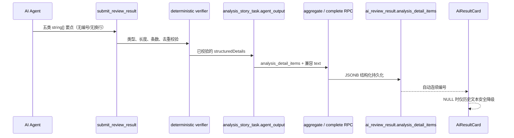

# 需求开发评审一致性平台 V1.37：AI分析详情结构化要点最终执行方案

## 1. 背景与目标
V1.36 在浏览器端将历史自由文本按项目符号、换行和句末标点做兼容性拆分，但截图表明这不能成为结果质量的事实来源：模型原始输出中的 `1)`、全角空格和不规则缩进会残留，前端不得不猜测文本结构，因而出现重复编号、空白错位和阅读层级不一致。

V1.37 将结构化责任前移到 Agent 输出契约：模型按五类结论提交单行要点数组，Worker 做确定性校验，最终化 RPC 持久化 JSONB，前端只按数组统一编号。既有自动分析和 Excel 导入结果没有结构化列时，继续使用 V1.36 的安全文本降级，不回填或篡改历史数据。

## 2. 范围与非目标
- 包含：为 `ai_review_result` 新增可空 `analysis_detail_items jsonb`，其对象固定包含 `implemented_content`、`missing_content`、`risks`、`test_points`、`ai_remark` 五个数组。
- 包含：扩展 Harness `submit_review_result` 输入为五个结构化 `string[]` 字段；Worker 要求每条要点为已 trim、无换行、1–500 字、每分类最多 12 条且无重复的文本。
- 包含：最终化时同时写入 JSONB 单一结构化来源，并由数组以换行拼接兼容既有五个 `text` 列。
- 包含：前端优先渲染 JSONB 数组、统一自动连续编号；`NULL` 的历史/人工结果使用原自由文本解析降级。
- 不包含：回写历史行、变更 Excel 模板、改变评审结论、Evidence 校验、Agent 权限、模型调用次数或人工确认流程。

## 3. 当前实现与问题
- `ReviewSubmission`、Harness schema 与 `toAgentResultRow` 只承载 `implementedContent` 等五个自由 `string` 字段。
- `aggregateCompletedResults` 将这些字符串传给 `complete_analysis_job`；该 RPC 只写 `ai_review_result` 的五个 `text` 列。
- V1.36 的 `parseAnalysisDetail` 只是一层历史兼容显示逻辑，截图中的 `1)` 和全角空格证明前端无法可靠判断模型意图。

## 4. 需求与验收标准
1. 后续自动分析必须通过 `implementedItems`、`missingItems`、`riskItems`、`testPointItems`、`remarkItems` 提交数组，而不能依赖自由文本段落组织。
2. 每一个结构化要点必须是非空单行字符串，去除首尾空白后 1–500 字；同分类最多 12 条，不允许重复。违反时 Worker 返回稳定的 `ANALYSIS_DETAIL_ITEMS_INVALID`，不提交结果。
3. `ai_review_result.analysis_detail_items` 只接受固定五键、五个数组、上述单行要点与每类上限；历史 `NULL` 合法。`complete_analysis_job` 将最终化 JSON 的该字段写入结果行。
4. 新自动分析的 JSONB 每类均存在（允许空数组）；旧 `text` 列由相同数组用 `\n` 拼接，保证现有 Excel/读取兼容。
5. 前端对结构化数组只渲染界面自动编号 `1…N`，不再显示 AI 提供的编号、列表符号或原始缩进；不使用文本断句。
6. `analysis_detail_items is NULL` 时继续调用 V1.36 安全解析器，历史和人工数据不丢失。
7. 迁移具备同名事务 SQL 测试；Worker、前端、版本一致性和本地 Supabase 验证实际通过。

## 5. 总体设计


数据对象采用与旧列相同的 snake_case key，降低最终化 JSON 与数据库边界的翻译风险：

```json
{
  "implemented_content": ["..."],
  "missing_content": [],
  "risks": ["..."],
  "test_points": ["..."],
  "ai_remark": []
}
```

## 6. 数据与接口设计
- 新增 `public.ai_review_result.analysis_detail_items jsonb`，允许 `NULL`（历史/人工），非空时强制精确五键、值均为数组、每项单行 trim 文本且每数组不超过 12 项。
- 新迁移以 `CREATE OR REPLACE FUNCTION public.complete_analysis_job(uuid,text,jsonb,jsonb)` 覆盖最终化函数，插入结果时写 `analysis_detail_items`；函数签名不变，现有 service-role 授权不变。
- Harness / Worker 对外采用 camelCase `implementedItems`、`missingItems`、`riskItems`、`testPointItems`、`remarkItems`；finalizer 转为 DB snake_case 对象。
- `AiReviewResult` 增加 `analysis_detail_items: AnalysisDetailItems | null`；现有查询使用 `select('*')`，无新增浏览器写接口。

## 7. 前端与 Worker/运行时改造
- `worker/src/harness-plugins/review-control-tool/index.ts`：新增五个 array schema 字段并明确“不要自带序号、项目符号或换行”。
- `worker/src/ai/snapshot/deterministic-verifier.ts`：标准化并校验结构化数组，返回稳定错误码；不合格输出不能进入任务结果。
- `worker/src/index.ts`、`worker/src/pipeline/finalize-job.ts`：在 task output 与完成 RPC 参数中安全传递 `analysis_detail_items`，并从数组生成旧 text 兼容值。
- `src/App.tsx`：新结构化数据直接渲染统一 `ol`；仅 `NULL` 回退 V1.36 parser。
- `src/App.css`：结构化列表用 CSS counter 提供唯一连续编号；历史降级样式保持可区分。

## 8. 安全、兼容与回滚
- Agent 文字仍作为不可信数据，Worker / DB / React 三层均不执行 Markdown 或 HTML；仅持久化和插值字符串。
- 旧自动分析与人工 Excel 行的 JSONB 为 `NULL`；前端安全降级，不写回、不删除、不伪造结构化结论。
- 新校验只影响之后的 Agent 提交；在途旧 Session 不应因字段缺失被静默转换，部署时应先完成数据库迁移再重建 Worker。
- 回滚以新的前滚迁移或前端优先旧列实现，不删除 JSONB 数据，绝不 reset 数据库。

## 9. 实施步骤与文件范围
1. 新建秒级 UTC 命名、可重复应用的迁移及同名 SQL 测试，添加 JSONB 列、约束函数并覆盖最终化 RPC。
2. 扩展 Harness schema、verifier、Agent task output、finalizer、Worker 测试与 DB RPC payload 测试。
3. 前端类型与分析详情组件优先读取 JSONB，统一 CSS counter 编号，保留 V1.36 纯文本兼容分支。
4. 本地执行数据库备份、`supabase migration up --local`、迁移 SQL 测试、Worker 类型检查/测试/构建；确认本地 Worker 无在途任务后重建 1 个副本并完成本地验证。
5. 同步 `PRODUCT_VERSION` 为 `V1.37`，运行版本一致性、前端检查、测试与构建。

主要文件：
- `supabase/migrations/<UTC>_analysis_detail_structured_items.sql`
- `supabase/tests/<UTC>_analysis_detail_structured_items_test.sql`
- `worker/src/harness-plugins/review-control-tool/index.ts`
- `worker/src/ai/snapshot/deterministic-verifier.ts`
- `worker/src/index.ts`
- `worker/src/pipeline/finalize-job.ts`
- `worker/src/__tests__/snapshot-and-broker.test.ts`
- `worker/src/__tests__/finalize.test.ts`
- `src/types.ts`
- `src/App.tsx`
- `src/App.css`
- `src/lib/product-version.ts`

## 10. 验证结果
待实现后补充实际执行的数据库迁移、SQL 测试、Worker/前端检查、本地 Worker 与版本一致性验证结果。
