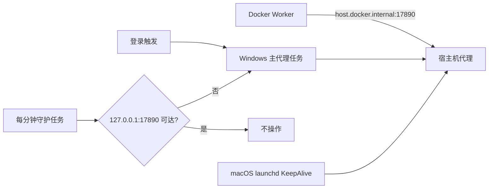

# 需求开发评审一致性平台 V1.38：跨平台代理守护最终执行方案

## 1. 背景与目标

运行 Worker 的 Windows 宿主机上，模型 / Linky 共用代理进程曾被外部终止（`0xc000013a`）后未恢复。原计划任务只有“用户登录”触发；代理正常退出或被中断后，任务进入 `Ready`，仅依赖“失败时重启”无法再次拉起，Worker 因而报 `LINKY_PROXY_UNREACHABLE`。

本次目标是在同一仓库中交付 macOS 与 Windows 兼容的代理守护安装器：macOS 保持 launchd `KeepAlive`，Windows 增加独立的分钟级端口健康任务。运行机拉取代码并重新安装后，代理端口 `127.0.0.1:17890` 不可达时会自动重新启动主代理任务。

## 2. 范围与非目标

包含：1

- 扩展 `scripts/model-vpn-proxy-service.mjs` 生成的 Windows 计划任务；
- 每分钟检测本机 TCP `127.0.0.1:17890`，仅在不可达时启动主代理任务；
- 保留原有登录触发、单实例限制、启动失败重试、代理认证与私有配置目录；
- 让卸载命令同时停用守护任务；
- 更新测试和运维说明。

不包含：

- 不改代理协议、端口、凭据、Worker 网络路由或数据库；
- 不把 Windows 当前用户登录任务改成无人登录的系统服务；
- 不执行任何云端部署、数据库操作或远程运行机操作。

## 3. 当前实现与问题

`scripts/model-vpn-proxy-service.mjs` 会按操作系统注册服务：macOS 使用 launchd 的 `KeepAlive`；Windows 注册 `codereviewplatform-model-vpn-proxy`，其触发器只有 `AtLogOn`。主任务设置了 `RestartCount`，但外部中断可表现为非失败完成，计划任务不会重新触发。

主代理仅监听 `127.0.0.1:17890`，Docker Worker 经 `host.docker.internal:17890` 访问；因此端口连通性是安全且准确的本机健康判据。

## 4. 需求与验收标准

1. macOS 与 Windows 必须仍由同一个 `npm run proxy:model-vpn:install` 安装入口支持。
2. Windows 重装后必须存在主代理任务和独立守护任务；守护任务以一分钟为周期运行。
3. 守护任务必须先检查 `127.0.0.1:17890`：可达时不启动任何新实例，不可达时启动主代理任务。
4. 同时触发不得并发启动代理，主任务继续使用 `MultipleInstances=IgnoreNew`。
5. `npm run proxy:model-vpn:uninstall` 必须停用主任务、旧任务及新增守护任务。
6. macOS launchd 的 `KeepAlive` 行为不可回退。
7. 自动化测试必须覆盖 Windows 任务脚本中的端口检查、分钟周期、幂等启动与卸载范围。

## 5. 总体设计

Windows 使用两个同一用户的计划任务：主任务只运行 Node 代理并保持单实例；守护任务是短生命周期 PowerShell 检查，不携带凭据。健康检查成功时立即退出；失败时只调用 `Start-ScheduledTask` 启动主任务。主任务仍是唯一持有代理进程的任务，避免重复代理与孤儿子进程。

## 6. 数据与接口设计

不涉及数据库、Supabase migration、RPC、RLS、Edge Function 或外部 API 变更。代理配置 JSON 结构、`.docker/worker.env` 中的连接地址和现有凭据保持不变。

## 7. 前端与 Worker/运行时改造

不涉及前端页面和 Worker 镜像代码。修改宿主机代理安装脚本及其测试；Worker 继续访问既有 `MODEL_CONNECTIVITY_PROXY_URL`。

## 8. 安全、兼容与回滚

- 健康任务只探测 loopback TCP 端口，不发送代理凭据或业务请求。
- 守护脚本不输出配置、认证信息、请求内容或日志正文。
- 两个任务均以运行 Worker 的当前用户注册，注销后仍不保证运行；这是既有部署边界。
- Windows 若需回滚，可在运行机执行 `npm run proxy:model-vpn:uninstall` 停用新旧任务，再部署此前版本的代码并执行旧安装命令。macOS 不受 Windows 守护任务影响。

## 9. 实施结果与文件范围

1. `scripts/model-vpn-proxy-service.mjs` 新增固定任务 `codereviewplatform-model-vpn-proxy-watchdog`，以一分钟周期运行短生命周期 PowerShell 守护脚本。脚本只使用 `Test-NetConnection` 探测 `127.0.0.1:<配置端口>`；端口不可达时，主任务仍为 `Running` 则先停止、等待两秒后重新启动，否则直接启动。主任务仍保留登录触发、失败重试与 `MultipleInstances=IgnoreNew`。
2. Windows 重装会替换主任务与守护任务；卸载会停用主任务、守护任务和已知旧任务。macOS 的 launchd `KeepAlive` 配置未改动。
3. `scripts/model-vpn-proxy-service.test.mjs` 增加守护任务周期、端口检查、停止 / 启动和非法端口的单测断言。
4. `README.md` 与 `worker/OPERATIONS.md` 说明两端守护差异、Windows 的最长一分钟恢复窗口及运行机重新安装命令。
5. `src/lib/product-version.ts` 已同步为 `V1.38`。

实际修改文件：

- `scripts/model-vpn-proxy-service.mjs`
- `scripts/model-vpn-proxy-service.test.mjs`
- `README.md`
- `worker/OPERATIONS.md`
- `src/lib/product-version.ts`
- `需求开发评审一致性平台/V1.38-跨平台代理守护/需求开发评审一致性平台-V1.38跨平台代理守护-最终执行方案.md`

## 10. 验证结果

已实际执行并通过：

- `npx vitest run scripts/model-vpn-proxy-service.test.mjs`：6/6 通过；
- `npm run worker:typecheck`；
- `npm run worker:build`：Harness manifest revision 3、34 个工具校验通过；
- `npm run test:worker`：59 个测试文件通过、13 个既有跳过；1,035 个测试通过、32 个既有跳过；
- `npm run web:typecheck`；
- `npm run build`；
- `npm run lint`：退出成功；仅报告既有 React Hook / Fast Refresh 警告，未涉及本次文件；
- 本地 Supabase 已运行。本地 Docker Worker 在确认最近排空记录 `active_attempts: 0` 后，以 `--build --force-recreate --scale worker=1` 完成重建；容器状态为 `Up`，日志出现 `worker_started`、`linky_import_enabled`、`code_qa_enabled`；
- `npm run version:check -- "需求开发评审一致性平台/V1.38-跨平台代理守护/需求开发评审一致性平台-V1.38跨平台代理守护-最终执行方案.md"`：文档与管理员展示版本均为 `V1.38`；
- `git diff --check`：通过。

未在本开发机执行：Windows 计划任务注册与实际杀进程后的分钟级恢复测试，因为代理运行机不在本机。运行机拉取并安装后，按 README 的 Windows 日志路径确认 `proxy_started`；随后停止代理进程，等待最多一分钟，确认任务重新启动且 `127.0.0.1:17890` 恢复监听。
