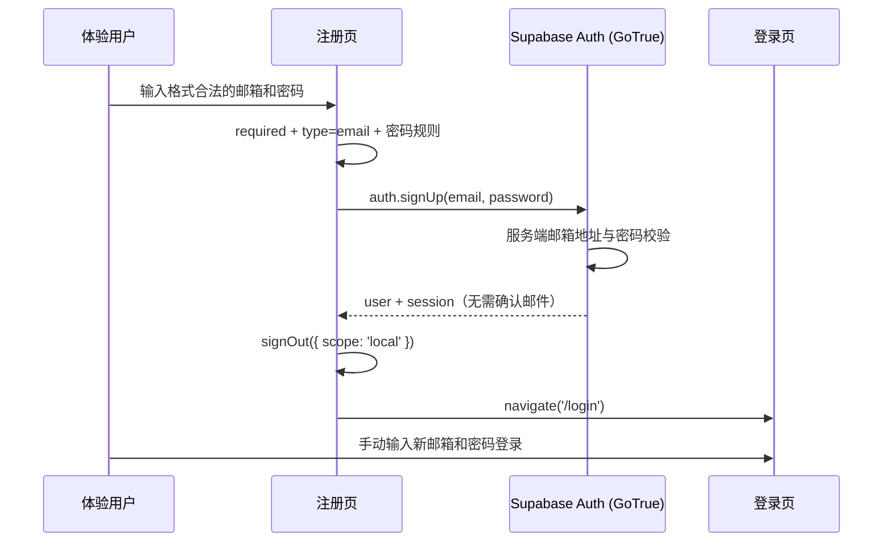

# 需求开发评审一致性平台 V1.39：临时关闭注册邮箱验证最终执行方案

## 1. 背景与目标

体验阶段不应因邮件服务额度、送达或 SMTP 故障阻断新用户使用。此前 Supabase Auth 要求新注册用户点击验证邮件后才能登录。

本次将注册策略临时调整为：保留邮箱地址格式校验和 Supabase Auth 的服务端邮箱地址校验；不发送、不等待注册确认邮件；账号创建成功后仍回到登录页，由用户手动输入新密码登录。

## 2. 范围与非目标

**本次包含：**

- 将本地 Supabase Auth 的邮箱注册确认开关设为关闭；
- 前端在 `signUp()` 返回自动会话时仅清除当前浏览器会话并导航到登录页；
- 保留注册页 Ant Design `type: 'email'` 规则、密码规则，以及 GoTrue 服务端邮箱合法性校验；
- 新增前端单元测试，固定“注册响应带 session 时不需要邮箱确认”的客户端契约；
- 将管理员“查看当前版本”同步为 `V1.39`。

**本次不包含：**

- 不删除或修改任何现有用户、角色、审计数据、迁移、RPC、RLS 或 Storage 策略；
- 不放宽为任意字符串邮箱，也不验证邮箱实际归属或可投递性；
- 不修改密码重置、改邮箱确认、微信登录或已有待验证账号的状态；
- 不改 Worker、镜像、Edge Function 或邮件服务供应商配置。

## 3. 当前实现与问题

`supabase/config.toml` 的 `[auth.email] enable_confirmations = true` 使本地 GoTrue 在 `auth.signUp()` 后不返回会话，而是发送确认邮件。云端同一设置也必须关闭才会生效。

`src/App.tsx` 的注册表单已有 `required + type: 'email'` 校验，`src/lib/api.ts` 的 `signUp()` 已通过 `data.session` 计算 `needsEmailConfirmation`，因此兼容 GoTrue 关闭确认后直接返回会话的响应。App 在 session 存在时会无条件渲染 `Shell`，所以注册页必须先通过 `clearLocalAuthSession()` 调用 GoTrue 的 `{ scope: 'local' }` 登出清除浏览器会话，再导航 `/login`；否则仅改 URL 仍会被自动带进工作台。

旧的待验证账号仍会受 `auth.users.email_confirmed_at` 约束；这是历史状态，不能被关闭开关自动修复。管理员可继续使用 V1.24 的受审计“标记已验证”功能处理已核实的历史账号。

## 4. 需求与验收标准

| 编号 | 要求 | 验证方式 |
|---|---|---|
| F1 | 新注册时 GoTrue 不要求点击验证邮件，注册响应直接带会话 | 本地 Auth 冒烟测试 |
| F2 | 注册响应带会话时，前端清除当前浏览器会话并导航 `/login`，用户手动登录后才进入工作台 | 单元测试 + 代码审查 + 构建 |
| F3 | 注册页仍拒绝格式不合法的邮箱 | `src/App.tsx` 的 `type: 'email'` 规则审查 + 前端类型检查 |
| F4 | API 适配层将有会话/无会话分别映射为 `needsEmailConfirmation=false/true` | Vitest 单元测试 |
| F5 | 管理员展示版本与最终执行方案均为 `V1.39` | `npm run version:check` |

## 5. 总体设计

确认关闭只影响“新注册后能否立即建立会话”。注册页会立即清除该浏览器会话以恢复登录页流程；浏览器表单和 GoTrue 保持各自的格式校验职责，两者都不是邮箱归属验证，也不能证明邮箱可收信。

## 6. 数据与接口设计

不涉及数据库结构、迁移、RPC、RLS、触发器、Storage 或 Edge Function。

`src/lib/api.ts` 现有接口保持不变：`signUp(email, password)` 仍返回 `SignUpResult`，其中 `needsEmailConfirmation` 严格取反于 `data.session`。本次仅新增该接口的测试覆盖，不改变调用参数、返回类型或授权边界。

本地配置变更位于 `supabase/config.toml`：`[auth.email].enable_confirmations = false`。云端设置不由数据库迁移承载，且该文件声明了仅本地适用的 `site_url`；因此发布人必须在 Supabase Dashboard 的 **Authentication → Providers → Email** 中单独关闭 **Confirm email**，不得直接执行整份 `supabase config push` 覆盖云端其它 Auth 设置。

## 7. 前端与 Worker/运行时改造

- `src/App.tsx`：保留注册表单邮箱格式规则；在 `needsEmailConfirmation` 为 `false` 时清除本浏览器自动会话、提示注册成功并跳转 `/login`。
- `src/lib/api.ts`：新增 `clearLocalAuthSession()`，仅以 GoTrue `{ scope: 'local' }` 清除当前浏览器会话，不删除账号、不影响其他设备。
- `src/lib/__tests__/auth-registration.test.ts`：mock `requireSupabase()`，断言 `signUp()` 会提交邮箱和密码；有 `session` 时返回无需确认，无 `session` 时保留兼容分支，并断言自动会话使用 local scope 清除。
- `supabase/config.toml`：关闭本地邮箱确认，且同步注释为本版本的体验策略。
- `src/lib/product-version.ts`：唯一展示常量改为 `V1.39`。

不涉及 Worker、DSH、模型、Worker 配置、镜像、Session 续跑或工具能力。

## 8. 安全、兼容与回滚

- 安全取舍：关闭邮箱归属确认后，用户可使用格式正确但不属于自己的邮箱创建可登录账号；这符合体验期降低邮件依赖的目标，但不适合把邮箱归属当作身份或敏感操作凭据的场景。
- 保留防线：GoTrue 继续校验邮箱格式、密码策略和重复账号规则；前端继续做即时格式校验；数据库角色/RLS 不变。
- 兼容：`SignUpResult.needsEmailConfirmation` 和旧确认页面保留，以兼容配置尚未同步、将来重新开启确认、以及历史待验证账号的表现；关闭确认时新增的 local sign-out 仅影响本浏览器，不改账号状态。
- 历史待验证账号：不会自动变为已验证。管理员仅在核实真实归属后，使用现有受审计 V1.24 功能标记确认。
- 回滚：在本地先将 `enable_confirmations` 前滚恢复为 `true` 并验证；再在 Supabase Dashboard 的 **Authentication → Providers → Email** 重新开启 **Confirm email**。无需删除用户或回滚数据库。

## 9. 实施步骤与文件范围

1. 已创建本最终执行方案，记录开关边界、历史账号兼容策略和验收条件；
2. 已修改 `supabase/config.toml`，将本地 `[auth.email].enable_confirmations` 设为 `false`；
3. 已修改 `src/lib/api.ts` 与 `src/App.tsx`：关闭确认后注册成功时仅清除本浏览器自动会话，再跳转 `/login`；
4. 已新增并扩展 `src/lib/__tests__/auth-registration.test.ts`，测试 API 适配层的两种会话响应及 local-scope 会话清除；
5. 已更新 `src/lib/product-version.ts` 为 `V1.39`；
6. 已备份本地数据库、重启本地 Supabase（未重置）并完成本地 Auth 注册/登录烟测；
7. 已执行前端测试、类型检查、构建、lint、版本同步和差异检查，结果见下一节。

主要文件：

- `supabase/config.toml`（修改）
- `src/lib/api.ts`（修改）
- `src/App.tsx`（修改）
- `src/lib/__tests__/auth-registration.test.ts`（新增）
- `src/lib/product-version.ts`（修改）
- `需求开发评审一致性平台/V1.39-临时关闭注册邮箱验证/需求开发评审一致性平台-V1.39临时关闭注册邮箱验证-最终执行方案.md`（新增）

## 10. 验证结果

### 10.1 已通过（2026-09-28，本地）

- `npm run db:backup:local`：已备份到 `.local-db-backups/local-20260928-120622.sql`；
- `supabase stop && supabase start`：本地服务已安全重启并从现有数据卷恢复，未执行 reset、未删除卷；
- 本地 Auth 烟测：一次性 `@example.test` 邮箱注册响应同时带 `access_token` 和 `refresh_token`，随后密码登录返回同一用户会话；仅该测试账号已从本地 `auth.users` 精确删除；
- `npm run test:web`：21 个测试文件、253 个测试全部通过；新增的第三个 `auth-registration.test.ts` 用例断言注册页将自动 session 以 `{ scope: 'local' }` 清除；
- `npm run web:typecheck`：通过；
- `npm run build`：通过；Harness manifest revision 3 / 34 tools 校验通过。Vite 仅报告既有大 chunk 提示；
- `npm run lint`：0 errors；存在 10 个未由本次改动引入的 React 规则 warnings；
- `npm run version:check -- "需求开发评审一致性平台/V1.39-临时关闭注册邮箱验证/需求开发评审一致性平台-V1.39临时关闭注册邮箱验证-最终执行方案.md"`：文档与产品展示版本均为 `V1.39`，通过；
- `git diff --check`：通过。

### 10.2 未执行

- 未执行云端 Supabase 配置写入、`supabase db push`、Edge Function 部署、Worker 镜像构建或 Worker 更新；
- 未做人工浏览器点击烟测；本地 GoTrue 真实注册与密码登录烟测、前端构建和 API 契约测试已覆盖核心链路。

## 11. 手动发布清单

1. 提交本次代码；
2. 在 Supabase Dashboard 打开目标项目，进入 **Authentication → Providers → Email**，关闭 **Confirm email** 并保存；请核对该项目为生产/体验目标项目，避免修改错误环境；
3. 以新的体验邮箱注册：应不收到注册确认邮件且回到登录页；手动输入新邮箱和密码后应进入工作台；
4. 如需恢复，重新开启同一页的 **Confirm email**；历史待验证账号不受开关自动补偿，仍按 V1.24 的管理员受审计流程处理。
