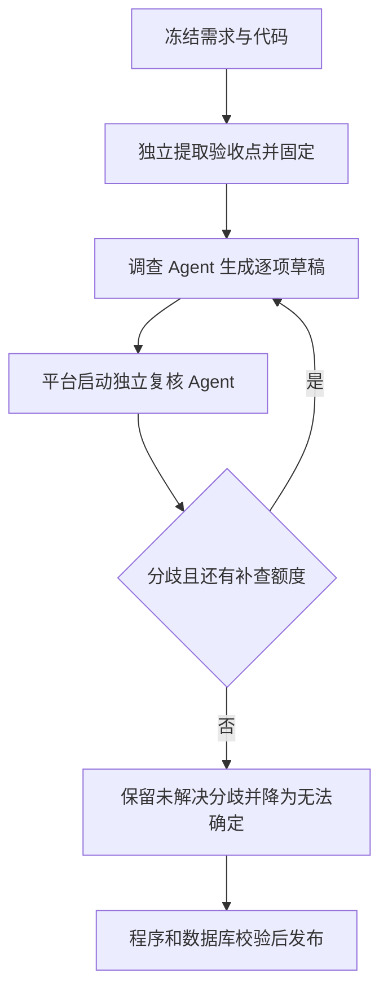

# 需求开发评审一致性平台 V1.43：验收点评审与独立复核最终执行方案

## 1. 背景与目标
用户反馈评审结论错误。当前由主 Agent 自主理解需求、调查及决定是否交叉审查；程序校验引用和提交条件，不能证明业务判断正确。本次实现固定验收点、逐项结论/证据绑定、平台必经的独立复核，并替换评审详情中的旧分类页签。

## 2. 范围与非目标
- 包含：需求标题/正文/详情/冻结附件的 AI 验收点提取；固定清单；逐项评审；需求相关 Bug/漏改/隐患；独立复核和最多一轮定向补查；分歧展示；Worker、数据库、详情页、本地验证。
- 继续使用 DSH；调查与复核由平台驱动独立会话，各自可按冻结权限和预算委派子 Agent。
- 不提交/推送代码，不修改云端数据库、Functions 或云端配置 Worker。
- 历史报告不伪造验收点；保持原数据可追溯，详情提示重新分析以生成新报告。

## 3. 当前实现与问题
- `worker/src/index.ts` → `ai/runtime/factory.ts` → `DeepSeekHarnessAcpEngine`。
- `requirement-snapshot.ts` 透传已有验收标准，没有 AI 提取固定清单。
- `ReviewSubmission` 有总体判断和分类数组，没有 criterionId 与证据绑定。
- `attempt-control-broker.ts` 强制候选核实完成、证据来源和覆盖检查，主 Agent 可选 fork 复核。
- `src/App.tsx` 按五个分类展示分析详情，独立展示三种证据页签。

## 4. 需求与验收标准
1. 验收点在调查前由 AI 提取，具有固定 ID、需求描述和可核实的原文出处；后续阶段不得静默改动清单。
2. 提交必须覆盖清单中的每个 ID，拒绝漏项、重复 ID、未知 ID、无效证据及实现结论缺少证据。
3. 调查只提交草稿，不消耗 task claim、不发布 ai_review_result。
4. 平台启动独立复核会话，提供原始材料、固定版本和草稿；复核可重新检索，所有结论引用经过验证的代码证据。
5. 有分歧则最多补查一轮，并再次独立复核；仍有分歧的验收点变为 UNCERTAIN，保留双方结论/依据。
6. 最终写入必须同时经过数据库阶段门禁与原有 claim/session/policy/scope/证据门禁。失败、取消、旧 Worker 或跳过复核不得发布新流程报告。
7. 风险记录触发条件、影响、证据、确定程度和归因；复核分歧不可静默丢弃。
8. 详情展示“验收点—评审结论—依据”和风险项，移除五个旧分析分类和三种独立证据分类页签。历史数据明确标为旧报告。

## 5. 总体设计

平台持有全程阶段状态、共享预算、身份与证据台账。阶段切换回收旧 DSH 进程、关闭该阶段节点准入，创建独立根身份/会话；复核不是调查 Agent 自主选择的子任务。

## 6. 数据与接口设计
- 新增迁移 `supabase/migrations/20261004182525_acceptance_review_workflow.sql`，只追加迁移。
- 云端发布发现既有 `complete_analysis_job` 函数体使用 CRLF；新增 `20261005031406_acceptance_review_crlf_compat.sql`，只将该函数源码的 CRLF 统一为 LF。原迁移不改。先在云端 SQL 编辑器手动执行此幂等兼容脚本，再重试 `db push`；CLI 会按正常顺序登记原功能迁移和兼容迁移。
- 保存固定验收点、阶段根身份、草稿与复核结果、补查次数和最终报告；新报告持久化到 `ai_review_result`，经既有批次权限读取。
- 已落地 `analysis_review_phase`、`begin_analysis_review_phase`、`save_analysis_review_phase`。新作业冻结 `review_workflow_version=1`；迁移前作业保持 0。准备、任务领取和最终汇总三个入口都根据 heartbeat 能力排除旧 Worker。
- `ai_review_result.acceptance_review` 保存逐项报告，`ai_code_evidence.evidence_id` 保持逐项绑定。最终汇总必须与任务已经提交的报告一致，不能另造结论。
- 阶段状态只能通过 service-role 且校验 task claim 的 RPC 写入；不得由模型/浏览器提供阶段身份或绕过最终门禁。
- 复用 profile-local 提交工具，扩展阶段输出 schema；由 Broker 根据平台状态决定接受阶段结果还是最终写入。

## 7. 前端与 Worker/运行时改造
- 提取器从允许的冻结文本中引用原文，不根据已有实现反推验收点。平台发现未取得、不可读（含图片）或截断的附件，以及全量需求快照生成失败时，会增加材料缺口来源；提取必须覆盖这些来源并标 `needsClarification=true`，后续结论强制 `UNCERTAIN`。当前仍是文本提取，未新增 OCR/图像验收，PDF/Office 的图形、批注等不在文本视图中。
- 复核使用新根身份与上下文，重新阅读证据；支持受控委派，共用总预算。
- 确定性契约校验及分歧处理放在可单测模块；DSH 只执行阶段任务，阶段推进由 Worker 控制。
- `ReviewWorkflowCoordinator` 已实现原文引用验证、固定清单覆盖、最多一轮补查和分歧保留。阶段提交只有成功持久化后才确认；重叠提交被拒绝。
- 复核必须使用自己的代码读取回执和检索覆盖记录；原调查记录不能替代独立复核取证。预留两次复核根节点名额，子 Agent 不能占用；冻结策略小于 3 个 Agent 时提前报明确信息。
- 沿用已有 Ant Design 与页面颜色；验收点表为主体，风险为独立列表，代码位置在对应条目内展开；小屏改用可读的逐项布局。
- `AcceptanceReviewCard` 已替换旧分析和独立证据分类页签。来源原文、代码位置、双方分歧都在对应条目展开；旧报告保留历史查看入口，不生成虚构验收点。

## 8. 安全、兼容与回滚
- 原有租约、取消、证据 hash、只读固定快照、根提交权与预算约束继续有效。
- 新流程版本冻结到新作业；旧作业和历史结果明确区分。
- 阶段状态/会话恢复必须对应当前流程版本；不能拿旧单阶段 checkpoint 当作已复核结果。
- 当前版本 1 作业不读取或写入旧单阶段 checkpoint；重启后的新 attempt 重新执行完整流程，阶段记录按 run 留存审计。版本 0 作业继续原恢复路径。阶段中断续跑尚未实现，不能将数据库保存的草稿称为可恢复的 DSH 会话。
- 回滚仅允许排空后切换代码，迁移保留；新流程任务不得交给旧 Worker 发布未复核结果。

## 9. 实施步骤与文件范围
1. 定义验收点/风险/复核契约、原文出处校验、覆盖校验和有限补查状态机及测试。
2. 添加数据库阶段状态、平级根身份授权和最终提交门禁及 SQL 测试。
3. 扩展 Broker、提交工具、DSH 平台阶段编排、prompts、Worker DB/API 映射。
4. 替换详情展示并同步产品版本。
5. 验证静态检查、Worker/前端回归、真实 DSH 脚本模型、本地 SQL 幂等/从零应用、本地 Worker 与登录后桌面/移动端。

## 10. 验证结果与手动发布

### 本地已验证
- 前端：`npm run build`、`npm run web:typecheck`、`npm run test:web` 通过；22 个文件、256 项测试。产品版本已同步为 V1.43，`version:check` 通过。
- Worker：`npm run worker:build`、`npm run worker:typecheck`、`npm run test:worker` 通过；61 个文件、1061 项通过，35 项需显式启用的集成测试默认跳过。
- 独立启动的真实 DSH/ACP 子进程测试通过：`RUN_ACP_INTEGRATION=1 ... -t 'V1.43 platform phases'`，复核证据 ID 与调查不同，只有平台最终提交。
- `RUN_V143_LOCAL_E2E=1` 的真实本地数据库 + factory + DSH + Broker + 最终汇总测试 2 项通过：正常一致路径为 3 个阶段/2 个根；补查后仍有分歧为 5 个阶段/3 个根，最终只发布一份报告，保留双方依据并降为 `UNCERTAIN`。同时校验风险和 evidence_id 的数据库保存。
- 最新 `codereviewplatform-worker:latest` 镜像内，以非 root Worker 用户运行同一组合测试，2 项通过。本地 Compose 项目 `codereviewplatform-local` 为 1 个 Up Worker，日志出现 `worker_started`，heartbeat 宣告 `acceptanceReviewWorkflowVersion=1`，容器到本地 Supabase 健康接口返回 200。测试 PostgreSQL 客户端只安装在随后删除的临时测试容器，未修改 Worker 镜像依赖。
- 旧版本 0 流程的本地数据库准备及完整 DSH 评审回归 2 项通过。修正测试夹具对已有 Vault pepper、现有 5 仓库白名单和现有结构化提交 schema 的旧假设；夹具及密码替换均只在事务内，最后回滚。
- 新 SQL 迁移已通过 `supabase migration up --local` 登记本地迁移历史，重复应用与配套事务测试通过：阶段顺序、错误 claim、根身份独立、原发布根保留、旧 Worker 准备/汇总拒绝、漏项、伪造引用、风险保留、风险独立取证和草稿不发布。事务内删除本次新对象、重新应用后回滚的从零对象验证通过。
- 浏览器：登录本地测试账号后，桌面 1440px、新报告出处/证据展开、双方分歧、风险及历史报告原文均正常。390px 与 320px 逐项布局可读；`documentElement.scrollWidth` 等于对应视口宽度，没有横向溢出。只有现有 Ant Design 弃用提示，没有加载失败或运行异常。测试账号与业务夹具完成后清理。
- Lint 通过，仅现有附件解析、Linky/CodeQA/Skill 页面等 11 条警告；`git diff --check` 通过。
- 换行兼容修复：本地事务内将旧 canonical writer 还原为云端同样的 CRLF 格式，成功重现 `V143 patch target missing`；执行新增兼容脚本后，原功能迁移与完整 V1.43 SQL 契约测试通过。兼容脚本连续执行两次，通过源码仅换行变化及 OID、owner、权限、安全属性不变断言；全部夹具回滚。

### 未执行或阻塞
- 用户确认关闭 Shadowrocket/VPN 后数据库连接恢复。用户执行原功能迁移时在 statement 37 失败；只读查询确认云端函数存在、源码为 CRLF，且新增阶段表和报告列均不存在，原迁移已回滚。兼容脚本及重新推送仍由用户手动执行；AI 未修改云端数据库。
- 已读取云端 security/performance advisors；它们反映既有云端基线，包括部分内部表 RLS 无浏览器策略、函数 search_path/可调用性提醒、Auth 泄露密码防护及既有索引/RLS 性能提示。本次新对象尚未上传，不能把该结果当成本次迁移的云端验收。新对象的本地权限已由 SQL 测试验证。
- Git 提交/推送、云端迁移、云端 Worker 更新及前端生产部署均未执行；本次不涉及 Edge Function 部署。
- 集成测试使用脚本模型响应验证真实 DSH 和平台执行链路，没有据此声称真实模型业务判断已经达到某种准确率；仍需用反馈中的错判需求做样本回放。
- 阶段中断后重新执行全流程，阶段会话续跑暂未实现；图片/OCR 与 Office/PDF 非文本内容不属于本次新增能力。

### 你手动发布
1. 检查最终 diff，提交代码。执行 Supabase CLI 时暂时关闭影响直连的 Shadowrocket/VPN。当前云端存在 CRLF 格式问题：先排空旧 Worker，然后在项目 `vbwstwwlhxkkcmqdulev` 的 SQL 编辑器中执行 `supabase/migrations/20261005031406_acceptance_review_crlf_compat.sql` 的完整内容。该步骤仅统一既有函数源码换行，保留逻辑和权限。
2. 执行 `supabase migration list --linked` 与 `supabase db push --linked --dry-run --skip-vault`，预期待应用为 `20261004182525_acceptance_review_workflow.sql` 和 `20261005031406_acceptance_review_crlf_compat.sql`。确认后执行 `supabase db push --linked --skip-vault`；兼容脚本第二次执行是 no-op，由 CLI 正常登记迁移历史，不执行 migration repair。不要清空数据库，也不要回改历史迁移。
3. 更新云端配置 Worker。当前 Mac 两套 Worker 共用已验证镜像，排空后执行：
   ```bash
   WORKER_ENV_FILE=.docker/worker.env docker compose -p codereviewplatform -f docker-compose.worker.yml up -d --no-build --force-recreate --scale worker=4
   ```
   有在途任务时先按 `docker命令/Docker Worker 启动命令手册.md` 使用 `npm run worker:drain`；更新完成后执行 `npm run worker:drain:lift` 恢复领取。远程服务器不适用本机共享镜像的假设。
4. 按现有项目发布流程发布前端。历史报告保持旧数据；重新分析后才生成验收点与独立复核报告。发布后选一条有完整需求文本的历史错判案例回放，核查原文出处、逐项证据和复核分歧。
