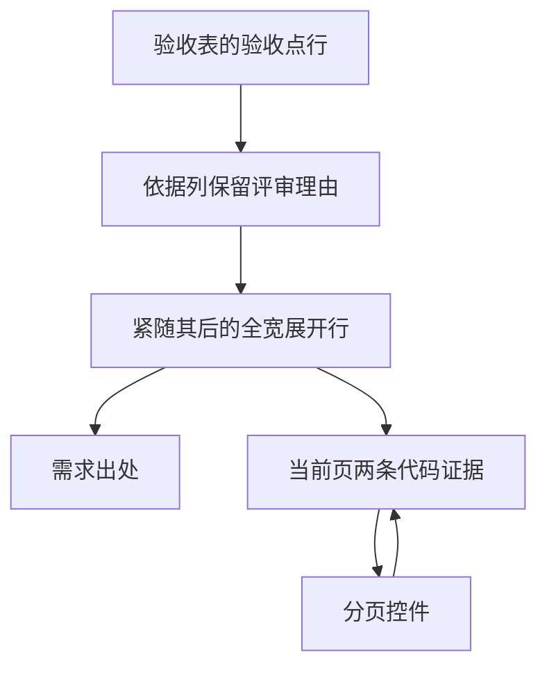

# 需求开发评审一致性平台 V1.43：验收点评审与独立复核最终执行方案

## 1. 背景与目标
V1.43 已将 AI 分析详情从旧分类页签收束为“验收点—评审结论—依据”和风险项。但证据展开入口位于验收表的第三列：桌面端前两列的固定宽度会形成大块左侧留白，较长的需求出处和代码证据挤在右侧，阅读路径不连贯；同时绑定证据会一次性渲染，没有分页。

本次在不改变评审结论、原文出处或证据绑定关系的前提下，将每个验收点的展开内容放到紧随该行的全宽证据面板，并为验收点、风险项和历史报告共用的证据列表提供浏览器端紧凑分页。

## 2. 范围与非目标
- 包含：验收点评审和风险项中“查看…依据”展开区的全宽布局、需求出处与证据的分层样式、每页两条的客户端分页、页码状态和小屏适配。
- 包含：保留绑定证据缺失告警，以及历史报告 `evidence_id || id` 的兼容回退。
- 不包含：数据库结构、RLS/RPC、Supabase 请求、Worker、证据生成规则、验收点/风险结论、服务端分页或全局证据页签。
- 不提交/推送代码，不修改云端数据库、Edge Function 或云端 Worker。

## 3. 当前实现与问题
- `ReviewDetailPage` 在 `src/App.tsx` 通过 `useBatchWorkspace` 一次读取当前需求所属 AI 结果的全部 `ai_code_evidence`，按 `ai_review_result_id` 过滤后传入 `AcceptanceReviewCard`。
- `src/components/AcceptanceReviewCard.tsx` 在验收表第三个 `td` 内直接渲染原生 `details`，`EvidenceDetails` 将所有 `evidenceIds` 映射为一个无分页的列表。
- `src/components/AcceptanceReviewCard.css` 为验收表第一、二列分别固定 32% 和 18% 宽度。因此展开的来源与证据只能从约半宽处开始，截图中的左侧空白来自表格前两列而不是证据列表的 margin。
- 当前请求已包含该需求的完整证据集合，短期以客户端分页即可避免额外接口和数据库改动；若未来单条结果的证据数量明显增大，再单独设计按结果的服务端 cursor 分页。

## 4. 需求与验收标准
1. 点击验收点的“查看需求出处与代码证据”后，来源原文和代码证据必须横跨验收表全部三列，不再受右侧“依据”单元格宽度限制。
2. 评审理由、双方分歧摘要仍位于原“依据”列，验收点、结论和依据的表格信息不丢失。
3. 单个展开区超过两条绑定证据时，仅显示当前页两条，并显示“显示 x–y / 总数 条”、可操作页码和上一页/下一页；每个展开区的页码互不影响。
4. 需求出处、短概述、仓库/文件/行号、commit、完整说明和缺失绑定证据告警保持现有语义；不得将未绑定的代码证据错配为引用。
5. 验收点、风险项和历史报告都使用相同的分页证据列表；证据 ID 集合更新或当前页超出总页数时回到有效页。
6. 720px 以下继续采用逐项布局，无横向滚动；展开面板和分页控件可在窄屏阅读与操作。

## 5. 总体设计

布局采用“摘要留在表格、证据展开为全宽复核面板”的层级：淡色面板将原文引用和代码定位纳入同一阅读区域，使用细分隔线而非叠加卡片。分页只在超过两条证据时出现，页码文字明确当前范围。

## 6. 数据与接口设计
- 不涉及数据库迁移、RPC、RLS、Edge Function 或 Worker 改动。
- 不新增网络接口；继续使用 `BatchWorkspace.evidence` 与 `AiCodeEvidence`。
- `EvidenceDetails` 以现有逻辑 ID `evidence_id` 匹配 `finding.evidenceIds`/`risk.evidenceIds`；历史报告维持 `evidence_id || id` 回退。

## 7. 前端改造
- `src/components/AcceptanceReviewCard.tsx`
  - 将每个验收点的 `details` 从第三列移到其后的 `<tr><td colSpan={3}>` 全宽行。
  - 为展开内容添加容器，保留来源原文和缺失证据提示。
  - 使用 Ant Design `Pagination` 实现每页 2 条的客户端分页，显示当前范围，并在证据集合变化时修正页码。
- `src/components/AcceptanceReviewCard.css`
  - 新增全宽证据行、展开面板、证据条目和分页区域样式；保持现有色彩和可见焦点。
  - 在移动端取消展开行多余内边距，保证分页可以换行而不产生横向溢出。
- `src/components/__tests__/AcceptanceReviewCard.test.tsx`
  - 覆盖全宽证据行、初始页仅显示两条绑定证据和范围提示；保留缺失证据不被错误替换的回归检查。

## 8. 安全、兼容与回滚
- 代码证据和需求原文继续作为 React 文本渲染，不解析 HTML 或执行脚本。
- 本次仅改变浏览器展示，不会写入或删除任何业务数据，也不会重置数据库。
- 无需部署顺序；前端回退到上一构建即可恢复旧的嵌入式展开样式，数据不受影响。

## 9. 实施步骤与文件范围
1. 调整 `AcceptanceReviewCard` 的验收点展开 DOM 层级，保留绑定和历史兼容逻辑。
2. 实现局部分页状态、当前范围文案与 Ant Design 页码控件。
3. 完成组件专属样式和响应式规则。
4. 更新组件回归测试，执行 Web 类型检查、针对性测试、构建和版本一致性校验。

主要修改文件：
- `src/components/AcceptanceReviewCard.tsx`
- `src/components/AcceptanceReviewCard.css`
- `src/components/__tests__/AcceptanceReviewCard.test.tsx`
- `需求开发评审一致性平台/V1.43-验收点评审与独立复核/需求开发评审一致性平台-V1.43验收点评审与独立复核-最终执行方案.md`

## 10. 验证结果
- `npx vitest run -c vitest.web.config.ts src/components/__tests__/AcceptanceReviewCard.test.tsx` 通过：4 项测试全部通过，覆盖全宽证据行、两条一页的初始分页、历史报告与缺失绑定证据。
- `npm run web:typecheck` 通过。
- `npm run build` 通过；仅保留既有的 Vite 大包体积提示。
- `npm run lint` 通过；仅剩附件解析、CodeQA、Linky、Skill 和既有页面的 11 条历史警告，本次组件不再新增警告。
- `npm run version:check -- "需求开发评审一致性平台/V1.43-验收点评审与独立复核/需求开发评审一致性平台-V1.43验收点评审与独立复核-最终执行方案.md"` 通过，文档与管理员展示版本均为 `V1.43`。
- 不涉及本地数据库迁移、Worker 镜像或云端发布验证。未启动本地长驻前端服务进行人工浏览器截图复核。
