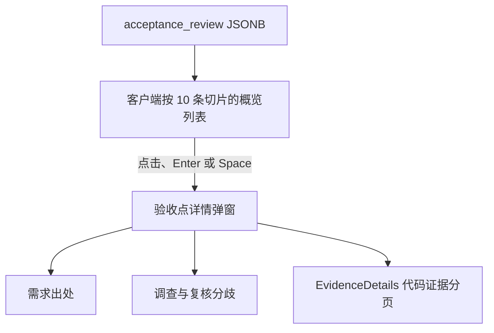

# 需求开发评审一致性平台 V1.44：验收点评审概览弹窗最终执行方案

## 1. 背景与目标
现有验收点评审将每个验收点的需求出处和代码证据直接展开在三列表格下方。验收点较多或依据较长时，用户难以连续扫描各项结论，页面也会产生大量纵向空白。

V1.44 将逐项展示改为“概览列表 + 详情弹窗”：列表集中呈现验收点、评审结论与依据，用户点击任一行后在弹窗查看完整需求出处、调查与复核分歧及关联代码证据；验收点列表按页浏览。

## 2. 范围与非目标
- 包含：验收点三列概览表、点击与键盘打开详情、详情弹窗、前端验收点分页、响应式与焦点样式。
- 保留：风险项区域、历史报告降级展示、单条验收点的结论与分歧文案、需求出处、代码证据及其每页两条的既有分页行为。
- 不包含：数据库结构、RLS、RPC、Edge Function、Worker、验收点评审 JSONB 契约、服务端分页或重新分析任务。

## 3. 当前实现与问题
`src/components/AcceptanceReviewCard.tsx` 从已加载的 `AiReviewResult.acceptance_review` 读取 `criteria`、`findings` 与 `sources`，并在每一条三列概览行后追加一个 `colSpan=3` 的展开行。展开行直接渲染需求出处与 `EvidenceDetails`。

`src/lib/api.ts` 的 `getBatchWorkspace` 已一次性读取当前导入的所有结果和证据；验收点来自同一结果的 JSONB，不存在独立验收点接口。因此本次无需改变数据请求，在浏览器端对已加载的验收点数组切片即可。

## 4. 需求与验收标准
1. 版本 1 的验收报告以三列列表展示“验收点、评审结论、依据”，不再在每条下方默认或手动展开详情行。
2. 概览列表每页展示 10 条验收点；验收点超过 10 条时显示页码和“显示 x–y / n 个验收点”范围说明。切页仅影响概览列表，不影响风险项和代码证据的既有分页。
3. 点击概览行可打开“验收点详情”弹窗；键盘 Tab 聚焦行后，Enter 或空格也可打开。
4. 弹窗完整展示验收点描述、待澄清标记、结论、完整依据、调查/复核分歧、需求出处及关联代码证据。
5. 缺失 finding、来源标签或证据时沿用现有可见降级文案，绝不匹配或伪造无关数据。
6. 历史报告（无 `acceptance_review` 或版本不为 1）的既有降级展示不变；风险项独立区域不变。
7. 管理员“查看当前版本”同步显示 `V1.44`，且版本校验通过。

## 5. 总体设计
概览表保持当前评审卡片的紫蓝信息层级，并让表格承担快速横向比较的任务；长文本只在按需打开的详情弹窗内呈现。

`AcceptanceReviewCard` 负责按报告身份维护当前概览页和已选验收点；通过 `criterionId` 关联结论，避免复制或修改原始报告。`EvidenceDetails` 继续只负责代码证据分页。

## 6. 数据与接口设计
不涉及数据库、迁移、RPC、RLS、Storage、Edge Function 或 Worker。

复用既有浏览器类型：`AcceptanceReviewReport.criteria` 提供验收点，`findings` 以 `criterionId` 关联结论，`sources` 提供来源标签；`AiCodeEvidence` 按 `evidence_id` 与 finding 的 `evidenceIds` 关联。分页仅对已加载的 `criteria` 数组切片，无新增网络请求。

## 7. 前端改造
- `src/components/AcceptanceReviewCard.tsx`：渲染当前页的概览行，添加 Ant Design `Pagination` 和 `Modal`；详情迁移至弹窗，风险区与历史降级分支保持不变。
- `src/components/AcceptanceReviewCard.css`：移除依赖全宽展开行的表现，补充可点击行、键盘焦点、依据截断、分页布局和可滚动详情弹窗样式；移动端仍将列表转为带标签的块级展示。
- `src/components/__tests__/AcceptanceReviewCard.test.tsx`：将全宽展开行断言改为概览列表与 10 条客户端分页断言，继续覆盖历史报告与缺失证据降级。
- `src/lib/product-version.ts`：将唯一版本常量更新为 `V1.44`。

## 8. 安全、兼容与回滚
- 模型生成的文字继续以 React 文本节点渲染，不解释为 HTML 或脚本。
- 弹窗不引入写操作、权限变化或额外数据暴露；仍只展示当前页面已取得的评审结果和关联证据。
- 不回写、删除或迁移任何数据，不执行数据库重置。
- 如需回退，可用独立前端提交恢复全宽展开行；不影响数据库、Worker 和既有评审结果。

## 9. 实施步骤与文件范围
1. 更新本方案与产品展示版本为 V1.44。
2. 在 `AcceptanceReviewCard` 构建概览行视图，添加前端分页、点击/键盘打开和详情弹窗。
3. 调整组件样式及已有组件测试的结构预期。
4. 执行前端类型检查、组件测试、构建和版本一致性校验，并将真实结果回填本方案。

主要修改文件：
- `需求开发评审一致性平台/V1.44-验收点评审概览弹窗/需求开发评审一致性平台-V1.44验收点评审概览弹窗-最终执行方案.md`
- `src/components/AcceptanceReviewCard.tsx`
- `src/components/AcceptanceReviewCard.css`
- `src/components/__tests__/AcceptanceReviewCard.test.tsx`
- `src/lib/product-version.ts`

## 10. 验证结果
- 已执行 `npm run web:typecheck`，通过。
- 已执行 `npm run test:web -- AcceptanceReviewCard`，4 条验收点评审组件测试全部通过；覆盖三列概览、10 条列表分页、历史报告降级和缺失证据可见降级。
- 已执行 `npm run build`，通过；Harness manifest 校验通过。Vite 仅报告项目既有的生产包体积超过 500 kB 提示，不影响构建成功。
- 已执行 `npm run lint`，以退出码 0 通过；仅有既有的控制字符正则、React Hook 依赖和 Fast Refresh 警告，未新增本次文件警告。
- 已执行 `git diff --check`，通过，无空白错误。
- 已执行 `npm run version:check -- "需求开发评审一致性平台/V1.44-验收点评审概览弹窗/需求开发评审一致性平台-V1.44验收点评审概览弹窗-最终执行方案.md"`，文档版本与管理员展示版本均为 `V1.44`，校验通过。
