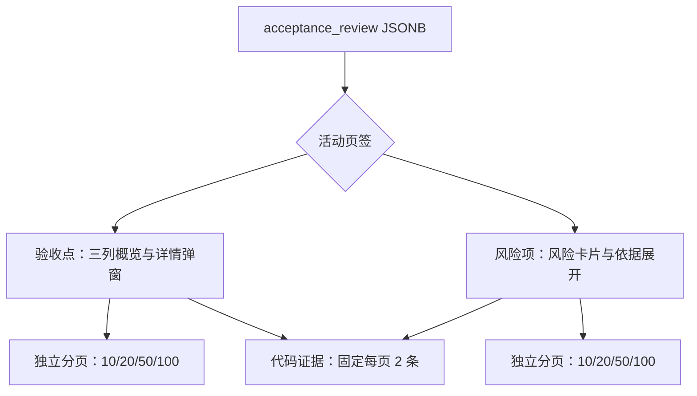

# 需求开发评审一致性平台 V1.45：验收点风险项页签分页最终执行方案

## 1. 背景与目标
V1.44 已将验收点评审改为可分页的三列概览与详情弹窗，但风险项仍在验收点表格下方完整展开。验收点和风险项混排会拉长阅读路径；验收点分页固定为每页 10 条，不能按实际审阅密度调整。

V1.45 将结构化评审内容拆分为“验收点”和“风险项”两个页签，并让两个列表各自提供与技能列表一致的每页条数选择，方便用户分别聚焦结论与风险。

## 2. 范围与非目标
- 包含：验收点/风险项页签、页签数量、两个列表独立的客户端分页状态、每页 10/20/50/100 条选择、范围说明、验收点概览的单行省略与悬停全文提示、响应式分页布局和组件测试。
- 保留：验收点详情弹窗、代码证据固定每页 2 条、历史报告降级、风险依据展开、既有结论及分歧文案。
- 不包含：数据库、RLS、RPC、Edge Function、Worker、评审 JSONB 契约、服务端分页、分页设置持久化或重新分析。

## 3. 当前实现与问题
`src/components/AcceptanceReviewCard.tsx` 对已加载的 `acceptance_review.criteria` 以固定每页 10 条切片，并将全部 `risks` 直接连续渲染。验收点分页不显示页大小选择器；风险项没有列表级分页。`src/pages/SkillManagementPage.tsx` 的技能列表使用 Ant Design `pageSize: 10`、`showSizeChanger: true` 和 `[10, 20, 50, 100]`，作为本次分页体验的参照。

## 4. 需求与验收标准
1. 版本 1 的结构化评审以“验收点”和“风险项”两个页签展示，页签显示各自总数；默认打开验收点。
2. 验收点页签继续展示三列概览、点击/键盘打开详情弹窗；风险项页签展示既有风险信息与“查看风险依据”展开内容。
3. 验收点和风险项均在浏览器端独立分页，默认每页 10 条；分页器可选择 10、20、50、100 条，与技能列表配置一致。
4. 改变某个页签的页码或每页条数不得影响另一页签；改变条数后该页签回到第 1 页，报告切换后两个列表回到第 1 页。
5. 分页范围准确反映当前列表；列表有内容时可调整每页条数，空列表显示已有的明确空态。
6. 历史报告降级、证据的两条固定分页及数据契约保持不变。
7. 管理员“查看当前版本”显示 `V1.45`，文档版本与产品版本校验通过。
8. 桌面端验收点概览表的验收点和依据列均单行截断；鼠标悬停单元格可查看完整文本，点击行仍打开既有详情弹窗。

## 5. 总体设计
卡片维持现有紫蓝色信息层级，页签只承担内容域切换，不复制数据。每个页签拥有独立的 `{ currentPage, pageSize }`，避免用户在风险列表翻页时改变验收点阅读位置。

## 6. 数据与接口设计
不涉及数据库、迁移、RPC、RLS、Storage、Edge Function 或 Worker。

复用 `AcceptanceReviewReport.criteria`、`findings`、`risks`、`sources` 与 `AiCodeEvidence`。分页只对浏览器已取得的数组切片，无新增请求、写入或持久化。

## 7. 前端改造
- `src/components/AcceptanceReviewCard.tsx`：加入 Ant Design 页签；为验收点与风险项维护独立分页状态，复用相同的页大小选项和页码规范逻辑；将现有风险区移入风险项页签；桌面端概览单元格通过 Tooltip 展示被截断的完整验收点和依据。
- `src/components/AcceptanceReviewCard.css`：补充分页与页签容器的间距、风险列表在页签内的边距、桌面端单行省略和移动端分页布局。
- `src/components/__tests__/AcceptanceReviewCard.test.tsx`：覆盖两个页签的初始呈现、各自分页范围与页大小选择配置，同时保留历史报告和缺失证据降级断言。
- `src/lib/product-version.ts`：将唯一版本常量同步至 `V1.45`。

## 8. 安全、兼容与回滚
- 模型文本继续作为 React 文本节点显示，不解释为 HTML 或脚本。
- 本次只调整现有结果的前端呈现，不引入写操作、权限变化或额外数据暴露。
- 不回写、删除或迁移任何数据，不执行数据库重置。
- 如需回退，可使用独立前端提交恢复 V1.44 的纵向布局；不会影响数据库、Worker 或历史评审结果。

## 9. 实施步骤与文件范围
1. 创建 V1.45 方案并同步产品展示版本。
2. 在 `AcceptanceReviewCard` 中实现双页签和独立的可调页大小分页。
3. 调整组件响应式样式并扩展组件测试。
4. 执行前端类型检查、组件测试、构建、版本一致性和差异空白检查，将真实结果回填本方案。

主要修改文件：
- `需求开发评审一致性平台/V1.45-验收点风险项页签分页/需求开发评审一致性平台-V1.45验收点风险项页签分页-最终执行方案.md`
- `src/components/AcceptanceReviewCard.tsx`
- `src/components/AcceptanceReviewCard.css`
- `src/components/__tests__/AcceptanceReviewCard.test.tsx`
- `src/lib/product-version.ts`

## 10. 验证结果
- 已执行 `npm run web:typecheck`，通过。
- 已执行 `npm run test:web -- AcceptanceReviewCard`，4 条组件测试全部通过；覆盖双页签、验收点与风险项各自的 10 条默认切片、可调页大小控件、验收点概览单行截断结构、历史报告降级及缺失证据可见降级。
- 已执行 `npm run lint`，以退出码 0 通过；仅有项目既存的控制字符正则、React Hook 与 Fast Refresh 警告，本次文件未新增警告。
- 已执行 `npm run build`，通过；Harness manifest 校验通过。Vite 仅报告项目既有的生产包体积超过 500 kB 提示，不影响构建成功。
- 已执行 `git diff --check`，通过，无空白错误。
- 已执行 `npm run version:check -- "需求开发评审一致性平台/V1.45-验收点风险项页签分页/需求开发评审一致性平台-V1.45验收点风险项页签分页-最终执行方案.md"`，文档版本与管理员展示版本均为 `V1.45`，校验通过。
- 本次不涉及数据库、Edge Function、Worker 镜像或 Worker 运行时改动；未执行任何云端发布操作。