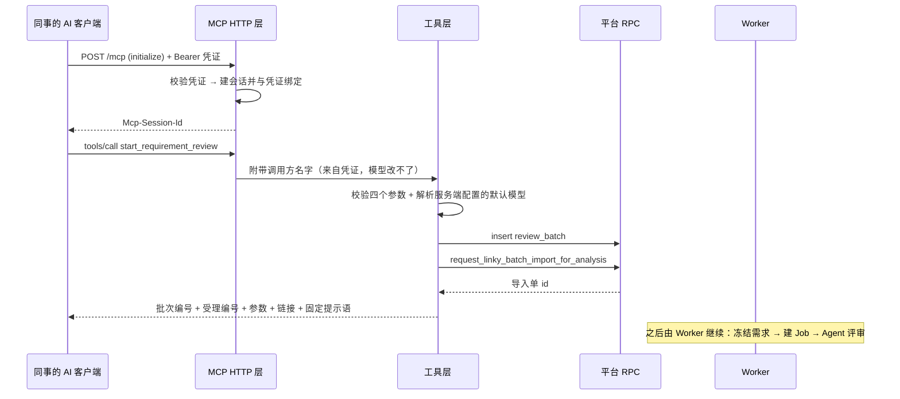

# 需求开发评审一致性平台 V1.47：远程 MCP 提交指定需求的代码评审最终执行方案

## 1. 背景与目标

### 为什么做

平台现在只有一个入口：打开前端，建批次、选项目组与发布窗口、勾需求、点「确认导入并冻结」。
研发同事大部分时间待在 Qoder / Codex 这类 AI 客户端里，想对自己手上的需求跑一次
「需求 ↔ 代码一致性」评审，要离开当前上下文去点一遍页面。

MCP（Model Context Protocol）正好解决这个问题：平台把"提交评审"这件事封装成一个工具，
同事在自己的客户端里配一个地址加一串凭证，用对话就能提交。

### 完成后提供什么能力

公司同事在 Qoder / Codex / Claude Code 等客户端配置远程 MCP 地址与访问凭证后，可以通过
AI 对话指定公司内**任意一条需求**（不限制需求负责人）发起评审；后台成功受理并落库后
立即拿到回执与平台链接，评审继续在后台跑，进度与结论在平台页面查看。

## 2. 范围与非目标

### 本次包含

- 一个独立的 Node 包 `mcp/code-review-mcp`，提供标准 **Streamable HTTP** 远程 MCP 端点；
- **唯一一个工具** `start_requirement_review`：入参为项目组、需求编号、目标分支、提交时间窗口；
- 访问凭证（Bearer / `X-Api-Key`）校验、会话与凭证绑定、调用方身份记账；
- 复用既有需求导入 + 批次 + Worker 评审链路，每次提交创建**仅含该需求的独立批次**；
- 受理成功后立即返回：批次编号、真实受理编号（需求导入单 id）、提交参数、批次详情链接、固定提示语；
- 失败时明确报错，且不在平台上留下空批次。

### 明确不包含

- **不提供进度查询、结果查询、轮询或自动等待**（首版刻意不做，避免把"看起来在动的进度"
  塞进对话；平台页面才是进度与结论的唯一界面）；
- 不新增数据库迁移、RPC、RLS 策略、Edge Function；
- 不改 Worker、不改 Harness 能力契约（`v4-capability-contract.json` 未动，manifest 哈希不变）；
- 不改前端页面（除产品版本常量）；
- 不开放模型选择给调用方；
- 不做 OAuth/动态客户端注册（MCP 规范的 OAuth 路线留到有多租户诉求时再说）。

## 3. 当前实现与问题

现有链路（V1.20 用户故事直连 Linky + V1.31 分析前需求自动冻结）：

```text
浏览器：/batches 建批次（review_batch）→ 选模型/分支
      → AI 结果管理页勾需求 → 点「开始分析」
      → request_linky_batch_import_for_analysis（冻结选择范围 + 标记自动分析意图）
Worker：第 5 条轮询在内网取 Linky 正文与附件 → 冻结进 review_story(+_attachment)
      → 全部需求冻结完成后由 complete RPC 创建 analysis_job
      → 逐需求跑 Agent → 结论落 ai_review_result(+ai_code_evidence)
```

缺口只有一个：**这条链路没有非浏览器入口**。RPC 本身已经具备全部门禁
（`ensure_manage_review_batch`、模型可用性、批次只读、活跃 Job 冲突），缺的是一个
能被 AI 客户端调用、且不把平台密钥交出去的远程通道。

另外要注意一个容易被做错的事实：`request_linky_batch_import_for_analysis` 返回的是
**导入单 id**（`linky_batch_import_request.id`），此刻 `analysis_job` 还不存在
（`analysis_status='PENDING'`、`analysis_job_id` 为 null）。回执里必须回导入单 id。

## 4. 需求与验收标准

| 编号 | 验收标准 | 验证方式 |
|---|---|---|
| A1 | 客户端配置 URL + Bearer 凭证后能完成 MCP 握手并看到工具 | 协议测试 + live-check 实测 |
| A2 | 对话提交指定需求后，后台确实落库（批次 + 导入单） | 本地 E2E 提交后查库 |
| A3 | 回执含批次编号、受理编号、需求编号与参数、平台链接、固定提示语 | 单测断言 + E2E 实际输出 |
| A4 | 受理编号是真实导入单 id，不伪造分析任务 id | 单测断言无 `analysis_job_id` + 查库确认 `analysis_job_id` 为 null |
| A5 | 立即返回，不等待导入与评审完成 | 代码无轮询；E2E 调用秒级返回 |
| A6 | 参数错误（分支、窗口、缺编号、缺项目组）时明确报错，且不提示成功 | 5 条失败用例实测 isError + 文本无"已提交"无链接 |
| A7 | 提交失败不在平台留下空批次 | 失败用例前后批次数不变 + 真实数据库补偿验证 |
| A8 | 缺失/错误凭证一律拒绝 | 协议测试 401 + `WWW-Authenticate` |
| A9 | 遵守既有平台权限，不绕过 RLS | VIEWER 账号实测被拒 |
| A10 | 客户端不接触 service-role key、模型 API Key、Linky 凭证 | 代码只用 anon key + 用户 JWT；回执只含编号/参数/链接 |
| A11 | 工具说明引导 AI 展示链接并结束流程 | 工具 description 与 server instructions 文本 |

失败行为的硬规矩：**只有真的受理成功才允许出现"已提交"字样和链接**。

## 5. 总体设计



组件职责：

| 文件 | 职责 |
|---|---|
| `src/config.mjs` | 环境变量解析与**启动即校验**（凭证长度/重复、枚举、必填） |
| `src/platform.mjs` | Supabase Auth + PostgREST 裸 fetch 客户端；懒登录、刷新、401 重试 |
| `src/review.mjs` | 参数归一化、模型解析、建批次 + 下导入单、失败补偿、链接拼装 |
| `src/format.mjs` | 回执/错误文本；错误码 → 可照着做的中文提示 |
| `src/tools.mjs` | 唯一工具定义（JSON Schema）与统一错误出口 |
| `src/server.mjs` | 低层 MCP Server：tools/list、tools/call、instructions |
| `src/http.mjs` | Streamable HTTP 端点、凭证校验、会话与凭证绑定、健康检查 |
| `src/index.mjs` | 入口：http（默认）/ stdio；stderr 结构化日志 |
| `scripts/live-check.mjs` | 用官方 MCP 客户端做连通性自检，`--submit` 才真实提交 |

刻意的选择：

1. **一次提交一个独立批次。** 批次是平台里唯一能同时框住"需求集合 + 代码快照 + 模型"的
   东西；把多次提交塞进同一批次，"这次评审的结论"就没有边界了。
2. **受理编号用导入单 id。** 见 §3。
3. **模型不开放给调用方。** 模型决定成本与结论质量，而远程调用方看不到平台的模型配置；
   服务端 `CRP_DEFAULT_MODEL` 决定，配错/停用时明确失败，绝不静默换一个顶上。
4. **四个必填参数没有默认值。** 目标分支与提交窗口直接改变结论，静默替默认值比报错更糟。
5. **不用 `@supabase/supabase-js`。** 这个包要能独立分发/部署，裸 fetch 少一个依赖，
   也不与主仓库的 supabase-js 版本互相牵制。

## 6. 数据与接口设计

- 数据库迁移：**不涉及**（没有新表、新列、新 RPC、新 RLS 策略、新 Storage 策略）。
- 复用的既有 RPC / 表：

| 名称 | 用途 | 门禁 |
|---|---|---|
| `POST /auth/v1/token` | 平台账号登录拿 JWT | 账号密码 |
| `list_enabled_model_configs`（回退 `list_model_display_names`） | 解析服务端配置的默认模型 | `can_create_review_batch()` |
| `insert review_batch` | 建本次独立批次 | 表 RLS（ADMIN/REVIEWER） |
| `request_linky_batch_import_for_analysis` | 冻结选择范围 + 标记自动分析意图，返回导入单 id | `ensure_manage_review_batch` + 模型/分支/批次状态校验 |
| `delete_review_batch` | 失败补偿，删掉本次刚建的空批次 | `ensure_manage_review_batch` |

- MCP 工具契约：

```jsonc
{
  "name": "start_requirement_review",
  "inputSchema": {
    "required": ["workspace_name", "story_code", "branch", "commit_window_days"],
    "properties": {
      "workspace_name": { "type": "string" },
      "story_code": { "type": "string" },
      "branch": { "enum": ["feature_dev", "feature_sit", "release"] },
      "commit_window_days": { "enum": [7, 14, 21, 28] },
      "workspace_id": { "type": "string" }   // 可选 UUID
    },
    "additionalProperties": false
  }
}
```

- 批次详情链接：`${CRP_PLATFORM_WEB_URL}/batches/<batch_id>/ai-result`
  （对应前端路由 `src/App.tsx` 的 `/batches/:batchId/*` → `ai-result`，进度与结论都在这一页）。
- `week_code` 全库唯一，前端用 `YYYYMMDD`；MCP 用 `YYYYMMDD-MCP<HHmmss>-<毫秒后三位>`，
  既不与人工批次相撞，也能在批次列表里按日期排序。

## 7. 前端与 Worker/运行时改造

- 前端：**不涉及**，除 `src/lib/product-version.ts` 的版本常量（版本展示同步要求）。
- Worker：**不涉及**。Worker 第 5 条轮询照原样处理导入单，之后照原样建 Job 并评审。
  因此不需要重建 Worker 镜像，也不需要滚动重启；新旧 Worker 可混跑。
- Harness 能力契约：**不涉及**（没有新工具、新 Broker 路由）。
- 运行时新增进程：这台 MCP 服务本身（常驻，可随时重启，无状态；会话丢失只影响正在连着的客户端）。

## 8. 安全、兼容与回滚

| 面 | 结论 |
|---|---|
| 密钥 | 只用 anon key + 平台账号 JWT。service-role key / 模型 API Key / Linky 凭证都不在这个进程里，回执只含编号、参数、链接 |
| 权限 | 平台 RLS 与 RPC 门禁照常生效。实测 VIEWER 账号提交被 `review_batch` 的 RLS 拒绝 |
| 鉴权 | Bearer（或 `X-Api-Key`）在 HTTP 层先校验，不过就 401 + `WWW-Authenticate`，连 `initialize` 都不处理 |
| 会话 | `Mcp-Session-Id` 与凭证绑定，换凭证复用同一会话回 403 |
| 身份 | 调用方名字取自校验通过的凭证，写进 stderr 日志与批次 `remark`；模型无法伪造 |
| 共用账号 | 全部调用方共用一个平台账号，批次 `created_by` 是该账号；"谁提交的"看 remark 里的凭证名 |
| 额度 | 持有凭证即可消耗模型额度，按人发放；泄露就从 `CRP_MCP_TOKENS` 删除并重启 |
| 传输 | 暴露到局域网之外必须套 HTTPS，否则 Bearer 凭证等于公开 |
| 兼容 | 对既有批次、在途任务、Session 续跑零影响；没有迁移，无需停写 |
| 回滚 | 停掉这个进程即可，平台回到只有前端入口的状态；已提交的批次照常跑完 |

## 9. 实施步骤与文件范围

1. 调查既有链路与门禁（`src/lib/api.ts`、`supabase/migrations/20260927045147_linky_import_auto_enqueue_analysis.sql`、`0019_single_harness_execution.sql`）。
2. 新建独立包与平台取数通道。
3. 实现提交编排与失败补偿。
4. 实现唯一工具与文本层。
5. 实现 Streamable HTTP 端点与凭证校验。
6. 单测 + 真实协议测试。
7. 本地 Supabase 全链路实测（含失败路径与权限路径）。
8. 文档与版本同步。

新增文件：

```text
mcp/code-review-mcp/package.json
mcp/code-review-mcp/package-lock.json
mcp/code-review-mcp/README.md
mcp/code-review-mcp/.env.example
mcp/code-review-mcp/src/{config,platform,review,format,tools,server,http,index}.mjs
mcp/code-review-mcp/scripts/live-check.mjs
mcp/code-review-mcp/test/{config-auth,submit,http-protocol}.test.mjs
需求开发评审一致性平台/V1.47-远程MCP提交需求评审/需求开发评审一致性平台-V1.47远程MCP提交需求评审-最终执行方案.md
```

修改文件：

```text
.gitignore                     # 忽略 mcp/**/.env
package.json                   # lint 范围加入 mcp；新增 mcp:install / mcp:start / mcp:test / mcp:live-check
README.md                      # 新增「远程 MCP 提交需求评审（V1.47）」章节
src/lib/product-version.ts     # V1.45 → V1.47
```

## 10. 验证结果

全部在**本地 Supabase**（`supabase_db_codeReviewPlatform`，经临时端口代理 `127.0.0.1:54331`
访问，因为本机 kong 的 54321 映射当时已失效）与本地起的 MCP 进程上实测。

### 10.1 自动化测试（真实执行）

`cd mcp/code-review-mcp && npm test` → **27 passed / 0 failed**，覆盖：

- 配置：必填项缺失即拒、凭证过短/重复即拒、HTTP 模式无凭证即拒（除显式允许匿名）；
- 鉴权：`extractToken` 支持 Bearer 与 `X-Api-Key`，`authenticate` 只认已登记凭证并回出调用方名字；
- 参数：分支/窗口枚举、需求编号与项目组必填、`workspace_id` 必须是 UUID；
- 受理回执：含批次编号、受理编号、参数、链接与固定提示语；**不含** `analysis_job_id`；
- 失败：错误文本不出现"已提交"、不含链接；RLS 原文被翻成"账号权限不足，请提权"；
- 失败补偿：导入单失败时调用了 `delete_review_batch`；
- 真实 Streamable HTTP 协议往返（官方 MCP 客户端 + 真 HTTP 端点）：401（无凭证/错凭证）、
  403（换凭证复用会话）、400（缺会话 id）、404（错路径）、`tools/list` 只有 1 个工具、
  `tools/call` 的调用方身份确实来自凭证。

### 10.2 本地端到端实测

```text
$ npm run live-check -- --url http://127.0.0.1:18848/mcp --token <凭证>
✔ initialize 成功   服务端信息 {"name":"codereview-mcp","version":"0.1.0"}
✔ tools/list 成功，共 1 个工具
  - start_requirement_review：必填参数 ["workspace_name","story_code","branch","commit_window_days"]

$ npm run live-check -- ... --submit --workspace "灵基Foundation" --story MCPE2E-0001 \
    --branch feature_sit --window 14
✅ 评审任务已成功受理并落库。
批次编号（review_batch.id）：cd5f6b20-dd8e-4db1-8610-d131a6432d82
任务受理编号（需求导入单 linky_batch_import_request.id）：9ef1927d-5387-4c3c-a4ae-a90373968bab
需求编号：MCPE2E-0001 ／ 项目组：灵基Foundation ／ 目标分支：feature_sit ／ 提交时间窗口：14 天
评审模型（服务端配置）：kimi-k3
平台详情链接：http://localhost:5173/batches/cd5f6b20-dd8e-4db1-8610-d131a6432d82/ai-result
评审任务已提交，执行需要较长时间，请前往代码评审平台查看进度和结果。
```

查库确认落库与"不伪造分析任务编号"：

```text
review_batch:                 id=cd5f6b20… default_branch=feature_sit status=DRAFT
                              remark=由远程 MCP 提交（调用方 qoder-demo，平台账号 admin@local.test）
linky_batch_import_request:   id=9ef1927d… batch_id=cd5f6b20… workspace_name=灵基Foundation
                              story_codes={MCPE2E-0001} status=QUEUED commit_window_days=14
                              analysis_context_version=2 analysis_status=PENDING analysis_job_id=(null)
review_batch.created_by=71e261d3…（= admin@local.test，证明走的是用户 JWT 而非 service-role）
```

### 10.3 失败路径实测（批次数 7 → 7，无残留）

| 用例 | isError | 文本含"已提交" | 含链接 | 返回原因 |
|---|---|---|---|---|
| 分支 `main` | ✅ | ❌ | ❌ | 目标分支只能是 feature_dev / feature_sit / release（BRANCH_INVALID） |
| 窗口 `30` | ✅ | ❌ | ❌ | 提交时间窗口只能是 7 / 14 / 21 / 28 天（COMMIT_WINDOW_DAYS_INVALID） |
| 缺需求编号 | ✅ | ❌ | ❌ | 需要需求编号（STORY_CODE_REQUIRED） |
| 缺项目组 | ✅ | ❌ | ❌ | 需要需求所在的项目组（WORKSPACE_NAME_REQUIRED） |
| `workspace_id` 非 UUID | ✅ | ❌ | ❌ | workspace_id 不是合法 UUID（WORKSPACE_ID_INVALID） |

### 10.4 权限与补偿实测

- **VIEWER 账号**（本地新建 `mcp-viewer@local.test`，经 `admin_update_user_role` 降为 VIEWER）
  起一台 MCP 后提交：回 `❌ 评审任务提交失败，平台上没有创建任何评审。`，原因为
  `new row violates row-level security policy for table "review_batch"`，批次数 7 → 7。
  据此把 42501/RLS 原文改成"账号权限不足，请让管理员提到 ADMIN 或 REVIEWER"。
- **失败补偿**（真实数据库）：用真 `PlatformClient` 只把
  `request_linky_batch_import_for_analysis` 换成抛错，观察到
  `batch_inserted → failed_as_expected(MODEL_SECRET_MISSING) → batch_after_compensation(remaining_rows=0)`，
  批次数 7 → 7。

### 10.5 真实需求 + 真实 Worker 的后台链路实测

这一段验证的是验收标准里的「**后台继续执行，用户可在平台查看真实进度**」。宿主机当时在
内网内（`curl` Linky `/stories` 返回 200），因此用 `LINKY_NETWORK_ACCESS_MODE=DIRECT`
在宿主机上直接跑 `worker/src/index.ts`（指向本地 Supabase），并提交 Linky 上的**真实需求**
`US-2026-012539`（项目组 `灵基质量执行平台quality-platform`，feature_dev，7 天）。

MCP 回执：批次 `395c51dc-5616-4219-9b49-a13f61ed18a7`，受理编号
`1bac96f9-5887-43cb-9578-aa1e49e33bee`。随后 Worker 日志（真实执行顺序）：

```text
linky_import_listed      request_id=1bac96f9… workspace=灵基质量执行平台quality-platform
                         upstream_total=42 usable=42 requested=1
linky_import_completed   stories_requested=1 stories_committed=1 stories_failed=0
job_claimed_for_preparation  job_id=4f6a9722-03c6-459f-963d-7e0907169431
repository_prepared      kdmanage-backend  4ce7cbd2…   (5 个仓库依次冻结到具体 commit)
repository_prepared      kdmanage-frontend 5ee6cccb…
repository_prepared      tmanage-backend   f3c4d2ab…
repository_prepared      tmanage-frontend  8c9d0856…
repository_history_manifest_saved  kdmanage-backend commit_count=42
```

库里对应的事实：

```text
linky_batch_import_request: status=SUCCEEDED stories_committed=1
                            analysis_status=QUEUED analysis_job_id=4f6a9722…
review_story:               US-2026-012539 【manage重构】支持manage重构测试
                            source_system=LINKY iteration=1012迭代 source_status=待处理
                            linky_workspace_name=灵基质量执行平台quality-platform
analysis_job:               status=PREPARING_SCOPE requested_branch=feature_dev
                            analysis_context_version=2 commit_window_days=7
```

于是「提交那一刻 `analysis_job_id` 为 null，受理编号只能是导入单 id」这件事在真实链路上
也成立：Job `4f6a9722…` 是导入完成之后才出现的。

**随后主动停止，避免消耗模型额度**：调 `request_analysis_job_cancel` →
`{"job_status":"FAILED","already_terminal":false}`，Job 变为
`FAILED / JOB_CANCELLED / 分析任务已被用户停止`，Worker 以 `JOB_LEASE_LOST` 收手（设计行为）。
验证完把批次删掉，复查 `review_batch=6 / 该批次 review_story=0 / 该 job=0`，Worker 与 MCP
进程、临时端口代理、临时代码缓存全部清理。

因此未跑 Agent 评审阶段（不是技术阻塞，是刻意不烧额度）：那一段是既有链路，本次没有改动。

### 10.6 客户端配置语法核实（修了一个真实缺陷）

第一版 README 里写的 `"type": "streamableHttp"` 是**错的**。查官方文档后更正：

| 客户端 | 正确写法 | 依据 |
|---|---|---|
| Qoder | `type: "http"`（或 `streamable-http`）+ `url` + `headers` | docs.qoder.com/cli/mcp-reference |
| Claude Code | `type` 必填且为 `http` / `streamable-http`（省略会被当 stdio）；或 `claude mcp add --transport http --header` | code.claude.com/docs/en/mcp |
| Cursor | 官方远程示例不带 `type`，只有 `url` + `headers` | cursor.com/docs/context/mcp |
| Codex CLI | TOML 无 `type` 键；Bearer 首选 `bearer_token_env_var`，也支持 `http_headers` | developers.openai.com/codex/extend/mcp |

驼峰 `streamableHttp` 在 Claude Code / Cursor / Qoder 上都不被接受 —— 这正是"配置看起来写了
却连不上"的那类缺陷，已按上表改写 README。

### 10.7 前端侧检查

- `npm run version:check -- 需求开发评审一致性平台/V1.47-远程MCP提交需求评审/需求开发评审一致性平台-V1.47远程MCP提交需求评审-最终执行方案.md` → 通过（文档 V1.47 = 产品 V1.47）。
- `npm run web:typecheck` → 通过。
- `npm run build` → 通过。
- `npm run lint`（已把 `mcp` 加入 oxlint 范围）→ 282 文件 11 warnings 0 errors，新增代码单独跑
  `npx oxlint mcp/code-review-mcp/{src,test,scripts}` 为 0 warnings 0 errors；11 条告警全在
  既有 `src/**`、`worker/**` 文件里。
- 仓库既有测试 `npm test` → 86 文件 / 1351 tests 全部通过（14 文件 35 用例为既有 skip）。

### 10.8 未验证项

- **未在真实 Qoder / Codex 客户端的 GUI 里连过**：本次用 MCP 官方 SDK 客户端
  （与各客户端同一套 Streamable HTTP 协议实现）完成握手、列工具、调工具；配置字段名已按
  §10.6 对过官方文档。Qoder **IDE** 侧官方文档只给了 SSE 的远程示例，`headers` 字段依据
  来自 Qoder CLI 的 MCP reference。
- **未跑 Agent 评审阶段**（见 §10.5，主动取消以避免消耗模型额度）。
- **未部署到常驻环境**，未配置 HTTPS 反向代理。
- **未在云端 Supabase 上执行任何写操作**：全部实测都在本地 Supabase。
