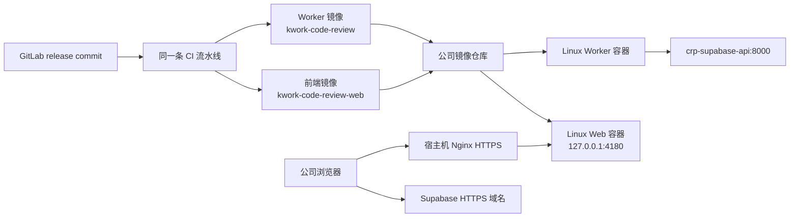

# 需求开发评审一致性平台 V1.49：前端镜像发布最终执行方案

## 1. 背景与目标

公司 Linux 已运行自部署 Supabase 与 Worker。原方案让部署人员在服务器上构建 `dist/` 并手工复制给宿主机 Nginx，导致同一 release 的 Worker 和前端无法从同一套可追溯镜像交付。

本版本让一条 `release` 流水线从同一 Git commit 分别构建两个不可变镜像：

1. 现有 Worker 镜像 `kwork-code-review`；
2. 新增前端镜像 `kwork-code-review-web`。

前端镜像不再依赖 DevOps 的 Docker build args。它始终是通用镜像；Linux 启动时只读挂载一份浏览器运行时配置。这样域名或 anon key 调整不需要重新构建镜像。

## 2. 范围

包含：

- `Dockerfile.webcompany` 的 linux/amd64 前端多阶段构建；
- 前端静态服务、健康检查、SPA 深链接与缓存；
- Linux 的 `docker-compose.web.yml`、运行时浏览器配置与宿主机 Nginx 反向代理；
- 同一 release 流水线中独立产出前端镜像的第二个构建节点。

不包含：

- 将 service-role key、数据库密码、GitLab Token 或模型 API key 放进浏览器；
- 让浏览器访问 Docker 服务名、`127.0.0.1:54341` 或容器内部地址；
- 启用 Kubernetes 部署节点；当前目标仍是公司 Linux Docker；
- 迁移历史公网 Supabase 数据、修改数据库结构或 Edge Functions。

## 3. 最终拓扑



前端容器只监听宿主机回环地址。Nginx 继续负责正式域名、证书和 HTTPS；浏览器经正式 Supabase 域名访问 API。

## 4. 镜像与运行时配置契约

### 4.1 `Dockerfile.webcompany`

- 构建与运行阶段均使用 Worker CI 已验证的 `kcr.kingdee.com/ai-2030/node:24-bookworm-slim-amd64`；
- 使用 `npm ci` 与 `package-lock.json`；
- 执行 `WORKER_DOCKERFILE=Dockerfile.workercompany npm run build:selfhost`，保留 Harness 一致性校验；
- 镜像只带空的 `public/runtime-config.js`，不接收任何 Docker build arg，也不写入环境密钥；
- 运行镜像没有 npm、源码或 `.env`，以非 root `node` 用户启动。

### 4.2 `runtime-config.js`

`index.html` 在 React bundle 前加载 `/runtime-config.js`。Linux 用宿主机文件覆盖镜像中的空默认文件：

```js
window.__CRP_RUNTIME_CONFIG__ = Object.freeze({
  supabaseUrl: 'https://<Supabase 正式域名>',
  supabaseAnonKey: '<自部署 Supabase .env 的 ANON_KEY>',
  wechatLoginEnabled: false,
  linkyApiBaseUrl: '',
})
```

此文件会被下载到浏览器，因此 `supabaseAnonKey` 可以填写，其他服务端秘密不得填写。浏览器地址必须是可从用户浏览器访问的 HTTPS 域名，不能填写 `crp-supabase-api`、`127.0.0.1` 或 Docker IP。

### 4.3 静态服务行为

`web-server.mjs` 监听 `8080`：

- `/__health` 返回 `200 ok`；
- `/assets/*` 用一年 immutable 缓存；
- `index.html` 与 SPA 深链接用 `no-store`；
- 带扩展名且不存在的资源返回 `404`，不伪装成首页；
- 解析路径时拒绝越过 `dist/` 根目录。

## 5. Linux 配置与发布

`docker-compose.web.yml` 只使用外部网络 `crp-selfhost-net`，不会创建由 Docker 自动挑选网段的默认网络。Web 容器只绑定 `127.0.0.1:4180`。

首次在 Linux 创建浏览器配置：

```bash
cd /home/kduser/crp/app
mkdir -p /home/kduser/crp/web
cp deploy/supabase-selfhost/env/frontend.runtime-config.js.example \
  /home/kduser/crp/web/runtime-config.js
chmod 644 /home/kduser/crp/web/runtime-config.js
nano /home/kduser/crp/web/runtime-config.js
```

在文件中填写正式 Supabase HTTPS 地址和 `/home/kduser/crp/supabase/.env` 的 `ANON_KEY`。然后用流水线给出的不可变前端镜像摘要发布：

```bash
export CRP_WEB_RUNTIME_CONFIG=/home/kduser/crp/web/runtime-config.js
export CRP_WEB_IMAGE='mirrors.kingdee.com/kingdee/lingee/patch/kwork-code-review-web@sha256:<digest>'

docker compose -p crp-selfhost-web \
  -f deploy/supabase-selfhost/docker-compose.web.yml config --quiet
docker compose -p crp-selfhost-web \
  -f deploy/supabase-selfhost/docker-compose.web.yml pull
docker compose -p crp-selfhost-web \
  -f deploy/supabase-selfhost/docker-compose.web.yml up -d
docker compose -p crp-selfhost-web \
  -f deploy/supabase-selfhost/docker-compose.web.yml ps
curl -fsS http://127.0.0.1:4180/__health
```

宿主机 `deploy/supabase-selfhost/nginx/review.conf` 的 `review.corp.example`、证书路径必须替换为 IT 分配的正式前端域名和证书路径。确认后执行：

```bash
sudo nginx -t && sudo systemctl reload nginx
```

## 6. CI 配置

保留当前 Worker 构建节点，新增第二个通用构建服务节点：

| 字段 | Worker 节点 | 前端节点 |
|---|---|---|
| Dockerfile | `Dockerfile.workercompany` | `Dockerfile.webcompany` |
| 产物仓库 | `.../kwork-code-review` | `.../kwork-code-review-web` |
| 架构 | `linux/amd64` | `linux/amd64` |
| 代码路径 | `/` | `/` |
| Docker build args | 无 | 无 |

前端节点的“应用编译”只校验构建输入：

```sh
node --version && [ -f Dockerfile.webcompany ] && [ -f deploy/supabase-selfhost/web-server.mjs ]
```

它与 Worker 节点同一 release 触发、使用同一生成号和 commit，但必须推送到独立的前端镜像仓库。公司 DevOps 不提供 build arg 输入不再是阻碍；前端真实地址在 Linux `runtime-config.js` 中配置。

当前 `pipeline-deploy.py` 仅是只读的执行器到 Linux SSH 端口探测，尚未执行登录或发布。真实发布继续在 Linux 人工执行，直到 CI 同事接入受保护的 SSH/JumpServer 凭据与人工审批。

## 7. 发布与回滚

前端仅变更时，只需要更新 `CRP_WEB_IMAGE` 后执行同一条 `up -d` 命令。Worker 仅变更时，无需重启 Web 容器。

调整域名、anon key 或 Linky 地址时，编辑 `/home/kduser/crp/web/runtime-config.js` 后执行：

```bash
cd /home/kduser/crp/app
export CRP_WEB_RUNTIME_CONFIG=/home/kduser/crp/web/runtime-config.js
export CRP_WEB_IMAGE='<当前已运行的前端镜像 digest>'
docker compose -p crp-selfhost-web \
  -f deploy/supabase-selfhost/docker-compose.web.yml up -d --force-recreate
```

回滚前端版本时，只需把 `CRP_WEB_IMAGE` 改回上一个已验证 digest 并 `up -d`。数据库、Functions、Worker 卷和 Supabase 容器不参与前端回滚。

## 8. 验收

1. `npm run web:typecheck` 与 `npm run build:selfhost` 成功；
2. 前端镜像的 `/__health` 为 200；
3. `/batches/<id>/ai-result` 刷新仍回到 SPA，不返回 404；
4. hash 资源有 immutable 缓存，`index.html` 为 no-store；
5. 浏览器 Supabase 请求是正式 HTTPS 地址，没有 Docker 别名、Linux 回环地址或 service-role key；
6. Linux 没有新增前端默认 bridge 网络，Web 只接入 `crp-selfhost-net`；
7. Worker 和 Web 镜像都可追溯到同一 release commit。

## 9. 验证结果

- 已通过：`npm run web:typecheck`；
- 已通过：`npm run build` 与 `npm run build:selfhost`，均包含 Harness manifest 一致性检查；
- 已通过：带临时镜像摘要的 Compose 配置校验；
- 已通过：以已构建的 `dist/` 启动 `web-server.mjs` 后，`/__health` 返回 200，SPA 深链接返回 `index.html` 且为 `no-store`，不存在的带扩展名资源返回 404，hash JS 资源为 immutable 缓存；
- 已通过：`Dockerfile.webcompany` 的 linux/amd64 完整构建；以只读挂载的临时 `runtime-config.js` 启动容器后，`/__health` 为 200、运行时配置可读取、SPA 深链接返回 `no-store`；
- 待 IT 提供：正式前端域名、正式 Supabase API 域名及其证书路径。取得这些值之前，不能宣称前端已经对公司浏览器上线。
