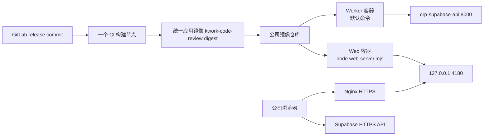

# 需求开发评审一致性平台 V1.49：统一应用镜像发布最终执行方案

## 1. 背景与目标

公司 Linux 已运行自部署 Supabase 与 Worker。原先给前端增加独立构建节点时，公司的通用流水线会把两个节点都推到同一个全局应用镜像名 `kwork-code-review`，后完成的节点可能覆盖前一个镜像标签，也增加了申请第二个应用的成本。

本版本改为一条 release 流水线只构建一个 linux/amd64 应用镜像。这个镜像同时包含：

- 后台 Worker 所需的运行文件；
- 浏览器前端编译产物 `dist/`；
- 仅提供静态文件的 `web-server.mjs`。

Linux 用同一个不可变 digest 分别启动 Worker 容器和 Web 容器。它们是两个独立进程，能独立重启和查看日志；镜像只需要构建、推送、拉取一次。

## 2. 范围

包含：

- `Dockerfile.workercompany` 同时编译 Worker 与前端；
- `worker.image.yml` 和 `docker-compose.web.yml` 都指向同一个 `CRP_APP_IMAGE`；
- Web 服务只在 `127.0.0.1:4180` 监听，使用既有 `crp-selfhost-net`；
- 浏览器运行时配置继续由 Linux 只读挂载，不写入镜像；
- 停用流水线中重复的“前端构建镜像”节点，保留原 Worker 构建节点。

不包含：

- 将 Supabase、Postgres、Edge Runtime 放进应用镜像；它们仍是独立基础服务；
- 将 service-role key、数据库密码、GitLab Token 或模型 API key 放到前端；
- 启用 Kubernetes 部署节点；当前仍由公司 Linux Docker 拉取并启动。

## 3. 最终拓扑



一个镜像不是一个容器：Worker 和 Web 有不同职责，必须保留两个容器。这样 Worker 重启不会中断网页，网页更新也不需要重启 Worker。

## 4. 镜像与运行时配置

### 4.1 统一镜像

`Dockerfile.workercompany` 使用公司 Node 24 amd64 基础镜像，依次执行：

1. `npm ci`；
2. `npm run worker:build`；
3. `npm run build:selfhost`；
4. 链接 Worker Harness 插件并以非 root `worker` 用户运行。

默认 `CMD` 仍是 `npm run worker:start`。`docker-compose.web.yml` 仅覆盖 Web 容器的命令为 `node web-server.mjs`。HTTP 健康检查只写在 Web Compose 服务中，避免 Worker 因没有 8080 端口被误判不健康。

### 4.2 浏览器配置

镜像中的 `public/runtime-config.js` 是空模板。Linux 将实际的 `/home/kduser/crp/web/runtime-config.js` 只读挂载到 `/app/dist/runtime-config.js`：

```js
window.__CRP_RUNTIME_CONFIG__ = Object.freeze({
  supabaseUrl: 'https://crp-supabase.kingdee.com',
  supabaseAnonKey: '<自部署 Supabase 的 ANON_KEY>',
  wechatLoginEnabled: false,
  linkyApiBaseUrl: '',
})
```

这个文件会发给浏览器，因此只允许公开的 anon key，不能填写任何服务端秘密。

## 5. Linux 发布方式

同一个 digest 同时供两个 Compose 项目使用：

```bash
cd /home/kduser/crp/app
export CRP_APP_IMAGE='mirrors.kingdee.com/kingdee/lingee/patch/kwork-code-review@sha256:<digest>'
export CRP_WEB_RUNTIME_CONFIG=/home/kduser/crp/web/runtime-config.js

# Web：同一镜像，但覆盖启动命令为静态文件服务。
docker compose -p crp-selfhost-web \
  -f deploy/supabase-selfhost/docker-compose.web.yml \
  pull
docker compose -p crp-selfhost-web \
  -f deploy/supabase-selfhost/docker-compose.web.yml \
  up -d --no-build

# Worker：同一镜像，保持默认 Worker 启动命令。
WORKER_ENV_FILE=.docker/worker.selfhost.env \
  docker compose -p crp-selfhost-worker \
    -f docker-compose.worker.yml \
    -f deploy/supabase-selfhost/worker.override.yml \
    -f deploy/supabase-selfhost/worker.image.yml \
    pull worker
WORKER_ENV_FILE=.docker/worker.selfhost.env \
  docker compose -p crp-selfhost-worker \
    -f docker-compose.worker.yml \
    -f deploy/supabase-selfhost/worker.override.yml \
    -f deploy/supabase-selfhost/worker.image.yml \
    up -d --no-build --scale worker=1
```

两个 Compose 文件都只接入 `crp-selfhost-net`（固定 `10.255.0.0/24`）。不会创建新的 172 网段。正式域名与证书审批完成后，宿主机 Nginx 将前端域名反向代理到 `127.0.0.1:4180`。

## 6. CI 配置

保留现有构建 `Dockerfile.workercompany` 的 Worker 节点即可，它现在会同时产出 Worker 与 Web 所需文件。删除或禁用重复的 `Dockerfile.webcompany` 前端构建节点，避免再次推送同一 tag 两次。

构建节点的应用编译校验改为：

```sh
node --version && ls -l Dockerfile.workercompany deploy/supabase-selfhost/web-server.mjs
```

流水线仍只负责构建与推送镜像。`pipeline-deploy.py` 仍仅做只读 SSH 端口连通性检查，不会自动登录或部署 Linux。

## 6.1 证书下发前的 HTTP 冒烟

证书尚未下发时，可用 `nginx/http-smoke.conf` 临时监听公司内网的 80 端口。它为两个已获批域名提供 HTTP：

- `http://crp-review.kingdee.com`；
- `http://crp-supabase.kingdee.com`。

Web 的 `runtime-config.js` 必须临时改为第二个 HTTP 地址。该配置只用于 DNS、反向代理、前端页面和匿名 API 连通性检查；不得在 HTTP 上登录、上传文件或做正式使用。临时配置不能与 HTTPS 的 `review.conf`、`supabase.conf` 同时安装。

若公司网络没有开放 80 端口，则不能通过改用“明文 443”绕过证书，应等待证书或由 IT 临时开放受控的 80 端口。

## 7. 回滚与边界

回滚时把 `CRP_APP_IMAGE` 改为上一条已验证 digest，然后分别执行 Web 与 Worker 的 `up -d`。数据库迁移、Functions、Supabase 卷不随应用镜像回滚。

Worker 更新前须确认没有在途任务；有任务时先排空再重建。Web 更新可独立重启，不会中断 Worker。

## 8. 主要文件

- `Dockerfile.workercompany`
- `deploy/supabase-selfhost/worker.image.yml`
- `deploy/supabase-selfhost/worker.override.yml`
- `deploy/supabase-selfhost/docker-compose.web.yml`
- `deploy/supabase-selfhost/web-server.mjs`
- `deploy/supabase-selfhost/env/frontend.runtime-config.js.example`

已删除不再使用的 `Dockerfile.webcompany`。

## 9. 验收标准

1. 一次 `Dockerfile.workercompany` 构建同时包含 `dist-worker/`、`dist/` 与 `web-server.mjs`；
2. 用默认命令启动时 Worker 仍可正常启动；
3. 用 `node web-server.mjs` 启动同一镜像时，`/__health` 返回 200，SPA 深链接可访问；
4. Web 与 Worker 都使用同一个不可变 `CRP_APP_IMAGE`；
5. 两个服务均只加入 `crp-selfhost-net`，不创建新 172 网段；
6. 浏览器运行时配置不包含服务端密钥。

## 10. 验证结果

- 已通过：`npm run worker:typecheck`、`npm run web:typecheck`；
- 已通过：`npm run test:worker`，62 个测试文件通过、14 个跳过，1,070 个测试通过、35 个跳过；
- 已通过：`Dockerfile.workercompany` 的 linux/amd64 统一镜像构建，构建中实际完成 `worker:build` 与 `build:selfhost`；
- 已通过：同一镜像以 `node web-server.mjs` 启动时，`/__health` 返回 200，运行时配置挂载生效，SPA 深链接返回 200 且为 `no-store`，不存在的 `.js` 资源返回 404；
- 已通过：Web 与 Worker Compose 配置校验均指向 `CRP_APP_IMAGE`；
- 已通过：同一镜像按默认 Worker 命令可启动并输出 `worker_started`；
- 未完成本机 Worker 的 Supabase RPC 业务联调：本机 Supabase 当前有已停止服务，Worker 启动后请求本地 RPC 返回 `fetch failed`。这不影响统一镜像是否能启动，但在本机 Supabase 恢复完整后仍应补做一次真实任务验证；
- 未执行：提交、推送、公司 Linux 拉取镜像、重启公司 Worker、Nginx/DNS/证书配置；
- 已获批域名：`crp-review.kingdee.com`（前端）与 `crp-supabase.kingdee.com`（Supabase API）；HTTPS 证书文件仍待 IT 下发并安装到 Linux。
