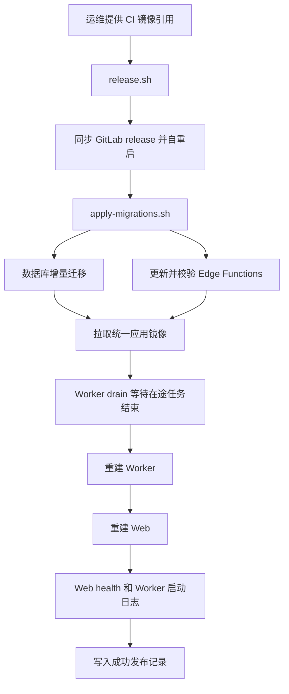

# 需求开发评审一致性平台 V1.50：统一 Linux 发布编排最终执行方案

## 1. 背景与目标

公司 Linux 已运行自部署 Supabase、Edge Functions、统一应用镜像的 Web 与 Worker。现有 `apply-migrations.sh` 能完成 release 分支的迁移与 Function 更新，但前端镜像、Worker 镜像、Worker 排空、Web 健康检查仍要人工拼接多条命令，容易遗漏顺序或用 `--force-recreate` 中断在途任务。

本版本提供一个 Linux 总发布入口。运维只需提供流水线生成的统一应用镜像引用，脚本即可按固定顺序完成 release 同步、增量迁移、Function 更新、Worker 安全重启、Web 更新与关键健康检查。

## 2. 范围与非目标

包含：

- 新增 `deploy/supabase-selfhost/scripts/release.sh`；
- 总脚本先同步 GitLab `release`，脚本文件改变时自动以新版本重新执行；
- 复用已有 `apply-migrations.sh` 的临时检出、数据库增量迁移、Function 差异复制、Function 回滚和加载校验；
- 扩展 Worker 排空脚本，使其能接受多个 Compose 覆盖文件；
- 用同一 `CRP_APP_IMAGE` 安全更新一个 Worker 副本与 Web 容器；
- 写入不含密钥的最近一次成功镜像与代码版本记录；
- 更新自部署说明与管理员展示版本。

不包含：

- CI 通过 SSH 自动登录 Linux；流水线仍只构建并推送镜像；
- 自动申请或切换 TLS 证书；
- 修改 Supabase 数据模型、迁移、RLS 或 Edge Function 业务逻辑；
- 自动中断在途 Worker 任务。Worker 未排空时发布会等待或失败，不强制重建。

## 3. 当前实现与问题

`apply-migrations.sh` 已做到：从 GitLab release 临时稀疏检出 `supabase/`，默认 dry-run，`--apply` 后执行 `supabase db push`、更新有变化的 Function、重启并验证 Functions。它不会更新 Web 或 Worker。

`worker-drain-restart.sh` 已能通过共享卷上的 `DRAIN` 标记停止领取新任务，等待全部副本写入 `DRAINED.*` 后重建容器，但原来只能接收一个 Compose 文件，不能直接用于 Linux 的 `worker.override.yml` 和 `worker.image.yml` 叠加配置。

## 4. 需求与验收标准

1. 运维在 Linux 执行 `release.sh --apply [--image <流水线镜像>]`，无需分别执行迁移、Function、Web、Worker 的发布命令；省略镜像参数时脚本通过 Nexus 查询精确应用组件并选择最大的 `release_时间戳` 标签；
2. 默认 dry-run 不修改数据库、Function 文件、容器或镜像；
3. apply 按“迁移和 Functions → 拉取统一镜像 → Worker 排空并重建 → Web 重建 → 健康检查”执行；
4. Worker 有在途任务时不强制中断，按既有 drain 机制等待；
5. 迁移/Function 失败时不得开始应用镜像更新；Function 仍由既有脚本恢复旧文件；
6. Web 健康端点必须返回 `ok`，Worker 日志必须包含 `worker_started`；
7. 任何脚本、日志或状态文件不得写入数据库口令、service-role key、GitLab Token 或模型密钥。

## 5. 总体设计

## 6. 数据与接口设计

不涉及数据库、RPC、RLS、Storage 或 Edge Function 业务接口变更。既有迁移仍由 Supabase CLI 前滚执行，不执行 `db reset`，不自动回滚已成功的迁移。

## 7. 前端与 Worker/运行时改造

Web 与 Worker 持续使用同一个 CI 镜像。Web 仍通过 `node web-server.mjs` 启动，读取 Linux 本地只读挂载的 `runtime-config.js`；总脚本只检查该文件存在，不重写公开 API 地址或 anon key。

Worker 更新使用 `worker-drain-restart.sh`，并传入基础 Compose、固定 Supabase 网络覆盖层和统一镜像覆盖层。脚本只更新一个副本，不删除 named volumes。

## 8. 安全、兼容与回滚

- 总脚本仅接受 release 分支，要求工作树没有已跟踪的未提交变更；
- Git 凭据使用内存 cache，迁移脚本与同步步骤共用，默认 30 分钟，不写密码文件；
- `--apply` 仍需要 Supabase CLI 对迁移的交互确认；
- Worker 排空超时会保持旧 Worker，脚本失败退出；
- Git 的 30 分钟内存凭据缓存不得继承迁移或平台发布锁文件描述符；脚本调用 Git 时关闭该描述符，避免发布退出后锁被缓存守护进程继续持有；
- 发生 Web/Worker 镜像问题时，使用状态文件记录的上一镜像引用重新执行总脚本；数据库迁移和 Functions 不随应用镜像回滚；
- HTTP 临时环境仍仅限内网/VPN；TLS 证书下发后按 V1.49 配置切换 HTTPS。

## 9. 实施步骤与文件范围

1. 新增 Linux 总发布脚本；
2. 让 Worker drain 脚本支持多个 Compose 文件；
3. 更新自部署 README 的日常发布命令和首次安装说明；
4. 将管理员产品版本同步为 V1.50；
5. 执行 Shell 语法、Compose 渲染、类型检查和版本一致性验证。

主要文件：

- `deploy/supabase-selfhost/scripts/release.sh`
- `scripts/worker-drain-restart.sh`
- `deploy/supabase-selfhost/README.md`
- `src/lib/product-version.ts`

## 10. 验证结果

- 已完成：新增 `release.sh`，支持 dry-run / apply、镜像引用、排空等待上限、release 自同步与脚本自重启；
- 已完成：`worker-drain-restart.sh` 支持重复传入多个 `--compose-file`，可叠加 Linux 网络和统一镜像覆盖层；
- 已完成：README 给出首次同步、日常预览与日常发布命令；
- 已完成：管理员展示版本同步为 V1.50；
- 已验证：`bash -n deploy/supabase-selfhost/scripts/release.sh scripts/worker-drain-restart.sh` 通过，`release.sh --help` 可用；
- 已验证：Nexus REST 查询能返回精确应用组件的 12 个发布标签；脚本只接受其 `release_数字` 标签，并按时间戳取最大值；查询失败时交互终端提示手工输入，非交互调用仍要求显式传入 `--image`；
- 已修正：Git 凭据缓存子进程不会继承迁移或平台发布锁；旧版脚本遗留的内存凭据缓存可通过 `git credential-cache exit` 正常退出并释放锁；
- 已验证：使用隔离的 Docker 命令模拟 Worker 空池启动，三个 `--compose-file` 会按基础文件、固定网络覆盖层、统一镜像覆盖层的顺序传给 Docker，且 `WORKER_ENV_FILE` 同时传入；
- 已验证：以临时的无密钥环境文件和运行时配置执行 Web/Worker Compose 渲染校验通过；
- 已验证：`npm run worker:typecheck`、`npm run worker:build`、`npm run test:worker`（62 通过、14 跳过；1070 通过、35 跳过）、`npm run web:typecheck`、`npm run test:web`（22 文件、257 通过）及版本一致性校验均通过；
- 未执行：公司 Linux 的真实数据库迁移、Function 更新、镜像拉取、Worker 排空或容器重启；这些动作只应由运维在目标服务器手动触发。
