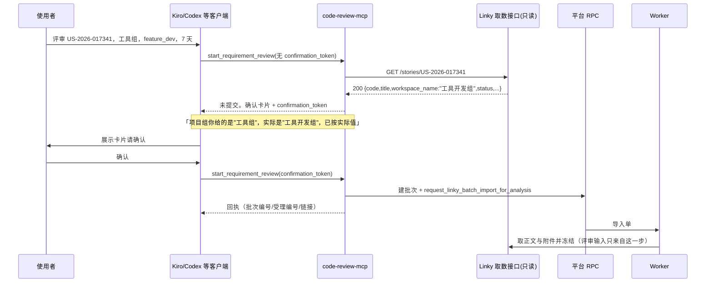

# 需求开发评审一致性平台 V1.56：MCP 提交前需求校验与确认最终执行方案

## 1. 背景与目标

2026-10-19 一次真实使用暴露了远程 MCP 链路的一个结构性缺陷：**调用方给的参数没人校验，
错了也要等到 Worker 导入阶段才知道，而那时候平台上已经建好了批次。**

实测经过（全部有 curl 证据，见 §10）：使用者在 Kiro 里说"评审 US-2026-017341，工具组，
feature_dev，7 天窗口"。MCP 原样受理、建批次、下导入单并回了一张"已成功受理"的回执；
几十秒后 Worker 导入失败，页面上显示

```text
LINKY_NETWORK_ERROR  勾选的 1 条需求全部导入失败
```

这句话有两处是假的：

1. **不是网络错误。** 真实原因是项目组名「工具组」在 Linky 里匹配不到任何工作区
   （真名是「工具开发组」）。上游对不存在的工作区**返回空列表而不是报错**，于是那条需求
   "不在列表里"，逐条失败，最后被我们自己的代码统一贴上 `LINKY_NETWORK_ERROR`。
2. **"已成功受理"也是误导。** 受理的是一张注定失败的导入单。使用者拿着回执去等结果，
   等到的是一个空批次。

目标：把校验挪到**提交之前**，并且在真正花钱之前让使用者**看到平台解析出来的真实需求**
并确认。完成后提供三件能力：

- **反查**：只给需求编号就能定位它真正属于哪个项目组，使用者不必自己拼对名字；
- **纠正**：使用者给错项目组名时，明确告诉他正确的是哪一个，而不是沉默地导入失败；
- **确认**：提交前返回一张"将要评审的需求"卡片（编号/标题/项目组/状态/迭代/发布窗口/
  负责人/正文与附件有无），由使用者确认后才真正建批次。

## 2. 范围与非目标

本次包含：

- MCP 新增只读工具 `lookup_requirement`（查需求，不花钱、不建批次）；
- `start_requirement_review` 增加**提交前校验 + 确认令牌**门禁，`workspace_name` 由必填改为可选；
- MCP 侧新增 Linky 只读客户端（仅 `/stories` 与 `/stories/{code}` 两个 GET）；
- Worker 侧把「项目组解析不到」「平台侧 token 失效」从 `LINKY_NETWORK_ERROR` 里分离出来；
- 前端 `describeLinkyError` 补齐对应文案；
- MCP 发布周期编码按 `Asia/Shanghai` 生成（修 UTC 容器差 8 小时、跨日错一天）。

明确不包含：

- **不让 MCP 提供需求正文。** 校验只读取用于确认展示的字段，评审用的正文与附件仍然
  **只**由 Worker 在内网侧取并冻结。这条边界从 V1.20 起没有变过：让调用方提供"需求正文"
  这一评审输入，平台无从判断它是否真的来自 Linky。
- **不替使用者选分支与窗口。** 这两个参数会直接改变评审结论，仍然必填、无默认值。
- 不做进度/结果查询，不轮询（V1.47 的边界不变）。
- 不修 Linky 上游 token 失效 —— 那是质量执行平台侧「配置 › Linky 工作区」的配置项，
  不在本仓库内。本次只保证它失效时平台**如实报告**而不是说成网络问题。

## 3. 当前实现与问题

```text
现状（V1.47）
Kiro ──start_requirement_review(workspace_name, story_code, branch, window)──► MCP
         │ 四个参数一个都不校验，workspace_name 必填且必须由调用方拼对
         ├─ 建 review_batch
         ├─ request_linky_batch_import_for_analysis
         └─ 回"✅ 已成功受理" ← 此刻完全不知道这条需求是否存在
                                   ↓ 几十秒后
                         Worker listAllStories(workspace_name)
                           → 上游 200 {"items":[],"total":0}   ← 工作区名不匹配
                           → 每条需求 LINKY_NOT_FOUND
                           → runLinkyBatchImport 抛死写的 LINKY_NETWORK_ERROR
```

三个具体缺口：

1. `mcp/code-review-mcp/src/review.mjs` 的 `submitRequirementReview` 只做形状校验
   （非空、UUID 格式、枚举），不验证参数在 Linky 里是否存在。
2. `worker/src/linky/batch-import-runner.ts` 的整单失败分支把错误码**死写**成
   `LINKY_NETWORK_ERROR`，丢掉了逐条失败的真实原因。
3. `worker/src/linky/client.ts` 把上游错误响应压成 `Linky 返回 HTTP 400`，丢掉响应体里
   的 `detail`（实测内容是 `Linky 返回错误（401）：invalid token`，即平台侧凭据失效）。

另有一个独立缺陷（同批修复）：`buildWeekCode` 用运行环境本地时间，而 MCP 容器 TZ 是 UTC，
导致发布周期编码比创建时间差 8 小时（实测 16:54:07 编成 `085407`），且北京时间 08:00
之前提交会把日期前缀错成前一天。

## 4. 需求与验收标准

| # | 验收标准 | 验证方式 |
|---|---|---|
| A1 | 只给 `story_code` 能解析出它真正所属的项目组，`workspace_name` 可不传 | 单测 + 真实接口 |
| A2 | 使用者给的 `workspace_name` 与解析结果不一致时，回执明确写出"你给的"与"实际是" | 单测 |
| A3 | 没带确认令牌的提交**一律不建批次**，只回确认卡片与令牌 | 单测断言无 insert |
| A4 | 确认令牌与四个关键参数绑定；参数变了令牌失效 | 单测 |
| A5 | 令牌有有效期，过期需重新确认 | 单测 |
| A6 | 需求在 Linky 里不存在时，提交被拒且不建批次 | 单测 |
| A7 | 上游 token 失效时，报"平台侧凭据失效"并指出要找谁，不报网络错误 | 单测 + 真实接口 |
| A8 | MCP 连不上 Linky 时不静默提交，也不硬失败：回"未校验"卡片要求确认 | 单测 |
| A9 | Worker 整单失败时上报主导原因码，不再一律 `LINKY_NETWORK_ERROR` | 单测 |
| A10 | 项目组在上游解析不到时，Worker 报 `LINKY_WORKSPACE_NOT_FOUND` | 单测 |
| A11 | 发布周期编码按 Asia/Shanghai 生成，跨日边界不错 | 单测（TZ=UTC 下跑） |

失败行为边界：

- 校验失败**绝不**建批次（避免平台上留空批次）；
- 校验结果不明（MCP 到 Linky 不通）**绝不**静默提交，但也不阻断 —— 以"未校验"状态
  要求使用者确认，确认后照常提交。这保持了 MCP 不在内网也能用。

## 5. 总体设计



组件职责：

| 组件 | 职责 | 刻意不做的事 |
|---|---|---|
| `src/linky.mjs`（新增） | 只读查 `/stories`、`/stories/{code}` | 不下载附件、不读正文送评审 |
| `src/preflight.mjs`（新增） | 解析/纠正参数，产出确认卡片数据 | 不写库 |
| `src/confirm.mjs`（新增） | HMAC 签发/校验确认令牌 | 不持久化（进程内密钥即可） |
| `src/tools.mjs` | 两个工具的入参契约与出参文本 | 不开放模型选择 |
| `src/review.mjs` | 提交编排（已有） | 不做评审判断 |

确认令牌为什么用 HMAC 而不是"让模型自己记得先查"：工具描述约束不了模型的实际行为，
而一次误提交就是一个真实批次加一份模型额度。令牌让"必须先查、必须让用户看过"成为
**服务端可验证的硬门禁**，模型绕不过去。

## 6. 数据与接口设计

- **数据库**：不涉及。没有新表、新列、新 RPC，沿用 `review_batch` 与
  `request_linky_batch_import_for_analysis`。
- **Edge Function**：不涉及。
- **能力契约**：不涉及，`v4-capability-contract.json` 与 manifest 哈希不变。

新增环境变量（`mcp/code-review-mcp/.env.example` 同步）：

| 变量 | 默认 | 说明 |
|---|---|---|
| `CRP_LINKY_API_BASE_URL` | 公司 Linky 取数接口地址 | 提交前校验用；留空则关闭校验 |
| `CRP_LINKY_TIMEOUT_MS` | `8000` | 单次校验请求超时 |
| `CRP_CONFIRM_TTL_MS` | `900000`（15 分钟） | 确认令牌有效期 |
| `CRP_CONFIRM_SECRET` | 启动随机生成 | 令牌签名密钥；多实例部署需显式配置 |
| `CRP_TIMEZONE` | `Asia/Shanghai` | 发布周期编码所用时区 |

工具契约变化：

```text
lookup_requirement(story_code, workspace_name?)            ← 新增，只读，不花钱
  → 需求卡片 + confirmation_token

start_requirement_review(story_code, branch, commit_window_days,
                         workspace_name?, workspace_id?, confirmation_token?)
  workspace_name：必填 → 可选（能从编号反查）
  无 confirmation_token  → 不提交，回卡片 + 令牌
  有且校验通过           → 提交，并使用**解析后的**项目组名
```

## 7. 前端与 Worker/运行时改造

前端：只改 `src/lib/api.ts` 的 `describeLinkyError`，为
`LINKY_WORKSPACE_NOT_FOUND` / `LINKY_UPSTREAM_AUTH_FAILED` / `LINKY_PROXY_PORT_BLOCKED`
补可操作文案。页面结构、组件、路由不变。

Worker：

- `src/linky/client.ts`：新增 `extractUpstreamDetail` 与 `isUpstreamAuthFailure`；
  非 2xx 时带上上游 `detail`；凭据失效单列 `LINKY_UPSTREAM_AUTH_FAILED`；
  修正 4xx 被重试一次的行为（注释一直声明不重试，实现却重试）。
- `src/linky/batch-import-runner.ts`：列表总数为 0 时直接以
  `LINKY_WORKSPACE_NOT_FOUND` 整单失败；整单失败时按逐条失败的主导原因码上报。

Worker 的能力、预算、Session、工具集均无变化；新旧 Worker 可混跑（只是错误码更准）。

## 8. 安全、兼容与回滚

- **评审输入的来源边界不变**：MCP 只读取用于"确认展示"的字段，冻结进库的正文与附件
  仍然只由 Worker 在内网取。MCP 读到的内容不写入任何表。
- **不新增密钥面**：Linky 取数接口自述"暂不验权，凭正确编号即可读取"，MCP 侧不持有
  Linky 凭据；`CRP_CONFIRM_SECRET` 只用于签确认令牌，泄露的最坏后果是跳过确认步骤，
  仍受平台 RLS 与账号角色约束。
- **SSRF**：Linky base URL 只来自服务端环境变量，不接受任何调用方输入的 host；
  路径只拼两个固定端点，`story_code` 经 `encodeURIComponent`。
- **兼容**：历史批次、在途导入单、既有 Worker 都不受影响。老客户端如果仍按
  V1.47 的方式传 `workspace_name` 也能用 —— 它变成"待校验的提示值"。
- **回滚**：MCP 是独立进程，回滚 = 用旧镜像重启；Worker 侧改动只影响错误码文本，
  回滚无数据后果。

## 9. 实施步骤与文件范围

全部已完成。

| # | 内容 | 文件 |
|---|---|---|
| 1 | Worker 错误码分离、保留上游 `detail`、4xx 不再重试 | `worker/src/linky/client.ts` |
| 2 | 项目组解析不到即整单失败；整单失败报主导原因码 | `worker/src/linky/batch-import-runner.ts` |
| 3 | 前端错误文案 | `src/lib/api.ts` |
| 4 | 发布周期编码按时区生成 | `mcp/code-review-mcp/src/review.mjs` |
| 5 | MCP Linky 只读客户端（新增） | `mcp/code-review-mcp/src/linky.mjs` |
| 6 | 提交前校验与纠正（新增） | `mcp/code-review-mcp/src/preflight.mjs` |
| 7 | 确认令牌签发/校验（新增） | `mcp/code-review-mcp/src/confirm.mjs` |
| 8 | 两个工具的契约与门禁 | `mcp/code-review-mcp/src/tools.mjs` |
| 9 | 确认卡片与回执文本 | `mcp/code-review-mcp/src/format.mjs` |
| 10 | 配置项与装配 | `mcp/code-review-mcp/src/config.mjs`、`src/index.mjs`、`.env.example` |
| 11 | 自检脚本两步流程 | `mcp/code-review-mcp/scripts/live-check.mjs` |
| 12 | 文档 | `mcp/code-review-mcp/README.md`、根 `README.md` |
| 13 | 测试 | `mcp/.../test/preflight-confirm.test.mjs`（新增 25 例）、`worker/src/__tests__/v156-linky-upstream-errors.test.ts`（新增 11 例）、`worker/src/__tests__/v120-linky-import.test.ts`、`src/lib/__tests__/v120-linky-errors.test.ts` |

## 10. 验证结果

### 10.1 真实接口证据（2026-10-19，公司网络内，curl 直连）

```text
GET /stories?workspace_name=工具组&page=1&page_size=1
→ 200 {"items":[],"total":0,"page":1,"page_size":1}        ← 不存在的工作区返回空列表

GET /stories?workspace_name=工具开发组&page=1&page_size=3
→ 400 {"detail":"Linky 返回错误（401）：invalid token"}      ← 工作区存在，上游凭据失效

GET /stories?workspace_name=前端开发组&page=1&page_size=3
→ 200 {"items":[],"total":0}                                ← 同样不匹配

GET /stories?page=1&page_size=1
→ 400 {"detail":"Linky 返回错误（401）：invalid token"}

GET /stories/US-2026-017341
→ 404 {"detail":"未找到用户故事: US-2026-017341"}

GET /stories/help
→ 200「workspace_name：工作区名称（精确匹配）…指定的工作区不存在时返回空列表（total=0）」
      详情响应含 "workspace_name"（项目组，按 issue.workspace_id 解析）
      文档示例中的项目组名为「工具开发组」
```

结论：使用者输入的「工具组」不匹配任何工作区（真名「工具开发组」，`worker/src/__tests__/
v120-linky-import.test.ts` 里 2026-09-24 实测的样例数据也是这个名字），这是本次导入失败的
直接原因；同时上游 Linky 凭据当前失效，所以即使项目组名填对也取不到数据 —— 后者属于
质量执行平台侧配置，需要那边的维护者更新 token。

### 10.2 时区修复（`TZ=UTC` 下执行，模拟容器环境）

```text
北京时间 2026-10-19 16:54:07 提交
  旧（容器本地=UTC）: 20261019-MCP085407   ← 页面上实际出现的值，差 8 小时
  新（Asia/Shanghai）: 20261019-MCP165407

北京时间 2026-10-19 07:30 提交
  旧: 20261018-MCP233000   ← 日期错成前一天，批次在列表里排到昨天
  新: 20261019-MCP073000
```

真实进程验证（`TZ=UTC` 启动 MCP，北京时间 17:49:49 提交，容器时间 09:49:49）：
落库的 `week_code = 20261019-MCP174949-08bc93` —— 与创建时间一致。

### 10.3 校验层对真实接口的实际结论

```text
preflightRequirement({ story_code:'US-2026-017341', workspace_name:'工具组' })
→ status  = UNVERIFIED
  code    = LINKY_UPSTREAM_AUTH_FAILED
  message = Linky 按编号查不到「US-2026-017341」，但上游取数接口当前本身不正常
            （…invalid token），所以这个"查不到"并不可信 —— 可能是编号写错了，
            也可能是上游故障导致查询没走完。凭据失效需要质量执行平台的维护者在
            「配置 › Linky 工作区」更新 token；在那之前提交的话，平台侧取需求同样会失败。
```

这条正是 §4 的 A7 + 健康探针要的行为：**没有**把上游故障说成"编号写错了"。

### 10.4 两步提交的端到端验证（本地 rehearsal Supabase + 真实 Linky 接口）

```text
第一步（不带令牌）
  → "⚠️ 还没有提交，而且这次没能核对成功"
  → 原因写明 LINKY_UPSTREAM_AUTH_FAILED 与 invalid token
  → 给出 confirmation_token（15 分钟）
  → 库内批次数：1（即第一步之前的存量，未新增）     ← A3 验证通过

第二步（带令牌）
  → "✅ 评审任务已成功受理并落库"
  → 回执保留"⚠️ 这次没有在提交前核对需求"            ← A8 验证通过
  → week_code = 20261019-MCP174949-08bc93           ← A11 验证通过
  → 测试批次随后以 delete_review_batch 清理，batch_left=0
```

### 10.5 自动化验证

| 命令 | 结果 |
|---|---|
| `npm --prefix mcp/code-review-mcp test` | 93 通过 / 0 失败（新增 25 例） |
| `npm run test:worker` | 1104 通过 / 35 跳过 / 0 失败 |
| `npm run test:web` | 264 通过 / 0 失败 |
| `npm run worker:typecheck` | 通过 |
| `npm run web:typecheck` | 通过 |

### 10.6 未验证项

- **Linky 详情端点 200 响应未能实地验证**：上游凭据当前失效，所有带工作区的调用都返回 400。
  因此"按编号反查项目组"这条主路径（A1/A2）目前只有单测覆盖，字段名取自 `/stories/help`
  文档与 `worker/src/linky/mapping.ts`（后者是 2026-09-24 对真实接口实测得到的）。
  **待上游 token 恢复后必须复跑一次** `npm run mcp:live-check -- … --submit`（不加
  `--confirm`）做实地确认。
- 本次未在公司 Linux 环境实机部署验证，只在本地完成；发布按既有统一脚本执行。
