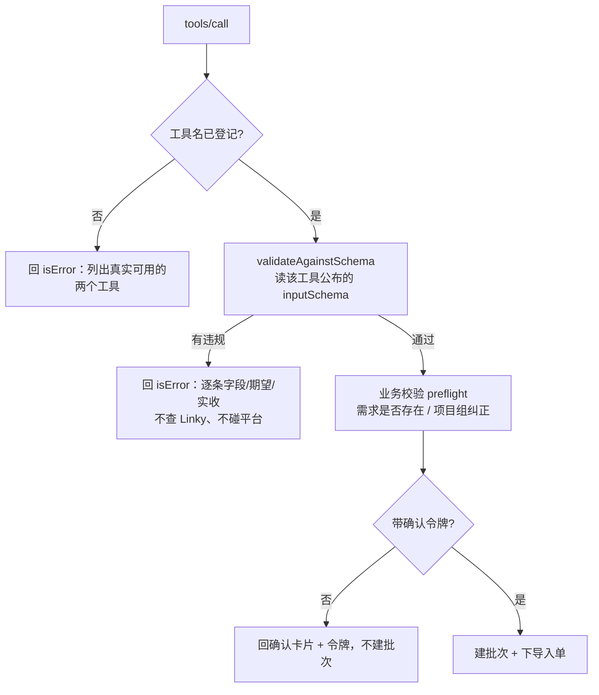

# 需求开发评审一致性平台 V1.59：MCP 入参 Schema 服务端校验最终执行方案

## 1. 背景与目标

V1.56 给 MCP 加了"提交前核对需求并让用户确认"。但它只覆盖了**语义**校验（需求在不在、
项目组对不对），**入参本身的形状校验仍然是一张空头承诺**：

本服务用的是 MCP SDK 的**低层** `Server`，它只把 `inputSchema` 原样转发给客户端，
**不校验** `tools/call` 的实参 —— 校验只存在于高层 `McpServer` + zod 那条路径
（已用 `grep inputSchema node_modules/@modelcontextprotocol/sdk/dist/esm/server/index.js`
确认零命中）。后果有三条，都不是报错而是静默走偏：

- `additionalProperties: false` 形同虚设。把 `workspace_name` 拼成 `workspace_names`
  不会报错，那个字段被**静默丢掉**，调用方以为自己指定了项目组，其实没有。
- 类型错误要一路走到业务代码才被另一份**手写**规则（`assertBranch` 等）拦住。
  两份规则——对外公布的 schema 和服务端手写的 if——是两个独立的真相，早晚分叉。
- 报错是业务口径的，不含"哪个字段、期望什么、实际收到什么"。客户端里的模型只能换个
  姿势重试，而每次重试都是一轮真实往返。

目标：**对外公布什么，服务端就按什么拒**，并把逐条原始报错回给客户端，让调用方的模型
能自我纠正。覆盖使用者点名的四类：发布周期、代码基线、项目组名、需求编号是否存在。

顺带修两个在 V1.57/V1.58 换域名之后暴露出来的实现问题（详见 §3）：MCP 的校验超时与
健康探针是按**旧域名**的性能特征设的，在新域名上一个太紧、一个直接打在 15 秒的慢查询上。

## 2. 范围与非目标

本次包含：

- MCP 新增 `src/schema.mjs`：一个**读对外公布的那份 schema** 去校验实参的校验器；
- 两个工具的 `call()` 入口前置 schema 门禁，违规时逐条回字段/期望/实收；
- 给 `story_code`、`workspace_id` 补 `pattern`，给 `story_code` 补 `maxLength`；
- 新增可选入参 `release_cycle`（发布周期），并校验格式、真实日期与年份范围；
- **`week_code` 改为与平台页面同构的 8 位 `YYYYMMDD`**，撞唯一键才退化为带后缀；
- 校验超时与健康探针按新域名的实测性能重新设定（详情 35 秒 / 探针 8 秒，分开计时）；
- 健康探针从**跨组查询**改为**按真实项目组查询**。

明确不包含：

- 不引入 zod / ajv 等校验库。本服务要能独立分发，依赖越少越好；而且自己实现能给出
  中文的、可照着改的报错。为避免"自己写一遍判断"带来的分叉，校验器**直接解释**
  我们对外公布的那个 `inputSchema` 对象。
- 不实现完整 JSON Schema。只实现本仓库实际用到的关键字；遇到未实现的关键字**抛错**。
- 不改分支/窗口的必填性（它们直接改变评审结论，静默替默认值比报错更糟）。
- 不改数据库、Edge Function、Worker 与能力契约。
- 不修 Linky 上游自身的性能（跨组查询 15 秒是上游"先汇总再分页"导致的，见 V1.58）。

## 3. 当前实现与问题

### 3.1 schema 不被执行

```text
客户端 ──tools/call(任意参数)──► 低层 Server ──原样透传──► registry.call()
                                   ↑ 不校验                    │
                                   inputSchema 只用于 tools/list │
                                                                ├─ assertBranch(手写)
                                                                ├─ assertCommitWindow(手写)
                                                                └─ 多余字段：静默忽略
```

### 3.2 发布周期格式与平台不一致

页面「创建评审批次」的发布周期是年/月/日三个下拉拼成的 8 位 `YYYYMMDD`
（`src/App.tsx` 的 `buildWeekCode`，默认当天，年份范围当前年前 2 后 3）。
MCP 生成的是 `20261019-MCP174949-20be86` —— 在批次列表的「发布周期」列里和旁边的
`20261016` 不是一类值，既难读也无法与人工批次比对；MCP 也没有提供指定发布周期的入参。

### 3.3 换域名后校验的时间预算失真

V1.57 把 Linky 换成了 `https://linky.kingdee.com`（去掉 `:2055`）。在新域名上实测
（2026-10-20，公司网络内 curl 直连）：

| 请求 | 耗时 | 说明 |
|---|---|---|
| `GET /stories/{code}` 命中 | **5.84s** | 不带 `config_id` 会遍历全部启用工作区 |
| `GET /stories/{code}` 未命中 | **31.80s** | 遍历完才能确认找不到 |
| `GET /stories?workspace_name=工具开发组&page_size=1` | **0.45～0.60s** | 按组查询 |
| `GET /stories?page_size=1`（跨组） | **15.06s** | 上游先汇总再分页（见 V1.58） |

V1.56 的实现与这组数字冲突两处：

1. `CRP_LINKY_TIMEOUT_MS` 默认 8 秒 < 命中的 5.84 秒余量太薄，且远小于未命中的 31.80 秒
   —— 结果"编号写错了"会永远表现为"核对超时"，而那恰好是本功能要拦住的情况之一。
2. `probeHealth()` 用的是**跨组**查询（15.06 秒）。它本身就是为"不要把上游故障误判成
   编号不存在"而存在的，却因为自己超时而永远报"不健康"。

另有一个更隐蔽的失效方式：探针如果用一个**不存在**的组名，上游会在本地短路返回
`200 {"items":[],"total":0}`，压根不调用 Linky —— 于是探针永远报"健康"，它要防的那个
误判照样发生。所以探针用的组名必须真实存在，并且"探针自己解析不到"要能被识别出来。

## 4. 需求与验收标准

| # | 验收标准 | 验证方式 |
|---|---|---|
| B1 | 入参按**对外公布的那份 schema** 校验，不另写一遍判断 | 单测（枚举值取自 schema 对象） |
| B2 | 违规时逐条回字段路径 + 期望值 + 实收值 | 单测 + 真实客户端往返 |
| B3 | 一次报出全部问题，不是只报第一条 | 单测 |
| B4 | 多传的参数报错，不静默忽略，并列出可用参数名 | 单测 |
| B5 | `commit_window_days: "7"` 不自动转成 7，如实报类型错误 | 单测 |
| B6 | 代码基线只接受 `feature_dev`/`feature_sit`/`release`，违规时回显允许值 | 单测 |
| B7 | 需求编号拒绝标题/中文/空格；接受 US-xxx、F-xxx、PREFIX-N、UUID 四种真实写法 | 单测 |
| B8 | 发布周期校验 8 位格式 + 真实日期 + 年份范围（与页面下拉一致） | 单测 |
| B9 | schema 校验不过时不查 Linky、不碰平台接口 | 单测断言零调用 |
| B10 | schema 出现校验器未实现的关键字时**抛错** | 单测 |
| B11 | `week_code` 与平台同构（干净 `YYYYMMDD`），撞唯一键才退化为带后缀 | 单测 |
| B12 | 详情超时大于实测未命中耗时（>32 秒） | 单测读配置断言 |
| B13 | 健康探针按真实项目组查询，且与详情**分开计时** | 单测断言 URL 带 workspace_name |
| B14 | 探针组名解析不到时报"探针配错了"，不冒充健康 | 单测 |
| B15 | 核对与提交两步的最坏耗时各自 < 客户端 60 秒上限 | 单测读配置断言 |

失败行为边界：schema 不过一律**不执行任何操作**，平台上不留任何痕迹；文本里明确写出
"没有创建任何评审"。

## 5. 总体设计



关键点：校验器**解释**那份对外公布的 schema，而不是复制一份规则。这样"公布值"与
"执行值"在结构上就不可能分叉 —— B1 的单测直接从 `TOOL_DEFINITION.inputSchema` 取枚举值
再断言服务端按它拒。

## 6. 数据与接口设计

- **数据库**：不涉及。
- **Edge Function**：不涉及。
- **能力契约**：不涉及，manifest 哈希不变。

新增/变更环境变量：

| 变量 | 默认 | 说明 |
|---|---|---|
| `CRP_LINKY_TIMEOUT_MS` | `8000` → **`35000`** | 按编号取详情；必须大于实测未命中的 31.8 秒 |
| `CRP_LINKY_HEALTH_TIMEOUT_MS` | **新增** `8000` | 健康探针（按组查询，实测 0.5 秒级） |
| `CRP_LINKY_HEALTH_WORKSPACE` | **新增** `工具开发组` | 探针用的项目组，必须真实存在 |

工具入参约束（对外公布，且服务端按同一份执行）：

| 参数 | 约束 | 对应页面字段 |
|---|---|---|
| `story_code` | `^[A-Za-z0-9][A-Za-z0-9_-]{1,63}$`，≤64 | 需求编号 |
| `branch` | enum `feature_dev`/`feature_sit`/`release` | 代码基线 |
| `commit_window_days` | integer enum `7`/`14`/`21`/`28` | 精准提交分析窗口 |
| `release_cycle` | **新增** `^[0-9]{8}$` + 真实日期 + 年份当前年前 2 后 3 | 发布周期 |
| `workspace_id` | UUID pattern | 项目组 |
| 其它任何参数 | `additionalProperties: false` → 报错 | — |

校验器实现的关键字：`type`（object/string/integer/number）、`properties`、`required`、
`enum`、`minLength`、`maxLength`、`pattern`、`minimum`、`maximum`、
`additionalProperties: false`。其余关键字出现即抛错。

## 7. 前端与 Worker/运行时改造

**均不涉及。** 本次只改 `mcp/code-review-mcp/**`。前端页面、Worker、DSH、权限、
预算、Session 与工具集都没有变化；MCP 是独立进程，新旧版本可混用（老客户端继续传
`workspace_name` 也能用，它变成待核对的提示值）。

## 8. 安全、兼容与回滚

- **收紧而非放宽**：本次新增的全是拒绝路径。此前能成功的合法调用行为不变
  （已由既有 112 个用例回归保证）。
- **`week_code` 格式变化只影响新建批次**，历史批次与在途导入单不受影响。
- **SSRF**：Linky base URL 仍只来自服务端环境变量；`story_code` 经
  `encodeURIComponent`，已加单测断言 URL 里不出现路径穿越。
- **报错内容不含敏感信息**：只回字段名、schema 约束与调用方自己传进来的值
  （字符串截断到 80 字符）。
- **回滚**：MCP 是独立进程，回滚 = 用旧镜像重启，无数据后果。

## 9. 实施步骤与文件范围

| # | 内容 | 文件 |
|---|---|---|
| 1 | schema 校验器（新增） | `mcp/code-review-mcp/src/schema.mjs` |
| 2 | 工具层前置门禁 + `release_cycle` + pattern 约束 | `mcp/code-review-mcp/src/tools.mjs` |
| 3 | `week_code` 改 `YYYYMMDD` + 唯一键冲突重试 + `assertReleaseCycle` | `mcp/code-review-mcp/src/review.mjs` |
| 4 | 探针改按组查询 + 详情/探针分开计时 | `mcp/code-review-mcp/src/linky.mjs` |
| 5 | 新配置项 | `mcp/code-review-mcp/src/config.mjs`、`src/index.mjs`、`.env.example` |
| 6 | 文档 | `mcp/code-review-mcp/README.md` |
| 7 | 测试（新增 25 例） | `test/schema-validation.test.mjs`（16）、`test/linky-budget.test.mjs`（9） |
| 8 | 既有用例按新契约更新 | `test/submit.test.mjs`、`test/submit-hardening.test.mjs` |

## 10. 验证结果

### 10.1 SDK 不校验实参（本次工作的前提）

```bash
$ grep -rn "inputSchema" node_modules/@modelcontextprotocol/sdk/dist/esm/server/index.js
（无输出）
$ grep -rn "inputSchema" node_modules/@modelcontextprotocol/sdk/dist/esm/server/mcp.js | head -3
115:  inputSchema: (() => {
211:  if (!tool.inputSchema) {
216:  const inputObj = normalizeObjectSchema(tool.inputSchema);
```

低层 `Server`（本服务用的）零命中，高层 `McpServer` 才有 —— 证实 schema 此前未被执行。

### 10.2 真实 MCP 客户端往返（B2/B4/B5/B6/B8）

官方 `Client` 连真实 HTTP 端点，一次传入 5 个错误参数，客户端收到：

```text
isError = true
❌ 参数不符合 start_requirement_review 的入参定义，没有执行任何操作（平台上没有创建任何评审）。

共 5 处问题：
  · workspace_names：不是这个工具的参数。可用参数：story_code / branch /
      commit_window_days / workspace_name / workspace_id / release_cycle / confirmation_token
      实际收到："工具组"
  · story_code：格式不符合要求（需匹配 ^[A-Za-z0-9][A-Za-z0-9_-]{1,63}$）
      实际收到："需求标题"
  · branch：只能是以下取值之一：feature_dev / feature_sit / release
      实际收到："main"
  · commit_window_days：必须是整数（不要加引号、不要带单位）
      实际收到：string "7天"
  · release_cycle：格式不符合要求（需匹配 ^[0-9]{8}$）
      实际收到："2026-10-20"

请按上面的说明修正参数后重新调用。不要凭猜测重试同一组参数。
```

同一次往返里 `tools/list` 看到的约束（证明公布值与执行值同源）：

```text
start_requirement_review 必填: ["story_code","branch","commit_window_days"]
  - story_code         : string pattern=^[A-Za-z0-9][A-Za-z0-9_-]{1,63}$
  - branch             : string enum=feature_dev|feature_sit|release
  - commit_window_days : integer enum=7|14|21|28
  - workspace_id       : string pattern=^[0-9a-fA-F]{8}-…
  - release_cycle      : string pattern=^[0-9]{8}$
```

### 10.3 新域名性能实测（2026-10-20，公司网络内 curl 直连）

```text
GET /stories/US-2026-017341                      → 200  5.84s
GET /stories/US-2026-999999                      → 404 31.80s   ← 决定详情超时必须 >32s
GET /stories?workspace_name=工具开发组&page_size=1 → 200  0.45s / 0.55s / 0.60s（三次）
GET /stories?page=1&page_size=1（跨组）           → 200 15.06s   ← 探针绝不能用它
DNS: linky.kingdee.com → 172.18.4.11
```

### 10.4 校验层对真实接口的端到端结论（B7/B12/B13）

```text
preflight({ story_code:'US-2026-017341', workspace_name:'工具组' })
  → VERIFIED，5.36s
    US-2026-017341 | 【server】【技能】技能加载优化 | 项目组 工具开发组
    ⚠ workspace_name "工具组" → "工具开发组"

preflight({ story_code:'US-2026-017341' })   # 完全不给项目组
  → VERIFIED，5.54s
    项目组 工具开发组 | 状态 需求编写完成 | 正文 114 字 | 附件 0 个
    负责人：需求 张烨 / 开发 薛宇轩 / 测试 王麒达
    ⚠ workspace_name null → "工具开发组"

preflight({ story_code:'US-2026-999999' })   # 不存在的编号
  → REJECTED，32.18s
    STORY_NOT_FOUND：Linky 里找不到需求「US-2026-999999」（已遍历全部启用的工作区）。
```

**注意**：这三条同时修正了 V1.56 文档 §10.1 的一个结论。V1.56 当时在**旧域名**
`feature.kingdee.com:2055` 上实测 `US-2026-017341` 返回 404、带组查询返回
`invalid token`，据此判断"这条需求不存在 + 上游凭据失效"。换到新域名后该需求**确实存在**
（项目组「工具开发组」）。当时之所以没有把它误判成"编号写错了"，是因为 V1.56 加了
健康探针降级 —— 这条保险在真实故障下起了作用。

### 10.5 时间预算核算（B15）

```text
linky 详情超时 = 35000 ms     探针超时 = 8000 ms     探针项目组 = 工具开发组
第一步（核对）最坏 = 35000 + 8000 = 43000 ms  < 60s 客户端上限  OK
第二步（提交）最坏 = 20000 + 3×8000 + 2×2000 = 48000 ms          OK
```

两步是各自独立的工具调用，客户端超时按单次算。

### 10.6 自动化验证

| 命令 | 结果 |
|---|---|
| `npm --prefix mcp/code-review-mcp test` | 121 通过 / 0 失败（新增 25 例） |
| `npm run test:worker` | 1104 通过 / 35 跳过 / 0 失败 |
| `npm run test:web` | 272 通过 / 0 失败 |
| `npm run worker:typecheck` | 通过 |
| `npm run web:typecheck` | 通过 |
| `npm run build` | 通过 |
| `npm run version:check` | 文档 V1.59 = 展示 V1.59 |

### 10.7 未验证项

- **未在公司 Linux 环境实机部署验证**，只在本地完成；发布按既有统一脚本执行。
- **`release_cycle` 的唯一键冲突重试未对真实库验证**：只用替身客户端注入 23505
  做了单测。真实路径依赖 PostgREST 把 SQLSTATE 放在 `code` 字段，这一点已用本地库
  确认约束名为 `review_batch_week_code_key`（`insert` 两次同值报
  `duplicate key value violates unique constraint "review_batch_week_code_key"`），
  但未跑通一次真实的 MCP 提交撞键场景。
- 健康探针的"上游凭据失效"分支在新域名上**无法实地复现**（新域名 token 正常），
  只有单测覆盖；旧域名上的真实响应已记录在 V1.56 文档 §10.1。
