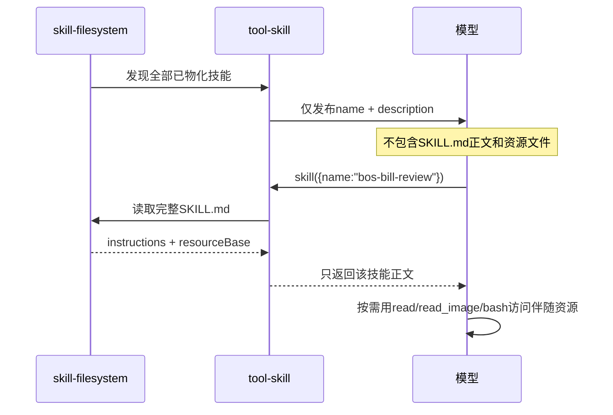
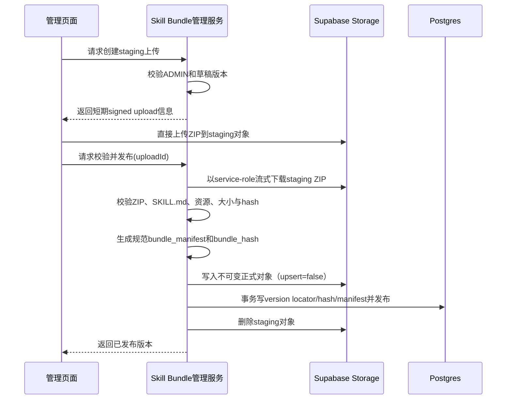
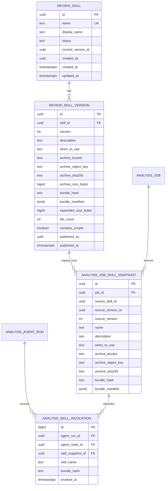
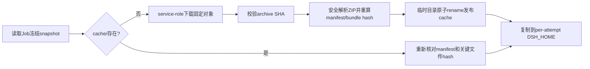
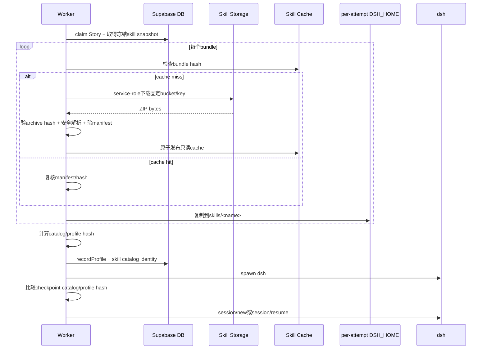

# 需求开发评审一致性平台 V1.6：DSH Skills 管理与注入最终执行方案

> 目标：管理员在前端维护多文件代码评审 Skill Bundle；技能版本元数据与冻结快照存数据库，归档字节存专用私有对象存储；创建 Analysis Job 时冻结全部已发布启用技能版本；Worker 下载、校验并缓存不可变 Bundle，在每次 attempt 启动前物化到私有 `DSH_HOME/skills/<name>/`；dsh 通过渐进式披露按需加载 `SKILL.md` 和伴随资源。
>
> 调研基线：当前项目依赖 `@deepseek-ai/dsh 0.1.5-rc.1`。

---

## 1. 背景与目标

当前 dsh 已具备 Skills 基础能力：

- `skill`：技能注册表；
- `skill-filesystem`：从文件系统发现 `<skill>/SKILL.md`；
- `tool-skill`：向模型发布技能目录并注册 `skill(name)`；
- skill tool 返回完整 instructions 和 `resourceBase`；
- root 和全部 child 角色均拥有 `skill`，部分角色还拥有 `read`、`read_image`、`grep`、`glob`、`bash` 等资源消费工具。

平台当前缺少完整供给链路：

- 没有技能定义、不可变版本、Bundle manifest 和发布状态；
- 没有技能管理页面和文件上传；
- 没有专用技能对象存储；
- Analysis Job 没有冻结技能目录和 Bundle hash；
- Worker 没有下载、缓存、安全解包和物化技能包；
- Session 恢复没有校验技能目录是否一致。

V1.6 要打通：

```text
管理员上传并发布Skill Bundle
→ 服务端校验归档并生成不可变manifest/hash
→ 新Analysis Job冻结全部已发布启用版本
→ Worker按hash下载或复用共享cache
→ Worker安全物化到per-attempt DSH_HOME/skills
→ dsh首轮只看到name + description
→ Agent调用skill(name)后加载SKILL.md正文
→ Agent按resourceBase继续读取references/assets/templates/scripts
```

---

## 2. 范围与非目标

### 2.1 V1.6范围

- 技能列表、新增、草稿、发布新版本、停用和版本历史；
- ZIP 格式多文件 Skill Bundle；
- 根目录必需 `SKILL.md`；
- 可包含 `references/`、`assets/`、`templates/`、`scripts/` 和经过校验的其他普通文件；
- 服务端生成规范 Bundle manifest；
- 专用私有 Supabase Storage bucket；
- 已发布版本和归档对象不可变；
- 新 Job 冻结全部已发布且启用的技能；
- 所有 Story Task 共用 Job 级 `skill_catalog_hash`；
- Worker service-role 下载、三层 hash 校验、安全解包；
- Worker 共享只读 Skill Cache；
- 每 attempt 复制到私有 `DSH_HOME/skills`；
- dsh 渐进式加载正文与伴随资源；
- Skill 和资源使用审计；
- Session 恢复校验 catalog/bundle/profile hash。

### 2.2 V1.6明确不做

- 技能与项目、应用、模块、仓库或代码路径绑定；
- 按 Story Task 筛选技能子集；
- 运行中热更新技能；
- 从代码 Workspace 自动发现项目自带技能；
- 模型或普通用户上传技能；
- Skill 文件自动执行；
- 未声明、未校验的任意文件类型；
- 新增模型工具或新增 Broker 路由；
- 把技能包长期放在代码 Workspace 或 Session 卷。

---

## 3. DSH Skill Bundle 的真实语义

### 3.1 DSH只自动发现SKILL.md

DSH filesystem provider 只扫描 skill root 的直属子项：

```text
<skill-root>/
└── <skill-name>/
    └── SKILL.md
```

Bundle 中其他文件不会被自动发现、注入或执行。`references`、`assets`、`templates`、`scripts` 只是平台约定的分类目录，DSH 不赋予这些目录特殊能力。

### 3.2 多文件Bundle示例

```text
bos-bill-review/
├── SKILL.md
├── references/
│   ├── domain-model.md
│   ├── operation-rules.yaml
│   └── error-codes.json
├── assets/
│   ├── bill-flow.png
│   └── state-machine.webp
├── templates/
│   ├── review-checklist.md
│   └── report.json
└── scripts/
    ├── inspect-bill.sh
    └── validate-metadata.mjs
```

`SKILL.md` 可以写：

```markdown
需要时读取：
- references/domain-model.md
- references/operation-rules.yaml
- assets/bill-flow.png

如需运行静态检查，可通过现有 bash 工具执行 scripts/inspect-bill.sh。
```

### 3.3 resourceBase如何工作

模型调用：

```text
skill({ name: "bos-bill-review" })
```

DSH 返回：

```json
{
  "name": "bos-bill-review",
  "provider": "filesystem",
  "resourceBase": {
    "kind": "directory",
    "path": "/workspace/agent-attempts/attempt-xxx/dsh-home/skills/bos-bill-review"
  },
  "content": "SKILL.md正文"
}
```

`resourceBase` 只是定位提示，不会改变 Session cwd，也不会自动读取资源。模型必须把绝对 base 与相对路径组合，然后使用已有工具：

| 资源 | 典型工具 |
|---|---|
| UTF-8 文本、JSON、YAML、CSV | `read`、`grep` |
| 文件名和目录查找 | `glob` |
| 图片 | `read_image` |
| 脚本 | `bash`，前提是角色有权限且发布策略允许 |
| 其他二进制 | 只有当前工具或容器程序支持时才可消费 |

### 3.4 渐进式披露



初始上下文不包含全部 Bundle 字节，但 Bundle 数量、description 和后续单项资源仍必须有硬上限。

---

## 4. 首版全量技能目录策略

V1.6 不建立技能—模块关系。创建 Job 时冻结全部：

```text
review_skill.status = PUBLISHED
且 current_version_id 非空
且技能未停用
```

所有 Story Task 共用相同目录和 `skill_catalog_hash`。

平台和 dsh 的职责：

```text
平台：管理、校验、冻结、下载、物化全部可信技能
DSH：根据name和description选择需要加载的技能
Worker：不做模块识别或语义选择
```

以后增加模块关系时，只改变“Job/Task选择哪些不可变版本”，不会改变对象存储、Bundle manifest、缓存和安全物化机制。

---

## 5. 文件存储架构

### 5.1 必须使用专用私有对象存储

当前项目只有 `review-files` bucket，主要用于批次导入文件，浏览器直接上传，且已有 authenticated 读策略。它不适合存放可能包含内部规则、脚本和参考资料的技能包。

V1.6 新建专用私有 bucket：

```text
skill-bundles
```

要求：

- `public = false`；
- 普通 `authenticated` 无 SELECT/INSERT/UPDATE/DELETE；
- 浏览器不持有 service-role；
- 上传和发布由 ADMIN 鉴权的受控服务端流程管理；
- Worker 仅以 service-role 下载数据库冻结 locator 指向的对象；
- 禁止 upsert 已发布对象；
- 已被 Job snapshot 引用的对象禁止删除。

### 5.2 对象键

发布对象使用内容寻址且不可变：

```text
<skill-id>/versions/<version>/<archive-sha256>.zip
```

例如：

```text
skill-bundles/
└── 12ab.../
    └── versions/
        └── 3/
            └── 7e91...c4.zip
```

上传阶段使用隔离 staging：

```text
staging/<admin-user-id>/<upload-id>.zip
```

发布成功后产生不可变正式对象并清理 staging。失败或超时的 staging 由保留期任务清理。

### 5.3 为什么不是只存数据库

数据库适合：

- 技能身份和状态；
- 版本元数据；
- manifest、hash、大小和文件数；
- Job 冻结快照；
- 审计。

对象存储适合：

- ZIP 原始字节；
- 图片、模板、脚本和大量参考资料；
- 不进入普通数据库备份和查询结果的大对象。

数据库不存完整 ZIP，也不存 signed URL。signed URL 是短期访问凭据，不能成为冻结 locator。

---

## 6. 上传、校验与发布流程

### 6.1 推荐流程



管理服务可实现为专用 Supabase Edge Function，例如：

```text
supabase/functions/skill-bundle-admin
```

它必须验证登录 JWT 和 ADMIN 身份，不接受浏览器自报的正式 bucket/key/hash。

### 6.2 ZIP根目录约定

归档根必须直接包含：

```text
SKILL.md
```

合法：

```text
bundle.zip
├── SKILL.md
├── references/...
└── assets/...
```

不接受额外外层目录：

```text
bundle.zip
└── bos-bill-review/
    └── SKILL.md
```

平台在物化时已经创建 `<DSH_HOME>/skills/<skill-name>/`，归档再带一层会让 DSH 找不到入口。

### 6.3 平台生成manifest

管理员不手写可信 manifest。服务端完成校验后生成规范 JSON：

```json
{
  "schemaVersion": 1,
  "skillName": "bos-bill-review",
  "entry": "SKILL.md",
  "archiveSha256": "sha256:...",
  "archiveSizeBytes": 12345,
  "expandedSizeBytes": 45678,
  "containsScripts": true,
  "files": [
    {
      "path": "SKILL.md",
      "sha256": "sha256:...",
      "sizeBytes": 1234,
      "mediaType": "text/markdown",
      "role": "ENTRY"
    },
    {
      "path": "references/domain-model.md",
      "sha256": "sha256:...",
      "sizeBytes": 3000,
      "mediaType": "text/markdown",
      "role": "REFERENCE"
    }
  ]
}
```

`bundle_hash` 对规范 manifest 中与内容身份有关的字段计算，不使用 ZIP entry 顺序、mtime、Unix mode 或压缩参数。

---

## 7. 归档和资源安全

### 7.1 三层hash

| hash | 用途 |
|---|---|
| `archive_sha256` | 下载字节是否完整 |
| `bundle_hash` | 展开后的逻辑文件集合是否一致 |
| `skill_catalog_hash` | Job冻结的全部技能版本是否一致 |

Worker 必须独立重算，不能相信数据库或上传方自报。

### 7.2 Zip Slip和路径规则

解析 entry 前必须：

- 统一使用 `/`；
- 拒绝绝对路径；
- 拒绝 Windows 盘符和 UNC；
- 拒绝 NUL、空段、`.`、`..`；
- 拒绝反斜杠路径歧义；
- 拒绝 Unicode 归一后冲突；
- 拒绝大小写归一后冲突；
- 拒绝重复 entry；
- 限制路径深度和长度；
- 确认最终目标始终位于 skill bundle root；
- 禁止“先解压、后检查”。

### 7.3 文件类型

所有 entry 必须是普通文件或目录。拒绝：

```text
symlink
hardlink
device
FIFO
socket
```

扩展名只用于产品允许列表，安全判断同时检查 MIME/magic。文本要求严格 UTF-8。

建议 V1.6 允许：

| 角色 | 示例类型 |
|---|---|
| ENTRY/REFERENCE/TEMPLATE | `.md .txt .json .yaml .yml .csv .xml` |
| ASSET | `.png .jpg .jpeg .webp .gif` |
| SCRIPT | `.sh .js .mjs .cjs`，见脚本规则 |

SVG、HTML、Office、可执行二进制、动态库、未知格式默认拒绝；后续有明确消费者和安全策略后再开放。

### 7.4 脚本规则

DSH 不会自动执行脚本，但 Agent 已有 `bash` 时可以显式运行绝对路径脚本。因此：

- 包含 `scripts/` 的版本标记 `contains_scripts=true`；
- 发布页面必须显式提示“此版本包含可执行指令资源”；
- 只有 ADMIN 可发布；
- 脚本必须出现在 manifest；
- 脚本不得包含秘密；
- 不继承 ZIP executable bit，物化后统一只读；
- 执行只能经过现有 `bash` 工具、角色权限、Sandbox、超时、进程和容器资源限制；
- Skill 加载不自动执行任何脚本；
- 脚本输出只能写代码 Workspace 的 `overlay/`、`artifacts/` 或 `.tmp/`；
- 当前 Shell 网络请求不等价于 platform-web allowlist，发布者必须承担这一风险；
- 审计至少记录 skill name、bundle hash 和 bash 工具生命周期，不记录秘密或完整命令正文。

若生产安全要求不能接受 Shell 网络和任意脚本语义，应通过部署策略关闭脚本类 Bundle，而不是假设“文件没有 +x 就不能执行”。

---

## 8. 容量和解压资源边界

### 8.1 单个Bundle

| 项目 | V1.6上限 |
|---|---:|
| ZIP上传字节 | 10 MiB |
| 展开总字节 | 50 MiB |
| entry数量 | 200 |
| 单文件展开字节 | 10 MiB |
| SKILL.md | 64 KiB |
| 目录深度 | 8 |
| 规范相对路径长度 | 240字节 |
| 压缩比 | 20:1 |
| 校验/解包时间 | 30秒 |

### 8.2 全技能目录

| 项目 | V1.6上限 |
|---|---:|
| 已发布启用技能 | 50 |
| description | 每项500字符 |
| 首轮目录渲染结果 | 32 KiB |
| 全部归档下载总量 | 100 MiB |
| 全部展开后总量 | 256 MiB |

限制点：

1. 上传校验服务；
2. 发布事务；
3. `enqueue_analysis_job` 冻结目录；
4. Worker cache miss 下载和解包；
5. per-attempt 物化。

任何超限均 fail closed，返回稳定错误码，不静默截断。

---

## 9. 数据模型与冻结快照

### 9.1 数据模型



### 9.2 Job冻结

创建 Job 时复制全部已发布启用版本的：

- name、description、whenToUse；
- 版本号；
- 固定 bucket/key；
- archive hash/size；
- bundle hash/manifest；
- 展开大小、文件数、脚本标记。

`analysis_job` 保存：

```text
skill_catalog_hash
skill_snapshot_version
skill_bundle_count
skill_archive_bytes
skill_expanded_bytes
```

所有 Story Task 共用这份目录。管理员发布 V2 或停用技能只影响新 Job。

### 9.3 对象保留

只要存在 `analysis_job_skill_snapshot` 引用：

- version 行不能删除；
- 正式 Storage 对象不能删除；
- manifest 不能更新。

未发布 staging 对象按短保留期清理；无任何 Job 引用的历史技能版本只能经过显式保留策略和审计删除。

---

## 10. Worker共享Skill Cache

如果每个 Story Task 都从对象存储下载全部技能，开销不可接受。新增共享缓存：

```text
SKILL_CACHE_ROOT=/workspace/skill-cache
```

Docker named volume：

```yaml
worker-skill-cache:/workspace/skill-cache
```

布局：

```text
/workspace/skill-cache/
└── <bundle-hash>/
    ├── bundle.zip
    ├── manifest.json
    └── files/
        ├── SKILL.md
        ├── references/...
        ├── assets/...
        └── scripts/...
```

发布缓存流程：



Cache 目录发布后只读。并发 Worker 对同一 bundle 使用临时目录 + 原子 rename；失败者删除临时目录并复用胜出结果，与 Git commit cache 的模式一致。

Cache 需要容量上限和 LRU/最后访问回收；有活动 attempt 或 Job snapshot 只代表对象存储必须保留，不要求本地 cache 永久保留，因为可重新下载。

---

## 11. Worker物化到DSH_HOME

### 11.1 不是代码Workspace

正确位置：

```text
<agentAttemptsRoot>/attempt-XXXX/dsh-home/skills/<skill-name>/
```

错误位置：

```text
Workspace/.dsh/skills     # Agent可写且优先级更高
Workspace/repos           # 污染固定commit语义
Workspace/artifacts       # 会被当成Agent产物
SessionRoot               # 不属于会话日志
```

### 11.2 per-attempt目录

```text
dsh-home/skills/
├── bos-bill-review/
│   ├── SKILL.md
│   ├── references/...
│   ├── assets/...
│   ├── templates/...
│   └── scripts/...
└── java-transaction-review/
    └── ...
```

从 cache 复制时：

- 禁止 hardlink，避免 attempt 写入影响共享 cache；
- 不跟随 symlink；
- 复制后再次检查 containment；
- 目录和文件统一只读；
- 正常收敛随 Profile 清理；
- 崩溃残留由 attempt orphan cleaner 回收。

### 11.3 skill-filesystem隔离

```json
{
  "id": "skill-filesystem",
  "config": {
    "includeDefaultRoots": false,
    "bundledSkillDir": "/absolute/per-attempt/dsh-home/skills",
    "watch": false,
    "watchFollowSymlinks": false
  }
}
```

只允许 DSH 发现 Worker 物化的冻结目录，不能被 Workspace 或宿主用户目录中的同名技能覆盖。

### 11.4 Worker类型

```ts
interface FrozenSkillBundle {
  snapshotId: string
  name: string
  description: string
  whenToUse?: string
  version: number
  archiveBucket: 'skill-bundles'
  archiveObjectKey: string
  archiveSha256: string
  archiveSizeBytes: number
  bundleHash: string
  bundleManifest: SkillBundleManifest
  expandedSizeBytes: number
  containsScripts: boolean
}

interface FrozenSkillCatalog {
  snapshotVersion: number
  catalogHash: string
  bundles: FrozenSkillBundle[]
}
```

Worker 不接受浏览器、模型或 Story 自报 locator，只接受 claim-fenced RPC 返回的 Job snapshot。

---

## 12. 下载、物化和Session恢复顺序

恢复不能先启动 dsh，再异步补技能。顺序必须是：



恢复时必须使用 Job 冻结 snapshot，不读取当前已发布技能。任一下载、hash、manifest、物化或兼容校验失败：

- 不回退到空技能；
- 不改用当前版本；
- 不静默新建 Session；
- 返回稳定错误码并终止 attempt。

建议错误码：

```text
SKILL_BUNDLE_DOWNLOAD_FAILED
SKILL_ARCHIVE_HASH_MISMATCH
SKILL_BUNDLE_INVALID
SKILL_BUNDLE_LIMIT_EXCEEDED
SKILL_CACHE_CORRUPT
SESSION_SKILL_SET_MISMATCH
```

---

## 13. Profile、hash和Checkpoint

三层 identity：

```text
archiveSha256             原始ZIP字节
bundleHash                单技能展开逻辑内容
skillCatalogHash          Job全部技能集合
```

`configHash` 纳入 `skillCatalogHash`；随机的 `bundledSkillDir` 绝对路径归一化为 `[per-attempt-skills]`。

新增持久字段：

```text
analysis_job.skill_catalog_hash
analysis_agent_run.skill_catalog_hash
analysis_session_checkpoint.skill_catalog_hash
```

恢复比较：

```text
Harness/Session格式
policy hash
profile hash
skill catalog hash
Session JSONL hash
session revision
```

当前恢复逻辑只记录 candidate profile hash 而不强制比较；V1.6 必须补齐 profile/catalog hash 门禁。

---

## 14. 前端技能管理

### 14.1 列表

| 列 | 说明 |
|---|---|
| 技能名称 | kebab-case name |
| 显示名称 | 管理员名称 |
| 状态 | 草稿/校验中/已发布/已停用/校验失败 |
| 当前版本 | V1、V2…… |
| Bundle文件数 | manifest统计 |
| ZIP/展开大小 | 容量治理 |
| 是否含脚本 | 高风险标记 |
| description | 首轮目录摘要 |
| 更新人/时间 | 审计 |
| 操作 | 上传新版本、校验、发布、停用、下载、版本历史 |

页面顶部显示全局目录容量：

```text
已启用技能：12 / 50
首轮目录：8.4 KiB / 32 KiB
归档总量：24 MiB / 100 MiB
展开总量：70 MiB / 256 MiB
含脚本技能：2
```

### 14.2 上传/发布页

- name 创建后不可改；
- 上传 ZIP 到 staging；
- 展示服务端解析的文件树；
- 展示 SKILL.md 解析结果；
- 展示每文件 hash、MIME、角色和大小；
- 显示 Zip Slip、链接、重复路径、未知类型、压缩比和容量检查；
- 含脚本时要求额外确认；
- 校验成功后才能发布；
- 发布后不可替换 ZIP，只能创建下一版本。

### 14.3 下载

只有 ADMIN 可以请求已发布 Bundle 的短期 signed URL。普通用户、Reviewer 和 Worker 不使用 signed URL：Worker 通过 service-role 和冻结 locator 下载。

---

## 15. 数据库权限与Storage策略

- `review_skill`、`review_skill_version`、Job snapshot、调用审计启用 RLS；
- 浏览器不直接写正式对象或版本表；
- staging 上传令牌由 ADMIN 服务端接口签发；
- `skill-bundles` 不授予普通 authenticated SELECT；
- 正式对象 key 由服务端生成；
- Worker service-role 下载前必须校验 bucket 固定为 `skill-bundles`、key 与冻结 snapshot 一致；
- 已发布对象禁止 upsert；
- 任何 Job snapshot 引用时禁止删除；
- 不直接依赖用户提交的 MIME、文件名、hash、bucket 或 key。

推荐服务端接口：

```text
skill-bundle-admin:create-upload
skill-bundle-admin:validate
skill-bundle-admin:publish
skill-bundle-admin:create-download-url
admin_list_review_skills
admin_get_review_skill
admin_disable_review_skill
get_story_task_skill_snapshot       # Worker only
```

---

## 16. 审计与可观测性

### 发布审计

记录：

```text
skill_id/version
archive_sha256/bundle_hash
file_count/archive_bytes/expanded_bytes
contains_scripts
published_by/published_at
validation_result
```

不记录 ZIP 正文、脚本正文或秘密。

### 调用审计

扩展现有 `/attempt/tool-audit` 白名单字段：

```text
skill_name
skill_bundle_hash
skill_snapshot_id
resource_relative_path（仅安全规范路径）
```

不新增 Broker 路由。`analysis_skill_invocation` 保存名称、版本、hash、Agent 和时间。

资源读取仍由现有 `read/read_image/grep/glob/bash` 生命周期审计；普通审计不存源码、资源正文或完整命令。

运行汇总增加：

```text
skill_catalog_count
skill_catalog_bytes
skill_bundle_download_bytes
skill_cache_hits/misses
skill_loaded_count
skill_resource_reads
skill_script_runs
```

---

## 17. 上线、兼容、清理与回滚

### 上线

1. 创建数据库表、私有 bucket 和 Storage 策略；
2. 部署管理 Edge Function；
3. 部署管理页面；
4. 发布初始 Bundle；
5. 部署新增 `/workspace/skill-cache` volume 的 Worker；
6. 确认新 Job 冻结 locator/manifest/catalog hash；
7. 确认 Worker 下载、cache、物化和 dsh资源读取；
8. 恢复创建新 Job。

旧 Worker 不得 claim 带 Bundle snapshot 的新 Job。

### 历史Job

迁移前 Job 固定为空技能目录：

```text
skill_snapshot_version = 0
skill_catalog_hash = empty-catalog-hash
```

不能在重启后突然加载后来发布的技能。

### 清理

- staging：短保留期自动删除；
- 正式对象：有 Job snapshot 引用时永久保留；
- skill cache：按容量/LRU回收，可重新下载；
- per-attempt DSH_HOME：正常收敛删除，崩溃由 orphan cleaner 删除；
- Session：仍按 Session 保留期处理，不存技能包副本。

### 回滚

- 暂停新 Job；
- 排空或取消带 Bundle snapshot 的 Job；
- 回滚 Worker/UI/Edge Function；
- 保留数据库版本、manifest、正式对象和审计；
- 不让旧 Worker执行它不理解的 Bundle Job。

---

## 18. 实施步骤与文件范围

### Phase 1：完整多文件Bundle

1. 创建 `review_skill`、`review_skill_version`、`analysis_job_skill_snapshot`、`analysis_skill_invocation`；
2. 创建私有 `skill-bundles` bucket、staging/正式对象策略；
3. 实现 skill-bundle-admin 上传、解析、验证、发布、下载；
4. 新增技能管理和 ZIP 文件树预览页面；
5. 修改 `enqueue_analysis_job` 冻结全部已发布启用 Bundle；
6. 新增 Worker claim-fenced snapshot RPC；
7. 新增 `SKILL_CACHE_ROOT` 和 Docker named volume；
8. 实现流式下载、三层 hash、安全 ZIP 解析和原子 cache；
9. 实现 per-attempt DSH_HOME 多文件物化；
10. 隔离 skill-filesystem roots；
11. catalog hash 纳入 profile/run/checkpoint/resume；
12. 增加发布、下载、cache、调用和资源审计；
13. 增加容量、归档攻击、恢复不一致和真实 DSH 资源读取测试。

### 主要改造位置

| 子系统 | 位置 |
|---|---|
| 数据表、bucket、RLS、Job冻结、RPC | 新 timestamped `supabase/migrations/*_managed_dsh_skill_bundles.sql` |
| 上传校验发布 | 新 `supabase/functions/skill-bundle-admin/` |
| 管理类型/API | `src/types.ts`、`src/lib/api.ts` |
| 技能管理页面 | 新 `src/pages/SkillManagementPage.tsx`、`src/App.tsx` |
| Worker Storage下载 | `worker/src/db/client.ts` 或新的 skill storage client |
| Bundle manifest/ZIP验证/cache | 新 `worker/src/ai/skills/*` |
| Profile和物化 | `worker/src/ai/acp/profile-materializer.ts` |
| Engine传递和恢复 | `worker/src/ai/runtime/deepseek-harness-acp-engine.ts` |
| Session兼容 | `worker/src/ai/session/session-recovery.ts`、checkpoint RPC |
| 调用审计 | authority plugin、Broker audit ingestion、监控类型 |
| Docker cache volume | `worker/src/config.ts`、`Dockerfile.worker`、`docker-compose.worker.yml` |
| 运维 | `worker/OPERATIONS.md` |

---

## 19. 验收标准

1. ADMIN 可上传合法多文件 ZIP，服务端解析并展示文件树；
2. 根 `SKILL.md` 缺失、嵌套外层目录、非法 frontmatter 均拒绝发布；
3. Zip Slip、绝对路径、`..`、重复规范路径、symlink、特殊文件和 Zip Bomb 均拒绝；
4. 发布后正式对象和 version 不可覆盖；
5. 新 Job 冻结全部已发布启用 Bundle 的固定 locator/hash/manifest；
6. 所有 Story Task 使用相同 catalog hash；
7. Worker cache miss 下载一次，cache hit 不重复下载并复核 manifest；
8. Worker 物化完整文件树到 `DSH_HOME/skills/<name>`，不写代码 Workspace；
9. dsh 首步只看到 name + description；
10. 调用 skill 后得到完整正文和正确 resourceBase；
11. Agent 可通过绝对 resourceBase 读取文本和图片资源；
12. 脚本不会因 Skill 加载自动执行，只能通过有权限的 bash 调用；
13. Workspace 中同名项目 Skill 无法覆盖平台 Bundle；
14. 管理员发布 V2 后，旧 Job 继续使用 V1，新 Job 使用 V2；
15. Worker 重启按相同 Job snapshot 重建目录；任何 hash 不一致拒绝恢复；
16. 超过单包、全目录、压缩比、文件数或时间上限均 fail closed；
17. 普通 authenticated 用户不能列出或下载 skill-bundles；
18. 日志和审计不出现 Bundle 正文、脚本正文、秘密或 signed URL；
19. Skill/资源不能作为 PINNED_SNAPSHOT 现有实现证据；
20. 历史空技能 Job 不会突然获得新 Bundle。

---

## 20. 验证计划与当前结果

### 实施后必须运行

```bash
npm run worker:typecheck
npm run worker:build
npm run test:worker
npm run web:typecheck
npm run test:web
npm run build
```

专项验证：

- Storage RLS 与 ADMIN/Worker访问矩阵；
- signed upload staging 和失败清理；
- ZIP parser 路径、链接、冲突、Zip Bomb、超时；
- archive/bundle/catalog 三层 hash；
- 多 Worker cache 原子发布；
- DSH真实 composition 发现SKILL.md并读取伴随资源；
- script不自动执行和现有bash权限约束；
- Session恢复同hash放行、不同hash拒绝；
- Job版本冻结和历史空目录兼容；
- UI文件树、容量和风险提示。

### 当前结果

本轮只更新执行方案和 Worker 目录架构文档，未修改产品代码、数据库、Storage 或 Worker，因此未运行产品测试。

已执行的文档验证：

- 结构检查：最终方案 22 个二级章节、5 张 Mermaid 图；目录架构文档 14 个二级章节、6 张 Mermaid 图；Markdown 围栏均平衡；
- 存储链路检查：包含私有 `skill-bundles`、staging、service-role 下载、三层 hash、共享 `/workspace/skill-cache` 和 per-attempt `DSH_HOME` 物化；
- 归档安全检查：包含 Zip Slip、Zip Bomb、symlink、hardlink、特殊文件、路径冲突、类型、压缩比、大小和超时限制；
- 资源检查：包含 `references`、`assets`、`templates`、`scripts`、`resourceBase` 和脚本不自动执行约束；
- 恢复检查：包含不回退空技能、固定 Job snapshot、catalog/profile hash 和 `SESSION_SKILL_SET_MISMATCH`；
- 旧方案残留搜索：“只支持 Markdown”“首版不支持 ZIP”“资源放后续”等旧限制均无匹配；
- 文件检查：V1.6 目录只保留本规范命名的最终执行方案；
- Git 格式检查：`git diff --check` 通过。

---

## 21. 当前已知差异

1. 当前项目只有 `review-files` bucket，没有技能专用 bucket；
2. Worker Supabase client 当前只封装 RPC，没有 Storage download；
3. 当前 Worker 没有 Skill Cache、ZIP验证或物化；
4. 当前 Profile 没有隔离 skill-filesystem roots；
5. 当前恢复只记录 candidate profile hash，尚未强制比较 skill/profile hash；
6. 已安装 base bundle 中 `skill-badge` 禁用，但平台 manifest 的 enabledPlugins 包含它，需要单独对齐。

---

## 22. 最终决策

V1.6 实现：

> **管理员上传不可变多文件 Skill Bundle；数据库保存版本、manifest、hash 和 Job 快照；专用私有对象存储保存 ZIP；Worker 通过 service-role 下载并安全校验到共享只读 Skill Cache，再复制到每次 attempt 的私有 DSH_HOME；dsh 只先披露 name + description，调用技能后再按需读取正文、references、assets、templates 和受控 scripts。**

技能包不物化到代码 Workspace。Workspace 只保存被评审代码、可写 overlay、artifacts 和临时文件；Skill Bundle 属于 dsh 运行配置，生命周期跟随 per-attempt DSH_HOME。
