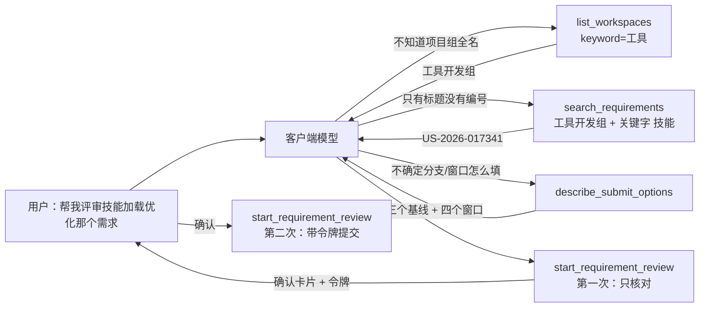

# 需求开发评审一致性平台 V1.60：MCP 只读查询工具最终执行方案

## 1. 背景与目标

提交一次评审要填 4 个参数，而**调用方的模型看不到平台页面上的下拉框**。它不知道有哪些
项目组（上游压根没有"列出工作区"的端点）、不知道代码基线只有三个值、不知道提交时间窗口
只能取 7/14/21/28。不给它查的途径，它就只能凭印象拼 —— 2026-10-19 那次事故的根子就在这里：
使用者说「工具组」（真名「工具开发组」），上游对不存在的工作区返回空列表而不是报错，
于是批次建好了、回执说"已成功受理"，几十秒后才以"全部导入失败"收场。

V1.56 加了提交前核对与确认，V1.59 让入参 schema 真正被服务端执行。但两者都是**拦**：
拦住错的参数。本次补上**查**：让模型能先把参数查准。

完成后提供三个只读工具（都不消耗模型额度、不建批次、不写任何表）：

- `list_workspaces`：有哪些项目组，支持模糊筛（说"工具组"能查到"工具开发组"）；
- `search_requirements`：按项目组列需求，用标题/负责人找到编号；
- `describe_submit_options`：每个提交参数的合法取值与含义。

顺带修两件在实测中暴露的事（详见 §3.2、§3.3）：确认卡片上「迭代/发布窗口」显示为空
（其实上游有值，只是详情端点不给），以及这条链路存在约 1/8 的瞬时连接失败。

## 2. 范围与非目标

本次包含：

- 三个只读查询工具及其文本输出；
- MCP 侧项目组人工清单 `src/workspaces.mjs`，与前端 `workspace-presets.ts` 由测试强制一致；
- Linky 客户端新增 `listStories`（**只按组查，不跨组**）；
- 确认卡片用列表端点补齐「迭代 / 发布窗口 / 关联特性 / 负责人」；
- 新增预警：详情说需求属于 X，但它不在 X 的需求列表里（这种情况导入会失败）；
- 只读 GET 增加一次**有预算约束**的重试。

明确不包含：

- **不提供进度/结果查询工具。** 这条边界从 V1.47 起没变过：对话里画一个没有后端事实的
  进度条，是这个平台一直拒绝做的事。进度与结论只在平台页面上看。
- **不开放模型选择。** `describe_submit_options` 只**告知**服务端配置了哪个模型。
- **不做跨项目组查询。** 上游跨组先汇总再分页，实测 15.06 秒（见 V1.58）。
- 不自动发现项目组清单：上游没有对应端点，清单仍是人工维护（与 V1.58 的结论一致）。
- 不改数据库、Edge Function、Worker 与能力契约。

## 3. 当前实现与问题

### 3.1 模型没有任何查参数的途径

V1.59 之后，参数错了会被拦住并回一条可照着改的报错。但"该填什么"仍然只能靠猜：
工具描述里只有枚举值（分支、窗口），项目组和需求编号完全没有来源。
`list_workspaces` 之于项目组、`search_requirements` 之于需求编号，就是把页面上
那两个下拉框的能力补给模型。

### 3.2 确认卡片上「迭代 / 发布窗口」显示为空，但上游有值

V1.56 的卡片字段全部取自**详情端点**。实测 `US-2026-017341`：

```text
详情端点： iteration = null       release_window = null      status = 'te3L3uJF'（内部码）
列表端点： iteration = '202610-1（0928-1016）'  release_window = 'R20261030'  status = '需求编写完成'
```

这与 `worker/src/linky/mapping.ts` 规则 2 记载的一致：**可读的迭代/发布窗口只有列表端点给**。
所以卡片上那两行显示"（空）"是在误导使用者 —— 字段在上游明明有值。

### 3.3 这条链路存在瞬时连接失败

实测连续 8 次按组查询，有 1 次在 **0.01 秒**就 `fetch failed`（2026-10-20）。
MCP 的 Linky 客户端**没有重试**（Worker 侧的客户端一直是"GET + 一次重试"）。
后果是一次网络抖动就把"核对通过"降级成"没核对成"，白白削弱 V1.56 的整个功能。

### 3.4 "详情说属于 X，但不在 X 的列表里"没有被发现

Worker 导入时要求需求**出现在该项目组的列表里**（可读字段只能从列表取，取不到就整条失败）。
如果详情端点说它属于某组、而列表里没有它，V1.56 的核对会报"通过"，但实际导入照样失败。
核对通过却导入失败，是这个功能最不该出现的结果。

## 4. 需求与验收标准

| # | 验收标准 | 验证方式 |
|---|---|---|
| C1 | `list_workspaces` 关键字"工具组"把"工具开发组"排在最前 | 单测 + 真实调用 |
| C2 | 关键字没命中时回全量清单，并说明清单外也能用 | 单测 |
| C3 | 前端与 MCP 两份项目组清单完全一致；不一致时测试失败 | 前端测试（并实测注入漂移会失败） |
| C4 | `search_requirements` 必须指定项目组（跨组实测 15 秒） | 单测 |
| C5 | 返回编号、标题、状态、负责人、迭代、发布窗口、关联特性 | 单测 + 真实调用 |
| C6 | 条数截断时如实说还有多少条；没翻完分页时声明"没找到≠不存在" | 单测 |
| C7 | 项目组查不到任何需求时提示"名称可能不完整"并指向 list_workspaces | 单测 |
| C8 | 上游凭据失效时说清"不是你的网络问题、该找谁" | 单测 |
| C9 | `describe_submit_options` 列出三个代码基线及人话含义、窗口、发布周期格式与默认值 | 单测 + 真实调用 |
| C10 | 明确写出模型由服务端决定、调用方不能指定 | 单测 |
| C11 | 三个查询工具全部 `readOnlyHint: true`，且不建批次、不碰平台写接口 | 单测断言零 insert |
| C12 | 确认卡片补齐迭代/发布窗口/关联特性 | 真实调用 |
| C13 | 需求不在其所属项目组列表里时给出预警（仅在翻完整个范围后） | 单测 |
| C14 | 只读 GET 瞬时失败后重试一次，且不让最坏耗时翻倍 | 真实调用 + 代码约束 |

## 5. 总体设计



工具清单的**顺序**是刻意的：三个查询在前，提交排最后 —— 它是唯一会花钱的那个。

## 6. 数据与接口设计

- **数据库**：不涉及。
- **Edge Function**：不涉及。
- **能力契约**：不涉及，manifest 哈希不变。
- **新增环境变量**：无。

新增文件：

| 文件 | 职责 |
|---|---|
| `mcp/code-review-mcp/src/workspaces.mjs` | 项目组人工清单 + 模糊匹配 |
| `mcp/code-review-mcp/src/workspaces.d.mts` | 仅为前端 tsc 能 import 这份清单做一致性断言 |
| `mcp/code-review-mcp/src/query-tools.mjs` | 三个查询工具的定义与文本输出 |
| `src/components/linky/__tests__/workspace-presets-sync.test.ts` | 强制两份清单一致 |

上游端点使用（全部只读 GET）：

| 端点 | 用途 | 实测耗时 |
|---|---|---|
| `/stories?workspace_name=X&page_size=200` | `search_requirements`、卡片补字段、健康探针 | 1.05s（200 条） |
| `/stories/{code}` | `lookup_requirement` 反查项目组 | 命中 5.84s / 未命中 31.80s |
| `/stories?page_size=1`（跨组） | **不使用** | 15.06s |

## 7. 前端与 Worker/运行时改造

前端：只新增一个测试文件（强制清单一致）。页面、组件、路由、样式均无变化。

Worker：**不涉及**，无需重建镜像。

## 8. 安全、兼容与回滚

- **只读**：三个新工具不写任何表、不建批次、不消耗模型额度；`search_requirements`
  返回的字段只是上游列表项里的标量（编号/标题/状态/负责人/迭代/窗口/特性）。
- **不越过评审输入的边界**：这些数据只用于"帮模型填参数"和"给人确认"，
  冻结进库的需求正文与附件仍然只由 Worker 在内网取。MCP 读到的内容不写入任何表。
- **SSRF**：base URL 仍只来自服务端环境变量；项目组名与需求编号都作为查询参数传递，
  编号另经 `encodeURIComponent`。
- **输出体积**：`search_requirements` 默认只回 20 条、上限 100，并如实告知被截断的条数 ——
  避免把 275 条需求灌进模型上下文。
- **兼容**：纯新增工具 + 卡片多了几行字段，老客户端不受影响。
- **回滚**：MCP 是独立进程，回滚 = 用旧镜像重启，无数据后果。

## 9. 实施步骤与文件范围

| # | 内容 | 文件 |
|---|---|---|
| 1 | 项目组清单与模糊匹配（新增） | `mcp/code-review-mcp/src/workspaces.mjs`、`workspaces.d.mts` |
| 2 | 三个查询工具的定义与文本（新增） | `mcp/code-review-mcp/src/query-tools.mjs` |
| 3 | 注册与分发 | `mcp/code-review-mcp/src/tools.mjs` |
| 4 | `listStories` + 有预算约束的重试 | `mcp/code-review-mcp/src/linky.mjs` |
| 5 | 卡片补字段 + 不在列表里的预警 | `mcp/code-review-mcp/src/preflight.mjs` |
| 6 | 文档 | `mcp/code-review-mcp/README.md`、根 `README.md` |
| 7 | 测试（新增 23 例） | `test/query-tools.test.mjs`（20）、`src/components/linky/__tests__/workspace-presets-sync.test.ts`（3） |
| 8 | 既有用例按新工具数更新 | `test/submit.test.mjs` |

## 10. 验证结果

### 10.1 三个工具对真实接口的实际输出（2026-10-20，新域名）

`list_workspaces(keyword="工具组")`：

```text
匹配「工具组」的项目组（共 4 个，最可能的在最前）：
  · 工具开发组
  · AI工程协作小组
  · Manage工作台组
  · harness工程架构组

上游按名称**精确匹配**，请原样使用上面的名称，不要改写或简写。
```

`search_requirements(workspace_name="工具开发组", keyword="技能", limit=4)` —— **1.14 秒**：

```text
项目组「工具开发组」（标题/编号含「技能」）共 66 条需求，下面列出前 4 条：

  · US-2026-039136  【kdm】【server】智能体关联的技能增加是否预加载属性
      状态 发布完成 · 负责人 张烨 · 迭代 202610-2（1019-1023） · 发布窗口 R20261018
      关联特性 小灵 1018 (FT-2026-003316)
  …
还有 62 条未显示，可以加 keyword 收窄或调大 limit（最多 100）。
拿到编号后用 start_requirement_review 提交（项目组可以不填，平台会按编号反查）。
```

`describe_submit_options()`：

```text
branch（代码基线）必填，没有默认值：
  · feature_dev：开发分支（最新，可能还没测过）
  · feature_sit：集成测试分支
  · release：发布分支（最接近线上）

commit_window_days（提交时间窗口，天）必填，只能是：7 / 14 / 21 / 28
release_cycle（发布周期）可选
  8 位 YYYYMMDD，默认当天（20261020）。必须是真实存在的日期，年份需在 2024 ~ 2029 之间。
评审模型：由服务端配置为「glm5.3-flash」，调用方不能指定
```

### 10.2 确认卡片补齐字段（C12，真实接口，6.21 秒）

```text
🔎 **还没有提交。** 以下是平台从 Linky 查到的需求，请让用户确认后再提交。

将要评审的需求：
  需求编号：US-2026-017341
  需求名称：【server】【技能】技能加载优化
  所属项目组：工具开发组
  当前状态：需求编写完成
  迭代：202610-1（0928-1016）          ← 补齐（详情端点是 null）
  发布窗口：R20261030                   ← 补齐
  关联特性：技能、智能体、工具功能优化 (FT-2026-001466)   ← 补齐
  需求负责人：张烨   开发负责人：薛宇轩   测试负责人：王麒达
  需求正文：114 字；附件：0 个

⚠️ 平台更正/提醒了以下内容，请一并告诉用户：
  · workspace_name：你给的是「工具组」，实际是「工具开发组」。…已按实际值提交。
```

### 10.3 清单一致性强制有效（C3）

往 MCP 的清单里注入一个"漂移组"，前端测试立即失败：

```text
× 两份清单的内容与顺序都相同
FAIL src/components/linky/__tests__/workspace-presets-sync.test.ts
Tests  1 failed | 2 passed (3)
```

还原后 3 项全通过。

### 10.4 瞬时失败与重试（C14）

```text
加重试前：连续 8 次按组查询 → 成功 7、失败 1（失败那次耗时 0.01s，fetch failed）
加重试后：连续 10 次        → 成功 10、失败 0
```

重试只在**快速失败**（耗时 < 预算的 25%）时触发，且复用剩余预算而不是叠加一个新预算 ——
否则详情端点 35 秒的预算翻倍成 70 秒，会超过客户端通常的 60 秒上限。

### 10.5 上游端点性能实测（决定本次全部设计取舍）

```text
GET /stories?workspace_name=工具开发组&page=1&page_size=200 → 200  1.05s（total=275，scopes=1）
GET /stories?workspace_name=工具开发组&assignee_name=张烨    → 200  0.37s（35 条）
GET /stories?workspace_name=工具开发组&assignee_name=武晨曦  → 200  0.45s（19 条）
GET /stories?page=1&page_size=1（跨组）                      → 200 15.06s   ← 一律不使用
GET /stories/US-2026-017341                                  → 200  5.84s
```

### 10.6 自动化验证

| 命令 | 结果 |
|---|---|
| `npm --prefix mcp/code-review-mcp test` | 141 通过 / 0 失败（新增 20 例） |
| `npm run test:web` | 275 通过 / 0 失败（新增 3 例） |
| `npm run test:worker` | 1104 通过 / 35 跳过 / 0 失败 |
| `npm run web:typecheck` | 通过 |
| `npm run worker:typecheck` | 通过 |
| `npm run build` | 通过 |

### 10.7 未验证项

- **C13（需求不在其项目组列表里的预警）只有单测覆盖**：真实数据里没有找到这种不一致的
  需求（`US-2026-017341` 在「工具开发组」列表第 1 页里确实存在，275 条翻完两页核对过）。
  该分支只在"翻完整个范围仍未找到"时触发，不会误报。
- **`list_workspaces` 的清单未与上游逐一核验**：沿用 V1.58 的人工目录（29 个名字，
  上游报 `scopes=33`，其余范围未从故事列表里出现过名字，不编造补齐）。逐一核验需要
  29 次按组查询（约 15 秒），不在工具调用里做。
- **未在公司 Linux 环境实机部署验证**，只在本地完成；发布按既有统一脚本执行。
