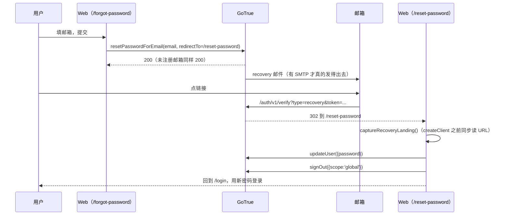

# 需求开发评审一致性平台 V1.64：登录页忘记密码自助重置最终执行方案

## 1. 背景与目标

登录页只有「邮箱 + 密码」和「微信扫码」两条入口。密码忘了之后平台里**没有任何自助出路**：
个人中心的 `changeMyPassword` 必须先用原密码重新登录做二次验证（`src/lib/api.ts`），
而原密码恰恰就是忘掉的那个东西；管理员侧只有改角色、确认邮箱、删除用户三个动作，
没有重置密码。实际结果是用户只能换一个邮箱重新注册，或者找管理员删号重建。

本次完成后提供的能力：登录页有「忘记密码？」入口，用户填邮箱 → 收到重置邮件 →
点开链接落在平台的重置密码页 → 设置新密码 → 全部旧会话失效 → 用新密码登录。

## 2. 范围与非目标

包含：

- 登录页「忘记密码？」入口；
- `/forgot-password` 发起页（含重发冷却）；
- `/reset-password` 重置页（恢复会话有效时设置新密码；链接失效时如实报错）；
- 恢复链接落地的识别与隔离：带着恢复会话回到平台时**不能**被直接带进工作台；
- GoTrue 恢复相关错误码的中文化；
- 本地 Supabase 的回调白名单。

非目标（本次明确不做）：

- 不做管理员代重置密码（没有 SMTP 时的后备路径，需要新迁移与审计表，单独立版本）；
- 不做短信/微信验证码找回；
- 不改 `changeMyPassword`（登录后改密码仍要求原密码）；
- 不新增数据库迁移、RPC、RLS、Edge Function、Worker 行为与能力契约变化；
- 不替公司内网部署配置 SMTP（这是发布侧的环境配置，见第 8 节）。

## 3. 当前实现与问题

```text
src/App.tsx
  App()  → session 为空 → <AuthRoutes/>（/login、/register，其余 → /login）
         → session 存在 → <Shell session/>（进工作台）
src/lib/api.ts
  signIn / signUp / resendSignUpEmail / changeMyPassword(需原密码)
  toAuthError()：按 GoTrue 错误码翻译中文，未收录的保留原文
src/lib/supabase.ts
  createClient(persistSession, autoRefreshToken)；flowType 未指定 → auth-js 默认 implicit
```

两个具体缺口：

1. **没有找回入口。** `resetPasswordForEmail` 从未被调用，登录页也没有任何提示。
2. **即使发出恢复邮件，落地也会被吞掉。** implicit 流程下恢复链接回到前端时带
   `#access_token=...&type=recovery`，`detectSessionInUrl` 默认开启，会直接把它变成一个
   正常会话并清掉 hash。此时 `App()` 看到 `session` 不为空，渲染的是 `Shell` ——
   用户被静默登进工作台，而密码还是旧的（或者他根本不知道新密码是什么）。
   所以必须有一个"这是恢复落地"的事实标记，并且要在 Supabase 客户端创建之前就把 URL 读下来。

## 4. 需求与验收标准

1. 登录页存在「忘记密码？」链接，指向 `/forgot-password`。
2. `/forgot-password` 提交合法邮箱后调用 `resetPasswordForEmail`，`redirectTo` 为
   当前站点的 `/reset-password`。
3. 为避免账号枚举，GoTrue 对未注册邮箱同样返回成功；页面文案必须是「如果该邮箱已注册，
   你会收到…」，不得断言账号存在。
4. 发送失败（SMTP 未配置、超额、频率限制）必须把真实原因显示出来，**不得**在没有发送成功的
   情况下显示"已发送"。
5. `/reset-password` 在恢复会话存在时显示新密码表单（新密码 ≥ 6 位、两次一致）。
6. 设置成功后吊销该账号**全部**会话（含当前设备），回到 `/login` 并提示用新密码登录。
7. 链接过期/已使用（`#error=...&error_code=otp_expired`）时显示失效提示和重新发起入口，
   不显示一个提交必然失败的表单。
8. 带恢复会话落地时，无论访问哪个路径都只能停在 `/reset-password`；放弃重置需显式点击
   「放弃并返回登录」（本地登出）。
9. 普通已登录用户手动访问 `/reset-password` 不进入重置流程（仍走工作台路由）。
10. 新密码与原密码相同、强度不足等 GoTrue 错误显示中文。

## 5. 总体设计



职责划分：

- `src/lib/password-recovery.ts`：**唯一**判断"这是恢复落地"的地方。模块提供纯函数
  `parseRecoveryLanding(hash, search)` 便于单测，以及 `captureRecoveryLanding()` 在
  `createClient` 之前被显式调用一次；另外接受 `PASSWORD_RECOVERY` 事件作为第二个来源。
- `src/lib/api.ts`：`requestPasswordReset` / `completePasswordReset` 两个动作，错误统一经
  `toAuthError` 翻译。
- `src/App.tsx`：`ForgotPasswordPage` / `ResetPasswordPage` 两个页面；`AuthRoutes` 增加两条
  路由；`App()` 增加"有会话但处于恢复流"的分支。

## 6. 数据与接口设计

- 数据库迁移 / RPC / RLS / Storage：**不涉及**。
- Edge Function：**不涉及**。
- Worker、能力契约、manifest：**不涉及**。
- 前端新增模块：`src/lib/password-recovery.ts`。
- 前端新增 API（均为 GoTrue 直调，走 anon key）：
  - `requestPasswordReset(email: string): Promise<void>` → `auth.resetPasswordForEmail`
  - `completePasswordReset(newPassword: string): Promise<void>` → `auth.updateUser` +
    `auth.signOut({ scope: 'global' })`
- 配置：`supabase/config.toml` 的 `additional_redirect_urls` 增加本地 `/reset-password`。

## 7. 前端与运行时改造

页面与交互：

| 路由 | 状态 | 界面 |
|---|---|---|
| `/login` | — | 密码框下方「忘记密码？」链接 |
| `/forgot-password` | 初始 | 邮箱表单 + 返回登录 |
| `/forgot-password` | 提交成功 | 「如果该邮箱已注册…」+ 60s 冷却重发 + 返回登录 |
| `/reset-password` | 恢复会话有效 | 新密码 + 确认密码表单、放弃并返回登录 |
| `/reset-password` | 链接带错误参数 | 失效提示 + 重新发起 |
| `/reset-password` | 无会话且非恢复落地 | 链接无效提示 + 重新发起 |

Worker / DSH / 权限 / 预算 / Session / 工具：无变化。

## 8. 安全、兼容与回滚

- **恢复会话必须被隔离**：有恢复落地标记时 `App()` 不渲染 `Shell`，避免"凭一封邮件直接进
  工作台"。放弃重置只做本地登出。
- **重置成功后全局登出**：密码忘记场景下无法排除旧密码泄露，`scope:'global'` 吊销全部
  refresh token，强制重新登录。这与 `changeMyPassword` 的 `scope:'others'`（本设备留用）不同，
  是故意的区别。
- **不做账号枚举**：发起页不区分邮箱是否注册。
- **微信-only 账号**（`@wechat.invalid`）没有真实邮箱，收不到邮件；页面文案提示用微信扫码登录，
  平台不假装发得出去。
- **回调白名单**：实测（本地 GoTrue，`GOTRUE_URI_ALLOW_LIST` 只有 `http://localhost:5173` 和
  `http://127.0.0.1:5173` 两个裸 origin 的情况下）`redirect_to=http://localhost:5173/reset-password`
  被接受并 303 回来 —— GoTrue 对**与 SITE_URL 同主机名**的地址放行，不要求把子路径逐条登记。
  因此生产侧只要 `SITE_URL` 的主机名与前端实际域名一致即可；`supabase/config.toml` 里补的
  通配项只是本地显式声明。
- **前置条件（发布侧，必须知道）**：自部署 GoTrue 当前**没有可用的邮件服务**。
  `deploy/supabase-selfhost/env/supabase.env.nonsecret.example` 的注释与 `ENABLE_EMAIL_AUTOCONFIRM=true`
  都是"没有 SMTP"这件事的直接证据（注册不需要验证邮件，正是因为发不出邮件）。
  在这种状态下 `/forgot-password` 会显示「邮件发送失败：Supabase Auth 没有可用的邮件服务（SMTP）」
  而不是假装成功。启用需要在服务器 `/srv/crp/supabase/.env`（现网实际路径见发布技能记录）配置
  `SMTP_HOST` / `SMTP_PORT` / `SMTP_USER` / `SMTP_PASS` / `SMTP_SENDER_NAME` / `SMTP_ADMIN_EMAIL`，
  重启 `auth` 容器，并确认 `SITE_URL` 与前端实际地址一致（现网是
  `http://crp-review.kingdee.com`）。注意重置链接里的令牌会走明文 HTTP，内网可接受，
  但 HTTPS 证书到位后应复查。
- **没有 SMTP 时的替代路径**：由 V1.65「管理员代重置密码」提供
  （`需求开发评审一致性平台/V1.65-管理员代重置密码/`），不依赖邮件。
- 兼容与回滚：纯前端增量，旧会话、在途任务、历史数据无影响；回滚＝回退前端构建。

## 9. 实施步骤与文件范围

已按下列顺序落地（全部为实际修改）：

1. `src/lib/password-recovery.ts`（新增）：`parseRecoveryLanding` 纯解析 +
   `captureRecoveryLanding` / `isRecoveryFlow` / `clearRecoveryFlow` 标记。
2. `src/lib/supabase.ts`：`createClient` 之前调用 `captureRecoveryLanding()`。
3. `src/lib/api.ts`：新增 `requestPasswordReset`、`completePasswordReset`、
   `PasswordResetSignOutError`；`onAuthChange` 识别 `PASSWORD_RECOVERY`；
   `authErrorMessages` 补 `same_password` / `otp_expired` / `session_not_found` /
   `mail_send_failed`，`toAuthError` 按文案识别"邮件发不出去"。
4. `src/App.tsx`：新增 `ForgotPasswordPage`、`ResetPasswordPage`；`AuthRoutes` 增加
   `/forgot-password`、`/reset-password` 与恢复流 pin；登录页加「忘记密码？」；
   `App()` 增加恢复流分支；重发按钮抽成 `EmailCooldownButton`。
5. `src/index.css`：`.auth-row-end`（「忘记密码？」靠右一行）。
6. `supabase/config.toml`：本地 `additional_redirect_urls` 增加通配子路径。
7. `src/lib/__tests__/password-reset.test.ts`（新增，14 个用例）与
   `src/lib/__tests__/password-reset-pages.test.tsx`（新增，4 个用例：两个页面的静态渲染）。
   为此 `ForgotPasswordPage` / `ResetPasswordPage` 从 `src/App.tsx` 具名导出。
8. `src/lib/product-version.ts`：`PRODUCT_VERSION = 'V1.64'`。

不涉及：迁移、RPC、RLS、Edge Function、Worker、能力契约、manifest。

## 10. 验证结果

### 自动化（本机，2026-10-20）

| 命令 | 结果 |
|---|---|
| `npm run test:web` | 28 个文件 / 303 个用例全部通过（本次新增 18 个） |
| `npm run web:typecheck` | 通过，无错误 |
| `npm run build` | 通过（`tsc -b` + vite build 成功） |
| `npm run version:check -- <本方案>` | 文档 V1.64 = 产品 V1.64，校验通过（随后 V1.65 把 `PRODUCT_VERSION` 推进到 V1.65，用本方案重跑会提示不同步，属预期） |
| `npx oxlint`（本次新增文件） | 0 warning / 0 error |

页面侧覆盖到的状态（`renderToStaticMarkup`，无 DOM）：发起页表单；恢复会话有效时的
新密码表单；链接过期时只给重新发起入口且**不**渲染表单；无凭据时同样不渲染表单。

### 真实链路（本地 Supabase + Mailpit，GoTrue `supabase_auth_codeReviewPlatform`）

用一个一次性账号跑完整条链路（验证后已用 admin API 删除该账号，未改动 `admin@local.test` 的密码）：

1. `POST /recover?redirect_to=http://localhost:5173/reset-password` → `200 {}`；
   Mailpit 收到主题 `Reset your password` 的邮件。
2. 点邮件里的 `/auth/v1/verify?...&type=recovery` → `303`，
   `Location: http://localhost:5173/reset-password#access_token=<…>&expires_at=…&expires_in=3600&refresh_token=<…>&sb=&token_type=bearer&type=recovery`
   —— 即"同主机名子路径被放行"，且片段格式与 `parseRecoveryLanding` 一致（该原文已写进单测）。
3. 用恢复会话 `PUT /user {"password": …}`（**不提供原密码**）→ `200`，`updated_at` 刷新。
4. `POST /logout?scope=global` → `204`。
5. 新密码 `POST /token?grant_type=password` → `200` 拿到会话；旧密码 → `400 invalid_credentials`。
6. 同一条重置链接再点一次 → `303`，
   `#error=access_denied&error_code=otp_expired&error_description=Email+link+is+invalid+or+has+expired&sb=`
   —— 与"链接不可用"分支的文案判定一致（该原文也已写进单测）。

### 未验证项

- **浏览器端未做人工点击走查**：四个状态只有静态渲染断言，没有在真实浏览器里走完
  「登录页 → 忘记密码 → 收邮件 → 点链接 → 设新密码 → 用新密码登录」
  （本地 CLI 网关 `54321` 当前没有宿主机端口映射，`supabase_kong_codeReviewPlatform`
  未发布端口，本地前端连不上本地 Supabase；上面的链路验证是直连 GoTrue 容器完成的）。
- **公司 Linux 环境未验证**，且在配置 SMTP 之前必然在第一步就失败（见第 8 节）。
- 微信-only 账号走找回密码的实际表现未实测（GoTrue 对无效收件域同样返回 200）。
