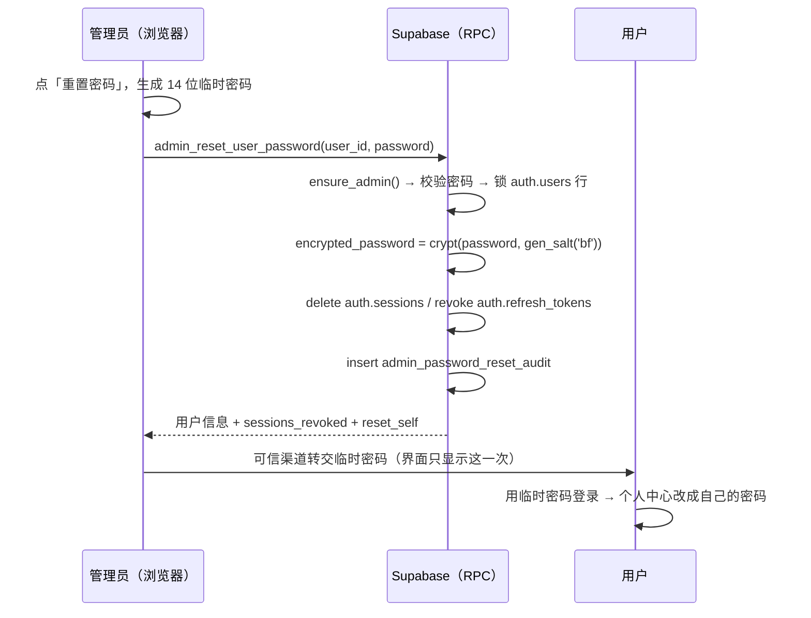

# 需求开发评审一致性平台 V1.65：管理员代重置用户密码最终执行方案

## 1. 背景与目标

V1.64 做完了登录页的自助找回密码，但它依赖 Supabase Auth 把邮件真的发出去。实测自部署
GoTrue 的发信配置是官方示例的占位值（`GOTRUE_SMTP_HOST=supabase-mail`，容器里连这个主机名
都解析不到；`GOTRUE_SMTP_USER=fake_mail_user`），且 `ENABLE_EMAIL_AUTOCONFIRM=true` 本身就是
"发不出邮件"的绕行配置。短期内不打算申请企业 SMTP，于是自助找回在现网等于不可用。

本次提供一条**完全不依赖邮件**的找回路径：用户找管理员，管理员在「用户管理 → 账号列表」
给他设一个临时密码，当面/通过可信渠道转交，用户用临时密码登录后自己到个人中心改掉。

## 2. 范围与非目标

包含：

- 新 RPC `public.admin_reset_user_password(p_user_id, p_password)`（ADMIN 专用，SECURITY DEFINER）；
- 审计表 `public.admin_password_reset_audit`（append-only，仅 ADMIN 可读，客户端不可写）；
- 重置同时**清掉该账号的全部登录态**（删 `auth.sessions`、吊销遗留 `auth.refresh_tokens`）；
- 用户管理页「重置密码」入口：生成/手填临时密码、一次性展示、复制；
- 管理员重置自己密码时前端自动登出并回到登录页；
- 临时密码生成器与错误码文案（可单测的纯函数）。

非目标：

- 不配置 SMTP、不改 V1.64 的邮件链路（两条路并存，哪条可用取决于环境）；
- 不强制用户下次登录必须改密码（没有这个状态位，加它要动登录后拦截，单独立版本）；
- 不在界面上展示审计记录（与既有 `admin_email_verification_audit` 保持一致，先只落库）；
- 不动 `auth.one_time_tokens`（见第 8 节）；
- 不涉及 Worker、Edge Function、能力契约。

## 3. 当前实现与问题

```text
src/App.tsx  AdminUsersPage
  列表 + 改角色(admin_update_user_role) + 标记已验证(admin_confirm_user_email)
       + 删除(admin_get_user_deletion_impact / admin_delete_user)
src/lib/api.ts
  changeMyPassword(currentPassword, newPassword)   ← 必须知道原密码
  requestPasswordReset / completePasswordReset     ← V1.64，依赖邮件
```

缺口：忘记密码的用户，管理员能做的只有「删号重建」。而删号对有业务记录的账号会被
`admin_delete_user` 正确拒绝，于是那部分人连这条土办法都没有。

## 4. 需求与验收标准

1. ADMIN 在账号列表每一行都能点「重置密码」。
2. 弹窗默认给出一个随机临时密码（14 位，含大小写、数字、符号，剔除 `0/O/1/l/I` 这类易混字符），
   可一键重新生成，也可以手工改。
3. 提交成功后**一次性**展示该密码并提供复制按钮；关闭后不再提供第二次查看（平台不留明文）。
4. 密码规则在数据库侧判定：非空、长度 ≥ 8、字节数 ≤ 72（bcrypt 的硬上限）、两端无空格。
   违反时返回稳定错误码，前端翻译成中文。
5. 只有 ADMIN 能调用；非 ADMIN 调用被拒绝（`ensure_admin()`）。
6. 目标账号不存在 → `USER_NOT_FOUND`；微信-only 账号（`@wechat.invalid`）→ `WECHAT_ONLY_ACCOUNT`
   （它没有邮箱登录通道，给它设密码没有意义）。
7. 重置成功后该账号在所有设备上的登录态失效，返回被清掉的 session 数量。
8. 目标账号邮箱未验证时，界面必须明确提示「改了密码也还登不进去，请一并标记已验证」——
   不替管理员偷偷把邮箱标成已验证。
9. 管理员重置自己的密码时：数据库同样执行，前端收到 `reset_self=true` 后清掉本地会话并回登录页。
10. 每次成功重置写一条审计（目标、操作者、清掉的 session 数、时间），客户端无法伪造。

## 5. 总体设计



口径：**明文密码只存在于管理员这一次的浏览器会话里**。数据库只存 bcrypt 哈希，审计表不记录
密码本身，前端不写 localStorage。

## 6. 数据与接口设计

迁移 `supabase/migrations/20261020075636_admin_reset_user_password.sql`：

| 对象 | 说明 |
|---|---|
| `public.admin_password_reset_audit` | `reset_user_id` / `reset_email` / `reset_display_name` / `reset_by` / `reset_by_email` / `reset_by_display_name` / `sessions_revoked` / `created_at`；RLS 仅 `is_admin()` 可 select；`revoke all ... from authenticated` 禁止客户端直写 |
| `public.admin_reset_user_password(uuid, text)` | SECURITY DEFINER，`set search_path = public`；返回 `id/email/display_name/role/email_confirmed_at/sessions_revoked/reset_self`；`revoke from public, anon` + `grant to authenticated` |

错误码（全部由数据库抛出，前端只翻译）：
`PASSWORD_REQUIRED` / `PASSWORD_TOO_SHORT` / `PASSWORD_TOO_LONG` / `PASSWORD_HAS_EDGE_SPACE` /
`USER_NOT_FOUND` / `WECHAT_ONLY_ACCOUNT` / `ADMIN role required`（来自 `ensure_admin()`）。

前端：

- `src/types.ts`：`AdminPasswordResetResult`；
- `src/lib/api.ts`：`adminResetUserPassword(userId, password)`；
- `src/lib/admin-password-reset.ts`（新增）：`generateTemporaryPassword()`、
  `describeAdminPasswordResetError()`、`TEMP_PASSWORD_MIN_LENGTH`、`TEMP_PASSWORD_MAX_BYTES`。

Edge Function / Worker / 能力契约：**不涉及**。

## 7. 前端与 Worker/运行时改造

`AdminUsersPage` 操作列新增「重置密码」，弹窗两个状态：

| 状态 | 内容 |
|---|---|
| 表单 | 目标账号信息；临时密码输入框（默认已生成）+ 重新生成 + 复制；风险提示：全设备登出、密码只显示一次、要求本人尽快改；邮箱未验证时追加提示；目标是自己时提示会被登出 |
| 结果 | 临时密码（可复制）+ 清掉的 session 数 + 转交提醒；自己重置时点「去登录」清会话 |

Worker / DSH / 预算 / Session / 工具：无变化。

## 8. 安全、兼容与回滚

- **权限**：RPC 内 `ensure_admin()`；审计表客户端只读（且仅 ADMIN）、写入只能经 RPC。
- **管理员本来就能做等价的事**（改角色、删号），所以"管理员可代设密码"没有扩大权限边界；
  但它确实意味着**管理员可以登录别人的账号**，因此每次操作都留审计，这是本次必须落库的理由。
- **全设备登出**：旧密码可能已泄露，`delete auth.sessions` 会级联删掉绑定的 refresh token；
  没有 session 的历史 token 再显式 `revoked = true`。已签发的 access token 在到期（默认 1 小时）
  前仍然有效 —— 这是 JWT 的固有性质，不是本次实现的缺陷，必要时只能缩短 JWT 有效期。
- **不动 `auth.one_time_tokens`**：那张表里混着注册确认、邮箱变更等未使用的令牌，
  为了重置密码顺手清空会把别人的注册确认链接一起废掉。代价是"已发出但未使用的重置邮件链接"
  在重置后仍可能可用；而现网根本发不出邮件，这一条暂不构成实际风险。
- **明文密码不落库、不落日志、不进审计表**；界面只显示一次。
- **bcrypt 72 字节上限**显式拒绝，而不是静默截断——否则管理员以为设了 100 位，实际只有前 72 字节生效。
- **兼容**：新增对象，不改既有迁移；历史数据、在途任务、Worker 不受影响。
- **回滚**：前端回退构建即可隐藏入口；数据库侧按仓库规则只前滚（如需停用，新写一个迁移
  `revoke execute` 掉 RPC），不回删审计表。

## 9. 实施步骤与文件范围

1. `supabase/migrations/20261020075636_admin_reset_user_password.sql`（新增）。
2. `supabase/tests/20261020075636_admin_reset_user_password_test.sql`（新增）。
3. `src/types.ts`：`AdminPasswordResetResult`。
4. `src/lib/admin-password-reset.ts`（新增）：生成器 + 错误码文案 + 长度常量。
5. `src/lib/api.ts`：`adminResetUserPassword`。
6. `src/App.tsx`：`AdminUsersPage` 新增入口与弹窗。
7. `src/lib/__tests__/admin-password-reset.test.ts`（新增）。
8. `src/lib/product-version.ts`：`PRODUCT_VERSION = 'V1.65'`。

## 10. 验证结果

### 数据库（本地 Supabase 容器 `supabase_db_codeReviewPlatform`，2026-10-20）

| 步骤 | 结果 |
|---|---|
| `supabase migration up --local` | `Applying migration 20261020075636_admin_reset_user_password.sql` → `Local database is up to date` |
| `psql < supabase/tests/20261020075636_admin_reset_user_password_test.sql` | 通过（exit 0，无 ASSERT FAILED，整份 rollback） |
| 同一迁移文件再次应用 | 通过（`create table if not exists` / `create or replace` 路径），之后再跑一次 SQL 测试仍通过 |
| 从零应用 | 本次 `migration up` 就是在"这些对象都不存在"的库上创建的，即 from-zero 路径 |

SQL 测试覆盖：哈希换新且能用新密码校验通过、哈希是 `$2a$10$`（与 GoTrue 自己写的 cost 一致）、
明文不入库、两条 session 全删、遗留 refresh token 被吊销、审计恰好一行且带 `sessions_revoked`、
自己重置返回 `reset_self=true`、未验证邮箱不被顺带标记为已验证、
`PASSWORD_REQUIRED` / `PASSWORD_TOO_SHORT` / `PASSWORD_HAS_EDGE_SPACE` / `PASSWORD_TOO_LONG` /
`USER_NOT_FOUND` / `WECHAT_ONLY_ACCOUNT` / 非 ADMIN 全部被拒且不留审计、anon 无执行权、
`authenticated` 不能直写审计表、只存在一个函数重载。

### 真实链路（本地 GoTrue + 本地库，用一次性账号，验证后已删除）

SQL 测试证明不了"GoTrue 认不认我们写的哈希"，所以另跑了一遍真实流程：

1. GoTrue `/signup` 建账号（密码 `Old-Password-1`），注册带来 1 个 session；
2. 以本地 ADMIN 身份（`request.jwt.claims` + `set role authenticated`）真实调用
   `admin_reset_user_password` → 返回 `sessions_revoked=1`、`reset_self=f`；
   库里 session 数变 0，哈希前缀 `$2a$10$`，审计行 `by_admin=t`；
3. GoTrue `/token?grant_type=password` 用管理员设的临时密码登录 → **成功拿到会话**；
4. 用旧密码登录 → 失败。

事后用 admin API 删掉两个一次性账号，并按 `reset_user_id` 清掉这两条验证用审计行
（`select count(*)` 确认为 0）；`admin@local.test` 的密码未被改动。

### 前端（本机）

| 命令 | 结果 |
|---|---|
| `npm run test:web` | 29 个文件 / 314 个用例通过（本次新增 11 个） |
| `npm run web:typecheck` | 通过，无错误 |
| `npm run build` | 通过 |
| `npm run version:check -- <本方案>` | 文档 V1.65 = 产品 V1.65，校验通过 |
| `npx oxlint`（改动文件） | 0 error，1 个与本次无关的既有 warning（`src/App.tsx` frozenAttachments） |

### 只读发布前检查

`supabase db push --linked --dry-run --skip-vault` 列出 3 个待推送迁移
（`20261020045257`、`20261020052658` 来自此前版本，`20261020075636` 是本次）。
注意 linked 的是 Supabase 云项目，**不是**现网；内网自部署的迁移由
`deploy/supabase-selfhost/scripts/release.sh` 内部的 `apply-migrations.sh` 应用。

### 未验证项

- **浏览器端未人工点击走查**：弹窗的两个状态（表单 / 一次性展示结果）没有在真实浏览器里点过
  （本地 CLI 网关 54321 没有宿主机端口映射，本地前端连不上本地 Supabase）。上面的链路验证
  是直连 GoTrue 容器 + psql 完成的。
- **现网（公司 Linux 自部署）未验证**：迁移尚未应用。
- 剪贴板复制在公司浏览器（非 HTTPS 的 `http://crp-review.kingdee.com`）上可能被策略拒绝；
  代码已对拒绝做了降级提示（提示手动选中复制），但未在该环境实测。
