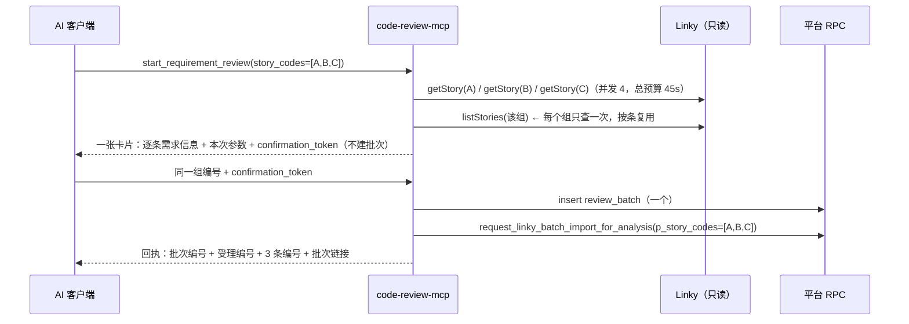

# 需求开发评审一致性平台 V1.66：MCP 批量提交需求评审最终执行方案

## 1. 背景与目标

远程 MCP 的 `start_requirement_review` 一次只接受一个 `story_code`。想同时评审两条需求，
只能调两次 —— 实测结果就是平台「评审列表」里出现两行各含一条需求的批次
（`MCP 评审：US-2026-042423` / `MCP 评审：US-2026-042424`，2026-10-20 18:01:21）。

这不是平台的限制，而是 MCP 侧把一个本来就是数组的接口钉成了单值：

- `request_linky_batch_import(p_batch_id, p_workspace_name, p_story_codes text[], …)`
  的 `story_codes` 约束是 `between 1 and 500`，由 RPC 自己去重并排序；
- 平台页面的「原始需求导入」本来就是勾选多条一次冻结；
- 只有 `mcp/code-review-mcp/src/review.mjs` 写死了 `p_story_codes: [storyCode]`。

一条需求一个批次带来的实际代价：同一次发布窗口的几条需求被拆成多个批次，各自冻结一份
代码快照、各自一套结论，使用者要在列表里对着好几行看进度；回执也分散在多轮对话里。

目标：**一次调用提交同一项目组下的 N 条需求，落成一个批次、一张导入单**，确认卡片逐条
列出每条需求的真实信息，由使用者一次确认。

## 2. 范围与非目标

本次包含（全部在 `mcp/code-review-mcp/` 内）：

- `start_requirement_review` 新增 `story_codes`（数组，1~20 条），保留 `story_code` 作为单条简写；
- 提交前校验按条并发执行，共享同一份项目组列表缓存，并受总预算约束；
- 确认令牌绑定**编号集合**（顺序无关），增删任何一条都必须重新确认；
- 确认卡片与回执改成多条形态，单条时文案与改造前保持一致；
- 服务端 schema 校验器支持 `array` / `items` / `minItems` / `maxItems`。

顺带修掉一个同一条调用链上的静默缺陷：**`release_cycle` 此前完全无效。** 它在 schema 里
声明了、在 `review.mjs` 里有 `assertReleaseCycle` 校验、README 也写着"默认当天"，但
`tools.mjs` 的 `handleSubmit` 从来没有把它传给 `submitRequirementReview` —— 调用方指定
任何发布周期都会被丢掉，批次永远落当天。改多条提交必须改这段参数传递，顺手补上比留着
一个"文档里存在、实际不生效"的参数更合适。

明确不包含：

- **数据库、RPC、Worker、能力契约一律不改。** `p_story_codes` 本来就是数组，没有任何迁移。
- **跨项目组一次提交。** 一张导入单只有一个 `workspace_name`，Worker 也只在那个组的列表里
  找需求。跨组只能按组分别提交，本次做成**明确拒绝**而不是悄悄建多个批次。
- `lookup_requirement` 仍然一次查一条（它的职责是"把一条需求查准"）。
- 进度与结果查询仍然不提供，回执仍然只给批次链接。

## 3. 当前实现与问题

```text
tools.mjs  handleSubmit(args.story_code)            ← 单值，schema required: ['story_code']
  → preflight.mjs  preflightRequirement(一条)        ← 详情 1 次 + 该组列表 1 次
  → confirm.mjs    issue({ story_code, … })          ← 令牌只绑一个编号
  → review.mjs     submitRequirementReview
       insert review_batch  name = `MCP 评审：<code>`
       rpc request_linky_batch_import_for_analysis  p_story_codes: [storyCode]
  → format.mjs     单条确认卡片 / 单条回执
```

缺口只有一个：链路上每一环都只能表达"一条"。平台侧的多需求能力完全没有被用到。

另外两处会在改成多条时立刻变成阻塞点：

- `schema.mjs` 的 `assertSupported` 对未实现的关键字**抛错**（刻意如此，避免静默忽略约束），
  所以 `items` / `minItems` 必须先实现，否则一声明就炸。
- `preflight.mjs` 里每条需求都会自己调一次 `listStories(workspaceName)`。该请求实测 1.05 秒
  / 200 条，N 条需求就是 N 次完全相同的查询。

## 4. 需求与验收标准

| 编号 | 要求 | 验证方式 |
|---|---|---|
| A1 | `story_codes` 接受 1~20 条；`story_code` 仍可用；两者同时给时取并集并去重 | 单测 |
| A2 | 一次调用只建**一个**批次、**一张**导入单，`p_story_codes` 含全部编号 | 单测断言 RPC 实参 |
| A3 | 批次名含全部编号；超过 120 字符时退化为「首条 等 N 条」 | 单测 |
| A4 | 确认卡片逐条列出编号/标题/状态/迭代/发布窗口/三类负责人/正文字数/附件数 | 单测 |
| A5 | 令牌绑定编号集合且顺序无关；增删一条即拒收并要求重新确认 | 单测 |
| A6 | 编号跨项目组时**拒绝提交**（不建批次），逐条列出编号→实际项目组 | 单测 |
| A7 | 上游健康而某编号查不到时整次拒绝，逐条标明哪几条不存在 | 单测 |
| A8 | 核对总预算用完时，未核对的逐条标 `UNVERIFIED` 并写明原因，不假装核对过 | 单测 |
| A9 | 回执列出全部编号与条数；单条提交的回执与改造前一致 | 单测 |
| A10 | 超过 20 条由 schema 拒绝，并提示改用平台页面批量导入 | 单测 |
| A11 | schema 校验器支持 `array`/`items`/`minItems`/`maxItems`，非法项逐条报路径 | 单测 |
| A12 | 一条都没给（既无 `story_code` 也无 `story_codes`）时明确报缺参数，不建批次 | 单测 |
| A13 | 第二次提交落库的编号以**令牌里确认过的那份**为准（客户端重排顺序不改变结果） | 单测断言 RPC 实参 |
| A14 | `release_cycle` 真正生效（此前被丢弃） | 单测断言 `week_code` |

边界与失败行为：

- 任一编号被判定**确定不存在**（上游健康 + 404）→ 整次拒绝。不做"替你剔掉那条照常提交"：
  那会让使用者以为 5 条都在跑，实际只有 4 条。
- 项目组不一致 → 整次拒绝，并给出按组拆分的具体建议。
- 核对不可用（MCP 不在内网 / 上游凭据失效）→ 全部标 `UNVERIFIED`，仍可确认提交，
  卡片与回执都写明"没核对过"。

## 5. 总体设计



组件职责变化：

| 文件 | 职责变化 |
|---|---|
| `src/schema.mjs` | 新增 array 支持（`items`/`minItems`/`maxItems`） |
| `src/review.mjs` | `normalizeStoryCodes`（并集去重上限）、`buildBatchName`、提交改走编号数组 |
| `src/preflight.mjs` | 新增 `preflightRequirements`：并发 + 列表缓存 + 总预算 + 跨组判定 |
| `src/confirm.mjs` | claim 携带 `story_codes`，规范串按**排序后**的集合签名 |
| `src/format.mjs` | 多条确认卡片、多条回执、多条"结果不明" |
| `src/tools.mjs` | schema 与描述、`handleSubmit` 多条编排 |
| `src/config.mjs` | `CRP_PREFLIGHT_BUDGET_MS`（默认 45000）、`MAX_STORIES_PER_SUBMIT=20` |

超时预算（为什么是并发 4 + 总预算 45 秒）：详情端点实测**命中 5.84 秒、未命中 31.80 秒**
（遍历完所有工作区才能确认找不到）。串行 20 条命中就是 117 秒，远超调用方客户端通常的
60 秒上限，使用者只会看到一句 "tool call failed"。并发 4 时 20 条命中约 30 秒；而全是错编号
这种病态输入会撞上总预算，此时未核对的部分**如实标成未核对**，而不是让整次调用挂死。
第二步（带令牌真正提交）不再做任何 Linky 核对，所以花钱的那条路径仍然很快。

## 6. 数据与接口设计

- 数据库：**不涉及**。`request_linky_batch_import` 的 `story_codes` 本来就是 `text[]`，
  约束 1~500，RPC 内部 `array_agg(distinct code order by code)` 去重排序。
- RPC 调用参数：形状不变，只是 `p_story_codes` 从一元数组变成 N 元。
- 工具入参（`start_requirement_review`）：

| 参数 | 变化 |
|---|---|
| `story_codes` | **新增**，`array<string>`，`minItems 1`、`maxItems 20`，每项同 `story_code` 的 pattern |
| `story_code` | 保留，单条简写；不再出现在 `required` 里（二者至少给一个，由服务端判） |
| 其余 | 不变 |

- 确认令牌：规范串新增 `stories=<排序去重后以逗号连接>`，`story=` 字段去掉。
  令牌格式仍是 `v1.<body>.<sig>`；**旧令牌会因签名不符被拒**（见 §8）。
- 配置：新增 `CRP_PREFLIGHT_BUDGET_MS`（默认 45000，最小 5000）。

## 7. 前端与 Worker/运行时改造

**均不涉及。** 不改前端页面、不改 Worker、不改 DSH 能力契约与 manifest，
`v4-capability-contract.json` 与 manifest 哈希不变，新旧 Worker 可混跑。
Worker 侧的导入逻辑本来就是按 `story_codes` 逐条取详情与附件，并逐条上报失败
（`stories_failed`），一条坏编号不会拖垮整单。

## 8. 安全、兼容与回滚

- 权限不变：仍只用 anon key + 平台账号 JWT，批次创建照样过 RLS。
- 额度：一次提交 N 条需求意味着 N 条需求的分析，额度消耗按条增加 —— 确认卡片把条数
  写在第一行，避免"确认了一个数不清的东西"。
- 兼容：`story_code` 单值调用的行为、文案与回执保持不变，老客户端无需改配置。
- **令牌不兼容**：规范串变了，改造前签出的令牌在新版上会以 `CONFIRMATION_INVALID` 被拒，
  提示重新确认。进程重启本来就会换掉随机密钥、令牌本来就失效，所以这不是新增代价。
- 回滚：MCP 是独立容器，回滚上一版镜像即可；平台侧没有任何结构变更需要回退。

## 9. 实施步骤与文件范围

1. `src/schema.mjs`：array 支持（先做，否则新 schema 一声明就抛错）。
2. `src/config.mjs`：`MAX_STORIES_PER_SUBMIT`、`CRP_PREFLIGHT_BUDGET_MS`。
3. `src/review.mjs`：`normalizeStoryCodes` / `buildBatchName` / 多条提交与回执字段。
4. `src/preflight.mjs`：`preflightRequirements`（并发、列表缓存、预算、跨组与缺失判定）。
5. `src/confirm.mjs`：claim 与规范串按编号集合。
6. `src/format.mjs`：多条卡片 / 回执 / 结果不明 / 拒绝文本。
7. `src/tools.mjs`：schema、描述、`handleSubmit` 编排、日志字段。
8. `src/query-tools.mjs`：`describe_submit_options` 补一段"可以一次多条"。
9. 测试：新增 `test/multi-story-submit.test.mjs`，并更新既有断言。
10. 文档：`mcp/code-review-mcp/README.md`、根 `README.md`、`src/lib/product-version.ts`。

## 10. 验证结果

实际落地范围（与计划一致，另加两处）：

| 文件 | 改动 |
|---|---|
| `mcp/code-review-mcp/src/schema.mjs` | array / items / minItems / maxItems，逐项报下标 |
| `mcp/code-review-mcp/src/config.mjs` | `MAX_STORIES_PER_SUBMIT=20`、`PREFLIGHT_CONCURRENCY=4`、`CRP_PREFLIGHT_BUDGET_MS` |
| `mcp/code-review-mcp/src/review.mjs` | `normalizeStoryCodes` / `buildBatchName`，提交与回执改编号集合 |
| `mcp/code-review-mcp/src/preflight.mjs` | `preflightRequirements`、列表缓存按 **Promise** 去重 |
| `mcp/code-review-mcp/src/confirm.mjs` | claim 带 `story_codes`，规范串 `stories=`（排序去重） |
| `mcp/code-review-mcp/src/format.mjs` | 多条卡片 / 回执 / 拒绝 / 结果不明 |
| `mcp/code-review-mcp/src/tools.mjs` | schema 与描述、多条编排、落库用令牌里的编号、补传 `release_cycle` |
| `mcp/code-review-mcp/src/query-tools.mjs` | `describe_submit_options` 说明多条用法 |
| `mcp/code-review-mcp/src/index.mjs` | 启动日志加 `preflight_budget_ms` / `max_stories_per_submit` |
| `mcp/code-review-mcp/scripts/live-check.mjs` | `--story` 支持逗号分隔与重复给 |
| `mcp/code-review-mcp/.env.example`、两份 README | 配置与参数文档 |
| `src/lib/product-version.ts` | `V1.66` |

实现过程中与原计划的两处偏差（都已落进代码）：

1. **列表缓存必须缓存 Promise 而不是结果。** 并发核对时几条需求会在同一瞬间都看到
   "缓存里没有"，于是同一个组的列表被查了两遍 —— 单测 `同组多条：…列表只查一次` 最初
   就是这么失败的。
2. **第二次提交落库用 `claim.story_codes`，不用这次实参里的。** `verify` 只保证两者是
   同一个集合，顺序可能不同；取令牌里那份，批次名与回执的顺序才和使用者刚看过的卡片一致。

实际执行的验证：

| 命令 | 结果 |
|---|---|
| `npm test`（mcp，`node --test`） | **168 pass / 0 fail**，含新增 `test/multi-story-submit.test.mjs` 14 条 |
| `npm run web:typecheck`（根） | 通过 |
| `npm run build`（根） | 通过（仅既有 chunk 体积告警） |
| `npm test`（根 vitest） | **1441 pass / 35 skipped / 0 fail** |
| `npm run version:check -- <本文件>` | 文档 V1.66 = 展示 V1.66，通过 |
| 真实启动 + MCP 客户端自检 | `node src/index.mjs` 起 HTTP，`scripts/live-check.mjs` initialize 成功，`tools/list` 回 5 个工具，`start_requirement_review` 的 `required` 为 `[]`；启动日志含 `max_stories_per_submit:20`、`preflight_budget_ms:45000` |
| 真实打印两步文本 | 两条需求的确认卡片（含「2 条需求」「同一个批次」、逐条字段、按编号标注的提醒）与回执（「需求（2 条，同一个批次）」+ 批次名含两条编号）均符合预期 |

未运行的验证（需要公司内网与真实平台账号，由使用者在 Linux 发布后执行）：

- 连内网的真实提交：`npm run mcp:live-check -- --url <地址> --token <凭证> --submit
  --story US-A,US-B`（不加 `--confirm` 只看卡片，不创建评审）；
- 真实跨组编号被拒、真实不存在编号被拒的上游行为（单测用假上游覆盖了逻辑分支）；
- 20 条满额提交的真实耗时（按 5.84 秒/条、4 路并发推算约 30 秒，未实测）。
