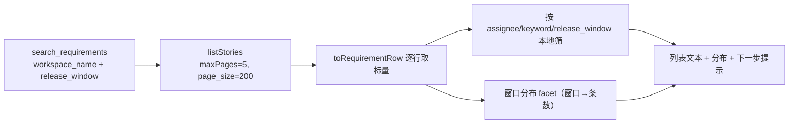

# 需求开发评审一致性平台 V1.67：MCP 按发布窗口查需求最终执行方案

## 1. 背景与目标

V1.66 让 MCP 一次能提交多条需求（`story_codes`），但"这个发布窗口有哪些需求"这一步仍然
拿不到：`search_requirements` 的入参只有 `workspace_name` / `keyword` / `assignee_name` /
`limit`，而 `keyword` **只匹配编号和标题**（`filterRequirements` 里就是
`row.code.includes || row.title.includes`）。所以把 `R20261106` 当关键字查，结果是 0 条 ——
发布窗口不在匹配字段里，而使用者在平台页面上恰好是按这个维度看需求的。

实际后果：想评审"R20261106 这个窗口的需求"，只能让模型把一个组的需求列出来（默认
`limit=20`，而一个组有两三百条），再靠人眼在被截断的列表里挑编号。

目标：`search_requirements` 支持按发布窗口筛，并在使用者不知道窗口确切写法时告诉他
这个组**有哪些**窗口、各多少条。配合 V1.66 的 `story_codes`，"查出某窗口的需求 →
一次提交成一个批次"这条链路才真正走通。

## 2. 范围与非目标

本次包含（全部在 `mcp/code-review-mcp/`）：

- `search_requirements` 新增 `release_window`（可选，精确匹配，大小写与首尾空白不敏感）；
- 输出新增「该项目组的发布窗口分布」（窗口 + 条数），在**没指定窗口**或**指定了但 0 命中**时给出；
- 这条查询路径把上游列表翻到 5 页（1000 条）—— 按窗口筛必须覆盖整组才算得准；
- 指定了 `release_window` 时 `limit` 默认提到 100（意图本来就是"这个窗口的全部"）。

明确不包含：

- **不给 `start_requirement_review` 加 `release_window`。** 按一个筛选条件批量提交、而
  使用者从没逐条看过编号，等于让他对一个数不清的集合付钱。流程仍然是：
  `search_requirements` 查出来 → 使用者看过编号 → 用 `story_codes` 提交。
- **不改数据库、RPC、Worker、能力契约**，也不改前端。
- **不让上游代劳过滤**：`GET /stories` 只认 `workspace_name` / `assignee_name` /
  `page` / `page_size`，没有发布窗口参数，只能取回整组在本地筛（与 V1.66 前端看板同一个限制）。

## 3. 当前实现与问题

```text
tools.mjs  handleSearch(args)
  → linky.listStories({ workspaceName, assigneeName })   ← maxPages 默认 2 ＝ 最多 400 条
  → toRequirementRow 逐行取标量（含 release_window，只用于**显示**）
  → filterRequirements(rows, keyword)                    ← 只看 code / title
  → formatRequirementList(... rows.slice(0, limit) ...)   ← limit 默认 20
```

三个缺口：

1. 没有发布窗口这个过滤维度，`keyword` 也匹配不到它；
2. 使用者/模型无从知道这个组**有哪些**窗口（平台页面上那是个下拉框，MCP 调用方看不到）；
3. 400 条的翻页上限对"按窗口筛"不够 —— 一个窗口的需求可能散落在第 3 页之后。

## 4. 需求与验收标准

| 编号 | 要求 | 验证方式 |
|---|---|---|
| A1 | `release_window` 精确匹配，首尾空白与大小写不敏感（`r20261106` 等于 `R20261106`） | 单测 |
| A2 | 可与 `keyword` / `assignee_name` 叠加，三者是且的关系 | 单测 |
| A3 | 未指定窗口时，输出列出该组的窗口分布（窗口 + 条数，倒序，最多 12 个） | 单测 |
| A4 | 指定的窗口 0 命中时，明确说"这个组没有这个窗口"并列出真实存在的窗口 | 单测 |
| A5 | 指定窗口时 `limit` 默认 100；显式给 `limit` 时以调用方为准 | 单测 |
| A6 | 这条路径请求上游至多 5 页、每页 200；没翻完时仍如实声明"没找到不等于不存在" | 单测断言 `maxPages` |
| A7 | 工具描述明确写出"可以按发布窗口筛"，否则调用方的模型不会用 | 单测 |
| A8 | 结果里的编号可以直接交给 `start_requirement_review` 的 `story_codes` | 文案断言 |
| A9 | 只读：不建批次、不碰平台写接口 | 单测 |

边界与失败行为：

- 发布窗口的值完全来自上游列表项的 `release_window`，平台不做格式校验（`R20261106` 只是
  当前的写法，不写死正则）；
- 没有发布窗口的需求（该字段为空）不会出现在任何窗口的筛选结果里，窗口分布里也不统计它们，
  但会在分布末尾如实写出"另有 N 条没有发布窗口"；
- 上游取数失败时沿用既有的错误文案（区分"凭据失效该找谁"与"名字可能不对"）。

## 5. 总体设计



职责分工保持原样：`tools.mjs` 只做编排与日志，取数在 `linky.mjs`，过滤与文本在
`query-tools.mjs`（所以过滤函数可以单独测，不必起服务）。

## 6. 数据与接口设计

- 数据库 / RPC / Storage：**不涉及**。
- 上游接口：参数不变，只是这条路径的 `maxPages` 从 2 提到 5。
- 工具入参（`search_requirements`）：

| 参数 | 变化 |
|---|---|
| `release_window` | **新增**，string，≤64，可选。精确匹配 |
| `limit` | 给了 `release_window` 时默认 100（原默认 20），上限仍 100 |
| 其余 | 不变 |

- 配置：不新增环境变量。

## 7. 前端与 Worker/运行时改造

**均不涉及。** 不改前端页面，不改 Worker、DSH 能力契约与 manifest；
`start_requirement_review` 的入参与行为不变（V1.66 的 `story_codes` 已足够承接查询结果）。

## 8. 安全、兼容与回滚

- 只读工具，不消耗模型额度、不写任何表，RLS 与权限模型不变。
- 兼容：新参数可选，老调用方行为逐字不变（未指定窗口时唯一的变化是输出末尾多一段窗口分布）。
- 代价：这条路径最坏多翻 3 页上游（每页实测约 1.05 秒），即最多约 5 秒。仍远小于工具超时。
- 回滚：MCP 独立容器，回滚上一版镜像即可；无数据变更需要回退。

## 9. 实施步骤与文件范围

1. `src/query-tools.mjs`：schema 新增 `release_window`、工具描述、`filterByReleaseWindow`、
   `releaseWindowFacet`、`formatRequirementList` 输出分布；
2. `src/tools.mjs`：`handleSearch` 透传窗口参数与 `maxPages`，默认 limit 规则，日志字段；
3. 测试：扩充 `test/query-tools.test.mjs`；
4. 文档：`mcp/code-review-mcp/README.md`、根 `README.md`、`src/lib/product-version.ts`。

## 10. 验证结果

实际落地范围：

| 文件 | 改动 |
|---|---|
| `mcp/code-review-mcp/src/query-tools.mjs` | `release_window` 入参与工具描述、`SEARCH_MAX_PAGES=5`、`filterByReleaseWindow`、`releaseWindowFacet`、列表文本（表头筛选条件 + 窗口分布 + 0 命中引导），`describe_submit_options` 提及按窗口查 |
| `mcp/code-review-mcp/src/tools.mjs` | `handleSearch` 透传窗口与 `maxPages`、窗口命中前算分布、按窗口时 limit 默认 100、日志加 `release_window` |
| `mcp/code-review-mcp/test/query-tools.test.mjs` | 新增 9 条用例 |
| `mcp/code-review-mcp/README.md`、根 `README.md` | 参数表与「按发布窗口查」小节 |
| `src/lib/product-version.ts` | `V1.67` |

一处实现细节值得记住：**窗口分布基于窗口过滤之前的集合**。用筛完的集合算分布等于自问
自答（永远只有你刚输入的那个窗口），而这段文本存在的全部意义就是回答"那到底有哪些窗口"。

实际执行的验证：

| 命令 | 结果 |
|---|---|
| `npm test`（mcp，`node --test`） | **177 pass / 0 fail**（V1.66 的 168 + 本次 9） |
| `npm run web:typecheck`（根） | 通过 |
| `npm run build`（根） | 通过（仅既有 chunk 体积告警） |
| `npm test`（根 vitest） | **1441 pass / 35 skipped / 0 fail** |
| `npm run version:check -- <本文件>` | 文档 V1.67 = 展示 V1.67，通过 |
| 真实打印三种返回 | ① 指定存在的窗口 → 只回该窗口 4 条、表头写明筛选条件；② 指定不存在的窗口 → 明说"没有这个窗口"并列出 R20261106/R20261030/R20261015 及条数、另加"3 条没填窗口"；③ 不指定 → 全量列表 + 末尾窗口分布 + "可以带 release_window 再查一次" |

逐条对照验收标准：A1~A9 全部由上述单测覆盖（A6 直接断言传给 `listStories` 的
`maxPages === 5`，A7 断言工具描述含"发布窗口"与 `release_window`，A9 断言只读工具
不产生任何 `insert`）。

未运行的验证（需要公司内网，由使用者在 Linux 发布后执行）：

- 真实上游数据下的窗口分布与条数（单测用的是按实测字段形状构造的假响应）；
- 一个组超过 1000 条时的截断声明（当前最大组 275 条，构造不出真实场景）。
